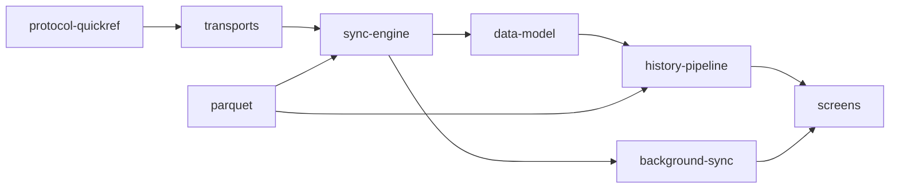

# opensensor.space — Android and iOS sensor companion

Mobile companion for devices running the shared
[`aq-parquet`](../aq-parquet) sync contract. Android connects multiple devices over Bluetooth
LE or local Wi-Fi/LAN, collects immutable **Parquet** files into a verified local archive, and
supports offline history. iOS currently discovers and connects one device for live readings,
using the same protocol and reviewed sensor rules. Reviewed live profiles cover M5Stack CoreS3
and Waveshare ESP32-S3-SIM7670G V2; Android can archive other schemas without guessing their
live meanings.

**Android is offline-first, not offline-only.** Its archive works with no internet and is filled
over **Bluetooth LE** always and, since protocol v2, over the **LAN** (one
TCP socket on your own Wi-Fi, found with mDNS, authenticated with a token the phone can only obtain
over the bonded BLE link). Cloud backup or sharing is a *later, opt-in* step, off by default.
`INTERNET` is declared **only so LAN sockets exist**; the code connects exclusively to addresses
from mDNS discovery of `_aqsync._tcp`. No cloud endpoint, no location permission, no analytics, no
accounts. Android data leaves the phone through the share sheet or the file picker. iOS currently
uses foreground BLE and Bonjour discovery; its archive and LAN transfer are not implemented.

## Platform status

| Platform | Current scope | Verification |
| --- | --- | --- |
| Android | Multi-device BLE/LAN collection, verified local archive, offline history, and background sync | Host gate passes; phone qualification is tracked separately in [`docs/status.md`](docs/status.md) and the [CoreS3](../aq-parquet/docs/boards/m5stack-cores3/bench-verified.md) and [Waveshare](../aq-parquet/docs/boards/waveshare-esp32-s3-sim7670g/bench-verified.md) records. |
| iOS | Foreground BLE live readings and Bonjour discovery; no archive, authenticated LAN transfer, or background collection yet | An owner-confirmed iPhone run showed live readings and a Bonjour result on 2026-10-08. Other behavior remains unqualified; see [`docs/ios-migration.md`](docs/ios-migration.md). |

Host tests, simulator builds, and phone observations are different evidence. The Android
application ID and signing identity remain stable for existing installations. Read the
[full status record](docs/status.md) for dated results and remaining checks.

## Documentation map

The docs are split by concern so you read only what you need. Start at
[`docs/README.md`](docs/README.md) for the routing table; the rules are in [`AGENTS.md`](AGENTS.md).



| Concern | File |
| --- | --- |
| Rebrand, multi-device implementation, reset/reflash policy and remaining qualification | [`docs/opensensor-space.md`](docs/opensensor-space.md) |
| What is verified, where, and what is next | [`docs/status.md`](docs/status.md) |
| Modules, layers, "what a change touches" | [`docs/architecture.md`](docs/architecture.md) |
| iOS app, shared Kotlin boundaries, build and qualification | [`docs/ios-migration.md`](docs/ios-migration.md), [`ios/AGENTS.md`](ios/AGENTS.md) |
| Screens, navigation, detail levels | [`docs/screens.md`](docs/screens.md) |
| Opcodes, frames, error codes, UUIDs, LAN framing (mirror of the firmware contract) | [`docs/protocol-quickref.md`](docs/protocol-quickref.md) |
| BLE vs LAN, pairing, the LAN token, reconnect | [`docs/transports.md`](docs/transports.md) |
| Download, verification, lost windows, resume, archive paths, `REBOOT` audit | [`docs/sync-engine.md`](docs/sync-engine.md) |
| Auto-sync, WorkManager, foreground notification, WifiLock, triggers (presence / advertising / Wi-Fi) | [`docs/background-sync.md`](docs/background-sync.md) |
| Room v10, DataStore, files on disk, backup | [`docs/data-model.md`](docs/data-model.md) |
| Index → tiers → derived day → charts; metrics, moods, time estimate | [`docs/history-pipeline.md`](docs/history-pipeline.md) |
| Own Parquet reader/writer, GeoParquet 2.0, fixtures, oracles | [`docs/parquet.md`](docs/parquet.md) |
| Stack, build, hooks, CI, signing, fake device | [`docs/build-and-release.md`](docs/build-and-release.md) |
| Lessons learned, grouped by concern | [`docs/lessons-learned.md`](docs/lessons-learned.md) |
| Long-form evaluation: history UX, data layer, iOS parity, D1–D11 | [`docs/history-ux-and-data-layer.md`](docs/history-ux-and-data-layer.md) |

## iOS app and current scope

The iOS app uses Kotlin Multiplatform for shared protocol and sensor rules, with a
Compose Multiplatform live-reading screen and native Core Bluetooth and Bonjour adapters.
The Android app retains its native Compose UI and platform data stack. Archive history,
LAN transfers and background collection are currently Android-only. Build and qualification
instructions are in [docs/ios-migration.md](docs/ios-migration.md); local iOS coding
instructions are in [ios/AGENTS.md](ios/AGENTS.md). On 2026-10-08, the owner confirmed
live readings on a connected iPhone and a Bonjour discovery result; pairing prompts,
reading accuracy, stale/background behavior and authenticated Wi-Fi transfer remain unqualified.

## Build

Android and host gate:

```sh
export JAVA_HOME="/Applications/Android Studio.app/Contents/jbr/Contents/Home"
tools/setup-hooks.sh                 # once per clone: git hooks (ktlint, gitleaks, hygiene; verify on push)
./gradlew --no-daemon clean verify   # lint + assembleDebug + every module's unit tests
adb install app/build/outputs/apk/debug/app-debug.apk
```

The iOS build requires macOS and Xcode. Follow [`docs/ios-migration.md`](docs/ios-migration.md)
for simulator framework linking, the Xcode build, and real-iPhone qualification steps.

Ready-made APKs: every push to `main` refreshes the rolling [`latest`](../../releases/tag/latest)
pre-release; a `v*` tag publishes a permanent release. Details, signing and the debug fake device:
[`docs/build-and-release.md`](docs/build-and-release.md).

## Layout

```
core/protocol/   KMP common rules + JVM adapters · contract mirror: UUIDs, frames v1+v2, CONFIG, LAN framing, JSON, PAR1/CRC verify
core/parquet/    JVM-only · own Parquet reader + writer (GeoParquet 2.0, LZ4/Snappy/GZIP, codec SPI) · test fixtures
core/history/    KMP sensor-domain rules + JVM file adapters · Metrics registry, Aggregator → tiers, TimeEstimate, Columns, AirMood, file index
app/             Android app · data/{ble,lan,sync,background,history,local,settings,export,fake} · ui/{scan,device,history,files,debug,settings}
ios/shared/      Kotlin Multiplatform presentation state and Compose Multiplatform live screen
ios/App/         Xcode app · Swift/Core Bluetooth/Bonjour platform adapters
tools/           fixture generators + PyArrow/DuckDB oracle (run in ../aq-parquet's pixi env), hooks, signing
docs/            one file per concern (see the map above)
```

The Bluetooth protocol is owned by the firmware repo (`../aq-parquet/docs/shared/ble-sync-protocol.md`);
this app mirrors it and never changes a frame, opcode, UUID or JSON key first.
