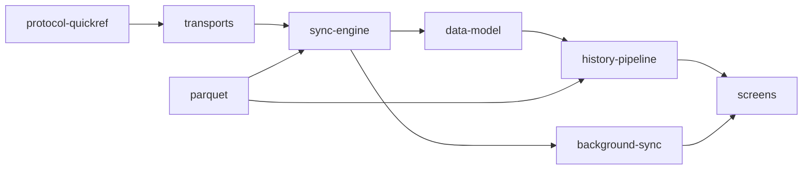

# opensensor.space mobile (Android and iOS)

The phone app for [opensensor.space](https://walkthru.earth/opensensor), a home for open sensors of every
kind. Air quality is the first device family. Weather, water, soil, noise and energy families
plug in the same way, as data rather than new screens.

The app does three things.

1. **Discover.** On first open, before you own anything, a map shows public sensor readings
   near you as H3 hexagon cells, never exact points. Tap a cell to see its devices and the
   average, minimum and maximum of what they measure. Tap a device to see its readings with
   range and metric filters. Until the public feed is live on S3 and source.coop, the map
   shows labelled sample data. See [docs/devices-and-discovery.md](docs/devices-and-discovery.md).
2. **Collect.** Pair your own devices over Bluetooth LE, then collect their immutable Parquet
   files over BLE or your local Wi-Fi into a verified archive on the phone. A file counts as
   synced only after its size, CRC-32 and `PAR1` checks pass.
3. **Understand.** Simple screens say what the readings mean in plain words, with the peacock
   as a guide. Detailed and Developer levels reveal per-file, per-metric and protocol detail
   only for the people who want it.

**Private by design.** The archive lives on the phone and works without internet. LAN
connects only to devices found through `_aqsync._tcp` mDNS, with a token obtained over bonded
BLE. The only other network use is anonymous, read-only downloads of the public map feed and
basemap, which a Settings switch turns off. Sharing a device's own data is off by default and
is turned on per device, in that device's settings, with confirmation. No accounts, no
analytics, no location permission. Public data carries H3 cells, never coordinates.

**One product on two phones.** Rules that must give the same answer on Android and iOS live in
shared Kotlin, and screens share one design system based on the opensensor.space website. See
[docs/cross-platform-guide.md](docs/cross-platform-guide.md). The production refactor that gets
there is tracked in [docs/production-readiness-plan.md](docs/production-readiness-plan.md).

## Platform status

| Platform | Current scope | Verification |
| --- | --- | --- |
| Android | Multi-device BLE/LAN collection, verified local archive, offline history, and background sync | Host gate passes; phone qualification is tracked separately in [`docs/status.md`](docs/status.md) and the [CoreS3](../aq-parquet/docs/boards/m5stack-cores3/bench-verified.md) and [Waveshare](../aq-parquet/docs/boards/waveshare-esp32-s3-sim7670g/bench-verified.md) records. |
| iOS | Foreground BLE enrollment/live readings; multi-sensor authenticated LAN sessions and verified local Parquet archive collection | Shared/native host tests and simulator/device builds pass. The earlier iPhone observation covers BLE live/discovery; new LAN transfer still needs real-phone qualification. See [`docs/ios-migration.md`](docs/ios-migration.md). |

Host tests, simulator builds, and phone observations are different evidence. The Android
application ID and signing identity remain stable for existing installations. Read the
[full status record](docs/status.md) for dated results and remaining checks.

## Documentation map

The docs are split by concern so you read only what you need. Start at
[`docs/README.md`](docs/README.md) for the routing table; the rules are in [`AGENTS.md`](AGENTS.md).



| Concern | File |
| --- | --- |
| Product direction, device families, public H3 discover map, sharing rules | [`docs/devices-and-discovery.md`](docs/devices-and-discovery.md) |
| Keeping Android and iOS the same, adding a sensor family or transport | [`docs/cross-platform-guide.md`](docs/cross-platform-guide.md) |
| Production refactor plan and workstreams | [`docs/production-readiness-plan.md`](docs/production-readiness-plan.md) |
| Rebrand, multi-device implementation, reset/reflash policy and remaining qualification | [`docs/opensensor-space.md`](docs/opensensor-space.md) |
| What is verified, where, and what is next | [`docs/status.md`](docs/status.md) |
| Modules, layers, "what a change touches" | [`docs/architecture.md`](docs/architecture.md) |
| iOS app, shared Kotlin boundaries, build and qualification | [`docs/ios-migration.md`](docs/ios-migration.md), [`ios/AGENTS.md`](ios/AGENTS.md) |
| Screens, navigation, detail levels | [`docs/screens.md`](docs/screens.md) |
| Opcodes, frames, error codes, UUIDs, LAN framing (mirror of the firmware contract) | [`docs/protocol-quickref.md`](docs/protocol-quickref.md) |
| BLE vs LAN, pairing, the LAN token, reconnect | [`docs/transports.md`](docs/transports.md) |
| Download, verification, lost windows, resume, archive paths, `REBOOT` audit | [`docs/sync-engine.md`](docs/sync-engine.md) |
| Auto-sync, WorkManager, foreground notification, WifiLock, triggers (presence / advertising / Wi-Fi) | [`docs/background-sync.md`](docs/background-sync.md) |
| Room v10, DataStore, files on disk, backup | [`docs/data-model.md`](docs/data-model.md) |
| Index → tiers → derived day → charts; metrics, moods, time estimate | [`docs/history-pipeline.md`](docs/history-pipeline.md) |
| Own Parquet reader/writer, GeoParquet 2.0, fixtures, oracles | [`docs/parquet.md`](docs/parquet.md) |
| Stack, build, hooks, CI, signing, fake device | [`docs/build-and-release.md`](docs/build-and-release.md) |
| Lessons learned, grouped by concern | [`docs/lessons-learned.md`](docs/lessons-learned.md) |
| Long-form evaluation: history UX, data layer, iOS parity, D1–D11 | [`docs/history-ux-and-data-layer.md`](docs/history-ux-and-data-layer.md) |

## iOS app and current scope

The iOS app uses Kotlin Multiplatform for shared protocol and sensor rules, with a
Compose Multiplatform live-reading screen and native Core Bluetooth and Bonjour adapters.
The Android app retains its native Compose UI and platform data stack. Both platforms
can collect over Wi-Fi after each phone saves access through BLE pairing. The shared
firmware allows three Wi-Fi clients per sensor alongside one BLE connection; both apps
can sync two sensors concurrently per phone. History/export UI and background collection
remain Android features while iOS migration continues. Build and qualification
instructions are in [docs/ios-migration.md](docs/ios-migration.md); local iOS coding
instructions are in [ios/AGENTS.md](ios/AGENTS.md). On 2026-10-08, the owner confirmed
live readings, Bonjour discovery, saved Wi-Fi access and collection starting on a
connected iPhone. Pairing prompts, reading accuracy, stale/background behavior and
completed-file phone verification still need qualification. The iPhone card now shows
average KiB/s; [dated transfer evidence](docs/transports.md#investigating-slow-wi-fi-collection-2026-10-08)
separates measured CoreS3 host throughput from pending phone speed checks.

## Build

Android and host gate:

```sh
export JAVA_HOME="/Applications/Android Studio.app/Contents/jbr/Contents/Home"
tools/setup-hooks.sh                 # once per clone: git hooks (ktlint, gitleaks, hygiene; verify on push)
./gradlew --no-daemon clean verify   # lint + assembleDebug + every module's unit tests
adb install app/build/outputs/apk/debug/app-debug.apk
```

The iOS build requires macOS and Xcode. Follow [`docs/ios-migration.md`](docs/ios-migration.md)
for simulator framework linking, the Xcode build, and real-iPhone qualification steps.
GitHub Actions validates shared Kotlin iOS tests and unsigned simulator Debug/device
Release builds on Apple Silicon with Xcode 27 and the iOS 27 SDK. Simulator apps and failure reports are retained
as workflow artifacts; iOS signing and TestFlight setup are documented in
[`docs/build-and-release.md`](docs/build-and-release.md#github-actions-ios-validation-researched-2026-10-08).

Ready-made APKs: every push to `main` refreshes the rolling [`latest`](../../releases/tag/latest)
pre-release; a `v*` tag publishes a permanent release. Details, signing and the debug fake device:
[`docs/build-and-release.md`](docs/build-and-release.md).
The release page distributes Android APKs and links to iOS simulator artifacts in
Actions. Signed iPhone/TestFlight distribution is not available yet.

## Layout

```
core/protocol/   KMP common rules + JVM adapters · contract mirror: UUIDs, frames v1+v2, CONFIG, LAN framing, JSON, PAR1/CRC verify
core/parquet/    JVM-only · own Parquet reader + writer (GeoParquet 2.0, LZ4/Snappy/GZIP, codec SPI) · test fixtures
core/history/    KMP sensor-domain rules + JVM file adapters · Metrics registry (moving to core/model), Aggregator → tiers, TimeEstimate, Columns, AirMood, file index
app/             Android app · data/{ble,lan,sync,background,history,local,settings,export,fake} · ui/{scan,device,history,files,debug,settings}
ios/shared/      Kotlin Multiplatform presentation state and Compose Multiplatform live screen
ios/App/         Xcode app · Swift/Core Bluetooth/Bonjour platform adapters
tools/           fixture generators + PyArrow/DuckDB oracle (run in ../aq-parquet's pixi env), hooks, signing
docs/            one file per concern (see the map above)

Planned (see the production plan)
build-logic/        convention plugins for every module
core/model/         Device, DeviceFamily, Capability, ObservedProperty, Scale, family registry
core/sync/          one sync engine for both phones behind FrameLink and ArchiveStore ports
core/designsystem/  opensensor.space tokens, theme and shared components (Compose Multiplatform)
core/publicfeed/    public discover feed port, sample fixture, later Parquet over HTTP
feature/discover/   shared map, cell sheet and public device page
```

The Bluetooth protocol is owned by the firmware repo (`../aq-parquet/docs/shared/ble-sync-protocol.md`);
this app mirrors it and never changes a frame, opcode, UUID or JSON key first.
