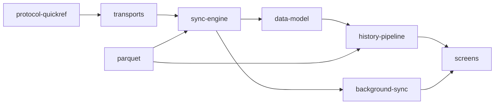

# opensensor.space — Android sensor companion

Native Android companion for devices running the shared
[`aq-parquet`](../aq-parquet) sync contract. Connect multiple devices over Bluetooth LE or
local Wi-Fi/LAN, collect their immutable **Parquet** files into a verified phone archive, and
explore measurements offline. Reviewed live profiles cover M5Stack CoreS3 and Waveshare
ESP32-S3-SIM7670G V2; other schemas can be collected without guessing their live meanings.

**Offline-first, not offline-only.** Everything works with no internet: the phone's archive is the
source of truth, filled over **Bluetooth LE** always and, since protocol v2, over the **LAN** (one
TCP socket on your own Wi-Fi, found with mDNS, authenticated with a token the phone can only obtain
over the bonded BLE link). Cloud backup or sharing is a *later, opt-in* step, off by default.
`INTERNET` is declared **only so LAN sockets exist**; the code connects exclusively to addresses
from mDNS discovery of `_aqsync._tcp`. No cloud endpoint, no location permission, no analytics, no
accounts. Data leaves the phone through the share sheet or the file picker.

## Status (2026-09-30)

The opensensor.space rebrand and initial multi-device implementation are in place: independent
controllers, a shared two-transfer budget, immutable archive collision checks, per-device
reset/reflash continuity, retained station epochs, and available-metric history with signed charts.
The Android application ID and signing identity are retained for existing installations.
`verify` passes: **236 tests passed, none skipped**, zero lint errors. The local
real-archive test decoded 767 device files after its sibling path was corrected.
Host verification and implementation details are in [`docs/opensensor-space.md`](docs/opensensor-space.md).
**Simultaneous phone collection and controlled reset/reflash qualification remain outstanding.**
The USB update opened on the OnePlus on 2026-09-29 with existing archives intact. Foreground
pairing repair restored Waveshare live readings; its earlier station history remained selectable.
Earlier BLE/LAN partial sync and one advertising wake were measured on a OnePlus 7 Pro (Android 16);
full sync, an Auto-sync period cycle, companion presence and Wi-Fi-arrival runs remain outstanding.
On 2026-09-30, the OnePlus History screen was checked after a Waveshare station reset: it now
shows compact generation labels, opens an earlier station at its latest recorded day, preserves
that date across range changes, and separates retained producer copies from untimed files.
Measured behavior lives in the firmware's
[CoreS3 bench record](../aq-parquet/docs/boards/m5stack-cores3/bench-verified.md);
[`docs/status.md`](docs/status.md) separates host tests from phone evidence.

## Documentation map

The docs are split by concern so you read only what you need. Start at
[`docs/README.md`](docs/README.md) for the routing table; the rules are in [`AGENTS.md`](AGENTS.md).



| Concern | File |
| --- | --- |
| Rebrand, multi-device implementation, reset/reflash policy and remaining qualification | [`docs/opensensor-space.md`](docs/opensensor-space.md) |
| What is verified, where, and what is next | [`docs/status.md`](docs/status.md) |
| Modules, layers, "what a change touches" | [`docs/architecture.md`](docs/architecture.md) |
| Screens, navigation, detail levels | [`docs/screens.md`](docs/screens.md) |
| Opcodes, frames, error codes, UUIDs, LAN framing (mirror of the firmware contract) | [`docs/protocol-quickref.md`](docs/protocol-quickref.md) |
| BLE vs LAN, pairing, the LAN token, reconnect | [`docs/transports.md`](docs/transports.md) |
| Download, verification, lost windows, resume, archive paths, `REBOOT` audit | [`docs/sync-engine.md`](docs/sync-engine.md) |
| Auto-sync, WorkManager, foreground notification, WifiLock, triggers (presence / advertising / Wi-Fi) | [`docs/background-sync.md`](docs/background-sync.md) |
| Room v9, DataStore, files on disk, backup | [`docs/data-model.md`](docs/data-model.md) |
| Index → tiers → derived day → charts; metrics, moods, time estimate | [`docs/history-pipeline.md`](docs/history-pipeline.md) |
| Own Parquet reader/writer, GeoParquet 2.0, fixtures, oracles | [`docs/parquet.md`](docs/parquet.md) |
| Stack, build, hooks, CI, signing, fake device | [`docs/build-and-release.md`](docs/build-and-release.md) |
| Lessons learned, grouped by concern | [`docs/lessons-learned.md`](docs/lessons-learned.md) |
| Long-form evaluation: history UX, data layer, iOS parity, D1–D11 | [`docs/history-ux-and-data-layer.md`](docs/history-ux-and-data-layer.md) |

## Build

```sh
export JAVA_HOME="/Applications/Android Studio.app/Contents/jbr/Contents/Home"
tools/setup-hooks.sh                 # once per clone: git hooks (ktlint, gitleaks, hygiene; verify on push)
./gradlew --no-daemon clean verify   # lint + assembleDebug + every module's unit tests
adb install app/build/outputs/apk/debug/app-debug.apk
```

Ready-made APKs: every push to `main` refreshes the rolling [`latest`](../../releases/tag/latest)
pre-release; a `v*` tag publishes a permanent release. Details, signing and the debug fake device:
[`docs/build-and-release.md`](docs/build-and-release.md).

## Layout

```
core/protocol/   pure JVM · contract mirror: UUIDs, frames v1+v2, CONFIG, LAN framing, JSON, PAR1/CRC verify
core/parquet/    pure JVM · own Parquet reader + writer (GeoParquet 2.0, LZ4/Snappy/GZIP, codec SPI) · test fixtures
core/history/    pure JVM · Metrics registry, Aggregator → tiers, TimeEstimate, Columns, AirMood, file index
app/             Android · data/{ble,lan,sync,background,history,local,settings,export,fake} · ui/{scan,device,history,files,debug,settings}
tools/           fixture generators + PyArrow/DuckDB oracle (run in ../aq-parquet's pixi env), hooks, signing
docs/            one file per concern (see the map above)
```

The Bluetooth protocol is owned by the firmware repo (`../aq-parquet/docs/shared/ble-sync-protocol.md`);
this app mirrors it and never changes a frame, opcode, UUID or JSON key first.
