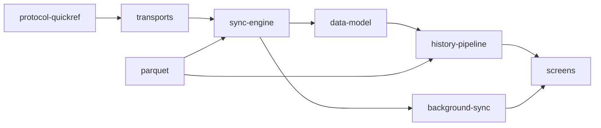

# opensensor.space mobile (Android and iOS)

The phone app for [opensensor.space](https://walkthru.earth/opensensor), a home for open sensors of every
kind. Air quality is the first device family. Weather, water, soil, noise and energy families
plug in the same way, as data rather than new screens.

The app does three things.

1. **Discover.** On first open, before you own anything, a map shows public sensor readings
   near you as H3 hexagon cells, never exact points. Tap a cell to see what its sensors
   measured. The map reads either the bundled sample, which is labelled as sample data, or the
   live OpenAQ aggregates on source.coop, chosen by the source switch on the map. See
   [docs/devices-and-discovery.md](docs/devices-and-discovery.md).
2. **Collect.** Pair your own devices over Bluetooth LE, then collect their immutable Parquet
   files over BLE or your local Wi-Fi into a verified archive on the phone. A file counts as
   synced only after its size, CRC-32 and `PAR1` checks pass.
3. **Understand.** Simple screens say what the readings mean in plain words, with the peacock
   as a guide. Detailed and Developer levels reveal per-file, per-metric and protocol detail
   only for the people who want it.

**Private by design.** The archive lives on the phone and works without internet. LAN
connects only to devices found through `_ossync._tcp` mDNS, with a token obtained over bonded
BLE. The only other network use is anonymous, read-only downloads of the public map feed and
basemap, and of a board template a file names when the app has none for it. One Settings switch
turns them off. Nothing uploads. Sharing a device's own data is not built. When it lands it stays
off by default and is turned on per device, in that device's settings, with confirmation. No
accounts, no analytics. Approximate foreground location is asked only on the Near me or Use phone
location tap. Device settings can save a privacy-limited H3 area to your sensor,
at resolution 8, with an optional declared country. Exact phone fixes
are never saved or sent. See [device location](docs/device-location.md). Public
data carries H3 cells, never coordinates.

**One product on two phones.** Rules that must give the same answer on Android and iOS live in
shared Kotlin, and screens share one design system based on the opensensor.space website. See
[docs/cross-platform-guide.md](docs/cross-platform-guide.md).

## Platform status

| Platform | Current scope | Verification |
| --- | --- | --- |
| Android | Multi-device BLE/LAN collection, verified local archive, offline history, and background sync | Host gate passes; phone qualification is tracked separately in [`docs/status.md`](docs/status.md) and the [CoreS3](../opensensor-space-firmware/docs/boards/m5stack-cores3/bench-verified.md) and [Waveshare](../opensensor-space-firmware/docs/boards/waveshare-esp32-s3-sim7670g/bench-verified.md) records. |
| iOS | The same shared screens, BLE and LAN collection into a verified local archive, offline history and per-device Auto-sync | Host, simulator and native checks pass. iPhone runs are tracked in [`docs/status.md`](docs/status.md), see [`docs/ios.md`](docs/ios.md) |

Host tests, simulator builds, and phone observations are different evidence. The app ID
is `space.opensensor.app` on Android and iOS. Read the
[full status record](docs/status.md) for dated results and remaining checks.

## Documentation map

The docs are split by concern so you read only what you need. Start at
[`docs/README.md`](docs/README.md) for the routing table; the rules are in [`AGENTS.md`](AGENTS.md).



| Concern | File |
| --- | --- |
| Product direction, device families, public H3 discover map, sharing rules | [`docs/devices-and-discovery.md`](docs/devices-and-discovery.md) |
| Keeping Android and iOS the same, adding a sensor family or transport | [`docs/cross-platform-guide.md`](docs/cross-platform-guide.md) |
| Device identity, fixed names, reset and reflash recovery | [`docs/device-identity.md`](docs/device-identity.md) |
| What is verified, where, and what is next | [`docs/status.md`](docs/status.md) |
| Modules, layers, "what a change touches" | [`docs/architecture.md`](docs/architecture.md) |
| iOS app, shared Kotlin boundaries, build and qualification | [`docs/ios.md`](docs/ios.md), [`ios/AGENTS.md`](ios/AGENTS.md) |
| Screens, navigation, detail levels | [`docs/screens.md`](docs/screens.md) |
| Opcodes, frames, error codes, UUIDs, LAN framing (mirror of the firmware contract) | [`docs/protocol-quickref.md`](docs/protocol-quickref.md) |
| BLE vs LAN, pairing, the LAN token, reconnect | [`docs/transports.md`](docs/transports.md) |
| Download, verification, lost windows, resume, archive paths | [`docs/sync-engine.md`](docs/sync-engine.md) |
| Auto-sync, WorkManager, foreground notification, WifiLock, triggers (presence / advertising / Wi-Fi) | [`docs/background-sync.md`](docs/background-sync.md) |
| Room (`AppDatabase`), DataStore, files on disk, backup | [`docs/data-model.md`](docs/data-model.md) |
| Index → tiers → derived day → charts; metrics, moods, time estimate | [`docs/history-pipeline.md`](docs/history-pipeline.md) |
| Own Parquet reader/writer, GeoParquet 2.0, fixtures, oracles | [`docs/parquet.md`](docs/parquet.md) |
| Stack, build, hooks, CI, signing, fake device | [`docs/build-and-release.md`](docs/build-and-release.md) |
| Lessons learned, grouped by concern | [`docs/lessons-learned.md`](docs/lessons-learned.md) |

## iOS app

The iOS app runs the same shared Compose screens as Android, hosted by `ios/shared`, over the
shared Kotlin sync engine, Room database and history pipeline. Swift keeps Core Bluetooth,
sockets and Bonjour, the Keychain, background tasks and the sticker scanner. Both phones collect
over Wi-Fi with a token each phone fetches over bonded BLE. Build and qualification instructions
are in [docs/ios.md](docs/ios.md), and local iOS coding instructions are in
[ios/AGENTS.md](ios/AGENTS.md). What an iPhone run has shown is recorded in
[docs/status.md](docs/status.md).

## Build

First-time Mac setup (Homebrew JDK 25 and Android SDK) is in [`CONTRIBUTING.md`](CONTRIBUTING.md).

Android and host gate:

```sh
export JAVA_HOME="/opt/homebrew/opt/openjdk@25/libexec/openjdk.jdk/Contents/Home"   # Gradle needs a JDK 25 (docs/build-and-release.md#build-jdk)
tools/setup-hooks.sh                 # once per clone: git hooks (ktlint, gitleaks, hygiene; verify on push)
./gradlew --no-daemon clean verify   # lint + assembleDebug + every module's unit tests
adb install app/build/outputs/apk/debug/app-debug.apk
```

The iOS build requires macOS and Xcode. Follow [`docs/ios.md`](docs/ios.md)
for simulator framework linking, the Xcode build, and real-iPhone qualification steps.
GitHub Actions validates shared Kotlin iOS tests and unsigned simulator Debug/device
Release builds on Apple Silicon with Xcode 27 and the iOS 27 SDK. Simulator apps and failure reports are retained
as workflow artifacts; iOS signing and TestFlight setup are documented in
[`docs/build-and-release.md`](docs/build-and-release.md#github-actions-ios-validation).

Ready-made APKs: every push to `main` refreshes the rolling [`latest`](../../releases/tag/latest)
pre-release; a `v*` tag publishes a permanent release. Details, signing and the debug fake device:
[`docs/build-and-release.md`](docs/build-and-release.md).
The release page distributes Android APKs and links to iOS simulator artifacts in
Actions. Signed iPhone/TestFlight distribution is not available yet.

## Layout

The module list is `settings.gradle.kts`. Every `:core`, `:family`, `:ui` and `:feature` module is
Kotlin Multiplatform. `:core` and `:family:air` target the JVM and iOS, and `:core:database`, `:ui`
and `:feature` target Android and iOS.

```
app/              Android app · data/{ble,lan,background,history,archive,storage,settings,local/security,di,fake} · ui/ screen hosts (Routes, ViewModels)
ios/App/          Xcode app · Swift adapters for Core Bluetooth, sockets, Bonjour, Keychain, background tasks
ios/shared/       iOS only Kotlin · AppRoot hosts the shared screens, bridges to the Swift adapters
build-logic/      convention plugins and the verify gates

core/model/       BoardTemplate, Datastream, AppProfile, Thing, H3Cell, bundled templates and profiles
core/protocol/    contract mirror · UUIDs, frames, CONFIG, LAN framing, JSON, PAR1 and CRC-32 verify
core/parquet/     own Parquet reader and writer (GeoParquet 2.0, codec SPI) · test fixtures
core/net/         HTTP range reads and the disk block cache
core/storage/     storage classes, atomic files, budget, retention
core/archive/     archive layout, verifier, ArchiveStore and ArchiveIndex ports
core/sync/        LinkSession, DeviceSession, SyncEngine, CollectionController, clock and token policy
core/history/     metric registry, file index, tiers, daily Parquet, time estimate
core/database/    the Room KMP database of both phones
core/publicfeed/  Discover feed port, sample and OpenAQ feeds, H3
core/units/       display units
core/settings/    DataStore preferences, detail level
core/stac/        STAC File Item and Thing Collection of a synced file
core/thing/       ThingKind contract, registry, PublishGate · thing/testkit
family/air/       WHO scales, EPA correction, NowCast, moods, air metrics

ui/designsystem/  opensensor.space tokens, theme and shared components
ui/strings/       shared copy and the copy lint tests
ui/permissions/   permission timing and dialogs
ui/map/           MapLibre basemap, cell picker, place search
feature/          shared screens · shell, discover, devices, today, history, files, device, setup, settings, debug

tools/            fixture generators with PyArrow and DuckDB oracles (run in ../opensensor-space-firmware's pixi env), hooks, signing, history-benchmark
docs/             one file per concern (see the map above)
```

The Bluetooth protocol is owned by the firmware repo (`../opensensor-space-firmware/docs/shared/ble-sync-protocol.md`);
this app mirrors it and never changes a frame, opcode, UUID or JSON key first.

## License & Attribution (CC-BY-4.0)

Walkthru.Earth original code in this repository (`app/`, `core/`, `feature/`, `ui/`, `ios/`, `tools/`, `build-logic/`, build files and documentation) is licensed under the **Creative Commons Attribution 4.0 International Public License (CC-BY-4.0)**. See [`LICENSE`](LICENSE) and [`NOTICE`](NOTICE). The CC-BY-4.0 license does not cover the third-party parts listed below, which keep their own licenses.

> **Attribution requirement.** Any application, app store build, firmware image, hardware product, dataset, or documentation that uses or incorporates `opensensor-space-mobile` must include clear, visible attribution to **Walkthru.Earth** ([https://walkthru.earth](https://walkthru.earth)), for example
>
> *"Sensor sync and air quality views powered by [Walkthru.Earth](https://walkthru.earth) (`walkthru-earth/opensensor-space-mobile`), licensed under CC-BY-4.0."*

## Third-party notices

| Component | Location | License | Copyright |
| :--- | :--- | :--- | :--- |
| Android Studio architecture template, the portions this project started from | spread through the Android project, per-file headers replaced by [`NOTICE`](NOTICE) | Apache-2.0, see [apache.org/licenses/LICENSE-2.0](https://www.apache.org/licenses/LICENSE-2.0) | Copyright (C) 2022 The Android Open Source Project |
| [Cairo](https://github.com/Gue3bara/Cairo) font v3.130, from google/fonts `ofl/cairo` at commit `a2c83daed9bc723922de8d0a9512990bd3d91df4` | `ui/designsystem/src/commonMain/composeResources/` | SIL OFL 1.1, see [`Cairo-OFL.txt`](ui/designsystem/src/commonMain/composeResources/files/licenses/Cairo-OFL.txt) | Copyright 2009 The Cairo Project Authors |
| Quicksand font, the variable TTF from google/fonts `ofl/quicksand` | `ui/designsystem/src/commonMain/composeResources/` | SIL OFL 1.1, see [`Quicksand-OFL.txt`](ui/designsystem/src/commonMain/composeResources/files/licenses/Quicksand-OFL.txt) | Copyright 2011 The Quicksand Project Authors |

Libraries pulled in by Gradle (for example AndroidX, Kotlin, Compose Multiplatform, OkHttp and `zstd-jni`) are not copied into this repository. Each keeps its own license, and app builds that ship them must carry their notices.
