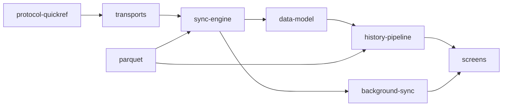

# AQ Sync — Android companion for the CoreS3 air-quality logger

Native Android app that pairs with an **M5Stack CoreS3 (ESP32-S3)** running the
[`m5stack-aq-parquet`](../m5stack-aq-parquet) firmware, shows its live readings, gives it UTC,
copies its finalized **Parquet** files into the phone — byte-exact, verified, offline — and turns
them into on-phone history (tiers, derived daily Parquet, charts).

**Offline-first, not offline-only.** Everything works with no internet: the phone's archive is the
source of truth, filled over **Bluetooth LE** always and, since protocol v2, over the **LAN** (one
TCP socket on your own Wi-Fi, found with mDNS, authenticated with a token the phone can only obtain
over the bonded BLE link). Cloud backup or sharing is a *later, opt-in* step, off by default.
`INTERNET` is declared **only so LAN sockets exist**; the code connects exclusively to addresses
from mDNS discovery of `_aqsync._tcp`. No cloud endpoint, no location permission, no analytics, no
accounts. Data leaves the phone through the share sheet or the file picker.

## Status (2026-09-18)

Protocol v2 + Auto-sync + on-phone history + GeoParquet 2.0 read/write are implemented.
`./gradlew verify` → **143/143 unit tests**, 0 lint errors (7 known warnings). BLE and LAN file
sync have run against the board from one phone (OnePlus 7 Pro, Android 16, partial runs); an
instrumented full sync and a complete Auto-sync period cycle have not. What was measured, on which
firmware and app commit, lives in the firmware repo's
[`docs/bench-verified.md`](../m5stack-aq-parquet/docs/bench-verified.md#phone-over-lan-and-ble-oneplus-7-pro-android-16);
the detailed ladder and the next steps are in [`docs/status.md`](docs/status.md).

## Documentation map

The docs are split by concern so you read only what you need. Start at
[`docs/README.md`](docs/README.md) for the routing table; the rules are in [`AGENTS.md`](AGENTS.md).



| Concern | File |
| --- | --- |
| What is verified, where, and what is next | [`docs/status.md`](docs/status.md) |
| Modules, layers, "what a change touches" | [`docs/architecture.md`](docs/architecture.md) |
| Screens, navigation, detail levels | [`docs/screens.md`](docs/screens.md) |
| Opcodes, frames, error codes, UUIDs, LAN framing (mirror of the firmware contract) | [`docs/protocol-quickref.md`](docs/protocol-quickref.md) |
| BLE vs LAN, pairing, the LAN token, reconnect | [`docs/transports.md`](docs/transports.md) |
| Download, verification, lost windows, resume, archive paths, `REBOOT` audit | [`docs/sync-engine.md`](docs/sync-engine.md) |
| Auto-sync, WorkManager, foreground notification, WifiLock | [`docs/background-sync.md`](docs/background-sync.md) |
| Room v8, DataStore, files on disk, backup | [`docs/data-model.md`](docs/data-model.md) |
| Index → tiers → derived day → charts; metrics, moods, time estimate | [`docs/history-pipeline.md`](docs/history-pipeline.md) |
| Own Parquet reader/writer, GeoParquet 2.0, fixtures, oracles | [`docs/parquet.md`](docs/parquet.md) |
| Stack, build, hooks, CI, signing, fake device | [`docs/build-and-release.md`](docs/build-and-release.md) |
| Lessons learned, grouped by concern | [`docs/lessons-learned.md`](docs/lessons-learned.md) |
| Long-form evaluation: history UX, data layer, iOS parity, D1–D11 | [`docs/history-ux-and-data-layer.md`](docs/history-ux-and-data-layer.md) |

## Build

```sh
export JAVA_HOME="/Applications/Android Studio.app/Contents/jbr/Contents/Home"
tools/setup-hooks.sh                 # once per clone: git hooks (ktlint, gitleaks, hygiene; verify on push)
./gradlew --no-daemon clean verify   # lint + assembleDebug + every module's unit tests
adb install app/build/outputs/apk/debug/app-debug.apk
```

Ready-made APKs: every push to `main` refreshes the rolling [`latest`](../../releases/tag/latest)
pre-release; a `v*` tag publishes a permanent release. Details, signing and the debug fake device:
[`docs/build-and-release.md`](docs/build-and-release.md).

## Layout

```
core/protocol/   pure JVM · contract mirror: UUIDs, frames v1+v2, CONFIG, LAN framing, JSON, PAR1/CRC verify
core/parquet/    pure JVM · own Parquet reader + writer (GeoParquet 2.0, LZ4/Snappy/GZIP, codec SPI) · test fixtures
core/history/    pure JVM · Metrics registry, Aggregator → tiers, TimeEstimate, Columns, AirMood, file index
app/             Android · data/{ble,lan,sync,background,history,local,settings,export,fake} · ui/{scan,device,history,files,debug,settings}
tools/           fixture generators + PyArrow/DuckDB oracle (run in ../m5stack-aq-parquet's pixi env), hooks, signing
docs/            one file per concern (see the map above)
```

The Bluetooth protocol is owned by the firmware repo (`../m5stack-aq-parquet/docs/ble-sync-protocol.md`);
this app mirrors it and never changes a frame, opcode, UUID or JSON key first.
