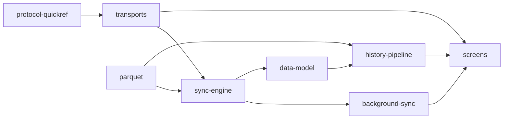

# docs/ — where to look, by concern

One file per concern. Each starts with a **Scope / Code / Related** header so you can decide in a
few lines whether it is the right file, then a compact Mermaid diagram, then the facts and the
decisions that belong to that concern only. Numbers were validated against the code on 2026-09-18
(`./gradlew verify`: 138 tests, 0 lint errors, 7 known warnings).

## Routing table

| I need to… | Read | Then open the code in |
| --- | --- | --- |
| Know what is verified, on what hardware, and what is next | [status.md](status.md) | `../m5stack-aq-parquet/docs/bench-verified.md` |
| Understand modules, layers, who depends on whom, "what a change touches" | [architecture.md](architecture.md) | `core/*/build.gradle.kts`, `app/build.gradle.kts` |
| Change a screen, the nav graph, detail levels | [screens.md](screens.md) | `app/…/ui/`, `data/settings/AppSettings.kt` |
| Look up an opcode, frame type, error code, UUID, LAN framing constant | [protocol-quickref.md](protocol-quickref.md) | `core/protocol/…/Frames.kt`, `AqUuids.kt`, `LanFraming.kt` |
| Touch BLE / LAN pipes, pairing, the LAN token, mDNS, reconnect | [transports.md](transports.md) | `data/ble/`, `data/lan/`, `data/DeviceConnectionRepository.kt` |
| Touch file download, verification, lost windows, resume, archive paths | [sync-engine.md](sync-engine.md) | `data/sync/`, `data/ble/DeviceSession.kt` |
| Touch auto-sync, WorkManager, the foreground notification, WifiLock, or the triggers that start a run early (companion presence, advertising flags, Wi-Fi arrival) | [background-sync.md](background-sync.md) | `data/background/`, `data/lan/LanWifiLock.kt`, `core/protocol/.../Advertisement.kt` |
| Touch Room tables, migrations, DataStore keys, on-disk layout, backup | [data-model.md](data-model.md) | `data/local/database/`, `app/schemas/`, `res/xml/data_extraction_rules.xml` |
| Touch the index → tiers → derived-day → chart pipeline, metrics, moods, time estimate | [history-pipeline.md](history-pipeline.md) | `core/history/`, `data/history/`, `ui/history/` |
| Touch the Parquet reader/writer, GeoParquet, codecs, fixtures, oracles | [parquet.md](parquet.md) | `core/parquet/`, `tools/*.py` |
| Build, sign, release, run hooks/CI, use the fake device | [build-and-release.md](build-and-release.md) | `tools/`, `.github/workflows/`, `data/fake/` |
| Avoid a mistake that was already made | [lessons-learned.md](lessons-learned.md) | (grouped by the concern above) |
| The long-form evaluation: history UX, data layer, iOS parity, D1–D11 | [history-ux-and-data-layer.md](history-ux-and-data-layer.md) | — |
| What the AirGradient Android app does differently, and verdicts | [review-airgradient-android.md](review-airgradient-android.md) | — |

Rules (non-negotiables) live in [`../AGENTS.md`](../AGENTS.md). The protocol contract lives in the
firmware repo: `../m5stack-aq-parquet/docs/ble-sync-protocol.md` — never in this repo.

## How the concerns connect

Read left to right: a byte on the wire (`protocol`) travels a pipe (`transports`), is verified and
archived (`sync-engine`) — interactively or by the worker (`background-sync`) — into files + Room
(`data-model`), which the `history-pipeline` turns into tiers and charts for the `screens`.
`parquet` is the codec both the sync verifier and the history pipeline read with.

## Conventions in these files

- **Code paths** are relative to `app/src/main/java/earth/walkthru/aqsync/` for `:app` and
  `core/<module>/src/main/kotlin/earth/walkthru/aqsync/` for `:core:*` (package names are shared
  across modules: `earth.walkthru.aqsync.data.*`).
- **"Uses → affects"** sections say what a file consumes and what breaks or changes downstream if
  you edit it — search there before editing.
- Dates are the day a decision was made or a fact was measured; "unverified" means not in
  `bench-verified.md`.
