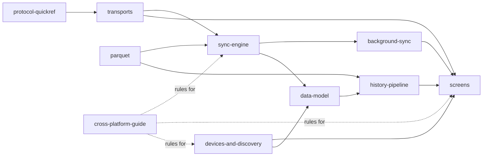

# docs/, the shared mobile project guide, by concern

One file per concern. Each starts with a **Scope / Code / Related** header so you can decide in a
few lines whether it is the right file, then a compact Mermaid diagram, then the facts and the
decisions that belong to that concern only. Current verification is recorded in [status.md](status.md); dated results describe their original revision.

## Product direction in one paragraph

opensensor.space supports open sensors of every kind, and air quality is the first family. A new
user lands on a public H3 discover map (sample data until the S3 and source.coop feed is live),
then pairs and collects their own devices over BLE or LAN into a verified local archive. Simple
screens explain readings in plain words. Technical detail lives behind the Detailed and
Developer levels. Android and iOS share rules, sync and design. Read
[devices-and-discovery.md](devices-and-discovery.md), [cross-platform-guide.md](cross-platform-guide.md)
and [production-readiness-plan.md](production-readiness-plan.md) before planning new work. Older
files describe the current Android-first, air-quality-first implementation and stay accurate for
that code until the plan's workstreams replace it.

## Routing table

| I need to… | Read | Then open the code in |
| --- | --- | --- |
| Know what is verified on Android, iOS simulator, and real devices | [status.md](status.md) | `../aq-parquet/docs/boards/*/bench-verified.md` |
| Keep design and sync behaviour the same on iOS and Android, add a sensor family or transport | [cross-platform-guide.md](cross-platform-guide.md) | `core/*/src/commonMain/`, `ios/App/`, `app/` |
| Understand the product direction, device families, the public H3 discover map and sharing rules | [devices-and-discovery.md](devices-and-discovery.md) | `core/publicfeed/`, `feature/discover/` |
| See the Android and iOS drift audit and the parity plan | [platform-parity-plan.md](platform-parity-plan.md), [parity-audit/](parity-audit/) | every module |
| See what still differs between Android and iOS, and why | [platform-differences.md](platform-differences.md), [parity-decisions.md](parity-decisions.md) | `app/`, `ios/App/` |
| See the production refactor plan and its workstreams | [production-readiness-plan.md](production-readiness-plan.md) | every module |
| Understand the opensensor.space rebrand, concurrent multi-device collection and reset/reflash recovery | [opensensor-space.md](opensensor-space.md) (implementation and remaining qualification) | `data/DeviceConnectionRepository.kt`, `data/background/`, `data/sync/`, `ui/`; new firmware owner `../aq-parquet/docs/shared/` |
| Build or extend the iOS app and shared Kotlin core | [ios-migration.md](ios-migration.md), `../ios/AGENTS.md` | `core/*/src/commonMain/`, `ios/` |
| Understand modules, layers, who depends on whom, "what a change touches" | [architecture.md](architecture.md) | `core/*/build.gradle.kts`, `app/build.gradle.kts` |
| Change a screen, the nav graph, detail levels | [screens.md](screens.md) | `app/…/ui/`, `data/settings/AppSettings.kt` |
| Permissions, privacy manifest, Play Data safety and App Store label | [store-compliance.md](store-compliance.md) | `app/src/main/AndroidManifest.xml`, `ui/permissions/`, `ios/App/` |
| Look up an opcode, frame type, error code, UUID, LAN framing constant | [protocol-quickref.md](protocol-quickref.md) | `core/protocol/…/Frames.kt`, `AqUuids.kt`, `LanFraming.kt` |
| Touch BLE / LAN pipes, pairing, the LAN token, mDNS, reconnect | [transports.md](transports.md) | `data/ble/`, `data/lan/`, `data/DeviceConnectionRepository.kt` |
| Touch file download, verification, lost windows, resume, archive paths | [sync-engine.md](sync-engine.md) | `data/sync/`, `data/ble/DeviceSession.kt` |
| Touch auto-sync, WorkManager, the foreground notification, WifiLock, or the triggers that start a run early (companion presence, advertising flags, Wi-Fi arrival) | [background-sync.md](background-sync.md) | `data/background/`, `data/lan/LanWifiLock.kt`, `core/protocol/.../Advertisement.kt` |
| Touch Room tables, migrations, DataStore keys, on-disk layout, backup | [data-model.md](data-model.md) | `data/local/database/`, `app/schemas/`, `res/xml/data_extraction_rules.xml` |
| Touch the index → tiers → derived-day → chart pipeline, metrics, moods, time estimate | [history-pipeline.md](history-pipeline.md) | `core/history/`, `data/history/`, `ui/history/` |
| Touch the Parquet reader/writer, GeoParquet, codecs, fixtures, oracles | [parquet.md](parquet.md) | `core/parquet/`, `tools/*.py` |
| Build, sign, release, run hooks/CI, use the fake device | [build-and-release.md](build-and-release.md) | `tools/`, `.github/workflows/`, `data/fake/` |
| Avoid a mistake that was already made | [lessons-learned.md](lessons-learned.md) | (grouped by the concern above) |
| The long-form evaluation: history UX, data layer, iOS parity, D1–D11 (its location section is superseded by H3 cells) | [history-ux-and-data-layer.md](history-ux-and-data-layer.md) | — |
| What the AirGradient Android app does differently, and verdicts | [review-airgradient-android.md](review-airgradient-android.md) | — |

Rules (non-negotiables and AI delegation guidance) live in [`../AGENTS.md`](../AGENTS.md).
The iOS app boundary is documented in [`../ios/AGENTS.md`](../ios/AGENTS.md). The protocol
contract lives in the firmware repo, `../aq-parquet/docs/shared/ble-sync-protocol.md`, never here.

## How the concerns connect

Read left to right: a byte on the wire (`protocol`) travels a pipe (`transports`), is verified and
archived (`sync-engine`), interactively or by the worker (`background-sync`), into files + Room
(`data-model`), which the `history-pipeline` turns into tiers and charts for the `screens`.
`parquet` is the codec both the sync verifier and the history pipeline read with.
`devices-and-discovery` defines what a device and a metric are, and the public map that sits
beside your own devices. `cross-platform-guide` holds the rules that keep both phones the same.

## Conventions in these files

- **Code paths** in Android docs are relative to `app/src/main/java/earth/walkthru/aqsync/`;
  shared KMP rules live in `core/<module>/src/commonMain/`, with JVM adapters in `jvmMain/`;
  iOS app and Apple adapters live under `ios/App/`, with Kotlin presentation code in
  `ios/shared/`. Android/core packages are `earth.walkthru.aqsync`; the iOS presentation
  package is `earth.walkthru.opensensor`.
- **"Uses → affects"** sections say what a file consumes and what breaks or changes downstream if
  you edit it — search there before editing.
- Dates are the day a decision was made or a fact was measured; "unverified" means not in
  `bench-verified.md`.
- Host/JVM tests, iOS simulator builds, Android phone runs, and iPhone runs are separate
  evidence. A result for one platform does not qualify another.
