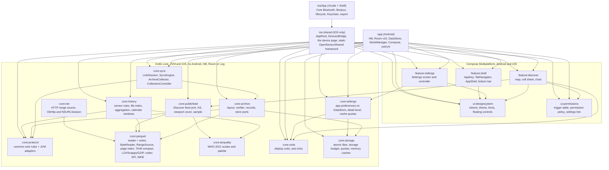
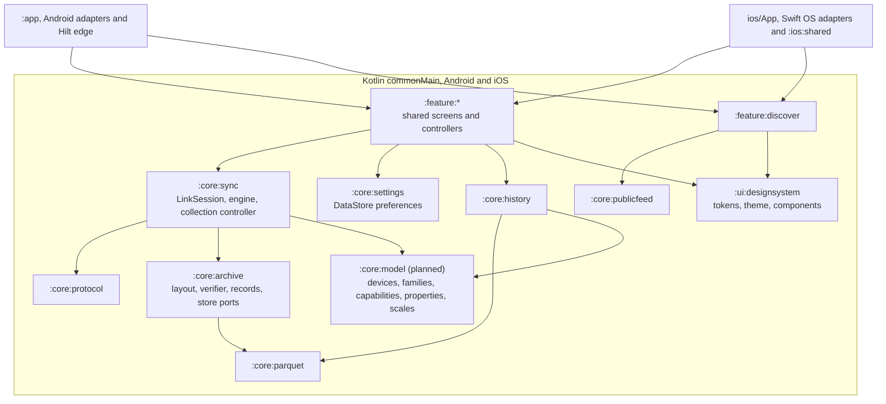
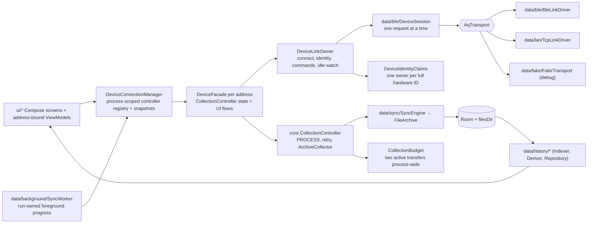

# Architecture of Android, iOS, shared modules, and what a change touches

**Scope:** module boundaries, dependency direction, package layout, and platform ownership.
**Code:** `settings.gradle.kts`, `build-logic/`, `core/*/build.gradle.kts`, `app/build.gradle.kts`, `build.gradle.kts` (`verify` task); `data/DeviceConnectionManager.kt`, `DeviceFacade.kt`, `DeviceLinkOwner.kt`, `CollectionAdmission.kt`, `DeviceIdentityClaims.kt`.
**Related:** [data-model.md](data-model.md) (storage), [transports.md](transports.md) · [sync-engine.md](sync-engine.md) · [history-pipeline.md](history-pipeline.md) (the layers in detail).

## Module graph

`:core:history` exposes `:core:parquet`, `:core:protocol` and `:core:airquality` as `api`, and
`:core:publicfeed` exposes `:core:parquet` and `:core:airquality`. `:core:net` exposes
`:core:parquet` and is not yet used by either app. A `:core` class cannot import
`android.*`, and the build enforces it. Every `:core` module compiles for JVM and iOS from
`src/commonMain`. Platform edges live in `src/jvmMain` (Java files, streams, positional `FileChannel` reads,
`java.util.zip`, `com.uber:h3`, OkHttp) and `src/iosMain` (`pread`, system zlib, H3 C
cinterop, `NSURLSession`).
Tests live in `src/commonTest` (JVM and iOS simulator) or `src/jvmTest` / `src/iosTest`. Calendar
windows use kotlinx-datetime. Android passes its `ZoneId` through `toKotlinTimeZone()`.

`:ui:designsystem`, `:ui:permissions`, `:feature:discover`, `:feature:settings` and `:feature:shell` target Android (the AGP KMP library target, not `jvm`)
and iOS. `:ios:shared` targets iOS only, so its `commonMain` consumes them directly. It renders the
current Compose iOS screen. `ios/App` supplies native app integration, Core Bluetooth, Bonjour
discovery, lifecycle, Keychain and Files export. Both platforms run the shared sync engine. The Android app remains a separate
platform entry point. See [ios-migration.md](ios-migration.md) for current scope and build commands.

Navigation is shared ([ADR 0001](adr/0001-shared-navigation.md)). `:feature:shell` holds the
sealed `AppKey : NavKey` hierarchy, `AppNavConfig` (a `SavedStateConfiguration` built with
`subclassesOfSealed`, so no reflection on iOS), the Compose free `TabNavigator` and `AppShell`, which
draws the one bottom bar around one Navigation 3 `NavDisplay` with a back stack per tab. It uses the
JetBrains `navigation3-ui` and `lifecycle-viewmodel-navigation3`, which resolve on Android to the
same androidx binaries. Both apps host `AppShell` and pass their screens in as entries. Android
entries keep `hiltViewModel()`, iOS entries hold plain controllers in a `viewModel { }` holder.
Screens that take Back first use `NavigationBackHandler`, never `BackHandler`.

### Target module graph

The graph above is today's code. [platform-parity-plan.md](platform-parity-plan.md) moves toward
the graph below, where every rule that must give the same answer on both phones is shared and
platform code only adapts OS services. `:core:sync`, `:core:archive`, `:core:settings` and
`:feature:settings` exist. The shared sync engine is adopted on both platforms. Room KMP backing remains planned.
Android uses the shared collection controller; iOS controller adoption remains
[#81](https://github.com/walkthru-earth/opensensor-space-mobile/issues/81). iOS Core Bluetooth
runs on the `BlePhysicalLink` serial queue. `:core:model` (device families and metrics
as data) is planned in [production-readiness-plan.md](production-readiness-plan.md) W11 and
[devices-and-discovery.md](devices-and-discovery.md).

## Build conventions (`build-logic/`)

`settings.gradle.kts` includes `build-logic/` through `pluginManagement { includeBuild(...) }`.
It holds four convention plugins, so a new shared module is one `plugins {}` line.

| Plugin | Applied by | Sets |
| --- | --- | --- |
| `opensensor.kmp.library` | every `:core` module | Kotlin Multiplatform with `jvm` (bytecode 17), `iosArm64`, `iosSimulatorArm64`, `kotlin-test` in `commonTest`, a `test` task that runs `jvmTest`. Adds `jvmTest` to `verify` and `iosSimulatorArm64Test` to `verifyIos` |
| `opensensor.kmp.compose-feature` | `:ui:designsystem`, `:ui:strings`, `:ui:permissions`, `:feature:discover`, `:feature:settings`, `:feature:shell` | the AGP KMP Android library target (namespace `earth.walkthru.opensensor.<module>`, SDK 37, min 31, Android resources, host tests), `iosArm64`, `iosSimulatorArm64`, Compose runtime, foundation, Material 3, UI and resources, internal resources class in `<namespace>.resources`, `kotlin-test` in `commonTest` (runs in the Android host test and on the simulator), a `test` task that runs `testAndroidHostTest`. Adds `testAndroidHostTest` to `verify` and `iosSimulatorArm64Test` to `verifyIos` |
| `opensensor.kmp.ios-framework` | `:ios:shared` | iOS only Kotlin Multiplatform with the static `OpenSensorShared` framework for each iOS target. Adds `iosSimulatorArm64Test` and `linkDebugFrameworkIosSimulatorArm64` to `verifyIos` |
| `opensensor.jvm.library` | none today (kept for a future JVM-only module) | Kotlin/JVM with Java and Kotlin bytecode 17 |

The conventions compile against the Kotlin, Android and Compose Gradle plugins as `compileOnly`.
The root `build.gradle.kts` declares every plugin once with `apply false`, so all modules share one
plugin classloader. Bytecode 17 is a compiler target, not `jvmToolchain(17)`. The build runs on the selected bundled JBR or CI JDK. A separate toolchain would require
a JDK download. Use the bundled Android Studio JBR for local verification.
Warnings are not errors yet, since existing code still has a few.

The real Parquet fixtures live once in `core/parquet/src/test/resources` and are published as
`:core:parquet` test fixtures (a hand-declared variant with the `java-test-fixtures` capability,
because a multiplatform module cannot apply that plugin). `:core:history` and `:core:protocol` tests
declare `testFixtures(project(":core:parquet"))` instead of pointing at another module's
directory. `:app` still adds that directory to its unit-test resources.

### Gates

The root build registers `verify` and `verifyIos` and lists only the `:app` tasks (`lintDebug`,
`assembleDebug`, `testDebugUnitTest`). Each convention plugin adds its own module's test tasks
(`build-logic/src/main/kotlin/Gates.kt`), so a new module is gated as soon as it applies a
convention. On a Mac host `verify` also runs `verifyIos`. Set `-Popensensor.skipIos=true` to skip
it. `verifyIos` includes `:core:parquet:iosSimulatorArm64Test`, which decodes the real fixtures on
the simulator. `app/src/androidTest` is in neither gate.

## Layers inside `:app`

## Package map

| Path (under `app/src/main/java/earth/walkthru/aqsync/`) | Holds | Android-only? |
| --- | --- | --- |
| `data/DeviceConnectionManager.kt`, `data/DeviceFacade.kt`, `data/DeviceLinkOwner.kt`, `data/TransportFactory.kt` | Process-owned registry; one facade and shared collection controller per address. The link owner owns transport, identity, commands and idle reconnect. The repository name is a compatibility typealias | yes |
| `data/DeviceIdentityClaims.kt`, `data/DeviceContinuityPolicy.kt` | Shared two-transfer budget; full hardware identity claims and authenticated continuity policy | no (JVM logic with DI bindings) |
| `data/ble/` | `BleScanner`, `BleLinkDriver` (GATT, serialized ops, `LinkDriver`), `BleDisconnectCauses` (pure status table), `DeviceSession` (every request), `FrameRecorder` (last 200 frames, redacts) | yes |
| `data/lan/` | `TcpLinkDriver` (`LinkDriver`), `SocketErrors` (pure errno table), `LanDiscovery` (NsdManager, shared legacy resolver), `LanDiscoveryState` (foreground browse), `LanWifiLock` (transfer leases), `LanTokenPolicy` (pure) | yes (policy/lease accounting: no) |
| `data/sync/`, `data/archive/` | Android file and Room adapters for the shared planner, collector and engine | files + Room |
| `data/background/` | `SyncForegroundService`, `SyncNotifications`, `SyncWorker`, `AutoSyncScheduler`, `AutoSyncRunner` (pure), `AppAutoSyncGateway`; triggers `CompanionPresence` + `CompanionPresenceService`, `AdvertFlagScan` + `AdvertScanReceiver`, `SyncTriggers` + `WifiArrivalReceiver` + `BootReceiver` | yes (runner: no) |
| `data/history/` | `HistoryIndexer`, `HistoryDeriver`, `DailyDerived*`, `HistoryRepository`, `parquet/AppParquetCodecs` (ZSTD) | Room + files |
| `data/local/database/` | `AppDatabase` (v10), `KnownDevice`, `StationEpoch`, `ArchivedFile`, `History.kt` (`MetricBucket`, `DerivedDay`) | yes |
| `data/settings/AppSettings.kt` | Android view of `:core:settings` (`DetailLevel` Simple · Detailed · Developer, clock consent, units, public sensors) | yes |
| `data/fake/FakeTransport.kt` | in-process proto 3 device with fault hooks | no (JVM) |
| `ui/scan · device (Today, Device, NowCard) · history · files · debug · settings · permissions · theme` | Compose. `ui/files` hosts the shared Files and inspector screens (`:feature:files`) with the Android slots and the chart by file. `Navigation.kt` supplies the Android entries to the shared `AppShell` (`:feature:shell`) | yes |

The iOS entry point is `ios/OpenSensor.xcodeproj`. Its Swift adapters own Apple services;
the current screen and presentation state live in `ios/shared`. Follow [`../ios/AGENTS.md`](../ios/AGENTS.md)
for iOS-specific guidance. SwiftUI review rules apply only if native SwiftUI views are introduced.

| Core module | Ownership |
| --- | --- |
| `protocol` | Wire frames, codec, JSON models, names, CRC and Parquet completion rules |
| `parquet` | Closeable positional readers, zero-copy byte views, footer cache, page index, range planning, codecs and writer |
| `net` | HTTP range reads through OkHttp on JVM and NSURLSession on iOS |
| `history` | Metric registry, indexing, aggregation, calendars, grouped `DayPass`, daily output and persistent tiers |
| `publicfeed` | Discover feed, H3, viewport cover and sample data |
| `units`, `airquality` | Display units, axis ticks and WHO 2021 scales |
| `storage` | Durable/Derived/Scratch roots, atomic no-replace commits, free-space budget, quota and memory pressure |
| `archive` | Layout, verifier, records and store/index ports. Android uses file/Room adapters; iosMain supplies `IosArchiveStore` and `ReceiptArchiveIndex` |
| `sync` | `LinkSession`, typed `DeviceSession` views, `SyncEngine`, `ArchiveCollector`, `CollectionController`, policies, progress and `StorageJanitor` |
| `settings` | Shared DataStore preferences, keys and detail level. iOS supplies its Application Support path and one-time UserDefaults import |

### Shared sync rules in `:core:protocol`

- `ParquetVerify` is the one completion rule. A file is synced only when its size matches, its
  CRC-32 equals `OPENED.crc32`, and it starts and ends with `PAR1`. The size is checked first, so a
  short file is never hashed. Platform adapters measure size, CRC-32 and the head and tail bytes
  and pass them to the common `verify`. The JVM `File` and `InputStream` overloads and
  `sha256Hex` are extensions in `jvmMain`, so callers outside the package import them by name.
- `Crc32` is streaming (`update(bytes, offset, length)`, `value`, `reset`). The JVM uses
  `java.util.zip.CRC32`, iOS uses the table-driven `PortableCrc32`, and `commonTest` proves both
  agree with the IEEE check value and with each other.
- `SafeName.isValid` mirrors the firmware `safe_parquet_name()` rule. It allows only
  `[0-9a-z._=/-]`, rejects `..`, `//` and a leading `/`, needs a name before `.parquet`, and caps the
  name at 399 bytes, with a phone segment cap of 241 bytes for receipts. The shared
  `SyncPlanner` uses it on both platforms.

## Rules that keep the modules honest

- **Pure modules receive plain records, never entities.** `ArchivedFile.info()` → `IndexedFileInfo`; `HistoryIndexer` wraps `ParquetIndexer`. Room's KSP also refuses an entity implementing an interface from another module ([lessons](lessons-learned.md#build--tooling)).
- **A new sensor is a registry entry** in `Metrics` (`:core:history`), not code. See [history-pipeline.md](history-pipeline.md#metric-registry).
- **A new analysis is a pure object in `:core:history`** with a test over the real fixtures, fed by `:app` from Room/files. Never a query inside a composable.
- **A new transport is a `LinkDriver`** behind `TransportFactory` and one `LinkSession` (`AqTransport` remains a compatibility surface); the session, engine and archive do not change ([transports.md](transports.md)).
- **Transport work never lives in a composable or Activity**; manager-owned controllers keep session/sync state through rotation and navigation. Opening another device selects another controller without closing existing connections.
- **The one native Android library** is `zstd-jni` (`@aar`), registered from `:app` into `:core:parquet`'s codec SPI (`AppParquetCodecs`). Every `:core` module targets JVM and iOS. iOS inflates GZIP with the system zlib and has no ZSTD codec yet.

## Concurrent collection and ownership

`DeviceFacade` owns collection intent and UI projections. Its shared `CollectionController`
owns active retries and leases. `DeviceLinkOwner` serializes physical connection changes,
manual commands and idle reconnect, and publishes live readings, manifest, controls and events. Address-bound ViewModels observe only that controller. The manager
publishes device snapshots for Home and notifications. `AutoSyncRunner` visits up to two devices
concurrently; a shared `CollectionBudget` also caps active interactive and worker transfers together
at two. `CollectionAdmission` atomically prevents worker and interactive collections from
overlapping, including preparation, waiting and cleanup. Per-device reservation is atomic
with command admission. This is a conservative software policy, **not a measured Android BLE connection limit**.

A worker claims its controller with its WorkManager run ID. An existing session or reconnect for
that device prevents a background claim; a connection to another device does not. Interactive
reconnect, sync and device commands cannot hijack a worker-owned controller; UI configuration
controls treat worker ownership as busy. Once `info` is verified, `DeviceIdentityClaims`
prevents two endpoint aliases from owning the same full hardware ID. Session close cancels and
joins the transfer before closing the pipe and releasing its identity claim. Reconnect, cancellation
and progress remain per device. Worker cancellation closes only that run's sessions.

The proto 3 firmware has one logical file handle per BLE connection and per LAN peer.
Android still prevents endpoint aliases from concurrently claiming one physical device on
the same phone. This phone policy is separate from firmware's independent peer handles.
The owner contract is [`../aq-parquet/docs/shared/ble-sync-protocol.md`](../../aq-parquet/docs/shared/ble-sync-protocol.md).

The shared `WriterLeases` in `SyncEngine` serializes the entire OPEN/read/verify/commit/index/CLOSE sequence for
one `(station, name)`, with cancellable waiters; different identities transfer independently.
An existing destination must verify against OPENED size/CRC/PAR1 and its recorded SHA-256 before
reuse. A conflict preserves existing bytes and provenance; commit refuses to replace a destination.
Reuse returns `alreadyArchived` so background summaries count only newly collected files. Hive
paths remain verbatim. `LanWifiLock` uses owner-specific, idempotently closed leases: the first
active LAN transfer acquires the radio lock and the last releases it. BLE and queued transfers hold
no Wi-Fi lease. API 31–33 mDNS resolution uses one shared resolver queue across foreground and
worker browses.

These changes are covered by host tests (`AutoSyncRunnerTest`, `DeviceOwnershipTest`,
`ConcurrentArchiveTest`, `LanTransferLeasesTest`). Simultaneous physical-device collection and the
new Android plumbing have **not been verified on hardware**. Historical phone measurements remain
in the [CoreS3 bench record](../../aq-parquet/docs/boards/m5stack-cores3/bench-verified.md).

History derives a grouped day once with `DayPass`, producing tiers and daily Parquet.
Android uses derive version 5. Its collection plans use projected station archive identities rather
than full history rows. iOS persists tiers and enforces the derived quota after building.
The [host benchmark](perf/history-2026-10-11.md) measures allocation on a synthetic corpus,
not phone cold-open latency or a qualified latency improvement.

## Uses → affects (edit here, check there)

| If you change… | It is consumed by… | So re-check… |
| --- | --- | --- |
| `core/protocol/Frames.kt` (opcodes, layouts) | `DeviceSession`, `FakeTransport`, `FrameRecorder`, `DebugScreen` raw box | the firmware contract first (owner), `FrameCodec*Test`, the fake |
| `AqTransport` interface | `BleLinkDriver`, `TcpLinkDriver`, `FakeTransport` (through `TransportLink`), `DeviceSession`, repository | `TcpLinkDriverTest` loopback, `:core:sync` `SyncEngineTest` |
| `Metrics` registry | `Aggregator`, `HistoryDeriver`, `DailyDerivedBuilder`, History picker, charts, Now card | `AggregationTest`, `HistoryDeriverTest`, Room `metric_bucket` rows (id strings) |
| Room entities | `SyncEngine`, `HistoryIndexer/Deriver/Repository`, ViewModels | a new migration + `app/schemas/<n>.json`, `DERIVE_VERSION` if tier meaning changed |
| `ParquetWriter` output | `DailyDerivedBuilder`, `tools/validate_parquet_samples.py` | PyArrow + DuckDB oracle run |
| `CollectionState` / `SyncProgress` | facade UI projections, Files, service and worker | `CollectionControllerTest`, facade tests, lease accounting and notification text |
| Manager/controller ownership, transfer budget | address-bound ViewModels, runner, worker, foreground service | `DeviceOwnershipTest`, `AutoSyncRunnerTest`, cancellation and per-device progress |
| Archive writer leases / immutable commit | `SyncEngine`, partial resume, archive index and export | `ConcurrentArchiveTest`, `SyncEngineTest`; preserve existing files on conflicts |
| LAN transfer leases / shared mDNS resolver | all interactive and worker LAN transfers | `LanTransferLeasesTest`; phone checks on API 31–33 and screen-off LAN |
| `DetailLevel` | every screen's `detailed`/`advancedMode` gate, Debug destination | migration from `advanced_mode` |

## Provenance

Generated from Google's `android/architecture-templates` (`base` branch) with
`customizer.sh earth.walkthru.aqsync Device "AQ Sync"`; the untouched output is commit `34f2d30`
(first commit "Generate from android/architecture-templates base"). Keep the template's structure
(Hilt, Room, Navigation 3, version catalog). Everything after it is diffable against that.
