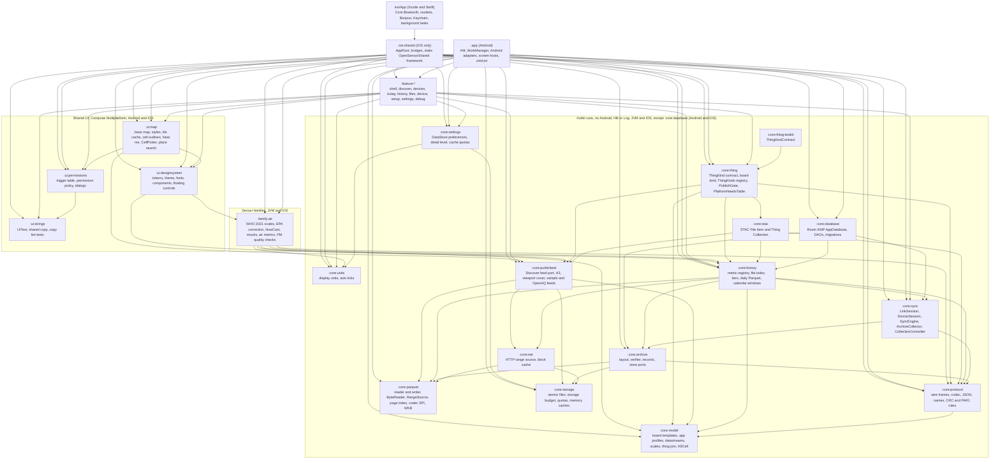
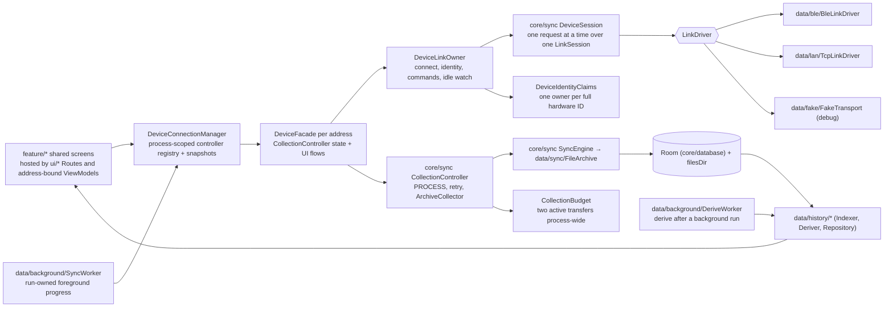

# Architecture of Android, iOS, shared modules, and what a change touches

**Scope:** module boundaries, dependency direction, package layout, and platform ownership.
**Code:** `settings.gradle.kts`, `build-logic/`, `core/*/build.gradle.kts`, `app/build.gradle.kts`, `build.gradle.kts` (`verify` task); `data/DeviceConnectionManager.kt`, `DeviceFacade.kt`, `DeviceLinkOwner.kt`, `CollectionAdmission.kt`, `DeviceIdentityClaims.kt`.
**Related:** [data-model.md](data-model.md) (storage), [transports.md](transports.md) · [sync-engine.md](sync-engine.md) · [history-pipeline.md](history-pipeline.md) (the layers in detail).

## Module graph

The module list is `settings.gradle.kts`, and each arrow below is a production `project(...)`
dependency of a `build.gradle.kts`. Test only dependencies are left out.

Each feature module takes only what its screen needs.

| Feature module | Depends on |
| --- | --- |
| `:feature:shell` | `:ui:designsystem`, `:ui:strings` |
| `:feature:discover` | `:core:history`, `:core:publicfeed`, `:core:settings`, `:core:units`, `:ui:designsystem`, `:ui:map` |
| `:feature:devices` | `:core:history`, `:core:settings`, `:core:sync`, `:ui:designsystem`, `:ui:permissions`, `:ui:strings` |
| `:feature:today` | `:core:history`, `:core:settings`, `:core:sync`, `:core:units`, `:ui:designsystem` |
| `:feature:history` | `:core:history`, `:core:settings`, `:core:units`, `:ui:designsystem`, `:ui:map` |
| `:feature:files` | `:core:history`, `:core:settings`, `:core:sync`, `:ui:designsystem`, `:ui:strings` |
| `:feature:device` | `:core:history`, `:core:publicfeed`, `:core:settings`, `:core:sync`, `:ui:designsystem`, `:ui:map`, `:ui:permissions` |
| `:feature:setup` | `:core:thing`, `:feature:device`, `:ui:permissions` |
| `:feature:settings` | `:core:settings`, `:core:units`, `:ui:designsystem` |
| `:feature:debug` | `:core:sync`, `:ui:designsystem` |

No `:core` module names air quality. `:family:air` (#188) holds the WHO 2021 scales and palette,
the EPA PM2.5 correction, the moods, the named air metrics, the PM sensor status and sticker, the
public cell summary, the PM NowCast (`PmNowCast`) and the quality checks (`QcRules`, `LiveQc`). It plugs in through the generic seams. `AirFamily` is a
`DerivedMetricProvider` that names its scales and capabilities, and `AirDiscover.COLLECTION` is the
bundled Discover scale set (`DiscoverCollection.installBundled`). Each app entry point installs it
at launch with one call, `AirFamily.install(kinds.metricProviders)`, when it builds its Thing kinds
(`ThingModule` on Android, `ThingKindsIos.kt` on iOS). Core
modules use it in their tests only, as the real fixture of the air boards. `CoreStaysAirFreeTest`
in `:family:air` fails the gate when a production source under `core/` names an air term.

`:core:history` exposes `:core:parquet` and `:core:protocol` as `api`, and
`:core:publicfeed` exposes `:core:parquet`, `:core:net` (its
`OpenAqAggregatesFeed` takes an `HttpRangeEngine` and reads through `HttpRangeSource`) and
kotlinx-datetime (daily rows carry a local date). `:core:net` exposes `:core:parquet`. Android
`DiscoverViewModel` (`OkHttpRangeEngine`) and iOS `AppRoot` (`UrlSessionRangeEngine`) each build one
`OpenAqAggregatesFeed` per process for Discover's Real source. A `:core` class cannot import
`android.*`, and the build enforces it. Every `:core` module compiles for JVM and iOS from
`src/commonMain`, except `:core:database`, which targets Android and iOS because Room ships
separate Android and iOS artifacts. Platform edges live in `src/jvmMain` (Java files, streams, positional `FileChannel` reads,
`java.util.zip`, `com.uber:h3`, OkHttp) and `src/iosMain` (`pread`, system zlib, H3 C
cinterop, `NSURLSession`).
Tests live in `src/commonTest` (JVM and iOS simulator) or `src/jvmTest` / `src/iosTest`. Calendar
windows use kotlinx-datetime. Android passes its `ZoneId` through `toKotlinTimeZone()`.

Every `:ui` and `:feature` module targets Android (the AGP KMP library target, not `jvm`) and
iOS. `:ios:shared` targets iOS only, so its `commonMain` consumes them directly, and its
`AppRoot` hosts the shared screens. `ios/App` supplies native app integration, Core Bluetooth,
sockets and Bonjour discovery, lifecycle, the Keychain and background tasks. Both platforms run
the shared sync engine and one shared collection controller per device, Android through
`DeviceFacade` and iOS through `SensorCollections`. See [ios.md](ios.md) for build commands.

Navigation is shared ([ADR 0001](adr/0001-shared-navigation.md)). `:feature:shell` holds the
sealed `AppKey : NavKey` hierarchy, `AppNavConfig` (a `SavedStateConfiguration` built with
`subclassesOfSealed`, so no reflection on iOS), the Compose free `TabNavigator` and `AppShell`, which
draws the one bottom bar around one Navigation 3 `NavDisplay` with a back stack per tab. It uses the
JetBrains `navigation3-ui` and `lifecycle-viewmodel-navigation3`, which resolve on Android to the
same androidx binaries. Both apps host `AppShell` and pass their screens in as entries. Android
entries keep `hiltViewModel()`, iOS entries hold plain controllers in a `viewModel { }` holder.
Screens that take Back first use `NavigationBackHandler`, never `BackHandler`.

## Build conventions (`build-logic/`)

`settings.gradle.kts` includes `build-logic/` through `pluginManagement { includeBuild(...) }`.
It holds five convention plugins, so a new shared module is one `plugins {}` line. SDK levels and
the bytecode target come from `OpenSensorConventions.kt`.

| Plugin | Applied by | Sets |
| --- | --- | --- |
| `opensensor.kmp.library` | every `:core` module except `:core:database`, and `:family:air` | Kotlin Multiplatform with `jvm`, `iosArm64`, `iosSimulatorArm64`, `kotlin-test` in `commonTest`, a `test` task that runs `jvmTest`. Adds `jvmTest` to `verify` and `iosSimulatorArm64Test` to `verifyIos` |
| `opensensor.kmp.android-library` | `:core:database` | the AGP KMP Android library target, `iosArm64`, `iosSimulatorArm64`, no Compose and no `jvm` target, `kotlin-test` in `commonTest`, a `test` task that runs `testAndroidHostTest`. Adds `testAndroidHostTest` to `verify` and `iosSimulatorArm64Test` to `verifyIos` |
| `opensensor.kmp.compose-feature` | every `:ui` and `:feature` module | the AGP KMP Android library target (namespace `space.opensensor.<module>`, Android resources, host tests), `iosArm64`, `iosSimulatorArm64`, Compose runtime, foundation, Material 3, UI and resources, internal resources class in `<namespace>.resources`, `kotlin-test` in `commonTest` (runs in the Android host test and on the simulator), a `test` task that runs `testAndroidHostTest`. Adds `testAndroidHostTest` to `verify` and `iosSimulatorArm64Test` to `verifyIos` |
| `opensensor.kmp.ios-framework` | `:ios:shared` | iOS only Kotlin Multiplatform with the static `OpenSensorShared` framework for each iOS target. Adds `iosSimulatorArm64Test` and `linkDebugFrameworkIosSimulatorArm64` to `verifyIos` |
| `opensensor.jvm.library` | `:tools:history-benchmark` | Kotlin/JVM with Java and Kotlin bytecode 17 |

The conventions compile against the Kotlin, Android and Compose Gradle plugins as `compileOnly`.
The root `build.gradle.kts` declares every plugin once with `apply false`, so all modules share one
plugin classloader. The shared modules' bytecode 17 is a compiler target, not `jvmToolchain(17)`, so the build needs one JDK only. `:app` keeps AGP's default JVM target.
Gradle runs on JDK 25, pinned in `gradle/gradle-daemon-jvm.properties`, which Android Studio, the terminal and CI
all follow ([build-and-release.md](build-and-release.md#build-jdk)). A `jvmToolchain(17)` would need a second JDK or a download.

The real Parquet fixtures live once in `core/parquet/src/test/resources` and are published as
`:core:parquet` test fixtures (a hand-declared variant with the `java-test-fixtures` capability,
because a multiplatform module cannot apply that plugin). `:core:history` and `:core:protocol` tests
declare `testFixtures(project(":core:parquet"))` instead of pointing at another module's
directory. `:app` also adds that directory to its unit-test resources.

### Gates

The root build registers `verify` and `verifyIos` and lists only the `:app` tasks (`lintDebug`,
`assembleDebug`, `testDebugUnitTest`). Each convention plugin adds its own module's test tasks
(`build-logic/src/main/kotlin/Gates.kt`), so a new module is gated as soon as it applies a
convention. On a Mac host `verify` also runs `verifyIos`. Set `-Popensensor.skipIos=true` to skip
it. `verifyIos` includes `:core:parquet:iosSimulatorArm64Test`, which decodes the real fixtures on
the simulator. `app/src/androidTest` is in neither gate.

## Layers inside `:app`

## Package map

| Path (under `app/src/main/java/space/opensensor/`) | Holds |
| --- | --- |
| `data/DeviceConnectionManager.kt`, `data/DeviceFacade.kt`, `data/DeviceLinkOwner.kt`, `data/TransportFactory.kt`, `data/AndroidLink.kt` | Process-owned registry, one facade and shared collection controller per address. The link owner owns transport, identity, commands and idle reconnect |
| `data/DeviceIdentityClaims.kt`, `data/CollectionAdmission.kt` | Full hardware identity claims, the two-transfer `CollectionBudget` and the admission that excludes worker and interactive collections |
| `data/ble/` | `BleScanner`, `BleLinkDriver` (GATT, serialized ops, `LinkDriver`), `BleDisconnectCauses` (pure status table), `BleBondAwaiter`, `BleStaleBondDetector` |
| `data/lan/` | `TcpLinkDriver` (`LinkDriver`), `SocketErrors` (pure errno table), `LanDiscovery` (NsdManager, shared resolver), `LanDiscoveryState` (foreground browse), `LanWifiLock` (transfer leases) |
| `data/sync/`, `data/archive/` | `FileArchive`, `FileArchiveStore` and the Hilt bindings of the shared planner, collector and engine |
| `data/background/` | `SyncForegroundService`, `SyncNotifications`, `SyncWorker`, `DeriveWorker`, `AutoSyncScheduler`, `AutoSyncRunner` (pure), `AppAutoSyncGateway`, and the triggers `CompanionPresence` + `CompanionPresenceService`, `AdvertFlagScan` + `AdvertScanReceiver`, `SyncTriggers` + `WifiArrivalReceiver` + `BootReceiver` |
| `data/history/` | `HistoryIndexer`, `HistoryDeriver`, `DailyDerived*`, `HistoryRepository`, `RoomHistoryTiers`, `parquet/AppParquetCodecs` (ZSTD) |
| `data/local/` | `di/DatabaseModule` (opens the shared `AppDatabase` of `:core:database`), `security/LanTokenCipher` and `SecureKnownDeviceDao` |
| `data/settings/`, `data/storage/` | The Android view of `:core:settings` (`AppSettings`, `DiscoverStore`) and of `:core:storage` (`AndroidStorageBudget`, `AppStorageControls`) |
| `data/di/` | `ThingModule` (the `ThingKinds` list), coroutine and data bindings |
| `data/fake/FakeTransport.kt` | In-process proto 3 device with fault hooks |
| `ui/` | Android hosts of the shared screens. `Navigation.kt` supplies the Android entries to the shared `AppShell` (`:feature:shell`), each `*Route.kt` and `*ViewModel.kt` hosts one `:feature` screen, `permissions/` launches the system dialogs, and `ui/files` adds the Android slots and the chart by file |

`DeviceSession`, `FrameRecorder`, `LanTokenPolicy`, `LanAutoEnable`, `DeviceContinuityPolicy`,
`SmartSyncPolicy` and `SyncEngine` are shared code in `core/sync/src/commonMain`.

The iOS entry point is `ios/OpenSensor.xcodeproj`. Its Swift adapters own Apple services;
`ios/shared` hosts the shared screens and holds the bridges to them. Follow [`../ios/AGENTS.md`](../ios/AGENTS.md)
for iOS-specific guidance. SwiftUI review rules apply only if native SwiftUI views are introduced.

| Core module | Ownership |
| --- | --- |
| `protocol` | Wire frames, codec, JSON models, names, CRC and Parquet completion rules |
| `parquet` | Closeable positional readers, zero-copy byte views, footer cache, page index, range planning, codecs and writer |
| `net` | HTTP range reads through OkHttp on JVM and NSURLSession on iOS |
| `history` | Metric registry, indexing, aggregation, calendars, grouped `DayPass`, daily output and persistent tiers |
| `publicfeed` | Discover feed port, the sample and OpenAQ feeds, H3 and viewport cover |
| `units` | Display units and axis ticks |
| `storage` | Durable/Derived/Scratch roots, atomic no-replace commits, free-space budget, quota and memory pressure |
| `archive` | Layout, verifier, records and store/index ports. Android uses file adapters, iosMain supplies `IosArchiveStore` and `LegacyReceiptImport` |
| `database` | The Room KMP schema (`AppDatabase`, entities, DAOs, migrations, exported schemas in `core/database/schemas/`) on the bundled SQLite driver, `RoomArchiveIndex` and `RoomPrunedFiles` for both phones. iosMain opens `Application Support/database/opensensor.db` through `IosArchiveDatabase` |
| `sync` | `LinkSession`, typed `DeviceSession` views, `SyncEngine`, `ArchiveCollector`, `CollectionController`, policies, progress and `StorageJanitor` |
| `settings` | Shared DataStore preferences, keys and detail level. iOS supplies its Application Support path and one-time UserDefaults import |
| `model` | Board templates, app profiles, datastreams, scales, `Thing.join` and the pure `H3Cell` check |
| `stac` | The STAC File Item and Thing Collection of a synced file, and `CanonicalJson` |
| `thing`, `thing:testkit` | The `ThingKind` contract, the `ThingKinds` registry, `PublishGate`, `PlatformNeedsTable` and the contract checks every kind runs |

### Shared sync rules in `:core:protocol`

- `ParquetVerify` is the one completion rule. A file is synced only when its size matches, its
  CRC-32 equals `OPENED.crc32`, and it starts and ends with `PAR1`. The size is checked first, so a
  short file is never hashed. Platform adapters measure size, CRC-32 and the head and tail bytes
  and pass them to the common `verify`. The JVM `File` and `InputStream` overloads and
  `sha256Hex` are extensions in `jvmMain`, so callers outside the package import them by name.
- `Crc32` is streaming (`update(bytes, offset, length)`, `value`, `reset`). The JVM uses
  `java.util.zip.CRC32`, iOS uses the table-driven `PortableCrc32`, and `commonTest` proves both
  agree with the IEEE check value and with each other.
- `SafeName.isValid` mirrors the firmware `safe_parquet_name()` rule. It allows only
  `[0-9a-z._=/-]`, rejects `..`, `//` and a leading `/`, needs a name before `.parquet`, and caps the
  name at 399 bytes, with a phone segment cap of 241 bytes so a `.partial.meta` or an older iOS build's
  `.verified.json` beside it still fits 255 bytes. The shared
  `SyncPlanner` uses it on both platforms.

### PM NowCast in `:family:air`

`PmNowCast.of(hourly)` is the US EPA NowCast for particles as AirNow publishes it
([#93](https://github.com/walkthru-earth/opensensor-space-mobile/issues/93)). It reads the 12 hourly
means before the running hour, needs two of the three latest, weighs each older hour by the lowest
over the highest hour floored at 0.5, leaves a missing hour out of both sums, and truncates PM2.5 to
0.1 µg/m³ and PM10 to 1 µg/m³. `pm25NowCast` in `:feature:today` feeds it the 12 whole UTC hours of
the phone archive's hourly tier before the current UTC hour, corrected PM2.5 first, then raw. Each
hour counts when any verified row is in it, there is no completeness threshold.

### PM quality checks in `:family:air`

`QcRules.flags(rows)` returns one `QcFlags` bitmask per `QcRow` and never changes a value
([#91](https://github.com/walkthru-earth/opensensor-space-mobile/issues/91)). `LiveQc` runs it over a
rolling window of the last 40 valid LIVE samples of one thing. LIVE is the same row the board
queues for storage, so the window gives the checks their neighbours. A sample read again (the same
`seq` and `mono`) joins once, and a new device or thing starts a new window. `TodayController` feeds
the flags of the newest sample to `NowReading`. A spike needs the row after it, so the newest live
sample is never a spike. The indexer and the daily builder store the flags beside the values, and
History and Discover show them, see
[Stored row checks](history-pipeline.md#stored-row-checks-91).

| Bit | Flag | Rule |
| --- | --- | --- |
| 1 | `PM25_ABOVE_PM10` | PM2.5 above PM10 by more than 1 µg/m³, the rounding of two whole µg/m³ values |
| 2 | `FLATLINE` | All particle count bins unchanged for 30 or more neighbouring rows |
| 4 | `SPIKE` | One row steps away from both neighbours by more than 20 µg/m³ and 20 percent (twice the PMS5003 datasheet consistency), with no count bin moving the same way by half the relative mass change |
| 8 | `HIGH_HUMIDITY` | RH above 85 percent, only on boards with RH |

Rows are neighbours when the later one comes at most three median steps after the earlier one.
A longer step, a repeated time or a time going back ends a flatline run and clears a spike. A missing
measurement is `NaN` or null counts, and the check that needs it does nothing. The bit values are
part of the derived tier format, so a bit is never reused or renumbered.

## Rules that keep the modules honest

- **Pure modules receive plain records, never entities.** `ArchivedFile.info()` → `IndexedFileInfo`; `HistoryIndexer` wraps `ParquetIndexer`. Room's KSP also refuses an entity implementing an interface from another module ([lessons](lessons-learned.md#build--tooling)).
- **A new sensor is a registry entry** in `Metrics` (`:core:history`), not code. See [history-pipeline.md](history-pipeline.md#metric-registry).
- **A new analysis is a pure object in `:core:history`** with a test over the real fixtures, fed by `:app` from Room/files. Never a query inside a composable.
- **A new transport is a `LinkDriver`** behind `TransportFactory` and one `LinkSession` (`DeviceTransport` remains a compatibility surface); the session, engine and archive do not change ([transports.md](transports.md)).
- **Transport work never lives in a composable or Activity**; manager-owned controllers keep session/sync state through rotation and navigation. Opening another device selects another controller without closing existing connections.
- **The one native Android library** is `zstd-jni` (`@aar`), registered from `:app` into `:core:parquet`'s codec SPI (`AppParquetCodecs`). iOS inflates GZIP with the system zlib and has no ZSTD codec.

## Concurrent collection and ownership

`DeviceFacade` owns collection intent and UI projections. Its shared `CollectionController`
owns active retries and leases. `DeviceLinkOwner` serializes physical connection changes,
manual commands and idle reconnect, and publishes live readings, manifest, controls and events. Address-bound ViewModels observe only that controller. The manager
publishes device snapshots for Home and notifications. `AutoSyncRunner` visits up to two devices
concurrently; a shared `CollectionBudget` also caps active interactive and worker transfers together
at two. `CollectionAdmission` atomically prevents worker and interactive collections from
overlapping, including preparation, waiting and cleanup. Per-device reservation is atomic
with command admission. This is a conservative software policy, **not a measured Android BLE connection limit**.

A worker claims its controller with its WorkManager run ID. An existing session or reconnect for
that device prevents a background claim; a connection to another device does not. Interactive
reconnect, sync and device commands cannot hijack a worker-owned controller; UI configuration
controls treat worker ownership as busy. Once `info` is verified, `DeviceIdentityClaims`
prevents two endpoint aliases from owning the same full hardware ID. Session close cancels and
joins the transfer before closing the pipe and releasing its identity claim. Reconnect, cancellation
and progress remain per device. Worker cancellation closes only that run's sessions.

The proto 3 firmware has one logical file handle per BLE connection and per LAN peer.
Android still prevents endpoint aliases from concurrently claiming one physical device on
the same phone. This phone policy is separate from firmware's independent peer handles.
The owner contract is [`../opensensor-space-firmware/docs/shared/ble-sync-protocol.md`](../../opensensor-space-firmware/docs/shared/ble-sync-protocol.md).

The archive's one `DeviceCoordinator` (`core/sync`), through its writer lease in `SyncEngine`, serializes the entire OPEN/read/verify/commit/index/CLOSE sequence for
one `(thing, name)`, with cancellable waiters; different identities transfer independently.
An existing destination must verify against OPENED size/CRC/PAR1 and its recorded SHA-256 before
reuse. A conflict preserves existing bytes and provenance; commit refuses to replace a destination.
Reuse returns `alreadyArchived` so background summaries count only newly collected files. Hive
paths remain verbatim. `LanWifiLock` uses owner-specific, idempotently closed leases: the first
active LAN transfer acquires the radio lock and the last releases it. BLE and queued transfers hold
no Wi-Fi lease. API 31–33 mDNS resolution uses one shared resolver queue across foreground and
worker browses.

These rules are covered by host tests (`AutoSyncRunnerTest`, `DeviceOwnershipTest`,
`ConcurrentArchiveTest`, `LanTransferLeasesTest`). Phone evidence is in [status.md](status.md) and
the [CoreS3 bench record](../../opensensor-space-firmware/docs/boards/m5stack-cores3/bench-verified.md).

History derives a grouped day once with `DayPass`, producing tiers and daily Parquet.
Android stamps each derived day with `HistoryDeriver.DERIVE_VERSION`. Its collection plans use projected thing archive identities rather
than full history rows. iOS persists tiers and enforces the derived quota after building.
The [host benchmark](perf/history-2026-10-11.md) measures allocation on a synthetic corpus,
not phone cold-open latency or a qualified latency improvement.

## Uses → affects (edit here, check there)

| If you change… | It is consumed by… | So re-check… |
| --- | --- | --- |
| `core/protocol/Frames.kt` (opcodes, layouts) | `DeviceSession`, `FakeTransport`, `FrameRecorder`, `DebugScreen` raw box | the firmware contract first (owner), `FrameCodec*Test`, the fake |
| `DeviceTransport` interface | `BleLinkDriver`, `TcpLinkDriver`, `FakeTransport` (through `TransportLink`), `DeviceSession`, `DeviceLinkOwner` | `TcpLinkDriverTest` loopback, `:core:sync` `SyncEngineTest` |
| `Metrics` registry | `Aggregator`, `HistoryDeriver`, `DailyDerivedBuilder`, History picker, charts, Today cards | `AggregationTest`, `HistoryDeriverTest`, Room `metric_bucket` rows (id strings) |
| Room entities | `SyncEngine`, `HistoryIndexer/Deriver/Repository`, ViewModels | a new migration + `core/database/schemas/<n>.json`, `DERIVE_VERSION` if tier meaning changed |
| `ParquetWriter` output | `DailyDerivedBuilder`, `tools/validate_parquet_samples.py` | PyArrow + DuckDB oracle run |
| `CollectionState` / `SyncProgress` | facade UI projections, Files, service and worker | `CollectionControllerTest`, facade tests, lease accounting and notification text |
| Manager/controller ownership, transfer budget | address-bound ViewModels, runner, worker, foreground service | `DeviceOwnershipTest`, `AutoSyncRunnerTest`, cancellation and per-device progress |
| `DeviceCoordinator` admission and writer leases / immutable commit | `SyncEngine`, partial resume, janitor, index repair, old file cleanup, archive index and export | `DeviceCoordinatorTest`, `ConcurrentArchiveTest`, `SyncEngineTest`; preserve existing files on conflicts |
| `HistoryStartup` and `HistoryOrchestrator` pass order | janitor, feed block quota, back-fill and its retry, time estimates and every derive pass on both phones | `HistoryOrchestratorTest`, `AppStartupTest`, `IosArchiveStartupTest`, `TierStoreTest`, `ThingDaysTest` |
| LAN transfer leases / shared mDNS resolver | all interactive and worker LAN transfers | `LanTransferLeasesTest`; phone checks on API 31–33 and screen-off LAN |
| `DetailLevel` | every screen's `level.detailed` and `level.developer` gate, Debug destination | `SettingsRepositoryTest`, the `advanced_mode` key written beside it |
