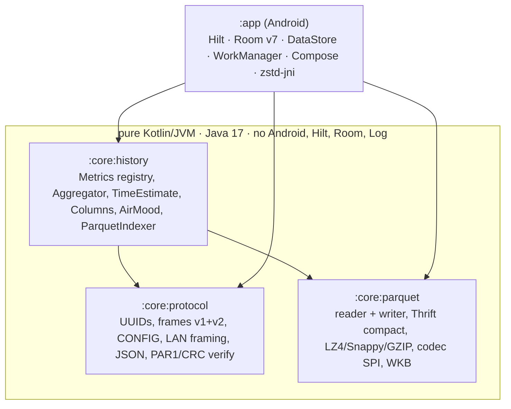
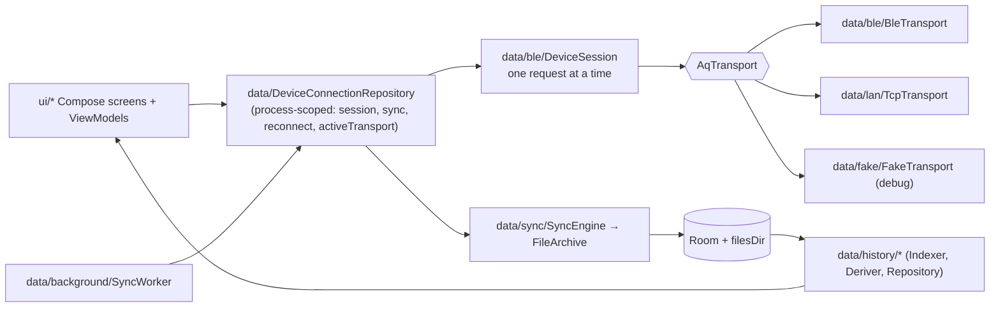

# Architecture — modules, layers, and what a change touches

**Scope:** module boundaries, dependency direction, package layout, the three "pure" modules vs `:app`.
**Code:** `settings.gradle.kts`, `core/*/build.gradle.kts`, `app/build.gradle.kts`, `build.gradle.kts` (`verify` task).
**Related:** [data-model.md](data-model.md) (storage), [transports.md](transports.md) · [sync-engine.md](sync-engine.md) · [history-pipeline.md](history-pipeline.md) (the layers in detail).

## Module graph

`:core:history` exposes `:core:parquet` and `:core:protocol` as `api`, so `:app` sees all three.
The boundary is enforced by the build: a `:core` class cannot import `android.*`. The pure side is
what the iOS app transliterates and what a hub/laptop tool can reuse unchanged.

## Layers inside `:app`

## Package map

| Path (under `app/src/main/java/earth/walkthru/aqsync/`) | Holds | Android-only? |
| --- | --- | --- |
| `data/DeviceConnectionRepository.kt`, `data/TransportFactory.kt` | The one place that picks a transport, owns the session, sync state, reconnect loop, `activeTransport` flow | yes |
| `data/ble/` | `BleScanner`, `BleTransport` (GATT, serialized ops), `DeviceSession` (every request), `FrameRecorder` (last 200 frames, redacts) | yes |
| `data/lan/` | `TcpTransport`, `LanDiscovery` (NsdManager), `LanWifiLock`, `LanTokenPolicy` (pure) | yes (policy: no) |
| `data/sync/` | `SyncPlanner`, `SyncEngine`, `FileArchive`, `ReadWindow`, `SyncResumePolicy` | files + Room |
| `data/background/` | `SyncForegroundService`, `SyncNotifications`, `SyncWorker`, `AutoSyncScheduler`, `AutoSyncRunner` (pure), `AppAutoSyncGateway` | yes (runner: no) |
| `data/history/` | `HistoryIndexer`, `HistoryDeriver`, `DailyDerived*`, `HistoryRepository`, `parquet/AppParquetCodecs` (ZSTD) | Room + files |
| `data/local/database/` | `AppDatabase` (v7), `KnownDevice`, `ArchivedFile`, `History.kt` (`MetricBucket`, `DerivedDay`) | yes |
| `data/settings/AppSettings.kt` | DataStore: `DetailLevel` Simple · Detailed · Developer | yes |
| `data/export/ExportManager.kt` | share / zip / SAF | yes |
| `data/fake/FakeTransport.kt` | in-process protocol-v2 device with fault hooks | no (JVM) |
| `ui/scan · device (Today, Device, NowCard) · history · files · debug · settings · permissions · theme` | Compose; `Navigation.kt`, `NavigationKeys.kt` | yes |

| `:core` module (`core/<m>/src/main/kotlin/earth/walkthru/aqsync/`) | Files |
| --- | --- |
| `protocol` → `data/protocol/` | `AqUuids`, `Frames`, `DeviceConfig`, `LanFraming`, `JsonModels`, `ParquetVerify` |
| `parquet` → `data/history/parquet/` | `ParquetFile`, `ParquetFooterParser`, `ParquetMetadata`, `ColumnValues`, `ParquetWriter`, `ThriftCompact(+Writer)`, `Lz4Block`, `ParquetCodecs`, `Geometry`, `GeoParquetMetadata` |
| `history` → `data/history/` | `Metrics`, `Aggregation`, `TimeEstimate`, `Columns`, `AirMood`, `HistoryModel`, `FileSummary`, `ParquetIndexer` |

## Rules that keep the modules honest

- **Pure modules receive plain records, never entities.** `ArchivedFile.info()` → `IndexedFileInfo`; `HistoryIndexer` wraps `ParquetIndexer`. Room's KSP also refuses an entity implementing an interface from another module ([lessons](lessons-learned.md#build--tooling)).
- **A new sensor is a registry entry** in `Metrics` (`:core:history`), not code — see [history-pipeline.md](history-pipeline.md#metric-registry).
- **A new analysis is a pure object in `:core:history`** with a test over the real fixtures, fed by `:app` from Room/files. Never a query inside a composable.
- **A new transport is an `AqTransport`** implementation behind `TransportFactory`; the session, engine and archive do not change ([transports.md](transports.md)).
- **Transport work never lives in a composable or Activity**; session/sync state is process-scoped in the repository so rotation does not abort a transfer.
- **The one native library** is `zstd-jni` (`@aar`), registered from `:app` into `:core:parquet`'s codec SPI (`AppParquetCodecs`). `:core:*` stays JVM-only.

## Uses → affects (edit here, check there)

| If you change… | It is consumed by… | So re-check… |
| --- | --- | --- |
| `core/protocol/Frames.kt` (opcodes, layouts) | `DeviceSession`, `FakeTransport`, `FrameRecorder`, `DebugScreen` raw box | the firmware contract first (owner), `FrameCodec*Test`, the fake |
| `AqTransport` interface | `BleTransport`, `TcpTransport`, `FakeTransport`, `DeviceSession`, repository | `TcpTransportTest` loopback, `WindowRecoveryTest` |
| `Metrics` registry | `Aggregator`, `HistoryDeriver`, `DailyDerivedBuilder`, History picker, charts, Now card | `AggregationTest`, `HistoryDeriverTest`, Room `metric_bucket` rows (id strings) |
| Room entities | `SyncEngine`, `HistoryIndexer/Deriver/Repository`, ViewModels | a new migration + `app/schemas/<n>.json`, `DERIVE_VERSION` if tier meaning changed |
| `ParquetWriter` output | `DailyDerivedBuilder`, `tools/validate_parquet_samples.py` | PyArrow + DuckDB oracle run |
| `SyncProgress` / `SyncEndCause` | Files screen, `SyncForegroundService`, `SyncWorker`, `SyncResumePolicy` | `SyncResumePolicyTest`, notification text |
| `DetailLevel` | every screen's `detailed`/`advancedMode` gate, Debug destination | migration from `advanced_mode` |

## Provenance

Generated from Google's `android/architecture-templates` (`base` branch) with
`customizer.sh earth.walkthru.aqsync Device "AQ Sync"`; the untouched output is commit `34f2d30`
(first commit "Generate from android/architecture-templates base"). Keep the template's structure
(Hilt, Room, Navigation 3, version catalog). Everything after it is diffable against that.
