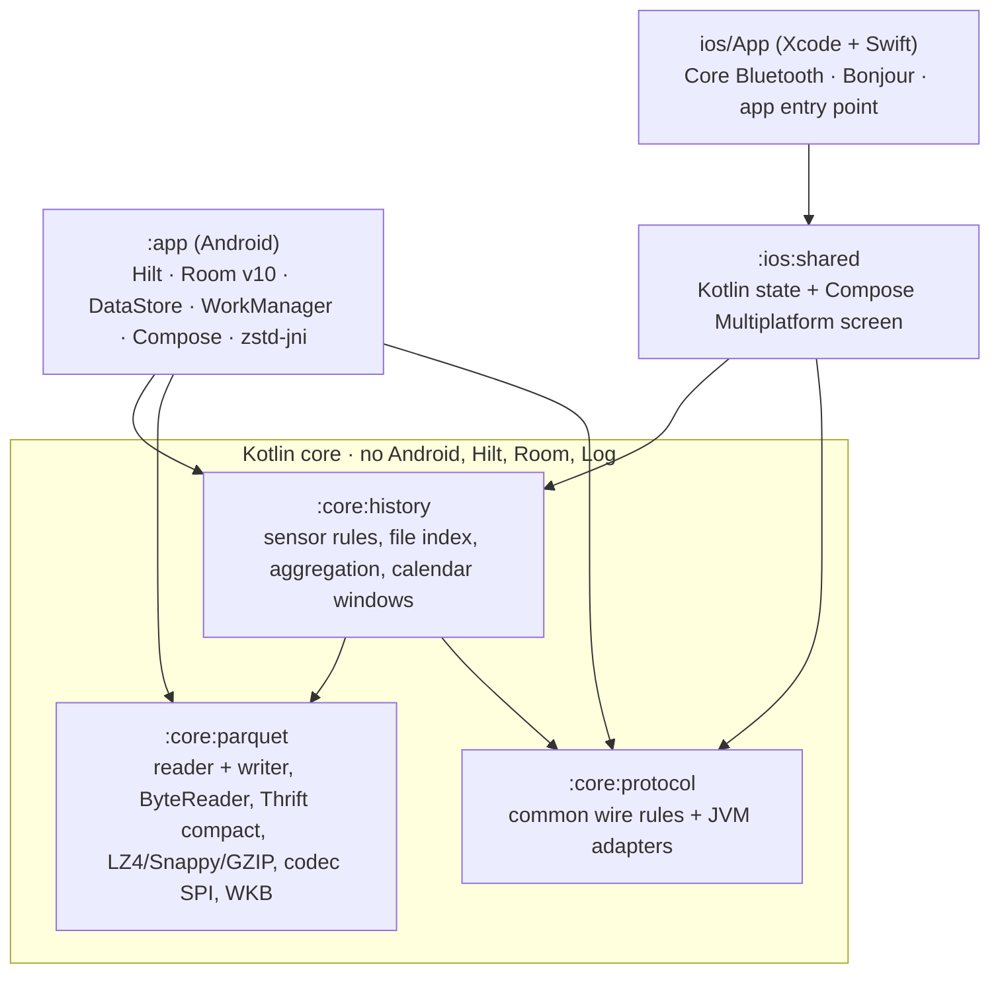
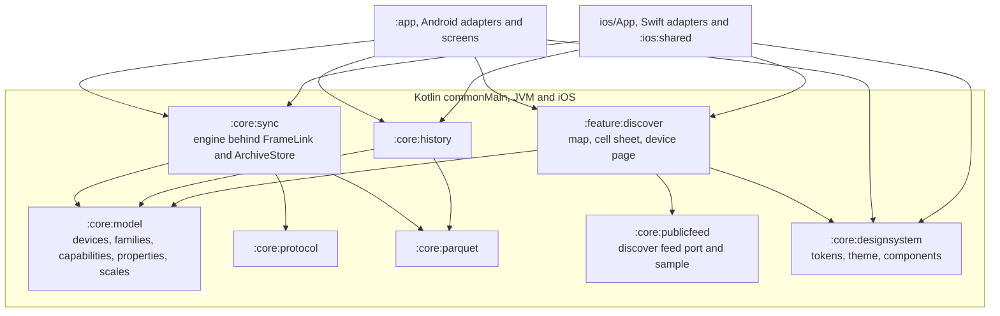
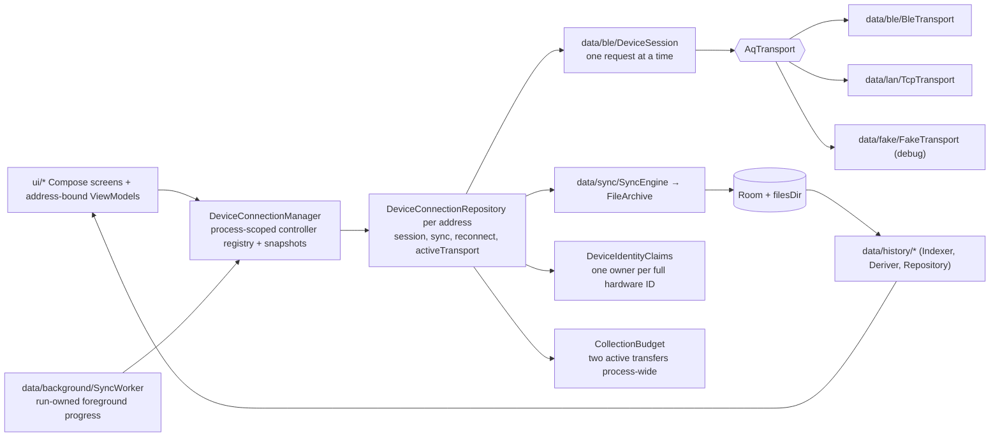

# Architecture of Android, iOS, shared modules, and what a change touches

**Scope:** module boundaries, dependency direction, package layout, and platform ownership.
**Code:** `settings.gradle.kts`, `build-logic/`, `core/*/build.gradle.kts`, `app/build.gradle.kts`, `build.gradle.kts` (`verify` task); `data/DeviceConnectionManager.kt`, `DeviceConnectionRepository.kt`, `DeviceIdentityClaims.kt`.
**Related:** [data-model.md](data-model.md) (storage), [transports.md](transports.md) · [sync-engine.md](sync-engine.md) · [history-pipeline.md](history-pipeline.md) (the layers in detail).

## Module graph

`:core:history` exposes `:core:parquet` and `:core:protocol` as `api`, so Android can see all three.
The boundary is enforced by the build. A `:core` class cannot import `android.*`.
`protocol`, `parquet` and `history` compile for JVM and iOS from `src/commonMain`. Their platform
edges live in `src/jvmMain` (Java files, streams, `FileChannel` mapping, `java.util.zip`) and
`src/iosMain` (`NSData` mapping, system zlib), and their tests in `src/commonTest` (JVM and iOS
simulator) or `src/jvmTest` / `src/iosTest`. Calendar windows use kotlinx-datetime. Android passes
its `ZoneId` through `toKotlinTimeZone()`. `:ios:shared` consumes common core
rules and renders the current Compose iOS screen. `ios/App` supplies native app integration,
Core Bluetooth and Bonjour discovery. The Android app remains a separate platform entry point.
See [ios-migration.md](ios-migration.md) for current scope and build commands.

### Target module graph

The graph above is today's code. The production plan moves toward the graph below, where every
rule that must give the same answer on both phones is shared and platform code only adapts OS
services. Device families and metrics become data in `:core:model`, so air quality is one
family among many. See [production-readiness-plan.md](production-readiness-plan.md) and
[devices-and-discovery.md](devices-and-discovery.md).

## Build conventions (`build-logic/`)

`settings.gradle.kts` includes `build-logic/` through `pluginManagement { includeBuild(...) }`.
It holds three convention plugins, so a new shared module is one `plugins {}` line.

| Plugin | Applied by | Sets |
| --- | --- | --- |
| `opensensor.kmp.library` | `:core:protocol`, `:core:parquet`, `:core:history` | Kotlin Multiplatform with `jvm` (bytecode 17), `iosArm64`, `iosSimulatorArm64`, `kotlin-test` in `commonTest`, and a `test` task that runs `jvmTest` |
| `opensensor.jvm.library` | none today (kept for a future JVM-only module) | Kotlin/JVM with Java and Kotlin bytecode 17 |
| `opensensor.kmp.ios-framework` | `:ios:shared` | the KMP library conventions plus the static `OpenSensorShared` framework for each iOS target |

The conventions compile against the Kotlin Gradle plugin as `compileOnly`. The root
`build.gradle.kts` declares every plugin once with `apply false`, so all modules share one plugin
classloader. Bytecode 17 is a compiler target, not `jvmToolchain(17)`, because the bundled Android
Studio JBR and CI provide JDK 21 only and a toolchain would need a network download.
Warnings are not errors yet, since existing code still has a few.

The real Parquet fixtures live once in `core/parquet/src/test/resources` and are published as
`:core:parquet` test fixtures (a hand-declared variant with the `java-test-fixtures` capability,
because a multiplatform module cannot apply that plugin). `:core:history` and `:core:protocol` tests
declare `testFixtures(project(":core:parquet"))` instead of pointing at another module's
directory. `:app` still adds that directory to its unit-test resources.

The root `verify` and `verifyIos` tasks aggregate the module tasks. `verifyIos` includes
`:core:parquet:iosSimulatorArm64Test`, which decodes the real fixtures on the simulator.

## Layers inside `:app`

## Package map

| Path (under `app/src/main/java/earth/walkthru/aqsync/`) | Holds | Android-only? |
| --- | --- | --- |
| `data/DeviceConnectionManager.kt`, `data/DeviceConnectionRepository.kt`, `data/TransportFactory.kt` | Process-owned registry; one bound controller per public BLE address owns its transport, session, state and reconnect; factory creates the pipes | yes |
| `data/DeviceIdentityClaims.kt`, `data/DeviceContinuityPolicy.kt` | Shared two-transfer budget; full hardware identity claims and authenticated continuity policy | no (JVM logic with DI bindings) |
| `data/ble/` | `BleScanner`, `BleTransport` (GATT, serialized ops), `DeviceSession` (every request), `FrameRecorder` (last 200 frames, redacts) | yes |
| `data/lan/` | `TcpTransport`, `LanDiscovery` (NsdManager, shared legacy resolver), `LanDiscoveryState` (foreground browse), `LanWifiLock` (transfer leases), `LanTokenPolicy` (pure) | yes (policy/lease accounting: no) |
| `data/sync/` | `SyncPlanner`, `SyncEngine`, `FileArchive`, `ReadWindow`, `SyncResumePolicy` | files + Room |
| `data/background/` | `SyncForegroundService`, `SyncNotifications`, `SyncWorker`, `AutoSyncScheduler`, `AutoSyncRunner` (pure), `AppAutoSyncGateway`; triggers `CompanionPresence` + `CompanionPresenceService`, `AdvertFlagScan` + `AdvertScanReceiver`, `SyncTriggers` + `WifiArrivalReceiver` + `BootReceiver` | yes (runner: no) |
| `data/history/` | `HistoryIndexer`, `HistoryDeriver`, `DailyDerived*`, `HistoryRepository`, `parquet/AppParquetCodecs` (ZSTD) | Room + files |
| `data/local/database/` | `AppDatabase` (v9), `KnownDevice`, `StationEpoch`, `ArchivedFile`, `History.kt` (`MetricBucket`, `DerivedDay`) | yes |
| `data/settings/AppSettings.kt` | DataStore: `DetailLevel` Simple · Detailed · Developer | yes |
| `data/export/ExportManager.kt` | share / zip / SAF | yes |
| `data/fake/FakeTransport.kt` | in-process protocol-v2 device with fault hooks | no (JVM) |
| `ui/scan · device (Today, Device, NowCard) · history · files · debug · settings · permissions · theme` | Compose; `Navigation.kt`, `NavigationKeys.kt` | yes |

The iOS entry point is `ios/OpenSensor.xcodeproj`. Its Swift adapters own Apple services;
the current screen and presentation state live in `ios/shared`. Follow [`../ios/AGENTS.md`](../ios/AGENTS.md)
for iOS-specific guidance. SwiftUI review rules apply only if native SwiftUI views are introduced.

| `:core` module (`core/<m>/src/<set>/kotlin/earth/walkthru/aqsync/`) | Files |
| --- | --- |
| `protocol` → `data/protocol/` | `commonMain`: `AqGatt`, `Frames`, `WireBuffer`, `DeviceConfig`, `ConfigChunkAccumulator`, `JsonModels`, `LanProtocol`, `Advertisement`, `LiveProfile`, `PlantowerBatchCandidate`, `Crc32` (`expect`), `ParquetVerify`, `SafeName`. `jvmMain`: `AqUuids`, `LanFraming`, `Crc32` (`java.util.zip`), `ParquetVerifyJvm` (file, stream and SHA-256 extensions). `iosMain`: `Crc32` (portable table) |
| `parquet` → `data/history/parquet/` | `commonMain`: `ParquetFile`, `SuspendParquetFile`, `ByteReader`, `SuspendByteReader`, `LocalFile` (`expect`), `ParquetFooterParser`, `ParquetMetadata`, `ColumnValues`, `ParquetWriter`, `ParquetSink`, `ThriftCompact(+Writer)`, `Lz4Block`, `ParquetCodecs`, `Geometry`, `GeoParquetMetadata`. `jvmMain`: `MappedFileReader`, gzip, `ParquetWriter(OutputStream, …)`, `OutputStreamSink`. `iosMain`: `MappedDataReader`, gzip (zlib) |
| `history` → `data/history/` | `commonMain`: `Metrics`, `AirMood`, `TimeEstimate`, `Aggregation`, `ChartAxis`, `Columns`, `HistoryModel`, `HistoryWindow`, `FileSummary`, `ParquetIndexer` |

### Shared sync rules in `:core:protocol`

- `ParquetVerify` is the one completion rule. A file is synced only when its size matches, its
  CRC-32 equals `OPENED.crc32`, and it starts and ends with `PAR1`. The size is checked first, so a
  short file is never hashed. Platform adapters measure size, CRC-32 and the head and tail bytes
  and pass them to the common `verify`. The JVM `File` and `InputStream` overloads and
  `sha256Hex` are extensions in `jvmMain`, so callers outside the package import them by name.
- `Crc32` is streaming (`update(bytes, offset, length)`, `value`, `reset`). The JVM uses
  `java.util.zip.CRC32`, iOS uses the table-driven `PortableCrc32`, and `commonTest` proves both
  agree with the IEEE check value and with each other.
- `SafeName.isValid` mirrors the firmware `safe_parquet_name()` rule. It allows only
  `[0-9a-z._=/-]`, rejects `..`, `//` and a leading `/`, needs a name before `.parquet`, and caps the
  name at 399 bytes. Android `data/sync/SyncPlanner.kt` still has its own copy with a 512 limit
  until the data layer switches to this one.

## Rules that keep the modules honest

- **Pure modules receive plain records, never entities.** `ArchivedFile.info()` → `IndexedFileInfo`; `HistoryIndexer` wraps `ParquetIndexer`. Room's KSP also refuses an entity implementing an interface from another module ([lessons](lessons-learned.md#build--tooling)).
- **A new sensor is a registry entry** in `Metrics` (`:core:history`), not code — see [history-pipeline.md](history-pipeline.md#metric-registry).
- **A new analysis is a pure object in `:core:history`** with a test over the real fixtures, fed by `:app` from Room/files. Never a query inside a composable.
- **A new transport is an `AqTransport`** implementation behind `TransportFactory`; the session, engine and archive do not change ([transports.md](transports.md)).
- **Transport work never lives in a composable or Activity**; manager-owned controllers keep session/sync state through rotation and navigation. Opening another device selects another controller without closing existing connections.
- **The one native Android library** is `zstd-jni` (`@aar`), registered from `:app` into `:core:parquet`'s codec SPI (`AppParquetCodecs`). `:core:parquet` and file-backed history stay JVM-only; protocol and sensor-domain rules target JVM and iOS.

## Concurrent collection and ownership

Each controller serializes connection changes and owns its own transfer/reconnect jobs, live readings,
manifest, controls and events. Address-bound ViewModels observe only that controller. The manager
publishes device snapshots for Home and notifications. `AutoSyncRunner` visits up to two devices
concurrently; a shared `CollectionBudget` also caps active interactive and worker transfers together
at two. This is a conservative software policy, **not a measured Android BLE connection limit**.

A worker claims its controller with its WorkManager run ID. An existing session or reconnect for
that device prevents a background claim; a connection to another device does not. Interactive
reconnect, sync and device commands cannot hijack a worker-owned controller; UI configuration
controls treat worker ownership as busy. Once `info` is verified, `DeviceIdentityClaims`
prevents two endpoint aliases from owning the same full hardware ID. Session close cancels and
joins the transfer before closing the pipe and releasing its identity claim. Reconnect, cancellation
and progress remain per device. Worker cancellation closes only that run's sessions.

The firmware still has **one open file per physical device across BLE and LAN**. Separate devices
can transfer together; concurrent transports to the same board cannot independently open files.
The owner contract is [`../aq-parquet/docs/shared/ble-sync-protocol.md`](../../aq-parquet/docs/shared/ble-sync-protocol.md).

`FileArchive.withWriterLease` serializes the entire OPEN/read/verify/commit/index/CLOSE sequence for
one `(station, name)`, with cancellable waiters; different identities transfer independently.
An existing destination must verify against OPENED size/CRC/PAR1 and its recorded SHA-256 before
reuse. A conflict preserves existing bytes and provenance; commit refuses to replace a destination.
Reuse returns `alreadyArchived` so background summaries count only newly collected files. Hive
paths remain verbatim. `LanWifiLock` uses owner-specific, idempotently closed leases: the first
active LAN transfer acquires the radio lock and the last releases it. BLE and queued transfers hold
no Wi-Fi lease. API 31–33 mDNS resolution uses one shared resolver queue across foreground and
worker browses.

These changes are covered by host tests (`AutoSyncRunnerTest`, `DeviceOwnershipTest`,
`ConcurrentArchiveTest`, `LanTransferLeasesTest`). Simultaneous physical-device collection and the
new Android plumbing have **not been verified on hardware**. Historical phone measurements remain
in the [CoreS3 bench record](../../aq-parquet/docs/boards/m5stack-cores3/bench-verified.md).

## Uses → affects (edit here, check there)

| If you change… | It is consumed by… | So re-check… |
| --- | --- | --- |
| `core/protocol/Frames.kt` (opcodes, layouts) | `DeviceSession`, `FakeTransport`, `FrameRecorder`, `DebugScreen` raw box | the firmware contract first (owner), `FrameCodec*Test`, the fake |
| `AqTransport` interface | `BleTransport`, `TcpTransport`, `FakeTransport`, `DeviceSession`, repository | `TcpTransportTest` loopback, `WindowRecoveryTest` |
| `Metrics` registry | `Aggregator`, `HistoryDeriver`, `DailyDerivedBuilder`, History picker, charts, Now card | `AggregationTest`, `HistoryDeriverTest`, Room `metric_bucket` rows (id strings) |
| Room entities | `SyncEngine`, `HistoryIndexer/Deriver/Repository`, ViewModels | a new migration + `app/schemas/<n>.json`, `DERIVE_VERSION` if tier meaning changed |
| `ParquetWriter` output | `DailyDerivedBuilder`, `tools/validate_parquet_samples.py` | PyArrow + DuckDB oracle run |
| `SyncProgress` / `SyncEndCause` | Files screen, `SyncForegroundService`, `SyncWorker`, `SyncResumePolicy` | `SyncResumePolicyTest`, notification text |
| Manager/controller ownership, transfer budget | address-bound ViewModels, runner, worker, foreground service | `DeviceOwnershipTest`, `AutoSyncRunnerTest`, cancellation and per-device progress |
| Archive writer leases / immutable commit | `SyncEngine`, partial resume, archive index and export | `ConcurrentArchiveTest`, `WindowRecoveryTest`; preserve existing files on conflicts |
| LAN transfer leases / shared mDNS resolver | all interactive and worker LAN transfers | `LanTransferLeasesTest`; phone checks on API 31–33 and screen-off LAN |
| `DetailLevel` | every screen's `detailed`/`advancedMode` gate, Debug destination | migration from `advanced_mode` |

## Provenance

Generated from Google's `android/architecture-templates` (`base` branch) with
`customizer.sh earth.walkthru.aqsync Device "AQ Sync"`; the untouched output is commit `34f2d30`
(first commit "Generate from android/architecture-templates base"). Keep the template's structure
(Hilt, Room, Navigation 3, version catalog). Everything after it is diffable against that.
