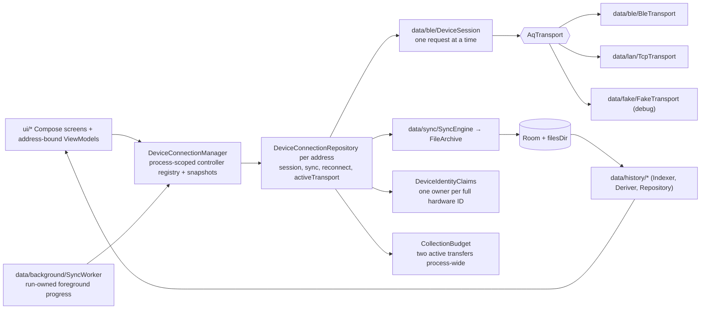

# Architecture — modules, layers, and what a change touches

**Scope:** module boundaries, dependency direction, package layout, the three "pure" modules vs `:app`.
**Code:** `settings.gradle.kts`, `core/*/build.gradle.kts`, `app/build.gradle.kts`, `build.gradle.kts` (`verify` task); `data/DeviceConnectionManager.kt`, `DeviceConnectionRepository.kt`, `DeviceIdentityClaims.kt`.
**Related:** [data-model.md](data-model.md) (storage), [transports.md](transports.md) · [sync-engine.md](sync-engine.md) · [history-pipeline.md](history-pipeline.md) (the layers in detail).

## Module graph

`:core:history` exposes `:core:parquet` and `:core:protocol` as `api`, so `:app` sees all three.
The boundary is enforced by the build: a `:core` class cannot import `android.*`. The pure side is
what the iOS app transliterates and what a hub/laptop tool can reuse unchanged.

## Layers inside `:app`

## Package map

| Path (under `app/src/main/java/earth/walkthru/aqsync/`) | Holds | Android-only? |
| --- | --- | --- |
| `data/DeviceConnectionManager.kt`, `data/DeviceConnectionRepository.kt`, `data/TransportFactory.kt` | Process-owned registry; one bound controller per public BLE address owns its transport, session, state and reconnect; factory creates the pipes | yes |
| `data/DeviceIdentityClaims.kt`, `data/DeviceContinuityPolicy.kt` | Shared two-transfer budget; full hardware identity claims and authenticated continuity policy | no (JVM logic with DI bindings) |
| `data/ble/` | `BleScanner`, `BleTransport` (GATT, serialized ops), `DeviceSession` (every request), `FrameRecorder` (last 200 frames, redacts) | yes |
| `data/lan/` | `TcpTransport`, `LanDiscovery` (NsdManager, shared legacy resolver), `LanDiscoveryState` (foreground browse), `LanWifiLock` (transfer leases), `LanTokenPolicy` (pure) | yes (policy/lease accounting: no) |
| `data/sync/` | `SyncPlanner`, `SyncEngine`, `FileArchive`, `ReadWindow`, `SyncResumePolicy` | files + Room |
| `data/background/` | `SyncForegroundService`, `SyncNotifications`, `SyncWorker`, `AutoSyncScheduler`, `AutoSyncRunner` (pure), `AppAutoSyncGateway`; triggers `CompanionPresence` + `CompanionPresenceService`, `AdvertFlagScan` + `AdvertScanReceiver`, `SyncTriggers` + `WifiArrivalReceiver` + `BootReceiver` | yes (runner: no) |
| `data/history/` | `HistoryIndexer`, `HistoryDeriver`, `DailyDerived*`, `HistoryRepository`, `parquet/AppParquetCodecs` (ZSTD) | Room + files |
| `data/local/database/` | `AppDatabase` (v9), `KnownDevice`, `StationEpoch`, `ArchivedFile`, `History.kt` (`MetricBucket`, `DerivedDay`) | yes |
| `data/settings/AppSettings.kt` | DataStore: `DetailLevel` Simple · Detailed · Developer | yes |
| `data/export/ExportManager.kt` | share / zip / SAF | yes |
| `data/fake/FakeTransport.kt` | in-process protocol-v2 device with fault hooks | no (JVM) |
| `ui/scan · device (Today, Device, NowCard) · history · files · debug · settings · permissions · theme` | Compose; `Navigation.kt`, `NavigationKeys.kt` | yes |

| `:core` module (`core/<m>/src/main/kotlin/earth/walkthru/aqsync/`) | Files |
| --- | --- |
| `protocol` → `data/protocol/` | `AqUuids`, `Frames`, `DeviceConfig`, `LanFraming`, `JsonModels`, `ParquetVerify` |
| `parquet` → `data/history/parquet/` | `ParquetFile`, `ParquetFooterParser`, `ParquetMetadata`, `ColumnValues`, `ParquetWriter`, `ThriftCompact(+Writer)`, `Lz4Block`, `ParquetCodecs`, `Geometry`, `GeoParquetMetadata` |
| `history` → `data/history/` | `Metrics`, `Aggregation`, `TimeEstimate`, `Columns`, `AirMood`, `HistoryModel`, `FileSummary`, `ParquetIndexer` |

## Rules that keep the modules honest

- **Pure modules receive plain records, never entities.** `ArchivedFile.info()` → `IndexedFileInfo`; `HistoryIndexer` wraps `ParquetIndexer`. Room's KSP also refuses an entity implementing an interface from another module ([lessons](lessons-learned.md#build--tooling)).
- **A new sensor is a registry entry** in `Metrics` (`:core:history`), not code — see [history-pipeline.md](history-pipeline.md#metric-registry).
- **A new analysis is a pure object in `:core:history`** with a test over the real fixtures, fed by `:app` from Room/files. Never a query inside a composable.
- **A new transport is an `AqTransport`** implementation behind `TransportFactory`; the session, engine and archive do not change ([transports.md](transports.md)).
- **Transport work never lives in a composable or Activity**; manager-owned controllers keep session/sync state through rotation and navigation. Opening another device selects another controller without closing existing connections.
- **The one native library** is `zstd-jni` (`@aar`), registered from `:app` into `:core:parquet`'s codec SPI (`AppParquetCodecs`). `:core:*` stays JVM-only.

## Concurrent collection and ownership

Each controller serializes connection changes and owns its own transfer/reconnect jobs, live readings,
manifest, controls and events. Address-bound ViewModels observe only that controller. The manager
publishes device snapshots for Home and notifications. `AutoSyncRunner` visits up to two devices
concurrently; a shared `CollectionBudget` also caps active interactive and worker transfers together
at two. This is a conservative software policy, **not a measured Android BLE connection limit**.

A worker claims its controller with its WorkManager run ID. An existing session or reconnect for
that device prevents a background claim; a connection to another device does not. Interactive
reconnect, sync and device commands cannot hijack a worker-owned controller; UI configuration
controls treat worker ownership as busy. Once `info` is verified, `DeviceIdentityClaims`
prevents two endpoint aliases from owning the same full hardware ID. Session close cancels and
joins the transfer before closing the pipe and releasing its identity claim. Reconnect, cancellation
and progress remain per device. Worker cancellation closes only that run's sessions.

The firmware still has **one open file per physical device across BLE and LAN**. Separate devices
can transfer together; concurrent transports to the same board cannot independently open files.
The owner contract is [`../aq-parquet/docs/shared/ble-sync-protocol.md`](../../aq-parquet/docs/shared/ble-sync-protocol.md).

`FileArchive.withWriterLease` serializes the entire OPEN/read/verify/commit/index/CLOSE sequence for
one `(station, name)`, with cancellable waiters; different identities transfer independently.
An existing destination must verify against OPENED size/CRC/PAR1 and its recorded SHA-256 before
reuse. A conflict preserves existing bytes and provenance; commit refuses to replace a destination.
Reuse returns `alreadyArchived` so background summaries count only newly collected files. Hive
paths remain verbatim. `LanWifiLock` uses owner-specific, idempotently closed leases: the first
active LAN transfer acquires the radio lock and the last releases it. BLE and queued transfers hold
no Wi-Fi lease. API 31–33 mDNS resolution uses one shared resolver queue across foreground and
worker browses.

These changes are covered by host tests (`AutoSyncRunnerTest`, `DeviceOwnershipTest`,
`ConcurrentArchiveTest`, `LanTransferLeasesTest`). Simultaneous physical-device collection and the
new Android plumbing have **not been verified on hardware**. Historical phone measurements remain
in the [CoreS3 bench record](../../aq-parquet/docs/boards/m5stack-cores3/bench-verified.md).

## Uses → affects (edit here, check there)

| If you change… | It is consumed by… | So re-check… |
| --- | --- | --- |
| `core/protocol/Frames.kt` (opcodes, layouts) | `DeviceSession`, `FakeTransport`, `FrameRecorder`, `DebugScreen` raw box | the firmware contract first (owner), `FrameCodec*Test`, the fake |
| `AqTransport` interface | `BleTransport`, `TcpTransport`, `FakeTransport`, `DeviceSession`, repository | `TcpTransportTest` loopback, `WindowRecoveryTest` |
| `Metrics` registry | `Aggregator`, `HistoryDeriver`, `DailyDerivedBuilder`, History picker, charts, Now card | `AggregationTest`, `HistoryDeriverTest`, Room `metric_bucket` rows (id strings) |
| Room entities | `SyncEngine`, `HistoryIndexer/Deriver/Repository`, ViewModels | a new migration + `app/schemas/<n>.json`, `DERIVE_VERSION` if tier meaning changed |
| `ParquetWriter` output | `DailyDerivedBuilder`, `tools/validate_parquet_samples.py` | PyArrow + DuckDB oracle run |
| `SyncProgress` / `SyncEndCause` | Files screen, `SyncForegroundService`, `SyncWorker`, `SyncResumePolicy` | `SyncResumePolicyTest`, notification text |
| Manager/controller ownership, transfer budget | address-bound ViewModels, runner, worker, foreground service | `DeviceOwnershipTest`, `AutoSyncRunnerTest`, cancellation and per-device progress |
| Archive writer leases / immutable commit | `SyncEngine`, partial resume, archive index and export | `ConcurrentArchiveTest`, `WindowRecoveryTest`; preserve existing files on conflicts |
| LAN transfer leases / shared mDNS resolver | all interactive and worker LAN transfers | `LanTransferLeasesTest`; phone checks on API 31–33 and screen-off LAN |
| `DetailLevel` | every screen's `detailed`/`advancedMode` gate, Debug destination | migration from `advanced_mode` |

## Provenance

Generated from Google's `android/architecture-templates` (`base` branch) with
`customizer.sh earth.walkthru.aqsync Device "AQ Sync"`; the untouched output is commit `34f2d30`
(first commit "Generate from android/architecture-templates base"). Keep the template's structure
(Hilt, Room, Navigation 3, version catalog). Everything after it is diffable against that.
