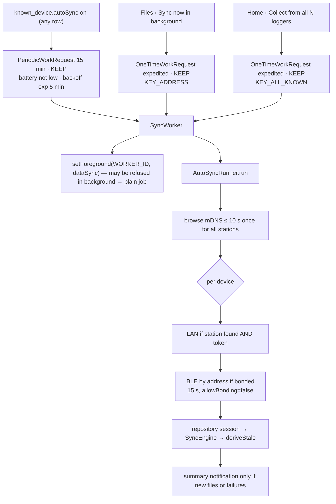

# Background sync — WorkManager, the foreground notification, WifiLock

**Scope:** everything that must outlive the screen: Auto-sync periodic work, "Sync now in background", "Collect from all loggers", the `dataSync` foreground service, the Wi-Fi lock.
**Code:** `data/background/AutoSyncScheduler.kt`, `SyncWorker.kt`, `AutoSyncRunner.kt` (pure decision logic + `AutoSyncPolicy`), `AppAutoSyncGateway.kt` (Android plumbing), `SyncForegroundService.kt`, `SyncNotifications.kt`; `data/lan/LanWifiLock.kt`; `ui/permissions/NotificationPermission.kt`; `AndroidManifest.xml` (service + `SystemForegroundService` merge, `WorkManagerInitializer` removal).
**Tests:** `AutoSyncRunnerTest` (links, guards, "nothing new") over the fake. The worker, service and scheduler plumbing are phone-only.
**Related:** [transports.md](transports.md), [sync-engine.md](sync-engine.md).

## Rule

**WorkManager + the `dataSync` foreground notification, never a bare thread.** No `Thread`, no
`GlobalScope`, no alarm, no sticky service, no CPU wake lock. The one sanctioned `WAKE_LOCK` use is
the `WifiManager.WifiLock` below.

## Who starts what

## Scheduling (`AutoSyncScheduler`)

| Request | Details |
| --- | --- |
| Periodic | Unique name, `KEEP`, **15 min** (`PeriodicWorkRequest.MIN_PERIODIC_INTERVAL_MILLIS`; Android picks the moment, later under Doze). Exists exactly while ≥ 1 `known_device.autoSync` row is on (the scheduler observes the count; the switch only flips the row) and is cancelled when the last goes off. Constraint: **battery not low only** — `NetworkType.CONNECTED` was dropped because the BLE path needs no network and a phone with Wi-Fi off never ran. |
| Sync now / Collect all | One unique `OneTimeWorkRequest`, `setExpedited(RUN_AS_NON_EXPEDITED_WORK_REQUEST)`, `KEEP`, input `KEY_ADDRESS` or `KEY_ALL_KNOWN`. Expedited work may carry network/storage constraints only → no battery rule. |
| Retry | `Result.retry()` with exponential backoff from 5 min, at most `MAX_RETRIES` 2 per period, **only** for transient conditions (a link exception, or a transfer that broke before every planned file had an outcome — `BackgroundSyncResult.incomplete`). Not reachable is not an error: one log line, next period. Per-file failures are not retried inside the period. |

## Decision logic (`AutoSyncRunner`, pure)

- **Which devices**: `autoSync` rows; `onlyAddress` for Sync now; `allKnown` visits `known_device` ordered by last connection whether or not the switch is on.
- **Links** (`AutoSyncPolicy.linksFor`): one mDNS browse per run (`LAN_BROWSE_MS` 10 s, early exit once every wanted station resolved); LAN when the station is found **and** a token is stored; else, and after a failed LAN connect, **BLE only if bonded** — direct `connectGatt` to the stored address, no scan, `BACKGROUND_BLE_CONNECT_MS` 15 s, `allowBonding = false`. Not found → finish quietly.
- **Interactive use wins**: skip any device while the repository holds a session (the same device, or another — one link at a time), re-checked between links. "Sync now in background" releases the interactive session first, then enqueues; the worker's session feeds the same `sync` state so the Files screen shows its progress.
- **Wi-Fi gate**: `AppAutoSyncGateway.browseLan` returns empty when no `TRANSPORT_WIFI` network is up (active network first, else a ≤ 1 s `NetworkRequest` probe; an offline LAN counts), so the 10 s browse never runs for nothing.
- **Never** pairs, scans, or touches a device the repository has a session with. `deriveStale()` runs after a run that brought files.

## Foreground work

| Path | Mechanism |
| --- | --- |
| User-started transfer | `SyncForegroundService` (`foregroundServiceType="dataSync"`), started by the repository **while the app is in the foreground** (API 31+ start rule). Owns no logic: mirrors `sync`/`reconnecting` into one ongoing notification (files done/total, bytes, current file, progress bar, **Stop** → `cancelSync`), paced at `NOTIFY_INTERVAL_MS` 500 ms (≤ 2 posts/s; `NotificationManager` sheds above ~5/s), stops itself `STOP_GRACE_MS` 1.5 s after `foregroundNeeded` turns false. `onTimeout` (API 35+, the 6 h / 24 h `dataSync` budget) cancels cleanly. **Not** kept alive while the link is idle. |
| Worker | `setForeground(ForegroundInfo(WORKER_ID, …, FOREGROUND_SERVICE_TYPE_DATA_SYNC))` with the same `SyncNotifications.progress`. `ForegroundServiceStartNotAllowedException` (app in background) → log one line, continue as a plain job (a running job has network access for its own duration); only the ongoing notification is missing. |
| Manifest | WorkManager's `SystemForegroundService` merged with `foregroundServiceType="dataSync"` (`tools:node="merge"`), or Android 14+ throws; default `WorkManagerInitializer` removed from `InitializationProvider` because of the Hilt worker factory. |
| Notifications | Channels `sync_progress`, `sync_summary`; ids `FOREGROUND_ID` 1001, `WORKER_ID` 1002, `SUMMARY_ID` 1003. Summary: "Synced 23 new files from AQ-6b40 · 1.1 MiB" (several devices → "from 2 loggers"), only when something arrived or failed. `POST_NOTIFICATIONS` asked once on the first Sync tap / Auto-sync switch-on (API 33+); a denial only hides the notification. |

Why the service exists (measured 2026-09-17): ~2 min after screen-off, `ConnectivityService`
logged "Destroyed live tcp sockets for uids={ours}" and `TcpTransport` saw "Software caused
connection abort" 6 ms later — the background network restriction, not the link.

## Wi-Fi lock (`LanWifiLock`)

One `WifiManager.WifiLock` from the first `OPEN` to the sync's `finally` — interactive and worker
alike (both go through `startSync`) — **only while the active transport is LAN**; BLE syncs hold
nothing and the lock is never kept over an idle link. Mode `WIFI_MODE_FULL_HIGH_PERF` on every API
on purpose: on API 31–33 it is active with the screen off, while `FULL_LOW_LATENCY` is only active
with the screen **on** and the app in the foreground (AOSP `WifiLockManager` checks
`IMPORTANCE_FOREGROUND`; a `dataSync` service does not count). On API 34+ the framework turns
HIGH_PERF into LOW_LATENCY anyway (`high_perf_lock_deprecated`). **Honest consequence: on Android
14+ this lock does not protect a screen-off LAN sync**; the automatic resume does
([sync-engine.md](sync-engine.md#resume-after-a-lost-link)). Measured before the lock: throughput
fell ~60 → ~12 files/min with the screen locked, then TCP stalled > 5 s.

## OEM battery killers

The test phone is a **OnePlus 7 Pro**; OxygenOS/ColorOS are the worst on dontkillmyapp.com:
"Don't optimize" is often not enough; may need "Allow background activity" and exclusion from
deep-optimization / sleep-standby lists; a swiped-away app may still be killed. WorkManager survives
(re-scheduled), a bare thread would not. **Nothing measured yet** — see [status.md](status.md#next).

## Uses → affects

| Edit… | Affects… |
| --- | --- |
| `AutoSyncPolicy.linksFor` | link order for worker **and** Collect all; `AutoSyncRunnerTest` |
| `AutoSyncGateway` interface | `AppAutoSyncGateway` (Android) and the test fake |
| `SyncNotifications.progress` text | both the service and the worker (same notification) |
| `known_device.autoSync` column | scheduler's observed count; every `KnownDevice` upsert must carry `previous?.autoSync` ([lesson](lessons-learned.md#room--data)) |
| `SyncForegroundService` start point | must remain a foreground-app moment (repository `startSync`), else API 31+ refuses |
| `LanWifiLock` acquire/release | `startSync` `finally`; never over BLE, never idle |
