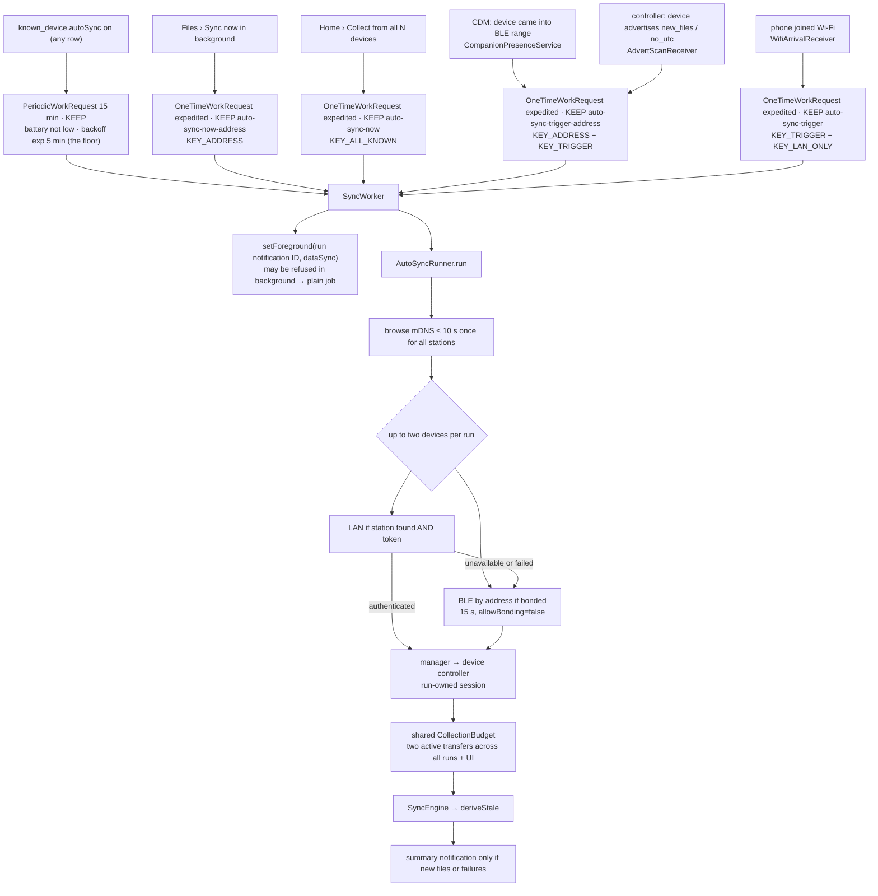

# Background sync — WorkManager, the foreground notification, WifiLock

**Scope:** everything that must outlive the screen: Auto-sync periodic work, "Sync now in background", collection from multiple devices, the `dataSync` foreground service, the Wi-Fi lock — and the **event-driven triggers** that start a run before the period is up: companion-device presence, the device's advertising flags, Wi-Fi arrival.
**Code:** `data/background/AutoSyncScheduler.kt`, `SyncWorker.kt`, `AutoSyncRunner.kt` (pure decision logic + `AutoSyncPolicy`), `AppAutoSyncGateway.kt` (Android plumbing), `SyncForegroundService.kt`, `SyncNotifications.kt`; `data/DeviceConnectionManager.kt`, `DeviceConnectionRepository.kt`, `DeviceIdentityClaims.kt`; triggers: `CompanionPresence.kt` + `CompanionPresenceService.kt`, `AdvertFlagScan.kt` (+ `AdvertScanReceiver`), `SyncTriggers.kt` (+ `WifiArrivalReceiver`, `BootReceiver`, `SyncTrigger`); `core/protocol/.../Advertisement.kt`; `data/lan/LanWifiLock.kt`, `LanDiscovery.kt`, `LanDiscoveryState.kt`; `ui/permissions/NotificationPermission.kt`; `AndroidManifest.xml` (services, receivers, `REQUEST_COMPANION_*`, `SystemForegroundService` merge, `WorkManagerInitializer` removal).
**Tests:** `AutoSyncRunnerTest` (links, per-device ownership, bounded parallel collection, cancellation, "nothing new", `lanOnly`) over the fake; `DeviceOwnershipTest`, `ConcurrentArchiveTest`, `LanTransferLeasesTest`; `AdvertisementTest` (protocol 2.1 bytes). The worker, service, scheduler, CDM and receiver plumbing are phone-only.
**Design and evidence:** [`../aq-parquet/docs/shared/background-sync-triggers.md`](../../aq-parquet/docs/shared/background-sync-triggers.md) (why these triggers, what Android does, what to measure); contract [`../aq-parquet/docs/shared/ble-sync-protocol.md`](../../aq-parquet/docs/shared/ble-sync-protocol.md). Historical phone evidence is in the [CoreS3 bench record](../../aq-parquet/docs/boards/m5stack-cores3/bench-verified.md): advertising-flag wake, once (2026-09-18, OnePlus 7 Pro, firmware `-v6.3`); companion presence and Wi-Fi arrival are not verified. The multi-device changes are host-tested only; no simultaneous hardware collection is claimed.
**Related:** [transports.md](transports.md), [sync-engine.md](sync-engine.md).

## Rule

**WorkManager + the `dataSync` foreground notification, never a bare thread.** No `Thread`, no
`GlobalScope`, no alarm, no sticky service, no CPU wake lock. The one sanctioned `WAKE_LOCK` use is
the `WifiManager.WifiLock` below.

## Who starts what

## Triggers — starting a run before the period is up

The 15-minute periodic request is the **floor**. Three sources enqueue expedited one-time
`SyncWorker` requests with `KEEP` and `KEY_TRIGGER`. Presence/advertisement work is unique per device
(`auto-sync-trigger-<address>`); Wi-Fi arrival uses `auto-sync-trigger` for a run over all opted-in
LAN devices. Manual work has separate names. A pending request for device A therefore does not
swallow device B's presence or advertising event; duplicate requests for the same target coalesce.
All per-device ownership guards still apply.

| Trigger | Mechanism | Fires when | Needs from the device |
| --- | --- | --- | --- |
| **Wake when nearby** (`SyncTrigger.PRESENCE`) | Companion Device Manager. Device screen › Auto-sync › *Set up wake when nearby* → `CompanionDeviceManager.associate` with a `BluetoothLeDeviceFilter` on the logger's **address**, single-device, one system confirm dialog (the logger must be advertising, so a BLE session is dropped for it and restored; LAN stays). Then `startObservingDevicePresence` (`ObservingDevicePresenceRequest` on API 36, address string on 31–35). The system binds `CompanionPresenceService`; `EVENT_BLE_APPEARED` / `onDeviceAppeared` → `syncNow(address, PRESENCE)` if the device's Auto-sync switch is on. Disappeared → nothing. Association id in `known_device.companionAssociationId` (schema v8); *Turn off* or *Forget* disassociates. | The logger comes into BLE range (once per arrival; AOSP scans `SCAN_MODE_LOW_POWER`, `FIRST_MATCH \| MATCH_LOST`, MAC filter; disappeared ≈ 10 s after the last report). | A stable public address — the CoreS3 default. |
| **Advertising flags** (`SyncTrigger.ADVERTISEMENT`) | `AdvertFlagScan`: `BluetoothLeScanner.startScan(filters, LOW_POWER + FIRST_MATCH \| MATCH_LOST, PendingIntent)` with two offloaded filters per **bonded** Auto-sync device — `deviceAddress` AND `serviceData(SERVICE, [0, flag], mask [0, flag])` for `new_files` and for `no_utc`. `AdvertScanReceiver` decodes `Advertisement`, skips when `changeKey` (`boot16:fin:flags`) equals the last run's or within 5 min, else `syncNow(address, ADVERTISEMENT)`. Registered at process start, re-armed by every periodic run (stop + start; a Bluetooth toggle drops it), unregistered when no bonded Auto-sync device exists. Needs `isOffloadedFilteringSupported()`; otherwise absent, with a log line. | The **device** decides: it sets `new_files` when a file finalizes and clears it after a `LIST`; `no_utc` while it has no UTC anchor (reboot). | Firmware ≥ `-v6.3` (protocol 2.1 advertising payload). |
| **Wi-Fi arrival** (`SyncTrigger.WIFI`) | `SyncTriggers`: `ConnectivityManager.registerNetworkCallback(NetworkRequest{TRANSPORT_WIFI}, PendingIntent)` → `WifiArrivalReceiver` → `syncOnTrigger(WIFI, lanOnly = true)` when ≥ 1 Auto-sync device has a LAN token; throttled to one start per 10 min (the callback also fires at registration when already on Wi-Fi). `lanOnly` keeps Bluetooth out of a run that says nothing about range. Re-registered at every process start (survives process death, not reboot → `BootReceiver`). | The phone joins any Wi-Fi network (SSID is location-gated, so "home" is unknown; the 10 s mDNS browse is the cost of a miss). | Nothing. |

Measured 2026-09-18 (`bench-verified.md`, "advertising payload wakes the phone"): with the app process killed (`am kill`), a `flush` on the board flipped `new_files`; 19 s later `ActivityManager: Start proc … for broadcast {…AdvertScanReceiver}`, `AQ-6b40: advertisement bcb4:1:2 new_files=true … lan=true; enqueueing a sync`, `trigger=ADVERTISEMENT`, LAN, `1 new file(s), 22498 B` at +28 s; the board logged `BLE ADV flags=0x2c fin=1` after the `LIST`. `setForeground` was refused (no association yet).

**Exemptions that come with CDM** (AOSP `CompanionExemptionProcessor`, *while an associated device is present*): `REQUEST_COMPANION_RUN_IN_BACKGROUND` → permanent power-save allowlist; `REQUEST_COMPANION_USE_DATA_IN_BACKGROUND` → background data allowed — the exemption the measured screen-off socket kill ("Destroyed live tcp sockets") called for; `REQUEST_COMPANION_START_FOREGROUND_SERVICES_FROM_BACKGROUND` → the worker's `setForeground` should stop being refused. All normal permissions, no location. Whether they hold on the OnePlus's ROM is exactly what the next phone run must show.

Both receivers that use `goAsync()` (`WifiArrivalReceiver`, `AdvertScanReceiver`) run their work in
the injected `@ApplicationScope` (a `SupervisorJob` with a logging exception handler) through
`launchReceiverWork`, bounded by `withTimeout(9 s)` below the system's 10 s allowance, and call
`PendingResult.finish()` on every path. A failure is logged by class name and never cancels other
work in the scope.

## Scheduling (`AutoSyncScheduler`)

| Request | Details |
| --- | --- |
| Periodic | Unique name, `KEEP`, **15 min** (`PeriodicWorkRequest.MIN_PERIODIC_INTERVAL_MILLIS`; Android picks the moment, later under Doze). Exists exactly while ≥ 1 `known_device.autoSync` row is on (the scheduler observes the count; the switch only flips the row) and is cancelled when the last goes off. Constraint: **battery not low only** — `NetworkType.CONNECTED` was dropped because the BLE path needs no network and a phone with Wi-Fi off never ran. |
| Sync now / Collect all | `OneTimeWorkRequest`, `setExpedited(RUN_AS_NON_EXPEDITED_WORK_REQUEST)`, `KEEP`: `auto-sync-now-<address>` with `KEY_ADDRESS` for one device, `auto-sync-now` with `KEY_ALL_KNOWN` for all. Expedited work may carry network/storage constraints only → no battery rule. |
| Triggered | `auto-sync-trigger-<address>` for presence/advertisement, `auto-sync-trigger` for Wi-Fi, `KEEP`; input `KEY_TRIGGER` (+ `KEY_ADDRESS` or `KEY_LAN_ONLY`). Workers may overlap. A controller already owned by another run is skipped; another device remains eligible. |
| Retry | `Result.retry()` with exponential backoff from 5 min, at most `MAX_RETRIES` 2 per period, **only** for transient conditions (a link exception, or a transfer that broke before every planned file had an outcome — `BackgroundSyncResult.incomplete`). Not reachable is not an error: one log line, next period. Per-file failures are not retried inside the period. |

## Decision logic (`AutoSyncRunner`, pure)

- **Which devices**: `autoSync` rows; `onlyAddress` for Sync now; `allKnown` visits `known_device` ordered by last connection whether or not the switch is on.
- **Links** (`AutoSyncPolicy.linksFor`): one mDNS browse per run (`LAN_BROWSE_MS` 10 s, early exit once every wanted station resolved); LAN when the station is found **and** a token is stored; else, and after a failed LAN connect, **BLE only if bonded** — direct `connectGatt` to the stored address, no scan, `BACKGROUND_BLE_CONNECT_MS` 15 s, `allowBonding = false`. Not found → finish quietly. `lanOnly` (the Wi-Fi trigger) leaves BLE out altogether.
- **Bounded collection**: the runner tries up to two devices concurrently, with LAN then BLE fallback sequential within each device. `CollectionBudget` caps active transfers across every worker and interactive controller together at two. Two is a conservative app policy, not a hardware BLE limit; simultaneous physical-device runs remain unverified.
- **Interactive use wins per device**: skip a device while its manager-owned controller holds a session or reconnect; re-check before fallback. A session with another device does not block collection. The controller's connection mutex makes ownership atomic, and the WorkManager run ID identifies its background owner. Interactive reconnect does not hijack that owner. "Sync now in background" releases only that device's interactive session before enqueueing; the address-bound Files screen observes the same controller's progress.
- **Hardware ownership**: after authenticated identity validation, a full `info.dev` claim prevents endpoint aliases from concurrently owning one physical board. BLE and LAN share the board's one open file. Transfer cancellation/join precedes session close; cancellation during initialization also closes the provisional transport. A worker's `finally` closes only its own session.
- **Wi-Fi gate**: `AppAutoSyncGateway.browseLan` returns empty when no `TRANSPORT_WIFI` network is up (active network first, else a ≤ 1 s `NetworkRequest` probe; an offline LAN counts), so the 10 s browse never runs for nothing.
- **Discovery**: `LanDiscoveryState` shares foreground browsing across controllers. Each worker browses once for its target set. On API 31–33 all browses share one `LegacyResolver` queue so only one `resolveService` call is active; API 34+ uses service-info callbacks.
- **Archive ownership**: the shared `WriterLeases` in `SyncEngine` covers OPEN/read/verification/commit/index/CLOSE for `(station, name)`. Another caller waits, then verifies an existing copy against OPENED size/CRC/PAR1 and the recorded SHA before reuse. Conflicts preserve existing bytes; commit refuses replacement. `alreadyArchived` copies do not increase new-file summary counts. Original Hive paths stay verbatim.
- **Never** pairs, scans, or takes over another owner's session. `deriveStale()` runs after a run that brought files; derivation remains serialized independently of transfer concurrency.

## Foreground work

| Path | Mechanism |
| --- | --- |
| User-started transfer | `SyncForegroundService` (`foregroundServiceType="dataSync"`), started by a controller **while the app is in the foreground** (API 31+ start rule). Owns no logic: aggregates manager snapshots for active interactive transfers/reconnects into one ongoing notification (files, bytes, progress; one device's reconnect message only when it is the sole active device). **Stop** and API 35+ timeout cancel interactive transfers/reconnects across controllers, leaving workers to their own cancel actions. Updates are paced at `NOTIFY_INTERVAL_MS` 500 ms; the service stops `STOP_GRACE_MS` 1.5 s after no interactive controller needs it. It is not kept alive over an idle link. |
| Worker | `setForeground(ForegroundInfo(runNotificationId, …, FOREGROUND_SERVICE_TYPE_DATA_SYNC))` with the same `SyncNotifications.progress`. Each worker has its own notification ID, derived from the WorkRequest id (`SyncWorker.notificationIdFor`, at or above 10 000 so it never collides with the fixed IDs), so a retry or a restarted process reuses it, and its own WorkManager cancel intent; it aggregates only controllers whose `backgroundOwner` equals that run ID. Its Stop cancels that run's device jobs. `ForegroundServiceStartNotAllowedException` (app in background) → log one line, continue as a plain job; with notifications permission a progress notification can still be posted. With a companion association and the device present, `REQUEST_COMPANION_START_FOREGROUND_SERVICES_FROM_BACKGROUND` should make the refusal go away — unverified. |
| Manifest | WorkManager's `SystemForegroundService` merged with `foregroundServiceType="dataSync"` (`tools:node="merge"`), or Android 14+ throws; default `WorkManagerInitializer` removed from `InitializationProvider` because of the Hilt worker factory. |
| Notifications | Channels `sync_progress`, `sync_summary`; interactive `FOREGROUND_ID` 1001, distinct worker IDs allocated from 10001, `SUMMARY_ID` 1003. The old `WORKER_ID` constant is no longer used by workers. Summary: "Synced 23 new files from AQ-6b40 · 1.1 MiB" (several sources → "from 2 devices"), only when something arrived or failed. `POST_NOTIFICATIONS` is requested on the first Sync tap / Auto-sync switch-on (API 33+); denial hides ordinary progress/summary notifications. |

Why the service exists (measured 2026-09-17): ~2 min after screen-off, `ConnectivityService`
logged "Destroyed live tcp sockets for uids={ours}" and `TcpTransport` saw "Software caused
connection abort" 6 ms later — the background network restriction, not the link. The companion
exemption (above) addresses the same restriction from the other side, for the whole time the logger
is present rather than only during a transfer; the service stays until a phone run shows it is
redundant.

## Wi-Fi lock (`LanWifiLock`)

One shared `WifiManager.WifiLock` has a separate `acquireLease()` owner for each active LAN transfer,
interactive and worker alike (both go through `startSync`). The lease is acquired after the shared
transfer permit, before the first `OPEN`, and closed in `finally`. The first owner acquires the
radio lock; the last releases it. Closing a lease twice cannot release another transfer's lock,
and a failed acquisition creates no owner. BLE, transfers waiting for a permit, and idle links
hold no lease. The accounting is host-tested; the concurrent Android lock behavior is not yet
measured. Mode `WIFI_MODE_FULL_HIGH_PERF` on every API
on purpose: on API 31–33 it is active with the screen off, while `FULL_LOW_LATENCY` is only active
with the screen **on** and the app in the foreground (AOSP `WifiLockManager` checks
`IMPORTANCE_FOREGROUND`; a `dataSync` service does not count). On API 34+ the framework turns
HIGH_PERF into LOW_LATENCY anyway (`high_perf_lock_deprecated`). **Honest consequence: on Android
14+ this lock does not protect a screen-off LAN sync**; the automatic resume does
([sync-engine.md](sync-engine.md#resume-after-a-lost-link)). Measured before the lock: throughput
fell ~60 → ~12 files/min with the screen locked, then TCP stalled > 5 s.

## OEM battery killers

The test phone is a **OnePlus 7 Pro**; OxygenOS/ColorOS are the worst on dontkillmyapp.com:
"Don't optimize" is often not enough; may need "Allow background activity" and exclusion from
deep-optimization / sleep-standby lists; a swiped-away app may still be killed. WorkManager survives
(re-scheduled), a bare thread would not. **Nothing measured yet** — see [status.md](status.md#next).

## Uses → affects

| Edit… | Affects… |
| --- | --- |
| `AutoSyncPolicy.linksFor` | link order for worker **and** Collect all; `AutoSyncRunnerTest` |
| `AutoSyncGateway` interface | `AppAutoSyncGateway` (Android) and the test fake |
| Controller ownership / `CollectionBudget` | interactive and worker transfers; `DeviceOwnershipTest`, `AutoSyncRunnerTest` |
| Worker owner and notification IDs | run-scoped progress/cancel; overlapping workers and interactive service need a phone check |
| `WriterLeases` / immutable commit | `SyncEngine`, partial resume and summaries; `ConcurrentArchiveTest`, `SyncEngineTest` |
| `SyncNotifications.progress` text | both the service and the worker (same notification) |
| `known_device.autoSync` column | scheduler's observed count; every `KnownDevice` upsert must carry `previous?.autoSync` ([lesson](lessons-learned.md#room--data)) |
| `SyncForegroundService` start point | must remain a foreground-app moment (repository `startSync`), else API 31+ refuses |
| `LanWifiLock.acquireLease` | each `startSync` `finally`; `LanTransferLeasesTest`; last owner releases, never over BLE or idle |
| Shared legacy mDNS resolver | foreground and overlapping worker browses; API 31–33 phone check |
| `Advertisement` layout | mirror of the firmware contract (`ble-sync-protocol.md`, "Advertising payload"); change there first; `AdvertFlagScan` filter bytes and `AdvertisementTest` |
| `SyncTrigger` enum | `AutoSyncScheduler.syncNow/syncOnTrigger`, `SyncWorker` log line, the periodic-run detection that re-arms the flag scan |
| `companionAssociationId` column | `CompanionPresence.observe` at start, `forget()` disassociation, Device screen "wake when nearby" line |
