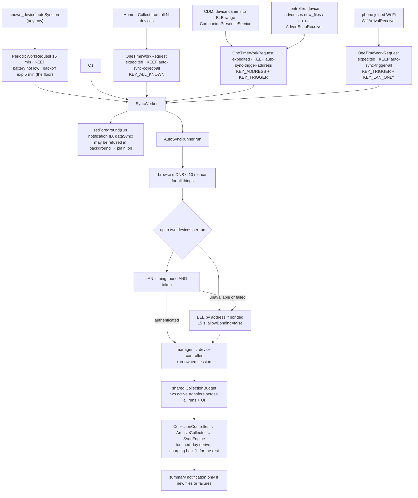

# Background sync, WorkManager, the foreground notification, WifiLock

**Scope:** everything that must outlive the screen: Auto-sync periodic work, collection from multiple devices, interactive `connectedDevice` PROCESS protection, worker `dataSync` protection and the Wi-Fi lock, and the **event-driven triggers** that start a run before the period is up: companion-device presence, the device's advertising flags, Wi-Fi arrival.
**Code:** `data/background/AutoSyncScheduler.kt`, `SyncWorker.kt`, `AutoSyncRunner.kt` (pure decision logic + `BackgroundSyncPolicy`), `AppAutoSyncGateway.kt` (Android plumbing), `SyncForegroundService.kt`, `SyncNotifications.kt`; `data/DeviceConnectionManager.kt`, `DeviceFacade.kt`, `DeviceLinkOwner.kt`, `CollectionAdmission.kt`, `DeviceIdentityClaims.kt`; triggers: `CompanionPresence.kt` + `CompanionPresenceService.kt`, `AdvertFlagScan.kt` (+ `AdvertScanReceiver`), `SyncTriggers.kt` (+ `WifiArrivalReceiver`, `BootReceiver`, `SyncTrigger`); `core/protocol/.../Advertisement.kt`; `data/lan/LanWifiLock.kt`, `LanDiscovery.kt`, `LanDiscoveryState.kt`; `ui/permissions/NotificationPermission.kt`; `AndroidManifest.xml` (services, receivers, `REQUEST_COMPANION_*`, `SystemForegroundService` merge, `WorkManagerInitializer` removal).
**Tests:** `AutoSyncRunnerTest` (links, per-device ownership, bounded parallel collection, cancellation, "nothing new", `lanOnly`) over the fake; `DeviceOwnershipTest`, `ConcurrentArchiveTest`, `LanTransferLeasesTest`; `AdvertisementTest` (protocol 2.1 bytes). `SyncWorkerBudgetTest`, `SyncServiceOwnershipTest`, `AndroidKeepAliveTest` and facade tests cover deadlines, stop mapping, command generations and lease accounting on the host. WorkManager, OS service and radio behavior still require a phone.
**Design and evidence:** [`../opensensor-space-firmware/docs/shared/background-sync-triggers.md`](../../opensensor-space-firmware/docs/shared/background-sync-triggers.md) (why these triggers, what Android does, what to measure); contract [`../opensensor-space-firmware/docs/shared/ble-sync-protocol.md`](../../opensensor-space-firmware/docs/shared/ble-sync-protocol.md). Historical phone evidence is in the [CoreS3 bench record](../../opensensor-space-firmware/docs/boards/m5stack-cores3/bench-verified.md): advertising-flag wake, once (2026-09-18, OnePlus 7 Pro, firmware `-v6.3`); companion presence and Wi-Fi arrival are not verified. The multi-device changes are host-tested only; no simultaneous hardware collection is claimed.
**Related:** [transports.md](transports.md), [sync-engine.md](sync-engine.md).

## Rule

**WorkManager + the `dataSync` foreground notification, never a bare thread.** No `Thread`, no
`GlobalScope`, no alarm, no sticky service, no CPU wake lock. The one sanctioned `WAKE_LOCK` use is
the `WifiManager.WifiLock` below.

## Who starts what

## Triggers, starting a run before the period is up

The 15-minute periodic request is the **floor**. Three sources enqueue expedited one-time
`SyncWorker` requests with `KEEP` and `KEY_TRIGGER`. Presence/advertisement work is unique per device
(`auto-sync-trigger-<address>`); Wi-Fi arrival uses `auto-sync-trigger-all` for a run over all opted-in
LAN devices. Manual work has separate names. Every enqueue checks its unique name first and returns
`ALREADY_QUEUED` instead of claiming a run that `KEEP` drops (2026-10-12). A pending request for device A therefore does not
swallow device B's presence or advertising event; duplicate requests for the same target coalesce.
All per-device ownership guards still apply.

| Trigger | Mechanism | Fires when | Needs from the device |
| --- | --- | --- | --- |
| **Wake when nearby** (`SyncTrigger.PRESENCE`) | Companion Device Manager. Device screen › Auto-sync › *Set up wake when nearby* → `CompanionDeviceManager.associate` with a `BluetoothLeDeviceFilter` on the logger's **address**, single-device, one system confirm dialog (the logger must be advertising, so a BLE session is dropped for it and restored; LAN stays). Then `startObservingDevicePresence` (`ObservingDevicePresenceRequest` on API 36, address string on 31–35). The system binds `CompanionPresenceService`; `EVENT_BLE_APPEARED` / `onDeviceAppeared` → `syncNow(address, PRESENCE)` if the device's Auto-sync switch is on. Disappeared → nothing. Association id in `known_device.companionAssociationId` (schema v8); *Turn off* or *Forget* disassociates. | The logger comes into BLE range (once per arrival; AOSP scans `SCAN_MODE_LOW_POWER`, `FIRST_MATCH \| MATCH_LOST`, MAC filter; disappeared ≈ 10 s after the last report). | A stable public address, the CoreS3 default. |
| **Advertising flags** (`SyncTrigger.ADVERTISEMENT`) | `AdvertFlagScan`: `BluetoothLeScanner.startScan(filters, LOW_POWER + FIRST_MATCH \| MATCH_LOST, PendingIntent)` with two offloaded filters per **bonded** Auto-sync device, `deviceAddress` AND `serviceData(SERVICE, [0, flag], mask [0, flag])` for `new_files` and for `no_utc`. `AdvertScanReceiver` decodes `Advertisement`, skips when `changeKey` (`boot16:fin:flags`) equals the last run's or within 5 min, else `syncNow(address, ADVERTISEMENT)`. Registered at process start, re-armed by every periodic run (stop + start; a Bluetooth toggle drops it), unregistered when no bonded Auto-sync device exists. Re-registration is serialized and shares `ScanStartBudget` with discovery. A denied start retains the current registration and leaves one start slot for discovery. Needs `isOffloadedFilteringSupported()`; otherwise absent, with a log line. | The **device** decides: it sets `new_files` when a file finalizes and clears it after a `LIST`; `no_utc` while it has no UTC anchor (reboot). | Firmware ≥ `-v6.3` (protocol 2.1 advertising payload). |
| **Wi-Fi arrival** (`SyncTrigger.WIFI`) | `SyncTriggers`: `ConnectivityManager.registerNetworkCallback(NetworkRequest{TRANSPORT_WIFI}, PendingIntent)` → `WifiArrivalReceiver` → `syncOnTrigger(WIFI, lanOnly = true)` when ≥ 1 Auto-sync device has a LAN token; throttled to one start per 10 min (the callback also fires at registration when already on Wi-Fi). `lanOnly` keeps Bluetooth out of a run that says nothing about range. Re-registered at every process start (survives process death, not reboot → `BootReceiver`). | The phone joins any Wi-Fi network (SSID is location-gated, so "home" is unknown; the 10 s mDNS browse is the cost of a miss). | Nothing. |

Measured 2026-09-18 (`bench-verified.md`, "advertising payload wakes the phone"): with the app process killed (`am kill`), a `flush` on the board flipped `new_files`; 19 s later `ActivityManager: Start proc … for broadcast {…AdvertScanReceiver}`, `AQ-6b40: advertisement bcb4:1:2 new_files=true … lan=true; enqueueing a sync`, `trigger=ADVERTISEMENT`, LAN, `1 new file(s), 22498 B` at +28 s; the board logged `BLE ADV flags=0x2c fin=1` after the `LIST`. `setForeground` was refused (no association yet).

**Exemptions that come with CDM** (AOSP `CompanionExemptionProcessor`, *while an associated device is present*): `REQUEST_COMPANION_RUN_IN_BACKGROUND` → permanent power-save allowlist; `REQUEST_COMPANION_USE_DATA_IN_BACKGROUND` → background data allowed, the exemption the measured screen-off socket kill ("Destroyed live tcp sockets") called for; `REQUEST_COMPANION_START_FOREGROUND_SERVICES_FROM_BACKGROUND` → the worker's `setForeground` should stop being refused. All normal permissions, no location. Whether they hold on the OnePlus's ROM is exactly what the next phone run must show.

Both receivers that use `goAsync()` (`WifiArrivalReceiver`, `AdvertScanReceiver`) run their work in
the injected `@ApplicationScope` (a `SupervisorJob` with a logging exception handler) through
`launchReceiverWork`, bounded by `withTimeout(9 s)` below the system's 10 s allowance, and call
`PendingResult.finish()` on every path. A failure is logged by class name and never cancels other
work in the scope.

## Scheduling (`AutoSyncScheduler`)

| Request | Details |
| --- | --- |
| Periodic | Unique name, `KEEP`, **15 min** (`PeriodicWorkRequest.MIN_PERIODIC_INTERVAL_MILLIS`; Android picks the moment, later under Doze). Exists exactly while ≥ 1 `known_device.autoSync` row is on (the scheduler observes the count; the switch only flips the row) and is cancelled when the last goes off. Constraint: **battery not low only**, `NetworkType.CONNECTED` was dropped because the BLE path needs no network and a phone with Wi-Fi off never ran. |
| Sync now / Collect all | `OneTimeWorkRequest`, `setExpedited(RUN_AS_NON_EXPEDITED_WORK_REQUEST)`, `KEEP`: `auto-sync-now-<address>` with `KEY_ADDRESS` for one device, `auto-sync-collect-all` with `KEY_ALL_KNOWN` for all. Every per-device request also carries the tag `auto-sync-device-<address>`. Expedited work may carry network/storage constraints only → no battery rule. |
| Triggered | `auto-sync-trigger-<address>` for presence/advertisement, `auto-sync-trigger-all` for Wi-Fi, `KEEP`; input `KEY_TRIGGER` (+ `KEY_ADDRESS` or `KEY_LAN_ONLY`). Workers may overlap. A controller already owned by another run is skipped; another device remains eligible. |
| Retry | `Result.retry()` with exponential backoff from 5 min, at most `MAX_RETRIES` 2 per period, **only** for transient conditions (a link exception, or a transfer that broke before every planned file had an outcome, `BackgroundSyncResult.incomplete`). Not reachable is not an error: one log line, next period. Per-file failures are not retried inside the period. |

## Decision logic (`AutoSyncRunner`, pure)

- **Which devices**: `autoSync` rows; `onlyAddress` for Sync now; `allKnown` visits `known_device` ordered by last connection whether or not the switch is on.
- **Links** (`BackgroundSyncPolicy.linksFor`): one mDNS browse per run (`LAN_BROWSE_MS` 10 s, early exit once every wanted thing resolved); LAN when the thing is found **and** a token is stored; else, and after a failed LAN connect, **BLE only if bonded**, direct `connectGatt` to the stored address, no scan, `BACKGROUND_BLE_CONNECT_MS` 15 s, `allowBonding = false`. Not found → finish quietly. `lanOnly` (the Wi-Fi trigger) leaves BLE out altogether.
- **Bounded collection**: the runner tries up to two devices concurrently, with LAN then BLE fallback sequential within each device. `CollectionBudget` caps active transfers across every worker and interactive controller together at two. Two is a conservative app policy, not a hardware BLE limit; simultaneous physical-device runs remain unverified.
- **Collection admission**: a process-wide lease rejects every worker collection while any interactive collection is active, including preparation, retry waiting and cleanup. An existing worker collection also prevents an overlapping interactive start. Idle UI sessions still block their own endpoint only. `CollectionAdmission.acquire` checks and records the process lease under one lock. `CollectionBudget` shares two permits across workers and UI. The per-device owner reservation and connection mutex enforce per-device command and link ownership; workers re-check before fallback. A background run never stops an interactive one. An interactive run already continues under its foreground service. The address-bound Files screen observes the same controller's progress and shows a worker holding the device through `DeviceFacade.ownership == BACKGROUND`. Collect all is gated app-wide (`observeAnyActive()` plus any device not idle, `anyCollectionActive`). `AutoSyncScheduler` talks to WorkManager through `SyncWorkQueue`, faked in `AutoSyncSchedulerTest`.
- **Hardware ownership**: after authenticated identity validation, a full `info.dev` claim prevents endpoint aliases on this phone from concurrently owning one physical board. Firmware has independent logical handles per BLE connection and LAN peer. Transfer cancellation/join precedes session close; cancellation during initialization also closes the provisional transport. A worker's `finally` closes only its own session.
- **Wi-Fi gate**: `AppAutoSyncGateway.browseLan` returns empty when no `TRANSPORT_WIFI` network is up (active network first, else a ≤ 1 s `NetworkRequest` probe; an offline LAN counts), so the 10 s browse never runs for nothing.
- **Discovery**: `LanDiscoveryState` shares foreground browsing across controllers. Each worker browses once for its target set. On API 31–33 all browses share one `LegacyResolver` queue so only one `resolveService` call is active; API 34+ uses service-info callbacks.
- **Archive ownership**: the writer lease of the shared `DeviceCoordinator` in `SyncEngine` covers OPEN/read/verification/commit/index/CLOSE for `(thing, name)`. Another caller waits, then verifies an existing copy against OPENED size/CRC/PAR1 and the recorded SHA before reuse. Conflicts preserve existing bytes; commit refuses replacement. `alreadyArchived` copies do not increase new-file summary counts. Original Hive paths stay verbatim.
- **Never** pairs, scans, or takes over another owner's session. `deriveAfterSync(start)` runs after a run that brought files and rebuilds only the days whose files were synced in that run; other stale days are counted as deferred and handed to `DeriveWorker` (unique `history-derive-backfill`, KEEP, `requiresCharging`, `AutoSyncScheduler.deriveBackfillRequest`), which runs the full `deriveStale()`. Every derive is one `HistoryOrchestrator.derivePass`, so derives run one at a time and never beside a back-fill, independently of transfer concurrency.

## Foreground work

| Path | Mechanism |
| --- | --- |
| User-started transfer | `SyncForegroundService` (`connectedDevice`, with `dataSync` as the permission fallback), started by a controller **while the app is in the foreground** (API 31+ start rule). Owns no logic: aggregates manager snapshots for active interactive transfers/reconnects into one ongoing notification (files, bytes, progress; one device's reconnect message only when it is the sole active device). **Stop** and API 35+ timeout cancel interactive transfers/reconnects across controllers, leaving workers to their own cancel actions. Updates are paced at `NOTIFY_INTERVAL_MS` 1 s and skipped while the screen is off (`ShadePacing.postPaced`, SCREEN_ON/OFF broadcasts); the final state always posts, even before the screen flow first emits. Lifetime follows only PROCESS leases, including preparation, retries and finalization. Stop calls `controller.stop(USER)` even while leased; timeout calls `controller.stop(FGS_TIMEOUT)`. Generation-specific refusal or destruction informs just its protected intents. There is no grace timer or inferred flag lifetime. |
| Worker | `setForeground(ForegroundInfo(runNotificationId, …, FOREGROUND_SERVICE_TYPE_DATA_SYNC))` with the same `SyncNotifications.progress`. Each worker has its own notification ID, derived from the WorkRequest id (`SyncWorker.notificationIdFor`, at or above 10 000 so it never collides with the fixed IDs), so a retry or a restarted process reuses it, and its own WorkManager cancel intent; it aggregates only controllers whose `backgroundOwner` equals that run ID. Its Stop cancels that run's device jobs. `ForegroundServiceStartNotAllowedException` (app in background) → log one line, continue as a plain job; with notifications permission a progress notification can still be posted. With a companion association and the device present, `REQUEST_COMPANION_START_FOREGROUND_SERVICES_FROM_BACKGROUND` should make the refusal go away, unverified. |
| Manifest | WorkManager's `SystemForegroundService` merged with `foregroundServiceType="dataSync"` (`tools:node="merge"`), or Android 14+ throws; default `WorkManagerInitializer` removed from `InitializationProvider` because of the Hilt worker factory. |
| Notifications | Channels `sync_progress`, `sync_summary`; interactive `FOREGROUND_ID` 1001, stable worker IDs derived from the WorkRequest UUID by `SyncWorker.notificationIdFor`, in `[10000, 10000 + 2^28)`, `SUMMARY_ID` 1003. The old `WORKER_ID` constant is no longer used by workers. Summary appears only when something arrived or failed, with a device count for several sources. `POST_NOTIFICATIONS` is requested on the first Sync tap / Auto-sync switch-on (API 33+); denial hides ordinary progress/summary notifications. |

Why the service exists (measured 2026-09-17): ~2 min after screen-off, `ConnectivityService`
logged "Destroyed live tcp sockets for uids={ours}" and the LAN socket (then `TcpTransport`) saw "Software caused
connection abort" 6 ms later, the background network restriction, not the link. The companion
exemption (above) addresses the same restriction from the other side, for the whole time the logger
is present rather than only during a transfer; the service stays until a phone run shows it is
redundant.

## Wi-Fi lock (`LanWifiLock`)

One shared `WifiManager.WifiLock` has a separate `acquireLease()` owner for each active LAN transfer,
interactive and worker alike through `CollectionController`. The lease is acquired after the shared
transfer permit in LAN LIST/PLAN, transfer and finalization states, and closed in `finally`. The first owner acquires the
radio lock; the last releases it. Closing a lease twice cannot release another transfer's lock,
and a failed acquisition creates no owner. BLE, transfers waiting for a permit, and idle links
hold no lease. The accounting is host-tested; the concurrent Android lock behavior is not yet
measured. Mode `WIFI_MODE_FULL_HIGH_PERF` on every API
on purpose: on API 31–33 it is active with the screen off, while `FULL_LOW_LATENCY` is only active
with the screen **on** and the app in the foreground (AOSP `WifiLockManager` checks
`IMPORTANCE_FOREGROUND`; a `dataSync` service does not count). On API 34+ the framework turns
HIGH_PERF into LOW_LATENCY anyway (`high_perf_lock_deprecated`). **Honest consequence: on Android
14+ this lock does not protect a screen-off LAN sync**; the automatic resume does
([sync-engine.md](sync-engine.md#resume-after-a-lost-link)). Measured before the lock: throughput
fell ~60 → ~12 files/min with the screen locked, then TCP stalled > 5 s.

## OEM battery killers

The test phone is a **OnePlus 7 Pro**; OxygenOS/ColorOS are the worst on dontkillmyapp.com:
"Don't optimize" is often not enough; may need "Allow background activity" and exclusion from
deep-optimization / sleep-standby lists; a swiped-away app may still be killed. WorkManager survives
(re-scheduled), a bare thread would not. **Nothing measured yet**, see [status.md](status.md#next).

## iOS Auto-sync

Issue #23. Host and simulator evidence only so far. No iPhone run.

**Code:** `ios/App/BackgroundSync.swift` (`AutoSync`, the OS side), `AppDelegate.swift`
(`AppServices` owns the adapters, so a launch without a screen works), the Auto-sync extensions in
`BluetoothCompanion.swift` and `LanDiscovery.swift`, `ios/shared/.../AutoSync.kt`
(`AutoSyncSettings`, `BackgroundSyncBridge`, `BackgroundSteps`), `AutoSyncSwitch.kt` (the lead of the Device section), and the shared
`BackgroundSyncRunner` and `BackgroundSyncPolicy` in `:core:sync`.
**Tests:** `AutoSyncTest` (switch store, due rules, the bridge over fake Swift ports, step mapping),
`BackgroundSyncRunnerTest` in `:core:sync`. The Swift scheduler, wakes and notifications are phone only.

| Piece | iOS behaviour |
| --- | --- |
| Switch | Per known sensor, first in its Device section, off by default. Turning it on asks for notifications only while iOS never asked. The switch stays on whatever the answer. Forget turns it off. Stored in UserDefaults `devices.autosync.v1`, peripheral ids and last run times only |
| Scheduled run | One `BGProcessingTask` (`space.opensensor.app.autosync`), no network or power requirement, earliest begin one policy period ahead. Nothing is scheduled while every switch is off. The shared runner picks the due sensors and tries Wi-Fi first when the thing was browsed with saved access, then the bonded peripheral |
| Retry | Only a step that ran to the end with no error counts as a run. A lost or broken step stays due, so when the shared policy asks for a retry the next request after its backoff runs it again, up to the retry bound, then the normal period. A Wi-Fi connect or access failure is a skip, so the runner goes on to the paired Bluetooth link, as on Android |
| Bluetooth wake | On leaving the screen, and after each run, sensors that are due and were not woken within the period get a pending connect with state restoration (`space.opensensor.app.central`). iOS completes it near the sensor, even after ending the app, and the run takes that sensor under a background time lease. Every wake is recorded before its run, whatever comes of it, and the woken sensor is never armed again inside its own run. So a sensor in range whose steps keep skipping wakes the app at most once a period (`AutoSyncSettings.armable`) |
| Bluetooth rule | Only saved peripheral identifiers, never a scan. iOS shows no pairing prompt off screen, so a lost bond fails the step. A link the user holds is never taken. No firmware-changing request is sent |
| Continued task | Only a Collect all pass uses one. No screen offers a background sync of one sensor. iOS 26 and later submit one `BGContinuedProcessingTaskRequest` per pass, with strategy `fail` under a unique `space.opensensor.app.sync.<uuid>` id. iOS shows its progress (steps done of steps planned) and Cancel, which ends the pass and the step in flight. When iOS refuses, or on iOS 18, only the step going holds its background time lease. A task ends once, whether the pass or its expiry comes first, and an expiry cancels only its own pass |
| Collect all | One sensor at a time through the shared controller. A user action stops the pass only for a sensor the pass holds or still plans, or a Bluetooth open while a Bluetooth step runs (`DevicesBridge.userFirst`). An action on another sensor leaves it going. On iOS 26 and later a pass counts as continuing in the background only once iOS launched its continued task. Until then, and after a refusal or a timeout, each step holds its run's background time |
| Interrupted run | A run iOS stops off screen is kept, with the existing paused notice. When the app is active again it starts once, after the open sensor page reconnects. It stays queued until a transport accepts it, so a run still cleaning up or a busy link only delays it. A page reopened over Bluetooth for another sensor keeps Bluetooth, so the Bluetooth resume is dropped (`LivePage.letsResumeUseBluetooth`) and its saved files stay. An interrupted Collect all step resumes as a plain sync. Forget drops it |
| Pending requests | Turning a switch on or leaving the screen schedules the `BGProcessingTask` only when no request is pending, so a waiting request keeps its earliest begin |
| Radio off and on | Pending connects are released when Bluetooth turns off and armed again when it is back on, so a wake near the sensor still arrives |
| Summary | One notification, replaced by the next, only when there are new files or failures. Words come from the shared catalogue, so Arabic follows the app language. Tapping it opens My devices. No ids or tokens in it |
| Logs | `Logger` category `autosync`, the runner's lines marked private |

Phone checks still owed (record them in [status.md](status.md)): iPhone locked, in Low Power Mode,
after iOS ends the app, restoration wake near the logger, the iOS 26 Collect all continued task with Cancel,
and the iOS 18 fallback.

## Uses → affects

| Edit… | Affects… |
| --- | --- |
| `BackgroundSyncPolicy.linksFor` | link order for worker **and** Collect all; `AutoSyncRunnerTest` |
| `AutoSyncGateway` interface | `AppAutoSyncGateway` (Android) and the test fake |
| Controller ownership / `CollectionBudget` | interactive and worker transfers; `DeviceOwnershipTest`, `AutoSyncRunnerTest` |
| Worker owner and notification IDs | run-scoped progress/cancel; worker/interactive exclusion is host-tested, OS notifications and quota need a phone check |
| `DeviceCoordinator` / immutable commit | `SyncEngine`, partial resume and summaries; `DeviceCoordinatorTest`, `ConcurrentArchiveTest`, `SyncEngineTest` |
| `SyncNotifications.progress` text | both the service and the worker (same notification) |
| `known_device.autoSync` column | scheduler's observed count; enrollment writes identity columns only through `recordConnection`, never the switch ([lesson](lessons-learned.md#room--data)); `DeviceFacadeTest` |
| `SyncForegroundService` start point | must remain a foreground-app moment (`CollectionController.start` PROCESS lease), else API 31+ refuses |
| `LanWifiLock.acquireLease` | each controller's lease cleanup; `LanTransferLeasesTest`; last owner releases, never over BLE or idle |
| Shared legacy mDNS resolver | foreground and overlapping worker browses; API 31–33 phone check |
| `Advertisement` layout | mirror of the firmware contract (`ble-sync-protocol.md`, "Advertising payload"); change there first; `AdvertFlagScan` filter bytes and `AdvertisementTest` |
| `SyncTrigger` enum | `AutoSyncScheduler.syncNow/syncOnTrigger`, `SyncWorker` log line, the periodic-run detection that re-arms the flag scan |
| `companionAssociationId` column | `CompanionPresence.observe` at start, `forget()` disassociation, Device screen "wake when nearby" line |

## Android worker runtime budget (#74)

Pinned WorkManager is 2.12.0. Each attempt has an eight-minute deadline covering foreground setup,
discovery, collection, scan rearming, history derivation and summary. Cancellation propagates,
with cleanup joined before the job returns. PROCESS comes from this worker's own `setForeground`
or its bounded ordinary job, never a second app service. Android 16 may stop it earlier for job
quota; foreground work does not exempt it. User cancellation maps to USER, foreground timeout
to FGS_TIMEOUT, and quota or the local deadline to SYSTEM.

Sources checked 2026-10-11 are the official [long-running worker guide](https://developer.android.com/develop/background-work/background-tasks/persistent/how-to/long-running),
[Android 16 quota changes](https://developer.android.com/about/versions/16/behavior-changes-all),
[CoroutineWorker execution limit](https://developer.android.com/reference/androidx/work/CoroutineWorker),
and [WorkManager release notes](https://developer.android.com/jetpack/androidx/releases/work).
Host tests verify accounting and cancellation; Android quota and radio behavior still need a phone run.
