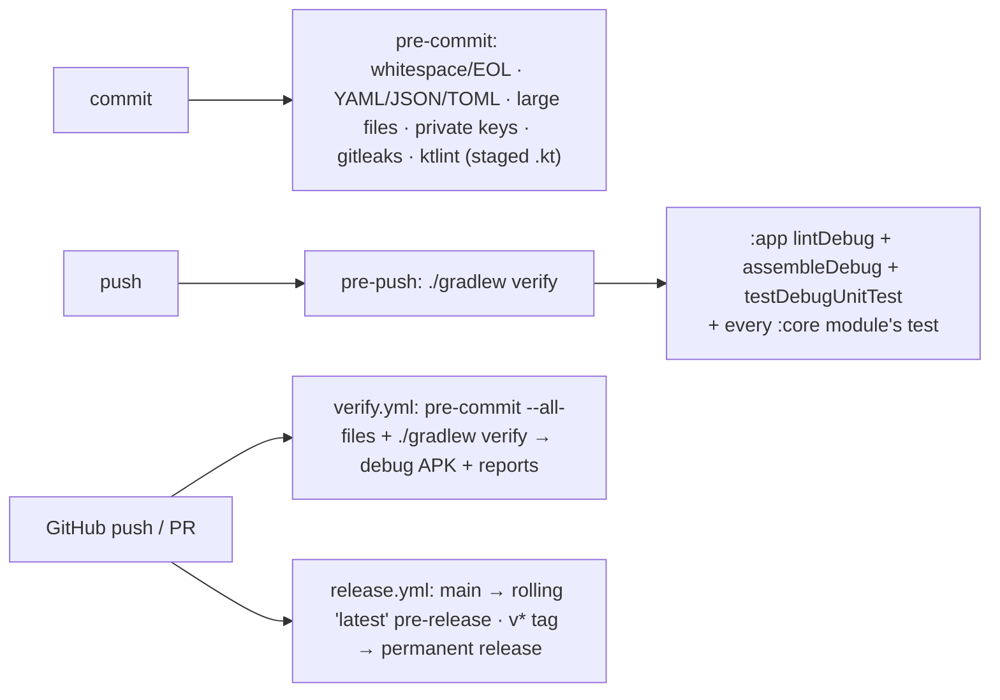

# Build, verify, release — stack, hooks, CI, signing, the fake device

**Scope:** toolchain versions, permissions declared, the `verify` gate, git hooks, GitHub Actions, release signing, and the debug-only fake device used by tests and demos.
**Code:** `gradle/libs.versions.toml`, `build.gradle.kts` (`verify`), `app/build.gradle.kts`, `.pre-commit-config.yaml`, `.editorconfig`, `.github/workflows/{verify,release}.yml`, `tools/setup-hooks.sh`, `tools/setup-signing.sh`, `data/fake/FakeTransport.kt`, `AndroidManifest.xml`.
**Related:** [architecture.md](architecture.md) (modules the gate builds), [status.md](status.md) (what the gate proves and what it cannot).

## Gate



```sh
export JAVA_HOME="/Applications/Android Studio.app/Contents/jbr/Contents/Home"   # JBR (JDK 25) or any JDK ≥ 17
tools/setup-hooks.sh                 # once per clone
./gradlew --no-daemon clean verify   # the gate; everything must pass before a commit
python3 tools/validate_station_epoch_migration.py   # stdlib SQLite, actual v8→v9 SQL vs Room exports
adb install app/build/outputs/apk/debug/app-debug.apk
```

Lint errors fail the build by design; **14 existing warnings** are known at 2026-09-29 (seven source warnings and seven
dependency-update notices) — do not add more
carelessly. `testOptions.unitTests.isReturnDefaultValues = true` so `android.util.Log` in a class
under JVM test does not throw. A ktlint hook that reformats a file fails the commit once; re-stage
and commit again. CI has **no phone and no emulator**: BLE, mDNS, the foreground service and
WorkManager plumbing are verified only on hardware and recorded in the firmware repo's
`bench-verified.md`.

## Stack (verified building 2026-09-29; dependency versions unchanged)

| | |
| --- | --- |
| Language / UI | Kotlin 2.4.20, Jetpack Compose (BOM 2026.09.00, material3 1.4.0), Material 3 dynamic color, Navigation 3 (1.1.7) |
| DI / data | Hilt 2.60.1, Room 2.8.5 (**schema v9**), DataStore Preferences 1.2.1, WorkManager 2.11.2 + `androidx.hilt:hilt-work` 1.4.0, kotlinx.serialization 1.11.0, coroutines 1.11.0 |
| Native | `zstd-jni` 1.5.7-17 (`@aar`) — the only native library |
| Build | AGP 9.4.0, Gradle 9.7.1, KSP 2.3.12, version catalog; Parquet stays JVM, protocol and sensor-domain logic target JVM (Java 17) and iOS |
| SDK | `compileSdk`/`targetSdk` **37**, `minSdk` **31** (modern Bluetooth permission model; no legacy branches) |
| Style | ktlint `intellij_idea`, `max_line_length = off`, house rules off (`{ a; b }` one-liners, compact `when`, one-line enums, `_x` backing fields, `function-signature`) |

Bump `libs.versions.toml` only to versions you have verified build, and note the date here.

## iOS build (migration started 2026-10-08)

The iOS app lives in `ios/OpenSensor.xcodeproj`, with the Compose framework in
`:ios:shared`. `verify` now includes its JVM presentation-state tests and shared
core tests. `verifyIos` is a separate macOS gate for simulator tests/framework
linking; Xcode compiles the Swift app. Signing teams stay in local Xcode settings
or command-line overrides. See [ios-migration.md](ios-migration.md) for commands,
current feature scope and simulator versus phone qualification.

Both host migration validators run in verification and release CI:
`validate_station_epoch_migration.py` checks v8→v9, and
`validate_sensor_installation_migration.py` checks v9→v10. Their SQL extraction
stops at the next migration declaration so later migrations cannot contaminate
earlier fixtures.

## Permissions (`AndroidManifest.xml`)

| Permission | Why | Runtime? |
| --- | --- | --- |
| `BLUETOOTH_SCAN` (`neverForLocation`), `BLUETOOTH_CONNECT` | the BLE pipe | yes |
| `INTERNET` | **only** LAN sockets to hosts from mDNS `_aqsync._tcp` discovery; no cloud endpoint | – |
| `ACCESS_LOCAL_NETWORK` | mDNS + LAN on API 37+; denial leaves BLE working | yes, API 37+ only |
| `FOREGROUND_SERVICE` + `FOREGROUND_SERVICE_DATA_SYNC` | `SyncForegroundService` and the worker's `setForeground` | – |
| `POST_NOTIFICATIONS` | progress + summary notifications | yes, API 33+ |
| `WAKE_LOCK` | **only** `LanWifiLock` during LAN transfers; no CPU wake lock anywhere | – |
| `REQUEST_COMPANION_RUN_IN_BACKGROUND`, `REQUEST_COMPANION_USE_DATA_IN_BACKGROUND`, `REQUEST_COMPANION_START_FOREGROUND_SERVICES_FROM_BACKGROUND`, `REQUEST_OBSERVE_COMPANION_DEVICE_PRESENCE` | "wake when nearby": the system's presence exemptions apply only while an associated logger is in range ([background-sync.md](background-sync.md#triggers--starting-a-run-before-the-period-is-up)) | – (normal); the association itself is one system dialog |
| `RECEIVE_BOOT_COMPLETED` | restart the process after boot so the Wi-Fi-arrival and advertising-flag registrations are re-armed; schedules nothing itself | – |

No location permission, no analytics/crash SDKs, no accounts. `allowBackup` with
`dataExtractionRules` ([data-model.md](data-model.md#backup)).

CI verification and release builds also run the station-epoch migration validator. It checks
SQL and exported schemas on the host. On 2026-09-29, an in-place USB `adb install -r` update
succeeded on the GM1911 (Android 16 / API 36), and existing archive summaries of 99 and 1,151
files remained visible. The previous installed schema was not inspected, so this does not
qualify a controlled v8→v9 Android Room migration; that scenario remains unverified.

## Releases

Every push to `main` refreshes the rolling **`latest`** pre-release (one universal APK — no native
ABI split matters since the app is Android 12+ and `zstd-jni` ships all ABIs — plus
`SHA256SUMS.txt`); a `v*` tag publishes a permanent release. Artifact retention 14 days (org max).
Signing is **fail-closed**. Release tasks require all four `AQSYNC_*` signing variables and an
existing keystore; Gradle never substitutes the debug signing config. The release job requires the
four keystore secrets plus `RELEASE_CERT_SHA256`, validates that the alias/private-key entry opens,
compares its certificate fingerprint to the configured value, runs the full `verify` suite in the
same job, builds the APK, and checks the APK signer with `apksigner` before publishing. A missing,
partial, wrong, or debug configuration fails before release creation. The expected project key is
`CN=AQ Sync, O=walkthru.earth`, SHA-256 `b039d9e8…f04f3f7`.

`tools/setup-signing.sh` generated `secrets/release.jks` (PKCS12, RSA 4096, 30 y) and
`secrets/.env` with the `AQSYNC_*` variables `app/build.gradle.kts` reads
(`AQSYNC_KEYSTORE_FILE/PASSWORD`, `AQSYNC_KEY_ALIAS/PASSWORD`, `AQSYNC_VERSION_CODE/NAME`) and
uploaded the four Actions secrets. Local signed release:
`set -a; source secrets/.env; set +a; ./gradlew :app:assembleRelease`. `secrets/` is git-ignored.
**Back the keystore up** — without it no future release installs over an existing one.

### Pipeline check (2026-09-29)

After the repository rename and merge at `06ab6cc`, the
[main verification run](https://github.com/walkthru-earth/opensensor-space-android/actions/runs/36584773614)
passed all hooks, the station-epoch validator, Gradle verification, and artifact uploads.
Downloaded reports contain 219 tests: **218 passed, one skipped**, zero failures, and 14 lint warnings.
The renamed repository resolves the Actions versions and retains its existing keystore secrets.
`RELEASE_CERT_SHA256` was added from the trusted local keystore's public certificate; no signing key changed.

The [release run](https://github.com/walkthru-earth/opensensor-space-android/actions/runs/36584773885)
then passed keystore/certificate validation and the full verified release build, but the final
signer check rejected a changed `apksigner` output label (`V2 Signer:` rather than `Signer #1`).
The APK verified cryptographically and reported the expected project certificate; publication
remained blocked. The workflow now recognizes both explicit label formats and still requires
one signer, one unique 64-digit SHA-256 certificate fingerprint, and an exact match to the
validated certificate. A fresh main run must pass this corrected check before publication is qualified.

## Fake device (debug builds, `FakeTransport`)

Menu → *Debug: fake device* (`FA:KE:00:00:00:01`) speaks protocol v2 in-process: three small
`PAR1…PAR1` files + one **1 MiB** benchmark file (≈ 8 s at the fake's chunk pace — enough to watch
the notification, Stop, and a `.partial` resume), correct CRCs, `live` JSON every **10 s**, a fake
configuration (pairing, Wi-Fi, LAN), a Wi-Fi scan list (`home` / `walkthru-field` / `CoffeeShop
Guest` can be joined; anything else → `failed`), a fake token, an 8 KiB serial log, and a `REBOOT`
that drops the link and applies pending `ble.*` changes. Persists for the process, like NVS.
*Debug: fake device (as LAN)* (`FA:KE:00:00:00:02`) is the same device with `payload_max` 1024 and
`GET_TOKEN` → `ERROR` 13 — **not a socket**. Fault hooks for tests: `dropLeadingChunks(readIndex)`,
`closedDelayMs`. Extend the fake rather than mocking.

## Provenance and generator gotchas

```sh
git clone --depth 1 --branch base https://github.com/android/architecture-templates.git opensensor-space-android
cd opensensor-space-android && rm -rf .git
/opt/homebrew/bin/bash customizer.sh earth.walkthru.aqsync Device "AQ Sync"   # bash ≥ 4; macOS ships 3
```

`customizer.sh` cannot take a spaced application name (`class AQ Sync`, `Theme.AQ Sync`) — fixed by
hand after generation; the raw output is the first commit so the fix is visible.

## Uses → affects

| Edit… | Affects… |
| --- | --- |
| `libs.versions.toml` | all modules; note the verified date above |
| `verify` task in root `build.gradle.kts` | pre-push hook and `verify.yml` (both call it) |
| manifest permissions | AGENTS.md non-negotiables; `LanPermission`, `NotificationPermission`, `BluetoothGate` |
| `FakeTransport` behaviour | `WindowRecoveryTest`, `AutoSyncRunnerTest`, `HistoryDeriverTest` and every debug demo |
| `.editorconfig` ktlint rules | the pre-commit hook and CI's `pre-commit --all-files` |
