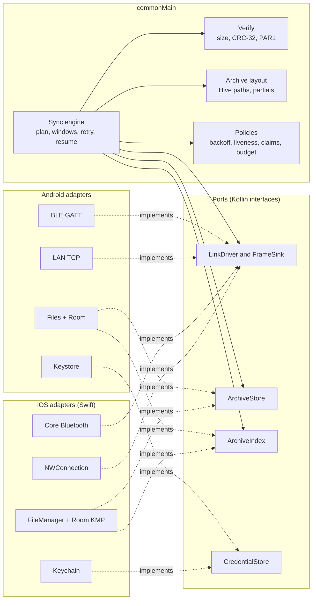

# Cross-platform guide (iOS and Android)

**Scope:** how this project keeps one product, one design and one sync behaviour across Android
and iOS, and the rules every new feature follows. **Code:** `core/`, `ios/shared/`, `app/`,
`ios/App/`. **Related:** [architecture.md](architecture.md), [ios.md](ios.md), `../ios/AGENTS.md`.

## The one-sentence rule

Share every decision, keep every OS service native. If two phones must reach the same answer
(is this file synced, what colour is this reading, when to retry), the answer lives in Kotlin
`commonMain` and is tested once in `commonTest`. If the work talks to the operating system
(radio, socket, file handle, keychain, permission, background time, share sheet), it lives in the
platform and stays thin.

## How other teams do this

Three patterns are common in production today.

| Pattern | Shared | Native | Fits when | Examples |
| --- | --- | --- | --- | --- |
| Shared logic, native UI | Domain, data, networking, sync | Each UI and OS service | Platform look matters most, two UI teams | Many KMP adopters listed in the [Kotlin case studies](https://kotlinlang.org/case-studies/) |
| Shared logic and shared UI | Above plus screens through Compose Multiplatform | OS services and system sheets | One small team, Android already in Compose | [Compose Multiplatform for iOS](https://www.jetbrains.com/compose-multiplatform/) is stable since 1.8 |
| Separate apps, shared contract | Only a written protocol and tokens | Everything | Two large independent teams | Apps that share only an API and a design system |

**This project uses the second pattern.** Android screens are already Compose, the iOS screen is
Compose Multiplatform, and one team maintains both. It is the cheapest path to parity. We keep the
option to drop into SwiftUI or UIKit at a boundary (document picker, system sheets) and never
build the same screen twice.

Common to all three patterns, and non-negotiable here, are a written wire contract (owned by
`../opensensor-space-firmware/docs/shared/`), one source of design tokens, and platform adapters behind narrow
interfaces.

## Sync parity

### Where the code lives

Both phones run `SyncEngine`, `ArchiveCollector` and one `CollectionController` per device from
`:core:sync`, with the `ArchiveStore` and `ArchiveIndex` ports from `:core:archive`. Android adapts
the ports in `app/.../data/archive/` and routes collection through `DeviceFacade`. iOS uses
`IosArchiveStore` in `:core:archive` iosMain with the shared Room index from `:core:database`, one `IosLink` per
connection over `LinkSession`, and `SensorCollections`, which every Swift sync entry point calls.
Swift `LanSession` and `BlePhysicalLink` feed each `LinkSession` through `LinkDriver` and
`FrameSink`. Keystore and Keychain stay platform code, and the credential port in the diagram is
planned. See [sync-engine.md](sync-engine.md#where-ios-still-differs-from-android) for the
behaviour that still differs.

### Rules

1. **The contract first.** A frame layout, opcode, error code, name rule or retry rule comes from
   `../opensensor-space-firmware/docs/shared/ble-sync-protocol.md`. Read it before changing either platform. If
   the code disagrees with it, the code is wrong.
2. **One engine.** The download loop (list, open, read windows, retry a failed window from the
   phone's own offset, close, verify, commit) runs in shared Kotlin on both phones. Platform code
   never decides whether a file is synced. A sync fix lands once, in `:core:sync`.
3. **Ports are small and byte based.** `LinkDriver` writes request frames and feeds reply bytes through `FrameSink` to `LinkSession`. No hex strings,
   no JSON for binary data, no per-byte callbacks across the Swift boundary. Convert `ByteArray`
   to `NSData` once in `iosMain` with pinned memory.
4. **One archive layout.** Hive paths and partial names are defined once in shared code, and the
   Room `archived_file` record is the "is synced" receipt on both phones. Both are documented in [data-model.md](data-model.md). A layout
   change ships with a migration for both platforms in the same change.
5. **Tests live in `commonTest`.** Shared tests run on the JVM or Android host in `verify` and on
   the iOS simulator in `verifyIos`. Each convention plugin gates its module, so a new module
   cannot be missed. A behaviour tested only in `jvmTest` or only in Swift is not shared
   behaviour. Corruption checks, name validation, resume, window retry and cancellation are in
   `:core:sync` and `:core:archive` `commonTest`, and the iOS runner in `ios/shared` `iosTest`
   (`SensorSyncTest`). Swift `TransferChecks` keeps only LAN claims, keepalive, framing and policy.
6. **Adapters are thin and boring.** A Swift adapter maps OS callbacks to the port and nothing
   else. If an adapter grows a `retry`, `if size ==` or `crc`, that logic belongs in shared code.
7. **Concurrency at the boundary.** Kotlin exposes `suspend` functions (bridged to Swift `async`)
   and state through a small observer or `StateFlow` wrapper. Kotlin objects stay confined to one
   actor on the Swift side. Revisit [Swift export](https://kotlinlang.org/docs/native-swift-export.html)
   when it leaves alpha, and SKIE or KMP-NativeCoroutines only when Flow-heavy APIs reach Swift.
8. **Same evidence on both phones.** A sync change is finished when both platforms pass host and
   simulator gates, and a phone run is recorded for any radio, background or permission change.

### Adding a transport (example, L2CAP or USB)

1. Confirm the firmware contract supports it (`../opensensor-space-firmware/docs/shared/`).
2. Implement `LinkDriver` on each platform that needs it and feed the connection's `LinkSession` through `FrameSink`. Declare
   `payloadMax` and capabilities.
3. Add the transport choice to the shared transport selection policy and its tests.
4. No change to the engine, verify or archive code should be needed. If one is, the port is wrong.

### Adding a sensor type or device family

Air quality is one family among many. Follow "Adding a device family" in
[devices-and-discovery.md](devices-and-discovery.md). In short, the firmware contract names the
properties, the metric registry gets a dictionary entry with `commonTest` coverage, and screens
pick it up through capabilities. Never a schema string check in a screen. Today the registry is
`Metrics` and `DeviceCapabilities` in `:core:history`. `:core:model` holds the board template, app
profile and datastream model that replaces them (#183), with the bundled templates and profiles
that LIVE already reads (#184). Today picks its hero by the profile `hero` through
`HeroRegistry`, else the generic `GenericMetricHero`
([devices-and-discovery.md](devices-and-discovery.md)).

## Design parity

### One source of design tokens

The brand lives on the website, in `walkthru-earth.github.io/lib/brand.ts` (the "sensing" palette,
signal blue and teal) and `app/globals.css` (type and shape). The apps follow it.

| Layer | Owner | Notes |
| --- | --- | --- |
| Brand tokens (colour roles, type, radii, spacing) | `:ui:designsystem` `commonMain`, values copied from the website registry | Light and dark from the same role names (`main`, `ink`, `paper`, `surface`, `accent`, `deep`, `text`, `muted`, `border`) |
| Scientific colours (health scales) | `:family:air` `WhoGuidelines` and `WhoStep` | WHO 2021 guideline and interim targets, one colour-blind checked palette, never derived from brand colours, never changed for aesthetics |
| Material 3 theme | `:ui:designsystem` maps tokens to a `ColorScheme`, `Typography` and `Shapes` | Android and iOS render the same theme through Compose |
| Fonts | Quicksand (Latin) and Cairo (Arabic), both OFL variable TTFs, Compose resources in `:ui:designsystem` with their licence texts | No runtime font download, the app works offline. Same faces and weights on Android and iOS |
| Floating controls | `:ui:designsystem` `FloatingControls.kt` | One style for every control over content, see below |
| Characters | Reference peacock from `public/mascots/peacock.webp`, with bundled variations in `:ui:designsystem` | Static compact portraits for live and archived air moods, guide, empty, progress and success states; original full artwork retained for welcome |

The [W3C Design Tokens format](https://www.designtokens.org/) (DTCG JSON) is the common way teams
keep web, Android and iOS tokens in one file and generate code per platform. When a third
consumer appears, move the registry to a DTCG JSON file and generate Kotlin and TypeScript from
it. Until then, the Kotlin token file names its website source and the values are compared in a
unit test.

### Floating controls (the global UI rule)

Every control that floats over content (the map, a chart, a photo) follows one set of rules on
both platforms. They borrow the principles of Apple's Liquid Glass guidance
([reference](https://www.conor.fyi/writing/liquid-glass-reference)), not its SwiftUI APIs,
because the shared screens are Compose.

- **One layer.** Controls float above content and never stack on each other. Content is never
  styled as a control.
- **Compact at rest, grows in use.** A control shows only its current state and expands into
  its options while touched, then folds back (the Discover time pill is the model).
- **Curved cards, not circles.** `FloatingControl.Shape` (16 dp) for controls, `SmallShape`
  (12 dp) for chips and small pills. Anything nested is concentric, its radius is the outer
  radius minus the inset (`FloatingControl.concentric()`).
- **Tint means something.** Only the selected or primary thing uses the brand's Signal blue
  (`FloatingControl.Selected` with `OnSelected` ink). Everything else is neutral surface.
- **Readable over anything.** `FloatingSurface` is a near opaque surface with a hairline border
  and a soft shadow. Touch targets are at least 44 dp (`FloatingControl.Size`), spacing to the
  screen edge is `FloatingControl.Margin`.
- **Accessible.** A collapsed control is one accessibility element with a name, a state and
  actions for its other options.

Never use Material's baseline colours on either platform. Both entry points wrap content in the
brand theme (`OpenSensorTheme` from `:ui:designsystem`, the same on Android and iOS), so nothing
renders in the default purple.

### Health scales and charts (the global data rule)

Every value that has a published health scale is judged against it, the same way on the map,
in charts, on cards and in the peacock expression. The scale lives once in `:family:air`.

- **WHO 2021, cited.** PM2.5 and PM10 use the WHO global air quality guidelines (2021), the
  24-hour guideline and its four interim targets (PM2.5 15, 25, 37.5, 50, 75 µg/m³. PM10 45,
  50, 75, 100, 150 µg/m³). A value at or below an edge belongs to the cleaner step. Properties
  without a WHO value (CO₂, temperature, humidity) have no scale and use the neutral viridis
  ramp. The app never invents a scale.
- **PM2.5 corrected by default.** A row with a valid relative humidity (finite, 0 to 100 %)
  shows the US EPA corrected PM2.5 for PurpleAir style PMS sensors (Barkjohn et al. 2021, the
  US-wide piecewise equation the EPA uses on the AirNow Fire and Smoke Map), computed from
  `pm25_cf1_ug_m3` and `relative_humidity_percent` by `EpaPm25Correction` in `:family:air`.
  Each row is corrected before averaging, never the average. A negative result clamps to 0 and
  there is no extrapolation. A row without a valid RH, every CoreS3 row and every Discover value
  (the public feed has no humidity) shows the atmospheric value, labelled raw. Every PM2.5 card
  and chart says "PM2.5 corrected" or "PM2.5 raw". Simple shows corrected only. Detailed shows
  corrected first, then raw. The WHO steps judge whichever value is shown. Archive files, the
  Room index, daily files and exports stay raw. The correction is derived on read and in the tiers.
- **Fixed, not relative.** A step colour means the same thing in every viewport, window and
  screen. Percentile stretching is only for properties without a scale.
- **Say the averaging.** The WHO values are 24-hour means. A 1-hour or 7-day mean is still
  coloured by the steps, and the legend says it is compared with the 24-hour guideline.
- **Charts.** Bars or points take the step colour, the background stays neutral, the y axis
  starts at zero, the guideline is a labelled dashed line, and the y maximum snaps up to a WHO
  edge so the guideline is always in view and charts compare. Outliers above the 95th
  percentile are capped and labelled.
- **Colour is never alone.** Every coloured value also shows its step name in text, and the
  palette runs light to dark so its order survives greyscale and colour-blind vision
  (`WhoPaletteTest`).
- **Not an AQI.** A WHO step is not an index. The live number is a short snapshot and is never
  presented as a 24-hour mean.

The shared `AirQualityPeacock` maps Fresh air to Happy, Fair to Calm, Getting hazy to Concerned,
Poor and Smoky to Masked, and Thick smoke to Feather shield. Missing measurements use Confused.
This changes the visual cue only. Labels, advice, units, WHO step colours and chart scales keep
their meaning. Metrics without a published scale keep neutral metric cards.

Use the same reference character and bundled static portraits for empty results and app states,
through `PeacockIcon` and `MascotGuide`, instead of generic smiley emoji. Working, Sleeping and
Concerned distinguish progress, unavailable or stale readings, and problems. In-app portraits
are at least 48 dp and keep the face and feather gestures visible. Keep the translated explanation
beside the character, and mark the image decorative when the label already carries its meaning.
Both apps load this art from Compose resources and never fetch character images over the Internet.
Android uses coloured portraits in notification large icons and a monochrome peacock small icon,
which the platform tints; notification sizes remain under system control.

Sources: [WHO global air quality guidelines, 2021](https://www.who.int/publications/i/item/9789240034228),
[Mazama Science, qualitative display of air quality data](https://working-with-data.mazamascience.com/2021/03/18/qualitative-display-of-air-quality-data/),
[South Coast AQMD accessible AQI scale](https://www.aqmd.gov/home/research/pubs-docs-reports/newsletters/may-june-july-2022/accessible-aqi-scale).

### Accessibility

Every shared screen reads well on TalkBack and VoiceOver from the same Compose semantics. Compose
Multiplatform 1.12 maps them to UIKit on iOS. `heading()` becomes the header trait (the VoiceOver
rotor's Headings), `Role.Button`, `Role.Switch` and `Role.Tab` become the button, toggle and tab
traits, `selected` becomes the selected trait, a progress value becomes adjustable, a live region
posts an announcement, and `isTraversalGroup` with `traversalIndex` orders traversal. The tree syncs
lazily while a screen reader runs, so neither app sets `AccessibilitySyncOptions`. Use only standard
Compose semantics, never a platform accessibility API in a shared screen.

The rules for a new screen or component.

1. **Headings.** The page title, each card or section title and each sheet or dialog title carries
   `Modifier.headingSemantics()` (`Modifier.semantics { heading() }`). `SectionCard`, `CardHeader`,
   `MascotGuide` and `InfoSheet` do this already. An eyebrow that titles something passes
   `Eyebrow(heading = true)`. A label inside a row is not a heading.
2. **Roles.** A Material `Button`, `IconButton`, `Switch`, `Checkbox`, `RadioButton` or `Tab` names its
   role itself. A custom tap target passes `role =` to `clickable`, `selectable` or `toggleable`.
   Exclusive choices sit in a `selectableGroup()` and use `selectable(role = Role.RadioButton)` or
   `Role.Tab`. `SemanticsLintTest` in `:ui:strings` fails on a custom tap target without a role.
3. **Names.** An icon-only button has a translated `contentDescription` that says what it does
   ("Back", "More about Wi-Fi"). An icon or image beside text that says the same is decorative and
   gets `contentDescription = null`. The peacock is decorative unless it says something the text
   does not. `InfoSheet` includes a visible translated `Close` button (`OutlinePillButton`) in addition
   to swipe and scrim dismissal.
4. **One element per thing.** A card or row that is one item (a reading with its unit and WHO step, a
   device row, a stat line) merges with `Modifier.cardSemantics()` (`semantics(mergeDescendants = true)`)
   or `Modifier.valueSemantics(label, value, unit, state)` (`clearAndSetSemantics`), and a clickable row
   merges by itself. A settings row with a switch reads its label and its state together through
   `Modifier.switchRowSemantics(checked, onCheckedChange)` (`toggleable(role = Role.Switch)`), and the
   `Switch` takes `onCheckedChange = null` when the row and the switch do the same thing. A row with a
   text button merges its label and its state (`"Sensor files, 40.0 MB"`) and leaves the button and any
   info button as their own stops. The merged part is at least `MinTouchTarget` tall. A short button
   label ("Find", "Clear") gets a description that names what it acts on, and a description always
   starts with the visible words ("All dates, Choose dates"), so Voice Control and Voice Access find
   the button by what it shows.
5. **Touch targets.** Every tap target is at least 48 dp (`MinTouchTarget` and `FloatingControl.Size`,
   both 48 dp), with at least 8 dp (`MinTouchSpacing` and `FloatingControl.MinSpacing`) between
   neighbouring controls such as `BrandBottomBar` tabs. `Modifier.touchTarget()` combines
   `minimumInteractiveComponentSize()` and `sizeIn(minWidth = 48.dp, minHeight = 48.dp)`, and
   `FloatingIconButton`, `FloatingTextButton`, `PillButton`, `OutlinePillButton`, `BottomBarItem`,
   `SectionTabs` and `InfoButton` apply it directly.
6. **Text scaling and wrapping.** No text breaks a line inside a word, in English or Arabic.
   `brandTypography` gives every style `Hyphens.None`, `LineBreak.Paragraph` for body styles and
   `LineBreak.Heading` for the rest. A short label (bottom bar tab, section tab, button, segment,
   chip, eyebrow, legend word, caption, screen or thing title) uses `FitText` in `FitText.kt`. It
   keeps the user's size while the label fits on one line, then shrinks on one line no lower than its
   own size at font scale 1.0, then to `FitTextLimits.FloorFraction` (85 percent) of that. The 1.0
   size is `Typography.oneScaleSize(style)`, the style's own sp for every style except the display
   numerals, which resolve to their `DisplaySizes` token (84, 48, 32) because `brandTypography` has
   already clamped them for the current scale. A display style is known by its size and tabular
   figures, so a copy with another line height, colour or weight still resolves to its token. Below the floor it wraps between words, up to
   `LabelMaxLines` (2), because a 48 dp target is a minimum height and the control grows for a second
   line. A word wider than its line even at the floor keeps shrinking until it fits whole, down to
   `MinFraction` (50 percent). Only past that does the label draw on one line at 50 percent with an
   ellipsis. Its semantics keep the full text, so screen readers read all of it. A hyphen between two
   letters or digits (OS-7500, Wi-Fi) joins one word, so no line ends on it. Body text and info sheet
   paragraphs use `BodyText`, which keeps the user's full size and shrinks only when one word is wider
   than the line, down to the same 50 percent. `SectionTabs` measures its labels at the floor and switches to
   `PrimaryScrollableTabRow` when they do not all fit their equal slots, so a tab never wraps or
   splits. `TypographyLimits` in `Typography.kt` sets the line caps of the remaining labels
   (`EyebrowMaxLines = 2`, `StatLabelMaxLines = 3`, `StatValueMaxLines = 2`, `TickingMaxLines = 2`).
   `SectionCard`
   and `StatLine` weight their primary text and cap value width so trailing buttons and values stay
   inside a 320 dp viewport. `MascotGuide` stacks the peacock above its text on narrow widths
   (`< 340.dp`) or at font scales `>= 1.5f`. `brandTypography` clamps display numeral sizes
   (`displayLarge`, `displayMedium`, `displaySmall`) through `clampedDisplaySizeSp(baseSp, density)`
   using `Density.toDp()` so they never render smaller than their 1.0x `dp` size (including under
   Android 14 non-linear font scaling) and cap at `TypographyLimits.MaxDisplayFontScale` (`1.35f`)
   while body, label, title and headline styles scale up to 200 percent.
7. **Contrast and non-colour cues.** `ColorContrast.kt` in `:ui:designsystem` is the single definition
   of `relativeLuminance`, `contrastRatio`, `BODY_TEXT_CONTRAST` (`4.5`), `LARGE_TEXT_CONTRAST` (`3.0`),
   `UI_COMPONENT_CONTRAST` (`3.0`), `WhoStep.color()`, `WhoStep.onColor()`,
   `WhoStep.textColorOnSurface()`, `signalBarColor()` and `swatchBorderColor()`, with `app`,
   `:feature:today` and `:feature:history` delegating to it. `FloatingSurface`, `FloatingIconButton`
   and `FloatingTextButton` borders, `SignalBars` filled and hollow-outlined unfilled bars, and
   `MoodLegend` swatch borders maintain at least 3 to 1 contrast in both Light and Dark themes, while
   plain `BrandCard` keeps the website `outlineVariant` border token and `MoodStrip` outlines only the
   selected block. Selected, on, off, progress and a WHO step reach the screen reader as words, through
   the control's own state, `stateDescription` or the merged text. The `Eyebrow` capitals are visual
   only, its semantics carry the text as written.
8. **Reduce motion and live regions.** Compose honours Android "Remove animations", and `Motion.kt`
   reads the system setting on both platforms through `rememberSystemReduceMotion()` (Android
   `Settings.Global.ANIMATOR_DURATION_SCALE` and `ValueAnimator.areAnimatorsEnabled()` observed via
   `ContentObserver`, iOS `UIAccessibility.isReduceMotionEnabled` observed via
   `UIAccessibilityReduceMotionStatusDidChangeNotification`). `OpenSensorTheme` is the one place
   that reads it and provides `LocalReduceMotion`. Components such as `Peacock` read
   `LocalReduceMotion`, and `Peacock` skips its entrance animation when it is true. `rememberNowMillis` keeps its 1 second tick so stale checks stay
   exact, while `TickingText` quantises its spoken `contentDescription` to 10 second steps via
   `quantiseSpokenMillis()`. `liveRegion = LiveRegionMode.Polite` goes only on a line that changes
   while the person waits, such as sync progress or a notice, never on a value that ticks every second.
9. **Charts and maps.** A chart starts with a text summary in `contentDescription` (what it shows,
   the highest value and its WHO step, which Simple leaves out). Then the bar chart and the calendar give one node per bar or
   day with a reading, in time order, naming the time, the value with its unit, the mood and the WHO
   step (Simple leaves the step out). Each is a button, and activating a bar selects it, as a touch
   does. These nodes are semantics only, laid over the canvas, each exactly its bar slot or day cell.
   `ExactTouchBounds` turns off the 48 dp minimum touch target for them, since a grown node would be
   covered by the next one and shift a bar to the left (#141). A touch picks a bar when it lifts, a
   sideways drag past the touch slop scrubs the bars, and a vertical drag is left to the page so it
   scrolls (`dragIntent`). Axis margins are measured from the
   labels with a `TextMeasurer`, so a large font never clips them. `layoutChartLabels` measures and
   places every label once and the canvas draws exactly those. `placeAxisLabels` keeps each axis
   label inside the canvas and skips one closer than the gap to its neighbour (its gridline stays).
   The guideline label wraps to two lines at the plot width or falls back to a shorter label
   (`fitGuideLabel`), and goes unlabelled only when none fits, since the note under the chart names
   the line. `BandColumnChartFontScaleTest` renders the chart and records every label it draws, at
   font scale 2.0 and 3.1, on 280 and 320 dp, in English and in Arabic right to left, at Simple and
   Detailed. The map container says what it shows, and the list beside
   it is the accessible way through the same cells.
10. **Copy.** Descriptions follow the copy rules above, translated in `values-ar`, positional
    arguments, and no em dashes, colons or semicolons.

`ColorContrastTest` and `ComponentsTest` in `:ui:designsystem` `commonTest` check palette contrast,
threshold-pinned luminance math, touch target tokens, non-linear and linear display scale clamping,
spoken tick quantisation and reduce-motion helpers. `SemanticsTest` in `:ui:designsystem` `iosTest`
renders the shared components on the iOS simulator and checks 48 dp touch bounds, 8 dp bottom bar
spacing, headings, merged rows, 200 percent font scale fitting without split words, `InfoSheet` close
action, switch rows, tab roles and live iOS reduce-motion notifications. `FitTextTest` in
`:ui:designsystem` `commonTest` pins the size search and the mid-word check, and `FitTextLayoutTest`
in `iosTest` renders bottom bar labels, section tabs, titles and body text at font scale 1.0, 2.0 and
3.1, 280 and 360 dp, in English and in Arabic right to left. Bottom bar labels stay on one line at no
less than their 1.0 size and body text breaks only between words. It also sweeps a label from 24 to
360 dp and checks that no line ends inside a word, and that a display numeral wraps at its token floor
at font scale 2.0 and 3.1. `BandColumnChartSemanticsTest` in
`:feature:history` `iosTest` walks the bar chart node by node, `BandColumnChartGestureTest` checks
that a vertical swipe over it scrolls the page while a sideways drag scrubs and a tap picks one bar,
`DayRingSemanticsTest` walks the Day ring one hour at a time after its summary, with the WHO step
only above Simple and every hour node on the ring at font scale 2.0, `ChartNodeBoundsTest` also checks
that every Month calendar day is a 48 dp target, `ThingChipsSemanticsTest` checks that only Developer
reads the full thing id, and `WhoCueTest` in `commonTest` pins the WHO step fill share and the 3 to 1
mark border. `FileRowSemanticsTest` in `:feature:files` `iosTest` checks that a file row has no tap of
its own and offers Share, Sync and Metrics as 48 dp buttons that name the file, `ListFailedCardTest`
checks that Try again asks the sensor to list again, and `SettingsRowSemanticsTest` in
`:feature:settings` `iosTest` checks the merged Storage rows, their 48 dp height and the button
names (`verifyIos`). Host tests cannot render
Compose without Robolectric, so the Android check is the phone walk below.

#### Phone walk (TalkBack and VoiceOver)

Run it on both phones after a screen changes, in English and in Arabic, and record it in
[status.md](status.md). Turn on TalkBack (Settings, Accessibility, TalkBack) or VoiceOver (Settings,
Accessibility, VoiceOver, or triple-click the side button).

1. **Tabs.** Swipe through the bottom bar. Each tab says its name, "tab", its position and
   "selected" for the open one. Double tap another tab and the screen title is the next heading.
2. **Headings.** On each tab, use the TalkBack headings control or the VoiceOver rotor set to
   Headings and swipe down. It stops on the page title and every card title, nothing else.
3. **Today.** Each metric card reads as one element, name, value, unit and WHO step in words. The
   "today so far" chart reads its summary. The info "i" says "More about" and the topic, and the
   sheet opens on its heading.
4. **My devices.** Each device row reads its name, how it connects and its sync state as one element.
   Start Collect all and check that the progress line is announced without moving focus.
5. **Device and Settings.** Each switch row reads its label and "on" or "off" and toggles with one
   double tap. Each choice reads as a radio button with its selected state. Icon-only buttons say
   what they do.
6. **History and Files.** Range and metric choices read their selected state. Each chart reads its
   summary, then a swipe reads each bar with a reading, its time, value, unit and mood (and WHO step
   above Simple). Each file row reads as one element, and the share and export buttons say what they
   do.
7. **Discover.** The map says what it shows, the time and metric controls read their current value,
   the cell sheet title is a heading, and the chart reads its summary.
8. **Targets.** With touch exploration on, every control can be found by a finger without a near
   miss. Double tap works on the first try for the small floating controls.
9. **Arabic.** Repeat steps 1 and 3 in Arabic. Swipe order follows right to left, except chart bars,
   which stay in time order, left to right, as they are drawn.

### Platform conventions that stay native

Shared screens still respect each OS where people notice:

- System back (Android predictive back, iOS edge swipe), status and navigation bar insets.
- Permission prompts, share and export sheets, document pickers, notifications.
- Haptics and system fonts for numbers when the brand font lacks tabular figures.
- Accessibility services (TalkBack, VoiceOver), Dynamic Type and font scale, Reduce Motion.

### Simple by default

Every screen designs for the Simple detail level first. Simple shows the headline readings now, today's
summary, sync state in words, and one primary action. Detailed adds per-file and per-metric
information. Developer alone shows raw frames, offsets, handles, CRC values, schema names,
logs and diagnostics. A new field states its level in code, and screenshot tests cover Simple.

### Copy

Write user-facing text so both platforms say the same thing. Shared screens keep their copy in
Compose resources, one catalogue for both apps (`feature/<name>/src/commonMain/composeResources/values/strings.xml`,
today Discover and Settings). Copy for iOS only screens and shared screens without a module
of their own lives in `:ui:strings`, and a key Android already has keeps its name and words. State
code holds a `UiText` (a catalogue key with arguments) and the composable resolves it. Android-only
screens still use `res/values*/strings.xml`. The `:ui:strings` host tests check every Android and
Compose `strings.xml` in the repository (`CopyLintTest`) and fail on a new `Text("…")` or English
sentence literal in the `:ios:shared`, `:ui:permissions` and `feature/*` common presentation sources
(`PresentationLiteralsTest`).
No em dashes, colons or semicolons in user-facing copy, and no Arabic semicolon (؛) in a translation.
Errors say what happened and what to do, in words a person without the firmware docs understands.

### Languages and right to left

The apps ship English (default) and Arabic (`ar`). Every catalogue has a `values-ar/strings.xml` next
to its `values/strings.xml`, the Android `app/src/main/res` one and each Compose resource module
(`ui/*`, `feature/*`). Compose resources read only the first of the phone's languages, while
Android `res/` and the iOS bundle take the first language the app ships. A phone set to French then
Arabic would show Arabic platform text, English shared screens and a mixed direction. So each app
first moves the language its platform resolved to the front of the list for that run, saving
nothing (`AppLanguage.kt` reads the `locale_tag` string in `res/`, `AppLanguage` in
`AppDelegate.swift` reads `Bundle.main.preferredLocalizations`). An explicit per-app language
already leads the list and is left alone. `preferredLanguage()` reads `Locale.current`, the value
Compose resources use, so the font follows the strings. Layouts mirror on their own because both apps
use start and end, never left and right, and directional icons (`AppIcons.ArrowBack`,
`ArrowForward`, `Send`, `ChevronLeft`, `ChevronRight`) set `autoMirror`. Cairo sets the text when
the language is written in Arabic script or the layout runs right to left (`usesCairoText` in
`Typography.kt`). Latin locales keep Quicksand.

To add a language `xx`.

1. Add `values-xx/strings.xml` beside every default catalogue, with every key and every plural
   form the language needs (Arabic needs zero, one, two, few, many and other). Keep placeholders.
2. Add `<string name="locale_tag">xx</string>` to `app/src/main/res/values-xx/strings.xml`. Add `xx`
   to `languages` (and its plural forms) in `TranslationsTest`, to
   `app/src/main/res/xml/locales_config.xml`, to `knownRegions` in the Xcode project, to
   `CFBundleLocalizations` in `ios/App/Info.plist`, and give each entry of
   `ios/App/InfoPlist.xcstrings` an `xx` value.
3. Run `verify`. `TranslationsTest` fails on a missing or extra key, a placeholder that differs, a
   language missing from the Android picker or the iOS purpose strings. `CopyLintTest` lints the new
   files, and `StringsMatchAndroidTest` and `CopyRulesTest` compare the shared keys in each language.
4. Have a native speaker review the copy and check the screens on a phone, then record it in
   `status.md`.

## Android and iOS differences that stay

Everything not listed here is shared Kotlin and behaves the same.

| Feature | Android | iOS |
| --- | --- | --- |
| Sync when the phone joins home Wi-Fi | `data/background/SyncTriggers.kt`, `WifiArrivalReceiver` | None. iOS gives a suspended app no public wake on network change |
| Re-arm triggers after reboot or update | `BootReceiver` in `data/background/SyncTriggers.kt` | Not needed. `BGTaskScheduler` requests and Core Bluetooth state restoration persist |
| Wi-Fi lock during a LAN transfer | `data/lan/LanWifiLock.kt` | Not needed |
| Wake near the sensor | Companion Device Manager presence and an offloaded advert scan (`CompanionPresence.kt`) | A pending `CBCentralManager.connect` with state restoration, armed only for sensors whose Auto-sync is due |
| Periodic Auto-sync | WorkManager every 15 min, battery not low | `BGProcessingTaskRequest`, the system picks the time. Background modes `processing` and `bluetooth-central` |
| Collect all off screen | Foreground service with a progress notification | `BGContinuedProcessingTask` on iOS 26 and later. Older iOS ends the pass when the app leaves |
| A run the user started, off screen | Foreground service | A UIKit background task. When iOS ends it the run stops as interrupted, keeps its bytes and starts again when the app is back |
| Turn Bluetooth on | System enable dialog | Not possible for apps. The system power alert and shared copy explain it |
| Bluetooth settings after a failed bond | Bluetooth settings intent | No public URL. Shared repair copy and the app settings link |
| Forget a sensor | Keeps the system bond | Drops the app record, Keychain access, Auto-sync and the Discover cell. The dialog says to remove the bond in iOS Settings |
| Local network permission | Runtime permission on API 37 and later | No status API. A `PolicyDenied` browse result counts as denied |
| Notifications permission | Asked from Sync or the Auto-sync switch | Asked from the Auto-sync switch only |
| LAN token at rest | Encrypted with an Android Keystore key | Keychain, `AfterFirstUnlockThisDeviceOnly` |
| Archive access | Read-only FileProvider over the export cache | Share and Save only, never in the Files app |
| Backup | Settings to cloud, archive device-to-device only | Settings backed up, archive excluded |
| Sticker scan | Google Code Scanner, no camera permission | VisionKit `DataScannerViewController`, camera asked on the Scan tap, Scan hidden where unsupported |
| Fake devices | Debug builds only (`TransportFactory`) | None |
| Idle Bluetooth link | Kept while the thing is open | Closed when the last page for the sensor leaves or the app leaves the screen |

Both apps keep the raw command denylist (`REBOOT`, `SET_CONFIG`) and frame redaction in
`:core:sync`. Neither app has widgets, Live Activities, App Intents or deep links.

## Checklist for a cross-platform change

- [ ] Contract checked in `../opensensor-space-firmware/docs/shared/` when the change touches the wire.
- [ ] Shared rule in `commonMain`, tested in `commonTest`.
- [ ] Platform adapters only map OS behaviour to a port.
- [ ] Design uses tokens, no raw colours or sizes in screens.
- [ ] Simple level reviewed, technical detail gated behind Detailed or Developer.
- [ ] Headings, roles, names, merged rows, 48 dp targets and chart summaries follow
      [Accessibility](#accessibility), and the phone walk is recorded for a changed screen.
- [ ] `./gradlew --no-daemon verify` (includes `verifyIos` on a Mac) and the unsigned simulator
      build pass.
- [ ] Phone evidence recorded for radio, background, permission or release behaviour, per platform.
