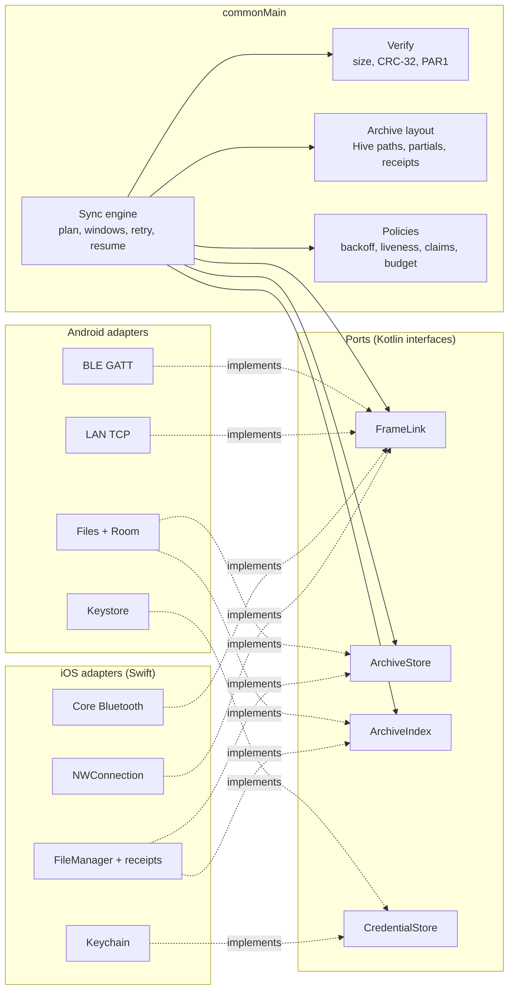

# Cross-platform guide (iOS and Android)

**Scope:** how this project keeps one product, one design and one sync behaviour across Android
and iOS, and the rules every new feature follows. **Code:** `core/`, `ios/shared/`, `app/`,
`ios/App/`. **Related:** [production-readiness-plan.md](production-readiness-plan.md),
[architecture.md](architecture.md), [ios-migration.md](ios-migration.md), `../ios/AGENTS.md`.

## The one-sentence rule

Share every decision, keep every OS service native. If two phones must reach the same answer
(is this file synced, what colour is this reading, when to retry), the answer lives in Kotlin
`commonMain` and is tested once in `commonTest`. If the work talks to the operating system
(radio, socket, file handle, keychain, permission, background time, share sheet), it lives in the
platform and stays thin.

## How other teams do this

Three patterns are common in production today.

| Pattern | Shared | Native | Fits when | Examples |
| --- | --- | --- | --- | --- |
| Shared logic, native UI | Domain, data, networking, sync | Each UI and OS service | Platform look matters most, two UI teams | Many KMP adopters listed in the [Kotlin case studies](https://kotlinlang.org/case-studies/) |
| Shared logic and shared UI | Above plus screens through Compose Multiplatform | OS services and system sheets | One small team, Android already in Compose | [Compose Multiplatform for iOS](https://www.jetbrains.com/compose-multiplatform/) is stable since 1.8 |
| Separate apps, shared contract | Only a written protocol and tokens | Everything | Two large independent teams | Apps that share only an API and a design system |

**This project uses the second pattern.** Android screens are already Compose, the iOS screen is
Compose Multiplatform, and one team maintains both. It is the cheapest path to parity. We keep the
option to drop into SwiftUI or UIKit at a boundary (document picker, system sheets) and never
build the same screen twice.

Common to all three patterns, and non-negotiable here, are a written wire contract (owned by
`../aq-parquet/docs/shared/`), one source of design tokens, and platform adapters behind narrow
interfaces.

## Sync parity

### Where the code will live (target)

This is the target shape from [platform-parity-plan.md](platform-parity-plan.md). It is not
today's code. Today Android runs `app/.../data/sync/SyncEngine.kt` and iOS runs a second engine in
`ios/App/SensorTransfer.swift` and `SensorArchive.swift`. `:core:archive` holds the archive layout, verifier, records and the `ArchiveStore` and
`ArchiveIndex` ports, which Android adapts in `app/.../data/archive/` and iOS adopts in wave 3. The
ports `FrameLink` and `CredentialStore` do not exist yet. `:core:sync` is an empty skeleton. Shared today are the wire codec, `ParquetVerify`, `Crc32` and `SafeName` in
`:core:protocol`, which the Swift engine does not call yet.

### Rules

1. **The contract first.** A frame layout, opcode, error code, name rule or retry rule comes from
   `../aq-parquet/docs/shared/ble-sync-protocol.md`. Read it before changing either platform. If
   the code disagrees with it, the code is wrong.
2. **One engine (planned).** The download loop (list, open, read windows, retry a failed window from the
   phone's own offset, close, verify, commit) runs in shared Kotlin. Platform code never decides
   whether a file is synced. Until wave 3 of the parity plan, the two engines must match
   behaviour by hand and a fix lands in both.
3. **Ports are small and byte based.** `FrameLink` sends and receives `ByteArray`. No hex strings,
   no JSON for binary data, no per-byte callbacks across the Swift boundary. Convert `ByteArray`
   to `NSData` once in `iosMain` with pinned memory.
4. **One archive layout.** Hive paths, partial names and receipt format are defined once in
   shared code and documented in [data-model.md](data-model.md). A layout change ships with a
   migration for both platforms in the same change.
5. **Tests live in `commonTest`.** Shared tests run on the JVM or Android host in `verify` and on
   the iOS simulator in `verifyIos`. Each convention plugin gates its module, so a new module
   cannot be missed. A behaviour tested only in `jvmTest` or only in Swift is not shared
   behaviour. Today corruption checks and name validation are in `commonTest`. Resume, window
   retry and cancellation are still tested twice, in `app/src/test` and in Swift `TransferChecks`.
6. **Adapters are thin and boring.** A Swift adapter maps OS callbacks to the port and nothing
   else. If an adapter grows a `retry`, `if size ==` or `crc`, that logic belongs in shared code.
7. **Concurrency at the boundary.** Kotlin exposes `suspend` functions (bridged to Swift `async`)
   and state through a small observer or `StateFlow` wrapper. Kotlin objects stay confined to one
   actor on the Swift side. Revisit [Swift export](https://kotlinlang.org/docs/native-swift-export.html)
   when it leaves alpha, and SKIE or KMP-NativeCoroutines only when Flow-heavy APIs reach Swift.
8. **Same evidence on both phones.** A sync change is finished when both platforms pass host and
   simulator gates, and a phone run is recorded for any radio, background or permission change.

### Adding a transport (example, L2CAP or USB)

1. Confirm the firmware contract supports it (`../aq-parquet/docs/shared/`).
2. Implement `FrameLink` (planned port, see above) on each platform that needs it. Declare
   `payloadMax` and capabilities.
3. Add the transport choice to the shared transport selection policy and its tests.
4. No change to the engine, verify or archive code should be needed. If one is, the port is wrong.

### Adding a sensor type or device family

Air quality is one family among many. Follow "Adding a device family" in
[devices-and-discovery.md](devices-and-discovery.md). In short, the firmware contract names the
properties, the metric registry gets a dictionary entry with `commonTest` coverage, and screens
pick it up through capabilities. Never a schema string check in a screen. Today the registry is
`Metrics` and `DeviceCapabilities` in `:core:history`. `:core:model`, `DeviceFamily` and a generic
`MetricCard` are planned (W11 in [production-readiness-plan.md](production-readiness-plan.md)) and
do not exist yet.

## Design parity

### One source of design tokens

The brand lives on the website, in `walkthru-earth.github.io/lib/brand.ts` (the "sensing" palette,
signal blue and teal) and `app/globals.css` (type and shape). The apps follow it.

| Layer | Owner | Notes |
| --- | --- | --- |
| Brand tokens (colour roles, type, radii, spacing) | `:ui:designsystem` `commonMain`, values copied from the website registry | Light and dark from the same role names (`main`, `ink`, `paper`, `surface`, `accent`, `deep`, `text`, `muted`, `border`) |
| Scientific colours (health scales) | `:core:airquality` `WhoGuidelines` and `WhoStep` | WHO 2021 guideline and interim targets, one colour-blind checked palette, never derived from brand colours, never changed for aesthetics |
| Material 3 theme | `:ui:designsystem` maps tokens to a `ColorScheme`, `Typography` and `Shapes` | Android and iOS render the same theme through Compose |
| Fonts | Quicksand (Latin) and Cairo (Arabic), both OFL variable TTFs, Compose resources in `:ui:designsystem` with their licence texts | No runtime font download, the app works offline. Same faces and weights on Android and iOS |
| Floating controls | `:ui:designsystem` `FloatingControls.kt` | One style for every control over content, see below |
| Characters | The peacock mascot from `public/mascots/peacock.webp` | A friendly guide on empty, welcome and success states, never on data |

The [W3C Design Tokens format](https://www.designtokens.org/) (DTCG JSON) is the common way teams
keep web, Android and iOS tokens in one file and generate code per platform. When a third
consumer appears, move the registry to a DTCG JSON file and generate Kotlin and TypeScript from
it. Until then, the Kotlin token file names its website source and the values are compared in a
unit test.

### Floating controls (the global UI rule)

Every control that floats over content (the map, a chart, a photo) follows one set of rules on
both platforms. They borrow the principles of Apple's Liquid Glass guidance
([reference](https://www.conor.fyi/writing/liquid-glass-reference)), not its SwiftUI APIs,
because the shared screens are Compose.

- **One layer.** Controls float above content and never stack on each other. Content is never
  styled as a control.
- **Compact at rest, grows in use.** A control shows only its current state and expands into
  its options while touched, then folds back (the Discover time pill is the model).
- **Curved cards, not circles.** `FloatingControl.Shape` (16 dp) for controls, `SmallShape`
  (12 dp) for chips and small pills. Anything nested is concentric, its radius is the outer
  radius minus the inset (`FloatingControl.concentric()`).
- **Tint means something.** Only the selected or primary thing uses the brand's Signal blue
  (`FloatingControl.Selected` with `OnSelected` ink). Everything else is neutral surface.
- **Readable over anything.** `FloatingSurface` is a near opaque surface with a hairline border
  and a soft shadow. Touch targets are at least 44 dp (`FloatingControl.Size`), spacing to the
  screen edge is `FloatingControl.Margin`.
- **Accessible.** A collapsed control is one accessibility element with a name, a state and
  actions for its other options.

Never use Material's baseline colours on either platform. Both entry points wrap content in the
brand theme (`AqSyncTheme` on Android, `OpenSensorTheme` on iOS), so nothing renders in the
default purple.

### Health scales and charts (the global data rule)

Every value that has a published health scale is judged against it, the same way on the map,
in charts, on cards and in the mood face. The scale lives once in `:core:airquality`.

- **WHO 2021, cited.** PM2.5 and PM10 use the WHO global air quality guidelines (2021), the
  24-hour guideline and its four interim targets (PM2.5 15, 25, 37.5, 50, 75 µg/m³. PM10 45,
  50, 75, 100, 150 µg/m³). A value at or below an edge belongs to the cleaner step. Properties
  without a WHO value (CO₂, temperature, humidity) have no scale and use the neutral viridis
  ramp. The app never invents a scale.
- **Fixed, not relative.** A step colour means the same thing in every viewport, window and
  screen. Percentile stretching is only for properties without a scale.
- **Say the averaging.** The WHO values are 24-hour means. A 1-hour or 7-day mean is still
  coloured by the steps, and the legend says it is compared with the 24-hour guideline.
- **Charts.** Bars or points take the step colour, the background stays neutral, the y axis
  starts at zero, the guideline is a labelled dashed line, and the y maximum snaps up to a WHO
  edge so the guideline is always in view and charts compare. Outliers above the 95th
  percentile are capped and labelled.
- **Colour is never alone.** Every coloured value also shows its step name in text, and the
  palette runs light to dark so its order survives greyscale and colour-blind vision
  (`WhoPaletteTest`).
- **Not an AQI.** A WHO step is not an index. The live number is a short snapshot and is never
  presented as a 24-hour mean.

Sources: [WHO global air quality guidelines, 2021](https://www.who.int/publications/i/item/9789240034228),
[Mazama Science, qualitative display of air quality data](https://working-with-data.mazamascience.com/2021/03/18/qualitative-display-of-air-quality-data/),
[South Coast AQMD accessible AQI scale](https://www.aqmd.gov/home/research/pubs-docs-reports/newsletters/may-june-july-2022/accessible-aqi-scale).

### Platform conventions that stay native

Shared screens still respect each OS where people notice:

- System back (Android predictive back, iOS edge swipe), status and navigation bar insets.
- Permission prompts, share and export sheets, document pickers, notifications.
- Haptics and system fonts for numbers when the brand font lacks tabular figures.
- Accessibility services (TalkBack, VoiceOver), Dynamic Type and font scale, Reduce Motion.

### Simple by default

Every screen designs for the Simple detail level first. Simple shows the headline readings now, today's
summary, sync state in words, and one primary action. Detailed adds per-file and per-metric
information. Developer alone shows raw frames, offsets, handles, CRC values, schema names,
logs and diagnostics. A new field states its level in code, and screenshot tests cover Simple.

### Copy

Write user-facing text so both platforms say the same thing. A shared string catalogue does not
exist yet. Android uses `res/values*/strings.xml`, Discover uses `DiscoverStrings.kt`, and the iOS
screen keeps its strings in `:ios:shared` Kotlin. The plan moves them to Compose resources
([platform-parity-plan.md](platform-parity-plan.md)).
No em dashes, colons or semicolons in user-facing copy. Errors say what happened and what to do,
in words a person without the firmware docs understands.

## Checklist for a cross-platform change

- [ ] Contract checked in `../aq-parquet/docs/shared/` when the change touches the wire.
- [ ] Shared rule in `commonMain`, tested in `commonTest`.
- [ ] Platform adapters only map OS behaviour to a port.
- [ ] Design uses tokens, no raw colours or sizes in screens.
- [ ] Simple level reviewed, technical detail gated behind Detailed or Developer.
- [ ] `./gradlew --no-daemon verify` (includes `verifyIos` on a Mac) and the unsigned simulator
      build pass.
- [ ] Phone evidence recorded for radio, background, permission or release behaviour, per platform.
