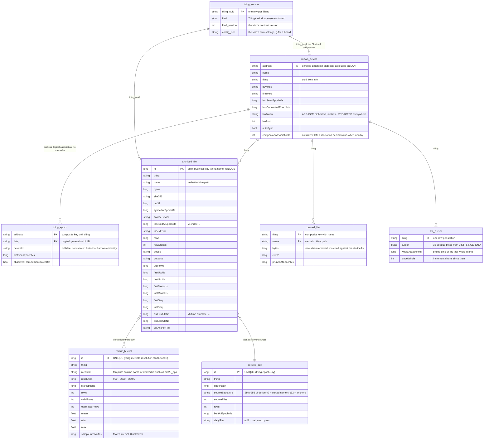
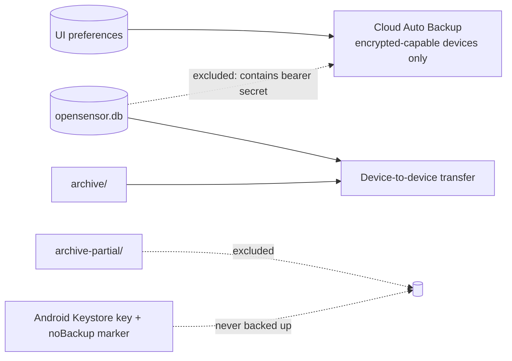

# Data model, Room, DataStore, files on disk, backup

**Scope:** what the phone stores, where, and how it moves between phones. Not how it is computed (see history-pipeline) or fetched (see sync-engine).
**Code:** `core/database` commonMain `data/local/database/AppDatabase.kt`, `KnownDevice.kt`, `ThingEpoch.kt`, `SensorInstallation.kt`, `ArchivedFile.kt`, `History.kt`, `ListCursor.kt`; `data/local/di/DatabaseModule.kt` (`opensensor.db`); `core/database/schemas/space.opensensor.data.local.database.AppDatabase/1.json`, `2.json`; `data/DeviceContinuityPolicy.kt`; `data/settings/AppSettings.kt`; `data/sync/FileArchive.kt`; `data/history/DailyDerived.kt`; `res/xml/data_extraction_rules.xml`.
**Related:** [sync-engine.md](sync-engine.md) (who writes `archived_file`), [history-pipeline.md](history-pipeline.md) (who writes the tiers), [transports.md](transports.md#lan-token-lifecycle) (the token).

## Finding and exporting the mobile archive

Android raw Parquet files live in app-private
`/data/user/0/space.opensensor/files/archive/<thing>/<relative Hive path>`.
Ordinary file managers cannot browse this directory. Open the sensor's **Files** screen,
then **⋮ → Save zip to…**, **Share archive as zip**, or **Share N Parquet files**.
Derived daily exports are separate from the original sensor files.

iOS raw files live in the app's private
`Library/Application Support/SensorArchive/<thing>/<relative Hive path>`, excluded from
cloud backup. **Files** (a button next to History on My devices) shares one file, all files,
or a zip of the archive, and saves the zip through Apple's Files picker, preserving
thing/Hive paths. Partial downloads are not exported. The original archive stays private and supports resume;
export is available without connecting a sensor. See [ios.md](ios.md)
for lifecycle and validation limits.

## Room schema v3 (`opensensor.db`)

One Room KMP schema in `:core:database` serves both phones on the bundled SQLite driver. Android
keeps the file in its app database directory. iOS keeps it at
`Application Support/database/opensensor.db`, excluded from backup, and uses only `archived_file`,
`pruned_file`, `list_cursor` and `thing_source`. Exported schemas live in `core/database/schemas/`.



`metric_bucket` and `derived_day` are **caches**: drop them and derive again → identical rows.
The EPA corrected PM2.5 (`metricId = pm25_epa`, #92) is one more `metric_bucket` metric derived
from the raw cf1 and RH columns. Archived files and `archived_file` rows never change.
`archived_file` is the index of the archive, never its source of truth (a file the reader refuses
keeps its row with `indexError`).
`list_cursor` keeps where each station's incremental `LIST_SINCE` left off, through `RoomListCursors`
behind the `ListCursors` port in `:core:sync` ([sync-engine](sync-engine.md#incremental-listing)). A
lost row only costs one whole listing. Forgetting a station keeps its row, and the next run still
lists in whole because the phone holds no file of it.
`thing_source` says where each Thing's data comes from, keyed by its UUID (#223). Its `kind` and
`kind_version` name the `ThingKind` that records it, and `config_json` holds that kind's settings,
never a PIN, a Wi-Fi password, a LAN token or a location. `known_device` stays the Bluetooth
adapter row of a board, so forgetting a board keeps its source. Every listing records the board's
source once through `ArchiveCollector`, behind the `ThingSources` port in `:core:sync`
(`RoomThingSources`), and a failed write never stops the run. In code a collection, a keep alive
lease and the iOS bridges name the Thing they reach by a `ThingId` (`:core:model`), a
`BleAddress` for a board or a `PhoneInstall` for this phone's own install.
`pruned_file` holds the files the user removed from this phone in Settings. Sync skips one while the
device lists the same name and size and the phone has no copy. Settings › Storage › Removed files ›
Download again empties it. Both phones use this table through `RoomPrunedFiles`, behind the `PrunedFiles` port in
`:core:archive`. On the first open of the iOS database, `LegacyReceiptImport` moves an older build's
`SensorArchive-pruned/pruned.v1` marks and `.verified.json` receipts into Room once. A receipt
becomes a record only if its file passes size, CRC-32 and `PAR1`, and a half-written, failing or
throwing receipt is skipped. The rows are checkpointed (`wal_checkpoint(FULL)`) before the
`receipts-imported` marker is written, and that launch deletes nothing. The next launch deletes every
receipt and `pruned.v1` without touching Room, so a row or mark removed in between stays removed.
Once none is left it writes `receipts-settled`, and from then on no launch walks the archive or
checkpoints. A launch cut short during the deletes, or one that cannot list the archive, leaves
`receipts-settled` unwritten, so the next one finishes them and never imports again. A first launch
that cannot list the archive writes no marker and imports on the next launch.

### Migrations

Version 2 adds `list_cursor` through `AutoMigration(from = 1, to = 2)`, which keeps every other
table. Version 3 adds `thing_source` through `Migration2To3`, and gives every Thing the phone
already knows, from `known_device`, `thing_epoch` or `archived_file`, an `opensensor-board` row at
contract version 1, so no stored Thing is lost on upgrade. A schema change adds an explicit or auto migration and the next
`core/database/schemas/<n>.json`.

`sensor_installation` is an owner-entered identity record, not evidence of a calibration. It stores
the full sticker, vendor/model, batch, source (`barcode` or `manual`), phone UTC assertion time,
and logger/thing identifiers. The record is written after the logger echoes `SET_CONFIG`.
It does not backdate an installation or change archived raw rows. The optional batch estimate
is a separate Parquet field and History metric. It never replaces the shown PM₂.₅, which is EPA corrected where RH is valid and atmospheric raw otherwise, each with its label.

### Thing generations and device continuity

`known_device.thing` is the latest accepted thing UUID for an enrolled Bluetooth endpoint.
`thing_epoch` retains each observed generation under that endpoint. `recordIfAbsent` preserves
its first observation; there is no foreign-key cascade when the owner forgets a device.
History can select these thing generations independently. They are associations, not permission
to replace a device or merge measurements from different things.

The current enrollment key remains the public Bluetooth address. A future durable phone-local
physical-device ID and endpoint reassignment need a separate migration and explicit ownership
policy. `info.dev` is a full hardware MAC identifier, not a cryptographic fingerprint; the wire
contract contains no device public key or signed firmware-image identity. Changes to `boot`, `fw`
or the dictionary hash are normal metadata changes. A changed or missing previously recorded
full hardware ID is rejected before identity is overwritten. An accepted thing change requires
the same full hardware ID over the enrolled BLE link; it adds an epoch, clears the old LAN token
and port, and fetches a replacement token over BLE. See [transports](transports.md#reset-reflash-and-identity-continuity).

Thing lineage never rewrites existing archive paths, database archive identities or file bytes.
An SD card can still contain older thing trees after NVS erase; firmware LIST traverses the
whole output tree. The protocol's archive namespace remains the thing from the collecting
session's INFO, while the original Hive path and Parquet thing metadata describe the file's
own generation. These can differ. Do not silently reparent old files or relabel their rows as
the current generation. Collection routing and history interpretation must preserve that distinction
([canonical firmware contract](../../opensensor-space-firmware/docs/shared/ble-sync-protocol.md#phone-sync-algorithm)).

No destructive fallback. Every version's JSON is exported to `core/database/schemas/`. Token encryption does
not change the SQL schema: `SecureKnownDeviceDao` encrypts new values with AES-256-GCM under a
non-exportable Android Keystore key. Row reads return the ciphertext unchanged, so ViewModels never
hold plaintext, and an upsert of a read row stores the same ciphertext again. Only
`LanCredentialStore.lanCredential(address)` decrypts, in the data layer, when a LAN transport is built. On first launch after upgrade,
existing 64-character plaintext values are encrypted in place before the scheduler or event triggers
start; a dedicated `LanTokenMigration` binding avoids casting the DAO implementation. A marker in
`noBackupFilesDir` makes that migration idempotent without putting key state into backup. If an
encrypted value cannot be authenticated (`AEADBadTagException`, also the result when the key was
regenerated, for example after device-to-device transfer), its key was permanently invalidated, or it
has malformed `enc1` framing, `lanCredential` clears only that row's `lanToken` and `lanPort` with one conditional update that matches the ciphertext it read, so a token renewed meanwhile survives. It preserves
the device and settings, and returns no credential until a later bonded BLE session refreshes it. A
transient `KeyStoreException` or `UnrecoverableKeyException` propagates and keeps the credential.
Unrelated crypto, programming and database failures also propagate.

### Write semantics that bit us

- **`@Upsert` on an entity with an auto id and a unique index updates nothing** (it runs `UPDATE … WHERE id = ?` with id 0). `archived_file` and `derived_day` use `@Insert(onConflict = REPLACE)`, the id carries no meaning. `known_device` (address is the PK) may use `@Upsert`.
- **`openSession` never writes a `KnownDevice` snapshot.** `connect()` already inserts a placeholder row with `insertIfAbsent` before the link opens. After `info`, `openSession` calls `insertIfAbsent` again with default settings, which adds a row only if it is still missing and returns -1 otherwise. An existing row gets `recordConnection`, which writes identity and timestamps only, so Auto-sync, the companion association and the LAN credential keep their latest value. Identity checks run before that write, and a thing change clears the old token and port first with `setLanToken`. Clearing an unusable credential, or a token the LAN refused or rotated, uses `clearLanTokenIfStored`, one conditional update on the ciphertext that failed.
- **`ArchiveIndex.update` is one Room transaction** (`ArchivedFileDao.update`, `@Transaction`), so index repair and a sync never lose each other's columns. `RoomArchiveIndexTest` (`:core:database` commonTest, Android host and iOS simulator) runs 64 concurrent updates on one key.
- `derived_day.dailyFile == null` means the daily Parquet failed → its signature is treated as stale next pass.

## DataStore (`:core:settings`, `SettingsRepository`)

One Preferences DataStore on both platforms, `datastore/settings.preferences_pb`. Android keeps it
under `filesDir` (the file the old `preferencesDataStore("settings")` wrote, so an upgrade keeps every
value). iOS keeps it under Application Support and imports its old `NSUserDefaults` keys
`discover.showPublicSensors` and `settings.unitSystem` once, then removes them. Android reads it
through `AppSettings`. `SettingsRepositoryTest` holds the golden key list.

| Key | Type | Meaning |
| --- | --- | --- |
| `detail_level` | string (`SIMPLE` / `DETAILED` / `DEVELOPER`) | the detail level |
| `advanced_mode` | boolean (legacy) | unset `detail_level` + `advanced_mode = true` → `DEVELOPER`. Still written with the level |
| `show_public_sensors` | boolean | Discover network switch, missing = on |
| `unit_system` | string (`AUTO` / `METRIC` / `IMPERIAL`) | display units, missing = `AUTO`. Display only, Room, Parquet and exports stay SI |

An older `clock_sync_mode` key may remain in the file. Nothing reads it.

## Files under `filesDir`

```
archive/<thing>/<hive path>.parquet              verified device files, byte-exact SD mirror   (sync-engine)
archive-partial/<thing>/<name>.partial(.meta)    in-progress downloads                           (sync-engine)
```

Derived day files live in the OS cache directory since #61, Android `cacheDir/derived/v1/` and
iOS `Library/Caches/derived/v1/`, so the OS may drop them and backups skip them.

```
derived/v1/<thing>/day=YYYY-MM-DD.parquet        one Parquet per UTC thing-day               (history-pipeline)
derived/v1/<thing>/day=YYYY-MM-DD.manifest.json  sources (name, crc32, time_anchor), coverage    (history-pipeline)
```

Derived files are written atomically (temp + rename) and **never inside `archive/`**, so the raw
zip stays the byte-exact mirror and the derived zip is the small analysis-ready export.

### Storage classes and atomic writes (#60)

`:core:storage` gives every directory a `StorageClass` through `StorageRoots`.

| Class | Directories | Janitor |
| --- | --- | --- |
| Durable | `archive/`, the Room database, `clock-anchors/` (iOS `SensorArchive/`, `SensorArchive-clock-anchors/`) | never deletes |
| Rebuildable | `cacheDir/derived/v1/` (iOS `Library/Caches/derived/v1/`), the map tile cache `cacheDir/maplibre-cache.db`, the feed block cache `cacheDir/feed-blocks/` (iOS `Library/Caches/feed-blocks/`) | old derived temps, a `derived/` left in `filesDir` or Application Support by an older build (removed whole), then the derived quota |
| Scratch | `archive-partial/`, `storage-tmp/`, `cache/export/` (iOS `tmp/opensensor-export/`) | temps after 1 h (derived builds stream into theirs), released export runs after 1 h (a leased run stays, `ExportRuns`), partials of an unknown thing after 1 h, any partial after 30 days |
| Settings | `datastore/` | never deletes |

Every writer goes through `AtomicFiles`. Temps are `storage-tmp/.ostmp-*` beside the roots, on the
same volume. `commitNoReplace` refuses an existing destination with `AlreadyCommitted` and leaves
the partial. Android has no hard links for apps (SELinux), so the JVM adapter takes a process lock,
checks the destination and runs `ATOMIC_MOVE`. iOS uses `renamex_np(RENAME_EXCL)`. Durable data is
flushed with `F_FULLFSYNC` on iOS (fsync only when the volume does not support it) and the parent
directory is synced on both platforms. Clock receipts are written once with `createNoReplace`.

`StorageJanitor` runs once per process as the first step of the shared `HistoryStartup.start`,
before the back-fill, from `OpenSensorApplication` on Android and `IosArchive.startIndexRepair` on iOS. It also finds final files without an index record (a crash
between commit and record), checks size, CRC-32, SHA-256 and `PAR1`, and indexes them with
`sourceDevice = "adopted"` through `ArchiveIndex.putIfAbsent` (Room `INSERT OR IGNORE` on both
phones), so a record the engine writes meanwhile is never replaced. A final that
fails `PAR1` stays in place, counted as unverifiable. A stale partial is re-listed before it is
deleted, since opening a partial rewrites its meta. The 30 day sweep re-lists under the thing's
`DeviceCoordinator` writer lease, the one the sync engine holds while it writes that file, so a resume that
starts during the sweep keeps its partial. The log line has counts only. `StorageBudget` reports free bytes per class for the free-space gate of #55.

### Quotas and memory pressure (#61)

`RetentionPolicy` (`:core:storage`) caps Rebuildable data, 64 MiB of derived day files, 20 MiB
of map tiles and 16 MiB of feed blocks by default. Inside the OS cache allowance the derived quota is
what is left after the map cap and the 16 MiB block cap (`derivedQuotaWithin`). Durable data has no cap. The policy is stored in the shared settings DataStore
(`derived_quota_bytes`, `map_cache_bytes`, `SettingsRepository.setRetention`), and a missing or negative
value reads as the default. Both apps read the derived quota from it at each enforcement and the map cap
once at process start. No screen edits the quotas yet. `QuotaEnforcer` deletes only derived `.parquet` files, the
oldest written first, until the total is under the cap, and keeps the manifests. A missing day file
with a matching manifest is rebuilt when something reads it. On Android the daily export calls
`HistoryDeriver.ensureDailyFiles()` first, and lists and zips the day files inside
`DerivedQuota.holding`, so no eviction runs until the zip is staged. When the last hold ends, after
success, failure or cancellation, the quota is applied at once, and a Clear History cache tapped during
the hold runs then. iOS has no derived reader yet. The quota also runs after a derive pass that rebuilt
a day and in the janitor. The feed `BlockCache` (#94) reads its quota at every write from
`blockCacheQuotaWithin`, the smaller of its cap and the OS cache allowance left after the map cache
(Android `getCacheQuotaBytes`). The quota is 0 while the volume has under 256 MiB free for
Rebuildable data, so the cache gives its files back under storage pressure, and the OS may purge the
directory at any time. It evicts the least recently used block first, before each write, so it never
holds more than the quota. It applies the quota again once at process start, right after the
startup sweep in `HistoryStartup.start`, on both phones, also when the sweep failed. The map cap is set once per process through MapLibre
`MapRuntimeOptions.maximumCacheSizeBytes`, before the first map. Settings shows the bytes per class
and clears the History cache, which also empties the feed block cache, or the map cache. Sensor files have no clear button.

`MemoryPressure` carries the OS signal to memory caches. Android maps `onTrimMemory`
`TRIM_MEMORY_UI_HIDDEN` and `TRIM_MEMORY_RUNNING_LOW` to Moderate, and `TRIM_MEMORY_BACKGROUND` and
above and `TRIM_MEMORY_RUNNING_CRITICAL` to Critical. iOS sends
Critical on `UIApplicationDidReceiveMemoryWarningNotification`. A `MemoryTrimmable` cache trims to half
its budget on Moderate and clears on Critical. The iOS History tiers keep at most 8 MiB of day
columns (`ByteBudgetLru`) and the bundled Discover sample feed at most 1 MiB.

These relative paths are defined once, in `ArchiveLayout` (`:core:archive`), for both phones. The
root is Android `filesDir`. iOS keeps its finals under `Application Support/SensorArchive/` and its
partials under `archive-partial/`. `ArchiveLayout` names the older partial and `.verified.json`
receipt forms, so iOS adopts old partials and imports old receipts once. On both phones the "is
synced" receipt is the `archived_file` record (`ArchiveRecord` behind the `ArchiveIndex` port), never a file. The archive
ports have no file delete. A verified copy is removed only when the user removes old format files in
Settings (`LegacyFileCleanup`, [parquet](parquet.md#removing-old-files-from-the-phone)), never by sync or the janitor (audit C, B6).
Each removal leaves a `PrunedFiles` record, so sync does not download the file again while the
device lists it at the same size. A whole LIST that no longer names the file drops the record, and
so does Download again.

## Backup

`res/xml/data_extraction_rules.xml`, 2026-09-17.



Cloud backup excludes the complete Room database: Android extraction rules cannot redact one column,
and `known_device.lanToken` is a bearer credential. Only non-secret UI preferences are eligible.
The archive is reproducible and commonly exceeds Auto Backup's 25 MB quota, so it is excluded too.
A user-initiated device-to-device transfer still carries the database and archive; because Android
Keystore keys do not transfer, the encrypted token may be unreadable on the destination and must be
fetched again over Bluetooth. The LAN protocol remains plaintext TCP: at-rest encryption and backup
exclusion do not encrypt traffic on the local network. `fullBackupContent`/`backup_rules.xml` was
removed, Android 12+ (our minSdk) reads only `dataExtractionRules`.

## Uses → affects

| Edit… | Affects… |
| --- | --- |
| any entity | a new explicit or auto migration, `core/database/schemas/<n+1>.json`, `exportSchema` check in CI |
| `archived_file` index columns | `ArchivedFile.info()` → `IndexedFileInfo` (pure), `HistoryIndexer`, `withUtcBetween` (filters `purpose`) |
| `metric_bucket` meaning | bump `HistoryDeriver.DERIVE_VERSION` (part of every day's signature) |
| `derived_day.sourceSignature` inputs | which days rebuild after a sync, keep `name:crc32` + anchor |
| `known_device` columns | `insertIfAbsent` defaults and `recordConnection` in `openSession`; `KnownDevice.toString` redaction |
| `thing_epoch` / continuity policy | History's generation picker, reset provenance, credential renewal; never archive path rewriting |
| `FileArchive.root` | `data_extraction_rules.xml` device-transfer include, Export zips, `HistoryIndexer` |
