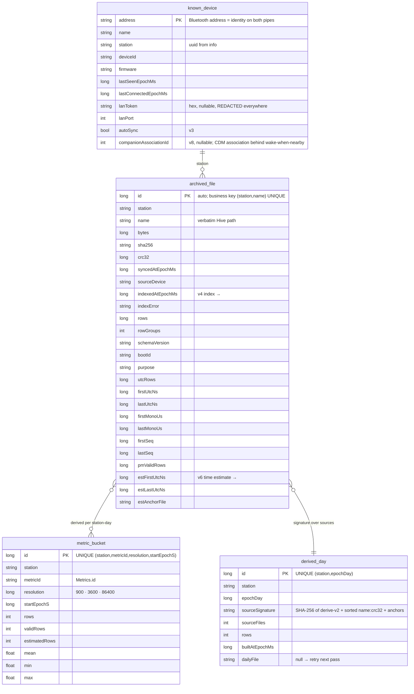
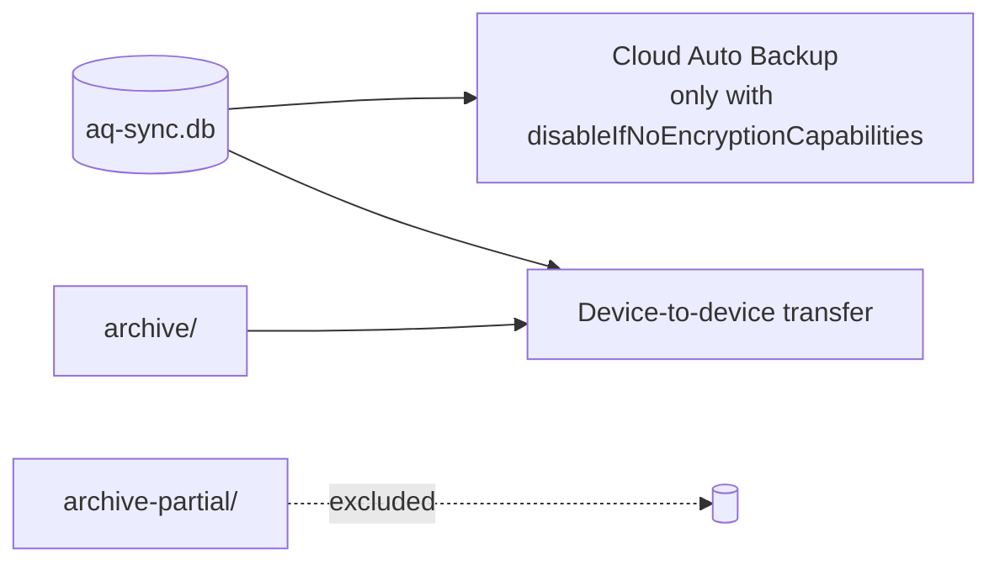

# Data model — Room, DataStore, files on disk, backup

**Scope:** what the phone stores, where, and how it moves between phones. Not how it is computed (see history-pipeline) or fetched (see sync-engine).
**Code:** `data/local/database/AppDatabase.kt`, `KnownDevice.kt`, `ArchivedFile.kt`, `History.kt`; `data/local/di/DatabaseModule.kt` (`aq-sync.db`); `app/schemas/earth.walkthru.aqsync.data.local.database.AppDatabase/1…7.json`; `data/settings/AppSettings.kt`; `data/sync/FileArchive.kt`; `data/history/DailyDerived.kt`; `res/xml/data_extraction_rules.xml`.
**Related:** [sync-engine.md](sync-engine.md) (who writes `archived_file`), [history-pipeline.md](history-pipeline.md) (who writes the tiers), [transports.md](transports.md#lan-token-lifecycle) (the token).

## Room schema v8 (`aq-sync.db`)



`metric_bucket` and `derived_day` are **caches**: drop them and derive again → identical rows.
`archived_file` is the index of the archive, never its source of truth (a file the reader refuses
keeps its row with `indexError`).

### Migrations

| From → to | Kind | Change |
| --- | --- | --- |
| 1 → 2 | explicit | `known_device.lanToken TEXT`, `lanPort INTEGER` |
| 2 → 3 | explicit | `known_device.autoSync INTEGER NOT NULL DEFAULT 0` |
| 3 → 4 | explicit | `archived_file` index columns (`ALTER TABLE … ADD COLUMN` each) |
| 4 → 5 | `AutoMigration` | new tables (`aggregate_bucket` wide, `derived_day`) |
| 5 → 6 | `AutoMigration` | `archived_file.est*` (time estimate), `estimatedRows` |
| 6 → 7 | `AutoMigration` + `DropWideTiers` (`@DeleteTable aggregate_bucket`) | `metric_bucket` one row per metric; `DERIVE_VERSION` 2 forces a rebuild |

No destructive fallback. Every version's JSON is exported to `app/schemas/`.

### Write semantics that bit us

- **`@Upsert` on an entity with an auto id and a unique index updates nothing** (it runs `UPDATE … WHERE id = ?` with id 0). `archived_file` and `derived_day` use `@Insert(onConflict = REPLACE)` — the id carries no meaning. `known_device` (address is the PK) may use `@Upsert`.
- **`openSession` rewrites every `KnownDevice` column.** The post-`info` upsert must carry `previous?.autoSync` (and any future column) or every connect switches auto-sync off.
- `derived_day.dailyFile == null` means the daily Parquet failed → its signature is treated as stale next pass.

## DataStore (`AppSettings`)

| Key | Type | Meaning |
| --- | --- | --- |
| `detail_level` | string (`SIMPLE` / `DETAILED` / `DEVELOPER`) | the one user setting |
| `advanced_mode` | boolean (legacy) | unset `detail_level` + `advanced_mode = true` → `DEVELOPER` |

## Files under `filesDir`

```
archive/<station>/<hive path>.parquet              verified device files — byte-exact SD mirror   (sync-engine)
archive-partial/<station>/<name>.partial(.meta)    in-progress downloads                           (sync-engine)
derived/v1/<station>/day=YYYY-MM-DD.parquet        one Parquet per UTC station-day               (history-pipeline)
derived/v1/<station>/day=YYYY-MM-DD.manifest.json  sources (name, crc32, time_anchor), coverage    (history-pipeline)
```

Derived files are written atomically (temp + rename) and **never inside `archive/`**, so the raw
zip stays the byte-exact mirror and the derived zip is the small analysis-ready export.

## Backup

`res/xml/data_extraction_rules.xml`, 2026-09-17.



Auto Backup is capped at **25 MB per app and skips the whole backup above it**; a full archive is
≈ 32 MB, so the old rule that included `archive/` silently backed up nothing. The database (known
devices, index, tiers, LAN token) is what a new phone needs to find the logger and pull again; the
token is LAN-scoped and rotatable, and restoring it keeps LAN alive since bonds never transfer.
`fullBackupContent`/`backup_rules.xml` was removed — Android 12+ (our minSdk) reads only
`dataExtractionRules`.

## Uses → affects

| Edit… | Affects… |
| --- | --- |
| any entity | a new explicit or auto migration, `app/schemas/<n+1>.json`, `exportSchema` check in CI |
| `archived_file` index columns | `ArchivedFile.info()` → `IndexedFileInfo` (pure), `HistoryIndexer`, `withUtcBetween` (filters `purpose`) |
| `metric_bucket` meaning | bump `HistoryDeriver.DERIVE_VERSION` (part of every day's signature) |
| `derived_day.sourceSignature` inputs | which days rebuild after a sync — keep `name:crc32` + anchor |
| `known_device` columns | the `openSession` upsert line; `KnownDevice.toString` redaction |
| `FileArchive.root` | `data_extraction_rules.xml` device-transfer include, Export zips, `HistoryIndexer` |
