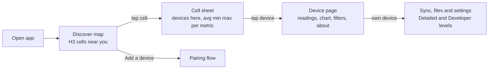

# Devices and discovery

**Scope:** how the app supports any sensor family (air quality is one of many), and how a new user
sees public sensor data near them on first open through a privacy-preserving H3 map.
**Code:** planned `:core:model`, `:core:publicfeed`, `:feature:discover`. **Related:**
[production-readiness-plan.md](production-readiness-plan.md) (W11, W12),
[cross-platform-guide.md](cross-platform-guide.md),
`../aq-parquet/docs/shared/table-and-observation-model.md`.

## Product direction

opensensor.space is a home for many kinds of open hardware: air, weather, water, soil, noise,
energy. The app must treat a new sensor family as data (a dictionary and a family entry), not as
new screens. And the app must be useful before someone owns a device. Like the first run of
Google Home, Eufy or Apple Weather, opening the app shows something real right away. Here that
means readings from public sensors nearby, shown as hexagon cells, never as exact points.

## Part 1. Sensor and hardware agnostic

### Model

The model follows the observation model the firmware already chose
(`table-and-observation-model.md`, SensorThings concepts). The app adopts the same names so the
phone, the firmware and a future host API agree.

| Concept | Meaning in the app | Today |
| --- | --- | --- |
| `Device` (Thing) | A station with a persistent UUID. The MAC address is separate | Station UUID and known device row |
| `DeviceFamily` | Hardware plus firmware line, with its transports, capabilities and dictionary | Implied by `cores3-*` schema prefixes |
| `Capability` | What a device can do (BLE sync, LAN sync, live stream, config, reboot) | Schema prefix checks in screens |
| `ObservedProperty` | One exact quantity, for example atmospheric PM2.5 or air temperature | `MetricSpec` in `Metrics.kt` |
| `Datastream` | One property measured by one instrument on one device | Parquet column |
| `Scale` | Optional interpretation of a value, for example the AQI bands | `AirMood` |

Rules.

1. **The dictionary comes from the device.** The firmware's versioned measurement dictionary is
   the source of property identity, unit, procedure and time semantics. The app ships a bundled
   copy for known schema IDs only as a fallback. The app never invents a unit or a band.
2. **Unknown is fine.** A column that is not in the dictionary still shows with its raw name and
   no scale, at Detailed level. It is never hidden, coerced or given a default.
3. **Scales are optional and scientific.** A `Scale` names its source (for example US EPA AQI or
   WHO 2021). Properties without a published scale use a neutral sequential colour ramp.
   Brand colours are never used to judge a value.
4. **Capabilities, not schema strings.** A screen asks `device.can(Capability.LanSync)`. Only the
   family registry reads schema IDs or adverts.
5. **One family entry per hardware line.** A `DeviceFamily` declares how to recognize the device
   (advert, manifest or schema ID), its transports, capabilities, dictionary and its headline
   properties (which one or two values the device card shows). Adding a family needs no change
   to the sync engine, the screens or the design system.
6. **Keep wire names.** The Android package `earth.walkthru.aqsync`, opcodes, UUIDs and archive
   paths stay. New shared types use generic names (`Reading`, `MetricCard`), never `Air*`.

### Adding a device family

1. The firmware repository documents the family's wire and measurement contract in
   `../aq-parquet/docs/shared/` (or its own contract repo).
2. Add its dictionary and a `DeviceFamily` entry in `:core:model` `commonMain`, with tests in
   `commonTest` that parse a real file from that family.
3. If it uses a new transport, follow "Adding a transport" in the cross-platform guide.
4. Optional. A family may provide a hero component (the air-quality mood face is one). Without
   one, the generic `MetricCard` is used.

## Part 2. Discover public sensors near you

### First-run flow



1. **Open.** There is no sign-in and no onboarding wall. The Discover tab shows the map. On first
   open, a small peacock welcome card says what the map is and offers "Add your sensor" and
   "Explore". It is dismissed once and never comes back.
2. **Map.** Hexagon cells are coloured by the selected metric over the selected window. Chips at
   the top choose the metric (PM2.5, temperature, humidity and so on, built from what the
   visible cells actually report), the window (now, 24 hours, 7 days) and the device kind.
   There is one legend. Stale cells are muted. Sample data is labelled "Sample data" until the
   real feed exists.
3. **Cell sheet.** A bottom sheet shows the number of devices, freshness, and for each metric the
   average, minimum and maximum. Below it is a list of the devices in the cell, each with a kind
   icon, a public name, a headline reading and when it last updated.
4. **Device page.** One page for public and owned devices. It shows current readings grouped by
   category, a chart with a range (24 hours, 7 days, 30 days) and aggregation (avg, min, max)
   filter, metric chips, a comparison with the cell average, and an about section (family, data
   licence, source link). An owned device adds sync, files and settings, with technical detail
   still gated by the detail level.
5. **Navigation.** Three tabs, Discover, My devices and Settings. With no paired device,
   Discover is the start tab. With a paired device, My devices is the start tab.

### Where the map is centred without location permission

The app has no location permission and keeps it that way. The map opens on, in order,
the last viewed area, the cell of the user's own published device, or a region derived from
the phone's time zone. People pan and search by place name from the bundled list. This is
enough to land "near you" for almost everyone without asking for location.

### Privacy rules

1. **No points, only cells.** Public data carries an H3 cell, never coordinates. The owner picks
   the cell on the map when they opt in to publishing. The phone never reads GPS for this.
2. **Precision cap.** Resolution 8 (about 0.7 km²) is the finest published resolution. The map
   shows resolution 7 (about 5 km²) by default and coarser cells when zoomed out.
3. **Minimum crowd.** A cell's device list is shown only when it holds at least three devices.
   With fewer, the map shows the parent cell's aggregate only, and the device list says "Too few
   sensors here to list them".
4. **Public identity.** A public device has a random public ID and an owner-chosen name. The
   station UUID, MAC address, BLE name and LAN token never leave the phone through this feature.
5. **Publishing is separate and opt-in.** Reading the public feed is anonymous and read-only.
   Uploading your own data is a later feature behind its own explicit opt-in.

### Network boundary

This feature changes the app's offline-only stance in one narrow way. The app may make
anonymous, read-only GET requests to the public feed and the basemap. There are no cookies,
accounts, identifiers or analytics. A Settings switch, "Show public sensors", turns it off. When
it is off or offline, Discover shows the last cached snapshot or the bundled sample, and pairing
and sync work exactly as before. `AGENTS.md` records this boundary.

### Public feed contract (proposed)

Static files on object storage (S3 or source.coop). No server, nothing to run, and the website
can read the same files with DuckDB-Wasm.

```
discover/v1/index.json                     generated_at, resolutions, metrics, licence
discover/v1/cells/res=<r>/parent=<p>.parquet   one file per resolution 3 parent
discover/v1/devices/parent=<p>.parquet         public devices in cells that pass the crowd rule
```

| Column (cells) | Type | Notes |
| --- | --- | --- |
| `cell` | string | H3 index |
| `res` | int8 | Resolution |
| `boundary` | list of (lat, lng) | Precomputed, so the phone needs no H3 library |
| `device_count` | int32 | |
| `kinds` | list of string | Family IDs present |
| `property` | string | ObservedProperty ID from the dictionary |
| `window` | string | `now`, `24h`, `7d` |
| `n`, `mean`, `min`, `max` | int32, double | Missing stays null |
| `updated_at` | timestamp | Stale cells are muted |

The publisher (host side, not this repo) does the H3 math and the crowd rule. The phone only
draws polygons and reads numbers. The files are immutable per `generated_at`, so the phone
caches with ETags. The fixture used until the feed exists has the same shape as JSON.

### Map technology

- **Renderer.** MapLibre Native through `maplibre-compose`, which targets Android and iOS from
  Compose Multiplatform. The cells are one GeoJSON source with a data-driven fill expression. Do
  not draw a composable per cell. If `maplibre-compose` does not support the pinned Kotlin and
  CMP versions, use an `expect`/`actual` map composable that wraps MapLibre Native through
  `AndroidView` and `UIKitView`. The screen code does not change.
- **Basemap.** A Protomaps PMTiles basemap on the same object storage, with a minimal style in
  the brand palette. No API key and no third-party tile service. Without network the hex layer
  still draws on a plain background.
- **Zoom and resolution.** Below zoom 6 use resolution 4, then 5 to 6, then 7 from zoom 10.
  Load only the parent files that intersect the viewport, and cap drawing at about 2,000 cells.
- **H3 on the phone.** It is not needed while the feed carries boundaries. If it is needed later,
  use `com.uber:h3` on Android and the H3 C library through cinterop on iOS behind one
  `expect` interface. No maintained pure Kotlin H3 exists today.

### Code layout

| Module | Owns |
| --- | --- |
| `:core:model` | `Device`, `DeviceFamily`, `Capability`, `ObservedProperty`, `Scale`, registry |
| `:core:publicfeed` | `PublicFeed` port, JSON fixture source, later the Parquet and HTTP source, cache |
| `:feature:discover` | CMP `commonMain` screens for the map, cell sheet and public device page, ViewModels |
| `tools/discover-fixture/` | Script that makes the sample feed (Python `h3`), committed output |

`:feature:discover` is shared Compose, so Android and iOS show the same screens from one
codebase. Platform code only provides the HTTP client engine and the cache directory.
