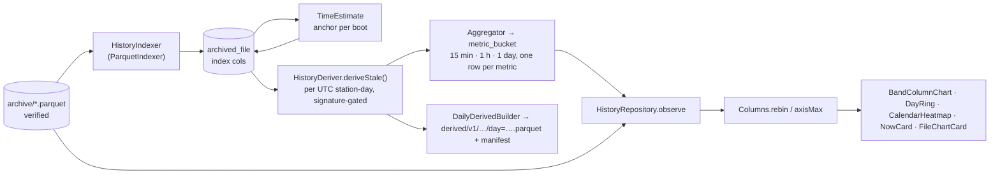

# History pipeline — index → tiers → derived day → charts

**Scope:** everything between a verified file in the archive and a coloured column on screen: the file index, the metric registry, aggregation tiers, the derived daily Parquet, time estimation for unsynced boots, the friendly layer, chart binning.
**Code (pure, `:core:history`):** `Metrics.kt`, `Aggregation.kt` (`Resolution`, `Aggregator`, `Bucket`), `TimeEstimate.kt`, `Columns.kt`, `AirMood.kt` (+ `NowReading`), `HistoryModel.kt` (`HistoryRange`, `HistorySeries`, `HistoryColumn`), `FileSummary.kt`, `ParquetIndexer.kt`.
**Code (`:app`):** `data/history/HistoryIndexer.kt`, `HistoryDeriver.kt`, `DailyDerived.kt` (`DailyDerivedBuilder`, `DerivedStore`), `HistoryRepository.kt`; `ui/history/*`, `ui/device/NowCard.kt`, `ui/files/FileChartCard.kt`.
**Tests:** `AggregationTest`, `TimeEstimateTest`, `ColumnsTest`, `AirMoodTest`, `FileSummaryTest`, `ParquetIndexerTest`, `RealArchiveTest` (all 766 real files when the firmware repo is a sibling); `HistoryIndexerTest`, `HistoryDeriverTest`, `HistoryRepositoryTest`.
**Related:** [parquet.md](parquet.md) (the reader/writer underneath), [data-model.md](data-model.md) (the tables), [screens.md](screens.md) (what is drawn). The long-form evaluation is [history-ux-and-data-layer.md](history-ux-and-data-layer.md).

## Flow

**When it runs:** index at sync time (same upsert as the row) + one process-start back-fill (`backfill`,
batches of 100, never-indexed rows first, failures retried once per pass); `estimateTimes()` at the
start of every derive pass; `deriveStale()` once at process start, after every interactive sync
(repository `finally`), and inside `SyncWorker` when files arrived. Opening Files/History only
observes Room. A day costs milliseconds; no separate `DeriveWorker`. `HistoryDeriver` and
`HistoryIndexer` each serialize their passes with a `Mutex`.

## Index (`ParquetIndexer` → `archived_file`, Room v4)

Derived from the **file**, never its name: rows, row groups, `schema_version`, `boot_id`,
`purpose`, UTC row count + span, monotonic span, sequence span, `pms_status == 4` count,
`indexedAt`/`indexError`. v6 footers answer spans from statistics without decoding
(`fromStatistics`); v1/v2 files decode three columns. `purpose = codec-comparison-duplicate-rows`
(benchmark copies) is indexed but excluded from every history query (`withUtcBetween` filters on
`purpose`). A refused file keeps its row with `indexError`.

## Metric registry

**A new sensor is a registry entry, not code.** Every quantity is a `MetricSpec(id, column, label,
unit, kind, gate, bands, chartable, envelope, axisFloor, settleSeconds)`. Tiers, daily files, the
History picker (`Metrics.chartable`) and the charts iterate the registry and never name a column.
A spec whose column a file lacks yields **no values, never zeros**, so the registry may be ahead of
the hardware.

| id | column | gate | bands | chartable | axisFloor | settle |
| --- | --- | --- | --- | --- | --- | --- |
| `pm25` | `pm25_atmospheric_ug_m3` | `pms_status == 4` | PM2.5 bands | ✓ envelope | 60 | 180 s |
| `pm10` / `pm1` | `pm10_…` / `pm1_atmospheric_ug_m3` | `pms_status == 4` | – | ✓ envelope | 60 | 180 s |
| `n03` / `n25` | `particles_gt03_per_01l` / `…gt25…` | `pms_status == 4` | – | ✗ | 10 | 180 s |
| `board_c` | `imu_temperature_c` (**not** ambient) | – | – | ✓ | 10 | – |
| `ambient_c` / `rh` | `ambient_temperature_c` / `relative_humidity_percent` | – | – | ✓ | 10 / 100 | – (SHT20 unresolved; yield nothing today) |
| `battery` / `vbus` | `battery_percent` / `vbus_mv` | – | – | ✗ | 100 / 10 | – |

PMS concentrations are **INT32** µg/m³ in the files; only IMU/temperature/humidity are FLOAT.

### Sensor warm-up and settling (2026-09-17)

Firmware nulls PM for uptime < 30 s (`pms_status = 1`) — the datasheet minimum and stricter than
Sensor.Community (wake 15 s before a 5 s window every 145 s, discard first cycle) and AirGradient
(continuous, moving averages, "Warming Up" on display only, EPA-2021 humidity compensation — needs
RH this board lacks). OpenAQ has no warm-up logic. **Measured on our archive** (DuckDB, 766 files,
14 boots ≥ 10 min): after the gate, minute 0 deviates from minutes 5–10 by 2.5 µg/m³ mean-absolute,
minute 3 by 1.7, minute 7 by 0.6 — inside one band. Decision: **discard nothing more**; particle
metrics carry `settleSeconds = 180` (`PMS_SETTLE_S`) and `MetricAgg.settling` counts those rows per
bucket for a future "n settling" hint. No humidity correction, no "AQI".

## Tiers (`Aggregator` → `metric_bucket`, Room v7)

`Resolution`: `MIN15` 900 s · `HOUR` 3600 s · `DAY` 86 400 s; `expectedRows = seconds / 10` (90 /
360 / 8 640). Identity `(station, metricId, resolution, startEpochS)`; per row: `rows`,
`validRows` (passed the gate), `estimatedRows`, `mean`, `min`, `max`. `coverage = validRows /
expected`. Rows without UTC are off the timeline unless dated by `TimeEstimate`. Built per UTC
station-day, replaced atomically per day. **Duplicate rows** across files are skipped on
`(boot_id_hi, boot_id_lo, sequence)` in both the tiers and the daily file so the two agree.
Means over a span are weighted by valid rows — never averages of averages.

## Derived daily Parquet (`DailyDerivedBuilder`)

`derived/v1/<station>/day=YYYY-MM-DD.parquet` + `.manifest.json`, written by the app's own
`ParquetWriter`. Rows: every UTC row of the day from the verified files, time-ordered,
de-duplicated; **one row group per UTC hour**. Columns: union of sources (v1 files leave the four v2
columns null) + `source_file_index` (INT32 into the manifest's `sources`) +
`event_time_utc_estimated_ns` for estimated rows (with `event_time_utc_ns` null). **No `station_id`
string column** (deviation from the evaluation) — stays flat numeric so our reader reads it back;
station is in the path and metadata. Metadata: invariant device keys + `derived_by`
(`AQ Sync Android derived-v1`), `derived_version`, `source_count`, `coverage_rows`, `complete`
(every known file in and the day ended > 30 min ago), `day`, `purpose = telemetry-derived-day`,
`time_estimate` note. Measured 188 B/row vs 512 B/row for device files (5–9× smaller). Validated by
PyArrow 25 + DuckDB 1.5.5 (`TIMESTAMPTZ`, range pruning, `time_bucket`).

### When a day is rebuilt

`derived_day.sourceSignature` = SHA-256 over `derive-v<DERIVE_VERSION>` + the day's sorted
`name:crc32` sources + anchors. `deriveStale()` rebuilds exactly the days whose set changed (late
file, re-synced mismatch, deleted file, new anchor) and drops days with no sources. Healthy log
line after a sync: `HistoryDeriver: derived 0 of N station-days (nothing changed)` (debug level).

## Time for rows logged before the clock (`TimeEstimate`, Room v6)

The **earliest fully-timed file of a boot** (`utcRows == rows`) is its anchor; for that boot's
unsynced files `utc ≈ anchor_utc + (monotonic_us − anchor_mono)` — never across a reboot, never
overwriting `event_time_utc_ns`. Uncertainty grows with distance at `DRIFT_PPM` 50. Verified on
boot `e452563e…` (2026-09-08): reproduces the firmware's own stamp 43 min after the anchor
**exactly**. Stored as `archived_file.estFirstUtcNs/estLastUtcNs/estAnchorFile` (index only, no
decode). Tiers carry `estimatedRows`; charts draw estimated stretches **dashed** and say so. Boots
that never got the time stay off the timeline.

## Friendly layer (`AirMood`, `NowReading`)

Five moods on the PM2.5 band edges **15 · 35 · 55 · 150 µg/m³** (WHO 2021 24-h guideline = 15):
`FRESH` "Fresh air" · `FINE` · `HAZY` "Getting hazy" · `SMOKY` · then "Thick smoke". Each has a
title, one line of advice and a comparison — colour is never the only carrier. `NowReading.of(live)`
puts the sensor state first (`pms_status ≠ 4` → words, never a number). "Right now" is a 10-second
snapshot; "Today so far" is the **local** day folded from the hourly tier with its coverage.
**No "AQI" anywhere** (a named index needs validated averaging rules). The face is a Canvas
placeholder (`MoodFace`) the capybara artwork replaces one-for-one on both platforms.

## Charts (`Columns`, Compose `Canvas`, no chart library)

| Range | Source | Slot | Points |
| --- | --- | --- | --- |
| Day | rows via `withUtcBetween` + reader (3 columns), binned to minutes above `RAW_POINT_CAP` 3 000 (a full day is 8 640 rows → ≤ 1 440) | 1 h → **24 columns** + 24-segment ring | re-read keyed on `(name, crc32, timeline start)` list, not every Room write |
| Week | `MIN15` tier | 1 h | |
| Month | `HOUR` tier | 1 day | + calendar heatmap |
| Year | `DAY` tier | 7 days | + calendar heatmap |

`rebin` folds a series into fixed slots with means weighted by covered seconds; `axisMax` = 95th
percentile of column means × 1.2 with a floor (`axisFloor`, 60 for PM2.5) rounded to a nice step;
columns above are capped and labelled (one label per run). Colour = the column's own band
(`spec.moodOf`), opacity = coverage, dashed outline = estimated time, whisker = peak. Time labels
in the phone's zone, buckets UTC-aligned. Day was 96 quarter-hours until 2026-09-18 (~3 dp bars
were not tappable). The same spec is Swift Charts `BarMark`s + a `LazyVGrid` on iOS; the ring is
the iOS widget shape. **Files › Chart by file** (`FileSummary`) is the same column style in file
order — the diagnostic a time axis cannot give.

## Uses → affects

| Edit… | Affects… |
| --- | --- |
| `Metrics` (add/rename a spec) | `metric_bucket.metricId` strings, picker chips, `DailyDerivedBuilder` columns, Now card if PM2.5; bump `DERIVE_VERSION` |
| `AirMood` edges | `Metrics.PM25_BANDS`, chart shading, Home/Today moods, calendar colours |
| `Aggregator` semantics | `DERIVE_VERSION`, `AggregationTest`, `HistoryDeriverTest` |
| `TimeEstimate` | day signatures (anchor), dashed drawing, daily file's estimated column |
| `Columns.slotSeconds` / `axisMax` | every chart; `ColumnsTest` |
| `HistoryRepository.observe` | History and Today (local-day fold), `HistoryRepositoryTest` |
| `ParquetWriter` (in parquet.md) | daily file layout → re-run `tools/validate_parquet_samples.py` |
