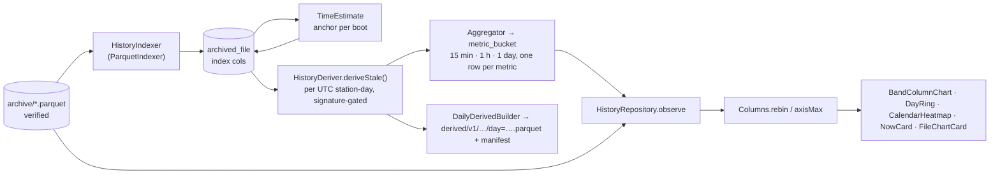

# History pipeline — index → tiers → derived day → charts

**Scope:** everything between a verified file in the archive and a coloured column on screen: the file index, the metric registry, aggregation tiers, the derived daily Parquet, time estimation for unsynced boots, the friendly layer, chart binning.
**Code (pure, `:core:history` `commonMain`, JVM and iOS since W8):** `Metrics.kt`, `Aggregation.kt` (`Resolution`, `Aggregator`, `Bucket`), `TimeEstimate.kt`, `Columns.kt`, `AirMood.kt` (+ `NowReading`), `HistoryModel.kt` (`HistoryRange`, `HistorySeries`, `HistoryColumn`), `HistoryWindow.kt`, `FileSummary.kt`, `ParquetIndexer.kt`.
**Code (`:app`):** `data/history/HistoryIndexer.kt`, `HistoryDeriver.kt`, `DailyDerived.kt` (`DailyDerivedBuilder`, `DerivedStore`), `HistoryRepository.kt`; `ui/history/*`, `ui/device/NowCard.kt`, `ui/files/FileChartCard.kt`.
**Tests:** `AggregationTest`, `TimeEstimateTest`, `ColumnsTest`, `AirMoodTest`, `FileSummaryTest`, `ParquetIndexerTest`, `RealArchiveTest` (all 766 real files when the firmware repo is a sibling); `HistoryIndexerTest`, `HistoryDeriverTest`, `HistoryRepositoryTest`.
**Related:** [parquet.md](parquet.md) (the reader/writer underneath), [data-model.md](data-model.md) (the tables), [screens.md](screens.md) (what is drawn). The long-form evaluation is [history-ux-and-data-layer.md](history-ux-and-data-layer.md).

## Flow

**When it runs:** index at sync time (same upsert as the row) + one process-start back-fill (`backfill`,
batches of 100, never-indexed rows first, failures retried once per pass); `estimateTimes()` at the
start of every derive pass; `deriveStale()` once at process start, after every interactive sync
(repository `finally`), and inside `SyncWorker` when files arrived. Opening Files/History only
observes Room. A day costs milliseconds; no separate `DeriveWorker`. `HistoryDeriver` and
`HistoryIndexer` each serialize their passes with a `Mutex`.

## Index (`ParquetIndexer` → `archived_file`, Room v4)

Derived from the **file**, never its name: rows, row groups, `schema_version`, `boot_id`,
`purpose`, UTC row count + span, monotonic span, sequence span, `pms_status == 4` count,
`indexedAt`/`indexError`. v6 footers answer spans from statistics without decoding
(`fromStatistics`); v1/v2 files decode three columns. `purpose = codec-comparison-duplicate-rows`
(benchmark copies) is indexed but excluded from every history query (`withUtcBetween` filters on
`purpose`). A refused file keeps its row with `indexError`.

## Metric registry

**A new sensor is a registry entry, not code.** (W11 generalizes this into device families in `:core:model`, see [devices-and-discovery.md](devices-and-discovery.md).) Every quantity is a `MetricSpec(id, column, label,
unit, kind, gate, healthScale, chartable, envelope, axisFloor, settleSeconds)`. Tiers, daily files, the
History picker (`Metrics.chartable`) and the charts iterate the registry and never name a column.
A spec whose column a file lacks yields **no values, never zeros**, so the registry may be ahead of
the hardware.

| id | column | gate | health scale | chartable | axisFloor | settle |
| --- | --- | --- | --- | --- | --- | --- |
| `pm25` | `pm25_atmospheric_ug_m3` | `pms_status == 4` | `WhoGuidelines.PM25` | ✓ envelope | 37.5 | 180 s |
| `pm10` | `pm10_atmospheric_ug_m3` | `pms_status == 4` | `WhoGuidelines.PM10` | ✓ envelope | 75 | 180 s |
| `pm1` | `pm1_atmospheric_ug_m3` | `pms_status == 4` | – | ✓ envelope | 60 | 180 s |
| `n03` / `n25` | `particles_gt03_per_01l` / `…gt25…` | `pms_status == 4` | – | ✗ | 10 | 180 s |
| `board_c` | `imu_temperature_c` (**not** ambient) | – | – | ✓ | 10 | – |
| `ambient_c` / `rh` | `ambient_temperature_c` / `relative_humidity_percent` | – | – | ✓ | 10 / 100 | – (SHT20 unresolved; yield nothing today) |
| `battery` / `vbus` | `battery_percent` / `vbus_mv` | – | – | ✗ | 100 / 10 | – |

PMS concentrations are **INT32** µg/m³ in the files; only IMU/temperature/humidity are FLOAT.

### Sensor warm-up and settling (2026-09-17)

Firmware nulls PM for uptime < 30 s (`pms_status = 1`) — the datasheet minimum and stricter than
Sensor.Community (wake 15 s before a 5 s window every 145 s, discard first cycle) and AirGradient
(continuous, moving averages, "Warming Up" on display only, EPA-2021 humidity compensation — needs
RH this board lacks). OpenAQ has no warm-up logic. **Measured on our archive** (DuckDB, 766 files,
14 boots ≥ 10 min): after the gate, minute 0 deviates from minutes 5–10 by 2.5 µg/m³ mean-absolute,
minute 3 by 1.7, minute 7 by 0.6 — inside one band. Decision: **discard nothing more**; particle
metrics carry `settleSeconds = 180` (`PMS_SETTLE_S`) and `MetricAgg.settling` counts those rows per
bucket for a future "n settling" hint. No humidity correction, no "AQI".

## Tiers (`Aggregator` → `metric_bucket`, Room v7)

`Resolution`: `MIN15` 900 s · `HOUR` 3600 s · `DAY` 86 400 s; `expectedRows = seconds / 10` (90 /
360 / 8 640). Identity `(station, metricId, resolution, startEpochS)`; per row: `rows`,
`validRows` (passed the gate), `estimatedRows`, `mean`, `min`, `max`. `coverage = validRows /
expected`. Rows without UTC are off the timeline unless dated by `TimeEstimate`. Built per UTC
station-day, replaced atomically per day. **Duplicate rows** across files are skipped on one
shared key, `RowKey` in `:core:history`: `(boot_id_hi, boot_id_lo, sequence)`, or
`(boot_id_hi, boot_id_lo, timeline ns)` when the sequence is absent or null, a missing boot half
counting as 0. The tiers, the day chart and the daily file all use it, so their row counts agree.
Means over a span are weighted by valid rows — never averages of averages.

## Derived daily Parquet (`DailyParquetBuilder`)

`derived/v1/<station>/day=YYYY-MM-DD.parquet` + `.manifest.json` on both platforms, written by the shared
`ParquetWriter`. Rows: every UTC row of the day from the verified files, time-ordered,
de-duplicated; **one row group per UTC hour**. Columns: union of sources (v1 files leave the four v2
columns null) + `source_file_index` (INT32 into the manifest's `sources`) +
`event_time_utc_estimated_ns` for estimated rows (with `event_time_utc_ns` null). **No `station_id`
string column** (deviation from the evaluation) — stays flat numeric so our reader reads it back;
station is in the path and metadata. Metadata: invariant device keys + `derived_by`
(`opensensor.space shared derived-v2`), `derived_version`, `source_count`, `coverage_rows`, `complete`
(every known file in and the day ended > 30 min ago), `day`, `purpose = telemetry-derived-day`,
`time_estimate` note. Measured 188 B/row vs 512 B/row for device files (5–9× smaller). Validated by
PyArrow 25 + DuckDB 1.5.5 (`TIMESTAMPTZ`, range pruning, `time_bucket`).

Android commits through `DailyDerivedBuilder`; iOS uses `IosDailyDerivedStore`. Both use the
same row-selection, deduplication and UTC partition algorithm. Temporary output is flushed,
the footer is read back, and the old cache manifest is invalidated before replacement. A
missing manifest after interruption causes a rebuild from immutable raw files. iOS rebuilds
at startup, after index changes and after new clock receipts, without a History screen visit.

### When a day is rebuilt

`derived_day.sourceSignature` = SHA-256 over `derive-v<DERIVE_VERSION>` + the day's sorted
`name:crc32` sources + anchors. `deriveStale()` rebuilds exactly the days whose set changed (late
file, re-synced mismatch, deleted file, new anchor) and drops days with no sources. Healthy log
line after a sync: `HistoryDeriver: derived 0 of N station-days (nothing changed)` (debug level).

## Time for rows logged before the clock (`TimeEstimate`, Room v6)

A successful automatic clock handshake persists the acknowledged UTC/monotonic pair in
app-private clock receipts, scoped to the original station and full 128-bit boot ID.
History uses the earliest receipt or fully-timed file of that boot; it also imports
`reconciliation_anchor_*` footer evidence when a verified firmware file arrives. It no longer
needs to wait for a fully-timed file to finalize. For that boot's unsynced files,
`estimated_utc_ns = anchor_utc_ns + (monotonic_us − anchor_mono_us) * 1000` — never across a
reboot, never overwriting `event_time_utc_ns`. The 50 ppm drift assumption is not a measured
accuracy bound and excludes phone clock error and transport latency. Verified on
boot `e452563e…` (2026-09-08): reproduces the firmware's own stamp 43 min after the anchor
**exactly**. Stored as `archived_file.estFirstUtcNs/estLastUtcNs/estAnchorFile` (index only, no
decode). Tiers carry `estimatedRows`; charts draw estimated stretches **dashed** and say so. Boots
that never retained a time anchor stay off the timeline. Durable receipts survive app restarts;
a new receipt or footer anchor rebuilds affected UTC days, including files whose estimated rows
cross midnight. See [UTC reconciliation](time-reconciliation.md).

## Friendly layer (`AirMood`, `NowReading`)

Six moods, one per step of the WHO 2021 Air Quality Guidelines PM2.5 scale (`:core:airquality`,
`WhoGuidelines.PM25`, 24-hour means). Edges **15 · 25 · 37.5 · 50 · 75 µg/m³**, inclusive from below
as WHO states them ("at or below 15 meets the guideline"): `FRESH` "Fresh air" (guideline) · `FAIR`
(IT-4) · `HAZY` "Getting hazy" (IT-3) · `POOR` (IT-2) · `SMOKY` (IT-1) · `THICK` "Thick smoke" (above
IT-1). The edges are never repeated in `:core:history` or the app. Each has a
title, one line of advice and a comparison — colour is never the only carrier. `NowReading.of(live)`
puts the sensor state first (`pms_status ≠ 4` → words, never a number). "Right now" is a 10-second
snapshot; "Today so far" is the **local** day folded from the hourly tier with its coverage.
**No "AQI" anywhere** (a named index needs validated averaging rules). The face is a Canvas
placeholder (`MoodFace`) that mascot artwork from the website replaces one for one on both platforms.

PM10 is banded on its own WHO scale (`WhoGuidelines.PM10`, 45 · 50 · 75 · 100 · 150 µg/m³) through
`MetricSpec.healthScale`; `moodOf`/`stepOf` read the scale, so a PM10 value maps to the same six moods
and colours. Colours are `WhoStep.color` (light to dark, colour-blind checked), mapped once in the
app's `Color.kt`.

`AirMood` is the air-quality family's scale, not the app's model of "good". Other families
show neutral metric cards unless their dictionary names a published scale. See
[devices-and-discovery.md](devices-and-discovery.md).

## Charts (`Columns`, Compose `Canvas`, no chart library)

| Range | Source | Slot | Points |
| --- | --- | --- | --- |
| Day | rows via `withUtcBetween` + reader (3 columns), binned to minutes above `RAW_POINT_CAP` 3 000 | 1 elapsed h → **23/24/25 columns** + matching ring on daylight saving transitions | re-read keyed on `(name, crc32, timeline start)` list, not every Room write |
| Week | `MIN15` tier | 1 h | |
| Month | `HOUR` tier | 1 day | + calendar heatmap |
| Year | `HOUR` tier | 7 local days | + local-day calendar heatmap |

`HistoryWindow` defines the same half-open local-calendar bounds for labels, paging, repository
queries and coverage. Its zone is a kotlinx-datetime `TimeZone` (Android converts its `ZoneId` with
`toKotlinTimeZone()`), and `Columns.rebinLocalDays` / `rebinLocalWeeks` take the same type. The JVM
tests check both against `java.time`. The ranges are rolling 1/7/30/365 local days; a day can last 23 or 25
hours. `Today so far` uses the same local-day bounds. Hourly UTC tier buckets wholly inside the
window remain cheap; at a fractional-offset midnight, `HistoryRepository` reads just the two
partial boundary intervals from verified rows so the adjacent UTC bucket cannot pollute the mean.
The Month/Year calendar and columns split tier points at variable local-day/week boundaries;
the fall-back 01:00 hours remain separate and selected-hour labels include UTC offsets.

`rebin` folds a series into fixed slots and `rebinHours/rebinLocalDays/rebinLocalWeeks` fold into
the selected calendar window, with means weighted by covered seconds. The y axis starts at zero;
its raw top is the 95th percentile of column means × 1.2 with a floor (`axisFloor`, 37.5 for PM2.5,
75 for PM10). For a metric with a WHO scale `ChartAxes.of` snaps that top up to the next WHO edge
(gridlines divide it, so 37.5 reads 0 · 7.5 · 15 …), which keeps the dashed, labelled WHO 24-hour
guideline line (PM2.5 15, PM10 45) in view and lets two days compare on one scale; above IT-1 the
top is a round number. Columns above are capped and labelled (one label per run). Following Mazama
Science's qualitative display advice and the South Coast AQMD accessible scale: bars coloured by
their own WHO step on a neutral background (no shaded bands), neutral ink for metrics without a
scale, opacity = coverage, dashed outline = estimated time, whisker = peak. A caption states the
averaging (hourly, daily or weekly means against a 24-hour guideline), and the touch readout names
the mood and WHO step in words. Time labels
in the phone's zone, buckets UTC-aligned. Day was 96 quarter-hours until 2026-09-18 (~3 dp bars
were not tappable). **Files › Chart by file** (`FileSummary`) is the same column style in file
order, the diagnostic a time axis cannot give.

## Shared screen (`:feature:history`, #18)

Android and iOS draw one History from `commonMain` (2026-10-09). The module holds the screen, the
band column chart, the day ring, the calendar heatmap, the archive and Developer cards and its
strings (Compose resources with Arabic). Chart text is drawn with the Compose text measurer, in
a left to right direction, and numbers go through `formatFixed` from `:core:units`. Date labels
use one `expect` seam (`formatEpoch`, `DateTimeFormatter` on Android, `NSDateFormatter` on iOS).

`HistoryController` is a plain class (the SettingsController pattern) over four ports. The
`HistorySeriesReader`, the `HistoryTiers` and the `ArchiveIndex` from `:core:history` and
`:core:archive`, plus two flows, the station History opens on and the station generations its
chips offer. It owns station, metric, range and paging, follows "now" across local midnight until
the user pages back, and opens on the last local day with readings.

| | Android | iOS |
| --- | --- | --- |
| Host | `HistoryViewModel` (Hilt, assisted by address) | `HistoryHolder` ViewModel in `AppRoot` |
| Index | Room `archived_file` (`RoomArchiveIndex`) | `.verified.json` receipts (`ReceiptArchiveIndex`), one instance shared with the sync runner (`IosArchive`) |
| Tiers | Room `metric_bucket` (`RoomHistoryTiers`) | computed in memory from the archive (`ArchiveHistoryTiers`) |
| Current station | the known device's station | the archived station with the latest reading |
| Chips | the device's authenticated station epochs | every archived station, oldest latest reading first |
| Index repair | `HistoryIndexer.backfillAll` once per process from `AqSyncApplication`, and after each sync | `ArchiveIndexRepair.repairWhenWaiting` from `IosArchive.startIndexRepair`, at launch and whenever a receipt waits for its index. Changes during a pass are conflated, and passes repeat until no record is waiting |
| Header | device section tabs and the link chip | a back arrow, opened from a History button on My devices or the device page |

Repair writes only its own columns. It merges the index and estimate columns onto the latest
record with `ArchiveIndex.update`, so a fingerprint the engine fills during a pass survives.
`ReceiptArchiveIndex` reads and writes under its lock. Room uses the default read then write,
which narrows the race but is not atomic (follow-up, a Room transaction). The engine's own
fingerprint fill still writes back a whole record. When that snapshot lacks the index columns,
the record waits again and the next pass repairs it.

`commonTest` covers the presentation helpers, the y axis ticks (metric and imperial) and the
controller over a fake archive. It runs as the Android host test and on the iOS simulator.

## Uses → affects

| Edit… | Affects… |
| --- | --- |
| `Metrics` (add/rename a spec) | `metric_bucket.metricId` strings, picker chips, `DailyDerivedBuilder` columns, Now card if PM2.5; bump `DERIVE_VERSION` |
| `WhoGuidelines` edges (`:core:airquality`) | `AirMood`, `MetricSpec.healthScale`, chart axis snap and colours, Home/Today moods, calendar colours, Discover |
| `Aggregator` semantics | `DERIVE_VERSION`, `AggregationTest`, `HistoryDeriverTest` |
| `TimeEstimate` | day signatures (anchor), dashed drawing, daily file's estimated column |
| `Columns.slotSeconds` / `axisMax` | every chart; `ColumnsTest` |
| `HistoryRepository.observe` | History and Today (local-day fold), `HistoryRepositoryTest` |
| `:feature:history` (`HistoryController`, charts, strings) | History on both apps, the Files chart by file on Android, `feature/history/src/commonTest` |
| `ParquetWriter` (in parquet.md) | daily file layout → re-run `tools/validate_parquet_samples.py` |
