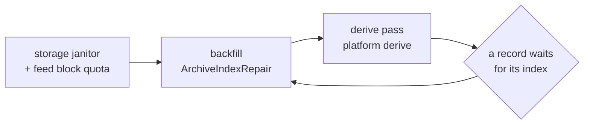

# History pipeline, index → tiers → derived day → charts

**Scope:** everything between a verified file in the archive and a coloured column on screen: the file index, the metric registry, aggregation tiers, the derived daily Parquet, time estimation for unsynced boots, the friendly layer, chart binning.
**Code (pure, `:core:history` `commonMain`, JVM and iOS since W8):** `Metrics.kt`, `FileTemplates.kt`, `Rollup.kt`, `Aggregation.kt` (`Resolution`, `Aggregator`, `Bucket`), `TimeEstimate.kt`, `Columns.kt`, `AirMood.kt` (+ `NowReading`), `HistoryModel.kt` (`HistoryRange`, `HistorySeries`, `HistoryColumn`), `HistoryWindow.kt`, `FileSummary.kt`, `ParquetIndexer.kt`.
**Code (`:app`):** `data/history/HistoryIndexer.kt`, `HistoryDeriver.kt`, `DailyDerived.kt` (`DailyDerivedBuilder`, `DerivedStore`), `HistoryRepository.kt`; `ui/history/*`, `ui/files/FileChartCard.kt`, with the shared day builder in `core/history` (`DailyParquetBuilder`).
**Tests:** `AggregationTest`, `TimeEstimateTest`, `ColumnsTest`, `AirMoodTest`, `FileSummaryTest`, `ParquetIndexerTest`, `RealArchiveTest` (all 766 real files when the firmware repo is a sibling); `HistoryIndexerTest`, `HistoryDeriverTest`, `HistoryRepositoryTest`.
**Related:** [parquet.md](parquet.md) (the reader/writer underneath), [data-model.md](data-model.md) (the tables), [screens.md](screens.md) (what is drawn).

## Flow

**When it runs:** index at sync time (same upsert as the row), then the shared start order below
(back-fill in batches of 100, never-indexed rows first, failures retried once per pass),
`estimateTimes()` at the start of every derive pass, and `deriveStale()` at process start, after every
interactive sync (repository `finally`), inside `SyncWorker` when files arrived, and in `DeriveWorker`
for the days a post-sync pass deferred. Opening Files/History only observes Room. A day costs
milliseconds.

### Pass order (`HistoryOrchestrator`, `:core:history`)

Both phones run the same order (#100). The shared `HistoryStartup.start` is called once per process,
from `OpenSensorApplication.onCreate` on Android and `IosArchive.startIndexRepair` on iOS
(`AppStartupTest`, `IosArchiveStartupTest`). It runs the storage janitor, then the feed block quota,
then `HistoryOrchestrator.run`. Beside it, it watches `FileTemplates.SERVED.changes` (a template the
cache loads at start or a board serves). Changes settle for `HistoryStartup.TEMPLATE_SETTLE` (2 s) and
coalesce into one check. When a template added or removed names a desc or dict that an indexed file's
footer names (`ArchiveIndex.anyIndexedNames`, one `EXISTS` query on the digest indices), the platform
derive runs again, so the days of the files it resolves rebuild with their metrics. A board that serves
fresh templates no file names costs no derive. No file is indexed again for it.

- **Janitor first.** The startup sweep runs before the first back-fill, so an orphan final it adopts
  is indexed in the same start. A failed sweep is logged, and the feed block quota and the start go on.
- **Backfill, then derive.** `backfill` and `derivePass` share one lock, so a back-fill and a derive
  never overlap. A derive asked during a back-fill waits and then sees the indexed records. After each
  back-fill `run` derives once, and again whenever a record waits for its index.
- **Retry.** A back-fill that leaves a record waiting, because the index threw, runs again with the
  derive after 30 s, 1, 2, 4 and 8 min (`RETRY_DELAYS`), then waits for the next index change. The
  first index emission is the start pass, so a record still waiting is not retried twice. The
  index flow emits only when waiting changes, so without the retry it would wait for the next start.
- **Time estimates.** `estimateTimes` rewrites the estimated spans a derive reads for its source sets
  and signatures, so it runs only inside a pass. A derive pass re-dates first. iOS's clock receipt
  follow-up calls `HistoryOrchestrator.afterClockReceipt`, which estimates as one pass and then
  derives. Android's SET_TIME saves the receipt on the link, then starts `deriveThing` off it, so a
  pass in flight never holds the link.
- **Every derive is a pass.** Android's `HistoryDeriver.deriveStale` and `ensureDailyFiles` and iOS's
  `IosArchive.rebuildDerived` each run inside one `derivePass`, which is not reentrant. iOS builds
  `rebuildDerived` with `derivePassOf`, so its derive body has no entry point outside a pass. The iOS
  History reader's own refresh of one thing takes only the derived lock, so History stays visible
  during a back-fill.
- **Held days.** A day a waiting record holds stays in History, see below.
- **Prune.** The old file cleanup writes its tombstone under the `DeviceCoordinator` writer lease,
  then its rebuild of the emptied things is a derive pass like any other.

## Index (`ParquetIndexer` → `archived_file`)

Derived from the **file**, never its name: rows, row groups, `file.purpose` from the `opensensor`
footer JSON, the boot from the first row's `boot_id_hi` and `boot_id_lo`, then the UTC row count + span, monotonic span, sequence span, the valid rows of the headline metric (the template's primary column through its gate and settle time, null when no bundled template knows the file or the column cannot be read),
the footer `dictionary.sha256` and `template.sha256` as they are,
`indexedAt`/`indexError`. The repair hands the footer `template.sha256` of each file that indexes to
`BoardDescriptors.confirm`, which evicts a served template with the same 16 hex prefix and another
full digest (see `protocol-quickref.md`). v6 footers answer spans from statistics without decoding
(`fromStatistics`); v1/v2 files decode three columns. Statistics with a negative null count or a
minimum above the maximum are no answer, the column is decoded instead. `purpose = codec-comparison-duplicate-rows`
(benchmark copies) is indexed but excluded from every history query (`withUtcBetween` filters on
`purpose`). A refused file keeps its row with `indexError`. `ArchiveRecord.isIndexed` (indexed and no
error) is the one test of whether a row's index columns can be read, and `withUtcBetween` applies the
same test in SQL. `ArchiveRecord.awaitsIndex` (never indexed, or reopened) marks a row the back-fill
still has to read.

Room schema 4 (`Migration3To4`) added the two footer digests and reopens every row indexed without an
error, and the one time iOS receipt import reads every receipt as never indexed, since neither knew
the digests. Until the back-fill reaches it, such a row awaits its index.

## Metric registry

**A new sensor is a template, not code.** Every metric is a `MetricSpec` built from one board
template datastream and the app profile (`Metrics.of(template, profile)`). A datastream counts when
its role is `physicalMeasurement` or `modelResult`. The spec's id and column are the datastream's
column name, with no mapping of older ids. The spec takes its gate from `opensensor:valid_when`,
its warm-up from `opensensor:settle_s`, its rollup from `opensensor:aggregate`, its unit and its
`opensensor:plausible_range` from the template. A missing aggregate rolls up as a mean. An unknown
one becomes `point` (the last value), so counters stay point. The profile's primary columns come
first, and `Metrics.defaultOf` opens History on the first of them.

**Derived metrics come from providers.** A `DerivedMetricProvider` (`:core:model`) reads a template
and returns `DerivedMetric`s, each a derived `Datastream` with a label, a `RowFormula` over its
`derived.from` columns and an optional stored column it is a view of. `Metrics.providers` lists them.
Each app installs its Thing kinds' providers at launch (`ThingKinds.installMetrics`, `Metrics.install`),
which rebuilds the catalog. Today that is only `AirDerivedMetrics` in `:core:airquality`, which derives `pm25_epa` when the template
stores `pm25_cf1_ug_m3` and `relative_humidity_percent`. Scales come from
`WhoGuidelines.forProperty`, so a template without PM columns builds its metrics and the catalog
(`Metrics.catalogOf`) with no air metric. The named air specs (`AirMetrics.PM25` and the rest in
`:core:history`) resolve from the catalog on first use, never while it is built.

`Metrics.all` is the union of the bundled templates. Where two boards describe one column, the first
keeps its unit and aggregate. Tiers, daily files, the History picker and the charts iterate these
specs and never name a column. A spec whose column a file lacks yields **no values, never zeros**.

**Each file is read by its own template (`FileTemplates`).** A file carries one footer key of ours,
`opensensor`, whose value is compact JSON (stac-opensensor `PROFILE.md` "Parquet footer", version
`0.1.0`, in the style of GeoParquet `geo`). `OpenSensorFooter` reads only `template.sha256`,
`dictionary.sha256`, `acquisition.sample_interval_ms`, `thing.id`, `thing.mobility` and `file.purpose`
from it and ignores every other member. The standard GeoParquet 2.0 `geo` key may sit beside it and is
ignored. A missing key, JSON that is not an object, an unknown major version, a missing
`thing.id` or `thing.mobility` (so an old `station` footer), a digest that is not 64 lowercase hex, an interval that is not an integer, a mobility other than `fixed`
or `moving`, or a Thing id or purpose that is not a non-empty string means the file has no footer. No unprefixed footer key is read (stac-opensensor decision 25). A file with only the old
unprefixed keys has no footer, so it keeps its rows and has no
metrics. A file with no `opensensor` key is not checked against its Thing. A rebuilt partial file carries no `opensensor` key either
(stac-opensensor question 30), so it reads the same way. Such files are wiped after the matched reflash (decision 14). The repair checks a file's
`thing.id` against its archive Thing, and the daily builder checks each source the same way.
The boot is not read from `firmware.boot_id`. Every row carries `boot_id_hi` and `boot_id_lo`, and
`rowBootId` formats the first pair as 32 lowercase hex digits, the same text firmware writes and sends
in its clock receipts. The schema name is not read at all.
The template (`FileTemplates.SERVED`) is the one whose exact bytes hash to `template.sha256`, a
template a board served and the app verified (`ServedTemplates`) first, then the bundled one (the build
precomputes that digest for every bundled file). Else it is the newest served one for
`dictionary.sha256`, then the bundled one. A template digest whose dict disagrees with the footer's is
not used. History resolves a file's template from its stored footer digests at each derive, and the
result is part of the day signature, so a file indexed before its board served a template it needs
gains its metrics at the next derive, with no index pass. The bundled bytes are the firmware's own, so a
real footer resolves by `template.sha256` alone, with no dictionary member needed. The catalog refuses
to load when an `index.json` desc is not the build digest of its file. The footer interval wins. Without it
the template's default interval is used, and without both the interval is 0 and expected rows are 0.
A tier bucket fed by files at different intervals keeps the shortest.

The daily file never writes the `opensensor` key. It leaves out GEOMETRY and GEOGRAPHY columns,
writes no `geo` key and keeps `h3_cell_id`. A derived day has no single honest value for
`thing`, `firmware`, `file` and `acquisition.time_semantics`, which `footer.json` requires, and an
indexer that finds the key would take the day file for a broken raw file. How a derived file is
marked waits on stac-opensensor question 29 and spec change 27. Until then the day file writes one
app-private key, `app_day` (`AppDay`). It is not part of the footer contract and will be revisited
with question 29 and spec 27. The key does not start with `opensensor`, so a match on that prefix
never finds a day file. Its value is flat JSON with its own `app_day_version` (1) and only what the
app reads back. `interval_ms` is the shortest positive interval of its sources, and `dict` and
`desc` are the dictionary and template digests, each only when every source names the same one
(`DailyParquetBuilder.appDay`). History reads a day file through `FileTemplates.ofDay`, so it gives
the same template and expected rows as its sources. A day of mixed dictionaries carries no digest,
and History reads its rows from the raw files. A day whose sources have no footer writes no
`app_day` and also reads from the raw files. The daily file's own bookkeeping keys (`day`,
`derived_by`, `source_count` and the rest) are app-local too. A day file writes no thing or
purpose key, since the thing is in its path.
`FileTemplates.bind` gives a file only the specs its template stores in the same unit and rollup,
with that template's gate and settle time. A file whose dict no bundled template knows keeps its rows
and has no metrics.

The chart axis (`ChartAxes.of`) snaps to the WHO scale when the metric has one. Otherwise it spans the
data, held inside the plausible range, and with no data it is the plausible range.

PMS concentrations are **INT32** µg/m³ in the files; only IMU/temperature/humidity are FLOAT.

**Corrected PM2.5 (#92).** `pm25_epa` is a view of the same rows, not a stored column. A derived spec
(`MetricSpec.derived`) passes every row and its `auxColumn` through `MetricSpec.valueOf(raw, aux)`,
whose `formula` for `pm25_epa` calls `EpaPm25Correction.correct(cf1, rh)` from `:core:airquality`. The `Aggregator` (Android and iOS
tiers), `FileSummary` and both `HistorySeriesReader` paths (raw rows and daily files) correct each
row before any mean, min or max. A row without a valid RH yields no corrected value, so a thing
without humidity has no `pm25_epa` buckets and every screen falls back to `pm25`, labelled raw.
Both PM2.5 specs carry `property = "pm25"` for the WHO scale and a `basis` (`CORRECTED` or `RAW`)
for the label. Daily files keep the raw `pm25_cf1_ug_m3` and RH columns, so they need no change.
Template metrics came with `HistoryDeriver.DERIVE_VERSION` 8 on Android and `TierCodec.VERSION` 4
on iOS, so installed days rebuild once. The `app_day` entry came with `DERIVE_VERSION` 9 and
builder `derived-v4`, which both platforms check, so cached day files rebuild once more. The resolved
template in the signature came with `DERIVE_VERSION` 10 and `TierCodec.VERSION` 5.

### Sensor warm-up and settling (2026-09-17)

Firmware nulls PM for uptime < 30 s (`pms_status = 1`), the datasheet minimum and stricter than
Sensor.Community (wake 15 s before a 5 s window every 145 s, discard first cycle) and AirGradient
(continuous, moving averages, "Warming Up" on display only, EPA-2021 humidity compensation, needs
RH this board lacks). OpenAQ has no warm-up logic. **Measured on our archive** (DuckDB, 766 files,
14 boots ≥ 10 min): after the gate, minute 0 deviates from minutes 5–10 by 2.5 µg/m³ mean-absolute,
minute 3 by 1.7, minute 7 by 0.6, inside one band. Decision: **discard nothing more**; particle
metrics carry `settleSeconds = 180` (`PMS_SETTLE_S`) and `MetricAgg.settling` counts those rows per
bucket for a future "n settling" hint. No humidity correction, no "AQI".

## Tiers (`Aggregator` → `metric_bucket`)

`Resolution`: `MIN15` 900 s · `HOUR` 3600 s · `DAY` 86 400 s. `expectedRows` is the span over the
footer's sample interval, and 0 when no interval is known. Identity `(thing, metricId, resolution,
startEpochS)`; per row: `rows`, `validRows` (passed the gate), `estimatedRows`, `mean`, `min`, `max`
and `sampleIntervalMs`. The value follows the metric's aggregate (`Rollup.kt`), so a sum adds, a
mode keeps the most common value and a point keeps the last. `coverage = validRows / expected`. Rows without UTC are off the timeline unless dated by `TimeEstimate`. Built per UTC
thing-day, replaced atomically per day. **Duplicate rows** across files are skipped on one
shared key, `RowKey` in `:core:history`: `(boot_id_hi, boot_id_lo, sequence)`, or
`(boot_id_hi, boot_id_lo, timeline ns)` when the sequence is absent or null, a missing boot half
counting as 0. The tiers, the day chart and the daily file all use it, so their row counts agree.
Means over a span are weighted by valid rows, never averages of averages.

## Derived daily Parquet (`DailyParquetBuilder`)

`derived/v1/<thing>/day=YYYY-MM-DD.parquet` + `.manifest.json` on both platforms, in the OS cache
directory under the derived quota (`docs/data-model.md`, Quotas and memory pressure), written by the shared
`ParquetWriter`. One shared `DayPass` opens each source once to time its rows and feed the tiers, and
closes it before the next. The daily file is then written one hourly row group at a time. A source is
opened again and decoded when its first hour is written and dropped after its last, so the builder holds
the columns of about one hour of sources, not the whole day (#98). On a JVM, 96 files of 900 rows peak at
about 10 MB instead of 45 MB (`DailyParquetMemoryTest`), and the bytes are the same as when every column
was held (`HistoryGoldenTest`). A source that cannot be reopened, or whose row count changed, fails the
daily file and is listed in `failedSources`. Row keys use a 64-bit hash with exact comparison
of the identity fields on collisions. Primitive timeline arrays preserve source order on ties. Every UTC row of the day from the verified files is time-ordered and de-duplicated, with
**one row group per UTC hour**. Columns: union of sources (v1 files leave the four v2
columns null) + `source_file_index` (INT32 into the manifest's `sources`) +
`event_time_utc_estimated_us` for estimated rows (with `event_time_utc_us` null). UTC instants are
written as `event_time_utc_us` and `clock_anchor_utc_us`, `TIMESTAMP(MICROS, UTC)`, whatever the
source stored, so a day that mixes older NANOS files and current MICROS files still has one
`event_time_utc_us` column in microseconds (`UtcColumns`). Device columns keep their `field_id`. An
older source without ids takes the id of the same name from a newer source. An id two sources
disagree on, or one that two names share, is dropped. `source_file_index` and
the estimate column have no id. **No thing
string column** (deviation from the evaluation). It stays flat numeric so our reader reads it back,
and the thing is in the path. Metadata: the `app_day` key above, `derived_by`
(`opensensor.space shared derived-v4`), `derived_version` (4), `source_count`, `coverage_rows`, `complete`
(every known file in and the day ended > 30 min ago), `day`, and the
`time_estimate` note. Measured 188 B/row vs 512 B/row for device files (5–9× smaller). Validated by
PyArrow 25 + DuckDB 1.5.5 (`TIMESTAMPTZ`, range pruning, `time_bucket`).

Android commits through `DailyDerivedBuilder`; iOS uses `IosDailyDerivedStore`. Both use the
same row-selection, deduplication and UTC partition algorithm. The writer provides row and column metadata directly. Temporary output is flushed,
and the old cache manifest is invalidated before replacement. A matching manifest and an
opened file descriptor are acquired under the same short lock as replacement. A missing or
stale manifest sends chart reads to immutable raw files. iOS rebuilds
at startup, after index changes and after new clock receipts, without a History screen visit.

Footer reuse. `DayPass` opens each source at most twice per derive, once to time it and once for the
hours it fills, so a footer cache would save one parse per source. The repeats are on the read side. `HistorySeriesReader` opens a day's derived file again for
every metric switch and every re-emission of the same Day window, so it keeps a `FooterCache` of 32
derived footers and page indexes (`DERIVED_FOOTERS`, a few tens of KB each), keyed by `SourceId` (path,
size and modification time). A rebuilt day is a new file with a new identity. Raw files still go
through the blocking `ParquetFile` and parse their footer on each open (index, today's raw rows, file
summaries, whose results Android already caches by name and CRC-32).

Damaged raw files. A verified copy can still hold a damaged page, since the SD card can corrupt it
before the firmware computes its CRC. `HistorySeriesReader` reads each raw file on its own. Rows and
row keys are staged and committed only after the file decoded and closed, as the derived path does.
A file that fails to open, decode or close is skipped, and `HistorySeries.unreadableSources` counts
it, so the other files of the window still chart. Cancellation still propagates. The Archive card
shows the count as "could not read" when it is above zero.

Read window. `HistorySeriesReader.readWindow` clamps every requested window to the thing's archive
span plus one day on each side, and to the seconds whose nanoseconds still fit a Long. A window far
past the archive costs no lookups and never multiplies into a wrapped nanosecond. The Settings date
picker of the old format cleanup offers the same span plus one day (`StorageControls.archiveDays`).

### When a day is rebuilt

`derived_day.sourceSignature` = SHA-256 over `derive-v<DERIVE_VERSION>` + the day's sorted
`ArchiveHistoryTiers.sourceLine`s, `name:crc32`, the anchor of an estimated file and `t<template>`,
the full desc (or `dict:<dict>` for a bundled one without) that `FileTemplates.digestOf` resolves now,
`-` for none. iOS tiers and day files use the same lines. `deriveStale()` rebuilds exactly the days
whose set changed (late file, re-synced mismatch, deleted file, new anchor, a template that starts or
stops resolving) and drops days with no sources. `ArchiveHistoryTiers` checks its days again on every
template change, and the Android derived day reader (`RoomDerivedDayFiles`) uses the deriver's
templates, so a reader never takes a day file built under another template. A day with no
source is kept while a row of that thing awaits its index and may place itself there
(`ThingDays.held`). A waiting row that kept a span holds the days of that span, one without a span
holds every day of its thing, and a row with an index error holds nothing. Android's
`HistoryDeriver`, iOS's `IosDailyDerivedStore` and the tier store retain in `ArchiveHistoryTiers` all
use this rule, so a derive pass that runs before the back-fill never deletes a day the back-fill is
about to fill again. `ThingDays.kept` is the one rule for what History shows on those days, so both
phones agree. A day that lost every source while a record holds it keeps what was derived for it,
in Room on Android and from its saved tier file on iOS, until the record indexes again. Healthy log
line after a sync: `HistoryDeriver: derived 0 of N thing-days (nothing changed)` (debug level).

## Time for rows logged before the clock (`TimeEstimate`)

A successful automatic clock handshake persists the acknowledged UTC/monotonic pair in
app-private clock receipts, scoped to the original thing and full 128-bit boot ID.
History uses the earliest receipt or fully-timed file of that boot. A footer carries no clock
anchor (decision 25 dropped `reconciliation_anchor_*`), the rows and the receipts do. It no longer
needs to wait for a fully-timed file to finalize. For that boot's unsynced files,
`estimated_utc_ns = anchor_utc_ns + (monotonic_us − anchor_mono_us) * 1000`, never across a
reboot, never overwriting the event time column. The 50 ppm drift assumption is not a measured
accuracy bound and excludes phone clock error and transport latency. Verified on
boot `e452563e…` (2026-09-08): reproduces the firmware's own stamp 43 min after the anchor
**exactly**. Stored as `archived_file.estFirstUtcNs/estLastUtcNs/estAnchorFile` (index only, no
decode). A row's estimate is kept in a column with its own validity array, so no Long value stands
for "no estimate". Tiers carry `estimatedRows`; charts draw estimated stretches **dashed** and say so. Boots
that never retained a time anchor stay off the timeline. Durable receipts survive app restarts;
a new receipt rebuilds affected UTC days, including files whose estimated rows
cross midnight. See [UTC reconciliation](time-reconciliation.md).

## Friendly layer (`AirMood`, `NowReading`)

Six moods, one per step of the WHO 2021 Air Quality Guidelines PM2.5 scale (`:core:airquality`,
`WhoGuidelines.PM25`, 24-hour means). Edges **15 · 25 · 37.5 · 50 · 75 µg/m³**, inclusive from below
as WHO states them ("at or below 15 meets the guideline"): `FRESH` "Fresh air" (guideline) · `FAIR`
(IT-4) · `HAZY` "Getting hazy" (IT-3) · `POOR` (IT-2) · `SMOKY` (IT-1) · `THICK` "Thick smoke" (above
IT-1). The edges are never repeated in `:core:history` or the app. Each has a
title, one line of advice and a comparison, colour is never the only carrier. `NowReading.of(reading)`
puts the sensor state first (`pms_status ≠ 4` → words, never a number). "Right now" is a 10-second
snapshot; "Today so far" is the **local** day folded from the hourly tier with its coverage.
**No "AQI" anywhere** (a named index needs validated averaging rules). Live and archived mood
indicators use the shared static `AirQualityPeacock` portraits from `:ui:designsystem`, derived
from the original reference character. Fresh air is Happy, Fair is Calm, Getting hazy is
Concerned, Poor and Smoky are Masked, and Thick smoke uses a Feather shield over the beak.
Missing measurements use Confused alongside the translated explanation. In-app portraits are
at least 48 dp, decorative beside the translated mood or state label, and bundled for offline
rendering. The original full character stays the welcome artwork. These cues replace generic
faces and emoji without changing measurement validity, labels, advice, WHO colours or scales.

PM10 is banded on its own WHO scale (`WhoGuidelines.PM10`, 45 · 50 · 75 · 100 · 150 µg/m³) through
`MetricSpec.healthScale`; `moodOf`/`stepOf` read the scale, so a PM10 value maps to the same six moods
and colours. Colours are `WhoStep.color` (light to dark, colour-blind checked), mapped once in the
app's `Color.kt`.

`AirMood` is the air-quality family's scale, not the app's model of "good". Other families
show neutral metric cards unless their dictionary names a published scale. See
[devices-and-discovery.md](devices-and-discovery.md).

## Charts (`Columns`, Compose `Canvas`, no chart library)

| Range | Source | Slot | Points |
| --- | --- | --- | --- |
| Day | current derived UTC-day files through a pruned scan, raw files on a cache miss, binned to minutes above `RAW_POINT_CAP` 3 000 | 1 elapsed h → **23/24/25 columns** + matching ring on daylight saving transitions | re-read keyed on `(name, crc32, timeline start)` list, not every Room write |
| Week | `MIN15` tier | 1 h | |
| Month | `HOUR` tier | 1 day | + calendar heatmap |
| Year | `HOUR` tier | 7 local days | + local-day calendar heatmap |

`HistoryWindow` defines the same half-open local-calendar bounds for labels, paging, repository
queries and coverage. Its zone is a kotlinx-datetime `TimeZone` (Android converts its `ZoneId` with
`toKotlinTimeZone()`), and `Columns.rebinLocalDays` / `rebinLocalWeeks` take the same type. The JVM
tests check both against `java.time`. The ranges are rolling 1/7/30/365 local days; a day can last 23 or 25
hours. `Today so far` uses the same local-day bounds. Hourly UTC tier buckets wholly inside the
window remain cheap; at a fractional-offset midnight, `HistoryRepository` reads just the two
partial boundary intervals from verified rows so the adjacent UTC bucket cannot pollute the mean.
The Month/Year calendar and columns split tier points at variable local-day/week boundaries;
the fall-back 01:00 hours remain separate and selected-hour labels include UTC offsets.

`rebin` folds a series into fixed slots and `rebinHours/rebinLocalDays/rebinLocalWeeks` fold into
the selected calendar window, with means weighted by covered seconds. The y axis starts at zero;
its raw top is the 95th percentile of column means × 1.2 with a floor (`axisFloor`, 37.5 for PM2.5,
75 for PM10). For a metric with a WHO scale `ChartAxes.of` snaps that top up to the next WHO edge
(gridlines divide it, so 37.5 reads 0 · 7.5 · 15 …), which keeps the dashed, labelled WHO 24-hour
guideline line (PM2.5 15, PM10 45) in view and lets two days compare on one scale; above IT-1 the
top is a round number. Columns above are capped and labelled (one label per run). Following Mazama
Science's qualitative display advice and the South Coast AQMD accessible scale: bars coloured by
their own WHO step on a neutral background (no shaded bands), neutral ink for metrics without a
scale, opacity = coverage, dashed outline = estimated time, whisker = peak. A caption states the
averaging (hourly, daily or weekly means against a 24-hour guideline), and the touch readout names
the mood and WHO step in words. Time labels
in the phone's zone, buckets UTC-aligned. Day was 96 quarter-hours until 2026-09-18 (~3 dp bars
were not tappable). **Files › Chart by file** (`FileSummary`) is the same column style in file
order, the diagnostic a time axis cannot give.

## Shared screen (`:feature:history`, #18)

Android and iOS draw one History from `commonMain` (2026-10-09). The module holds the screen, the
band column chart, the day ring, the calendar heatmap, the archive and Developer cards and its
strings (Compose resources with Arabic). Chart text is drawn with the Compose text measurer, in
a left to right direction, and numbers go through `formatFixed` from `:core:units`. Date labels
use one `expect` seam (`formatEpoch`, `DateTimeFormatter` on Android, `NSDateFormatter` on iOS).

`HistoryController` is a plain class (the SettingsController pattern) over four ports. The
`HistorySeriesReader`, the `HistoryTiers` and the `ArchiveIndex` from `:core:history` and
`:core:archive`, plus two flows, the thing History opens on and the thing generations its
chips offer. It owns thing, metric, range and paging, follows "now" across local midnight until
the user pages back, and opens on the last local day with readings.

| | Android | iOS |
| --- | --- | --- |
| Host | `HistoryViewModel` (Hilt, assisted by address) | `HistoryHolder` ViewModel in `AppRoot` |
| Index | Room `archived_file` (`RoomArchiveIndex`) | Room `archived_file` (`RoomArchiveIndex` through `IosArchiveDatabase`), one instance shared with the sync runner (`IosArchive`) |
| Tiers | Room `metric_bucket` (`RoomHistoryTiers`) | persisted signature-gated sidecars from the shared day pass (`ArchiveHistoryTiers`) |
| Current thing | the known device's thing | the archived thing with the latest reading |
| Chips | the device's authenticated thing epochs | every archived thing, oldest latest reading first |
| Index repair | `HistoryStartup.start` from `OpenSensorApplication`. The engine indexes each file in the same upsert, so a record waits only after a migration reopens it | `HistoryStartup.start` from `IosArchive.startIndexRepair`. The engine adds records without index columns, so a back-fill follows each new file. On both phones changes during a pass are conflated, and passes repeat until no record is waiting |
| Header | device section tabs and the link chip | a back arrow, opened from the History button on My devices |

Repair writes only its own columns. It merges the index and estimate columns onto the latest
record with `ArchiveIndex.update`, so a fingerprint the engine fills during a pass survives.
On both phones that read and write is one Room transaction (`ArchivedFileDao.update`). The engine's own
fingerprint fill still writes back a whole record. When that snapshot lacks the index columns,
the record waits again and the next pass repairs it.

`commonTest` covers the presentation helpers, the y axis ticks (metric and imperial) and the
controller over a fake archive. It runs as the Android host test and on the iOS simulator.

## Uses → affects

| Edit… | Affects… |
| --- | --- |
| A bundled template or app profile, or `Metrics` | `metric_bucket.metricId` strings, picker chips and the default metric, `DailyDerivedBuilder` columns, Now card if PM2.5; bump `DERIVE_VERSION` |
| `WhoGuidelines` edges (`:core:airquality`) | `AirMood`, `MetricSpec.healthScale`, chart axis snap and colours, Home/Today moods, calendar colours, Discover |
| `Aggregator` semantics | `DERIVE_VERSION`, `AggregationTest`, `HistoryDeriverTest` |
| `TimeEstimate` | day signatures (anchor), dashed drawing, daily file's estimated column |
| `Columns.slotSeconds` / `axisMax` | every chart; `ColumnsTest` |
| `HistoryRepository.observe` | History and Today (local-day fold), `HistoryRepositoryTest` |
| `:feature:history` (`HistoryController`, charts, strings) | History on both apps, the Files chart by file on Android, `feature/history/src/commonTest` |
| `ParquetWriter` (in parquet.md) | daily file layout → re-run `tools/validate_parquet_samples.py` |

## Incremental history and flow inputs

Android plans observe only name, size and CRC for the connected thing. History index updates
and another thing cannot rebuild a plan. Byte progress updates only the sampled overlay,
and the Files progress card collects its own flow. Charts collect thing rows while visible.
Scan summaries and index repair use aggregate queries instead of materializing every receipt.

Android groups one archive listing into UTC thing-days and moves decoding to
`Dispatchers.Default.limitedParallelism(2)`. Daily cache write failures keep valid tiers and
leave the day eligible for retry. Sources are chosen by real first UTC and name consistently
in tiers, daily output and raw chart fallback, including fractional chart windows. This fixes
previous disagreement when duplicate identities carried conflicting payloads.

iOS persists versioned tier sidecars beside daily files. Its three tier observers share a
thing snapshot containing summaries, while full buckets stay in the bounded LRU or disk
store. Idle replay expires after five seconds. Critical memory pressure drops cached buckets.
Sidecars participate in quota eviction and Clear History. A failed source pass is retried
rather than persisted under a complete source signature. Receipt lookups and mutations use a
keyed map. Publishing a pre-sorted immutable snapshot still requires an O(N) array copy.

The host benchmark and its fixed synthetic corpus are documented in
[`tools/history-benchmark`](../tools/history-benchmark/README.md). Its timing and allocation
results are host evidence. Real phone traces and cold-open latency require separate runs.
