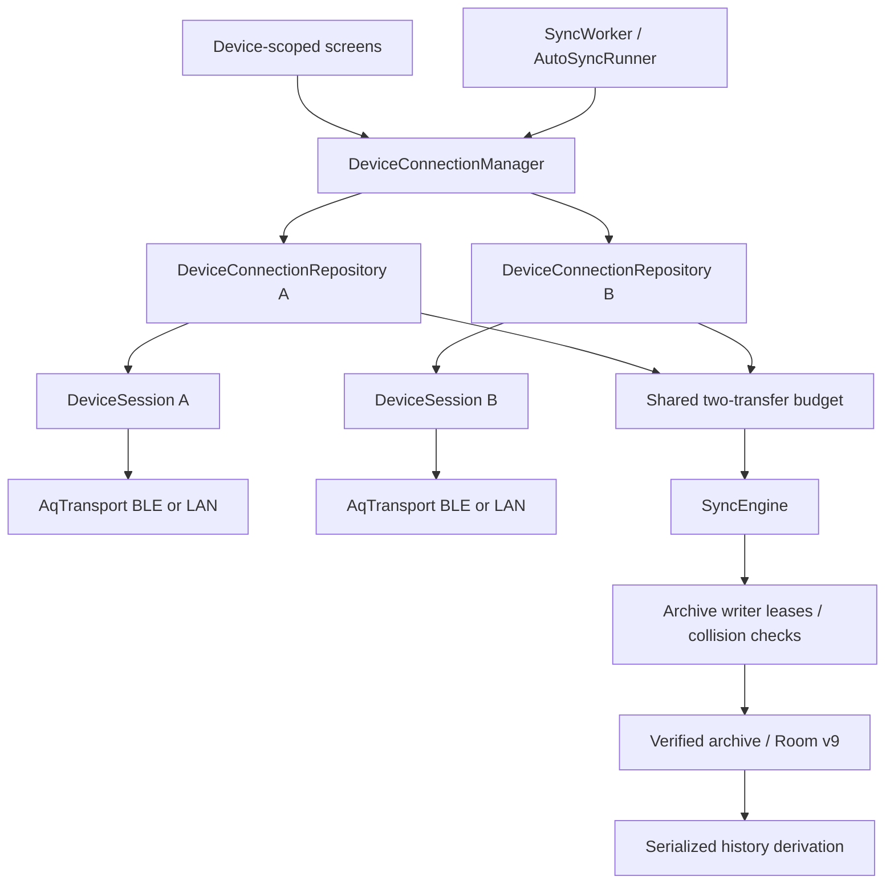

# opensensor.space — rebrand, concurrent collection and device recovery

**Scope:** implemented first slice, source audit and remaining qualification for a hardware-neutral,
multi-device Android companion. Host tests do not establish phone or board behavior.
**Code:** `data/DeviceFacade.kt`, `data/DeviceLinkOwner.kt`, `TransportFactory.kt`, `data/background/`,
`data/sync/`, `data/local/database/`, `core/protocol/.../JsonModels.kt`, `core/history/.../Metrics.kt`,
`ui/`, `res/values/strings.xml`.
**Related:** [architecture.md](architecture.md), [transports.md](transports.md),
[sync-engine.md](sync-engine.md), [background-sync.md](background-sync.md),
[data-model.md](data-model.md), [history-pipeline.md](history-pipeline.md), [screens.md](screens.md).

## Evidence and scope (2026-09-29)

The existing pending changes were committed and pushed to GitHub `main` first:
[`abf74ed`](https://github.com/walkthru-earth/opensensor-space-mobile/commit/abf74ed)
(Smart Sync, encrypted LAN credentials and fail-closed release signing).
`./gradlew --no-daemon clean verify` passed: 171 tests reported, 170 passed, one skipped,
zero failures/errors; lint reported zero errors and 14 warnings. Seven warnings concern newer
dependency versions; this investigation does not upgrade dependencies. Commit and push hooks passed.

Source audit: Android `abf74ed`, local `../aq-parquet` `cff2ef5`, and local
`../opensensor-space` `bf83a25`. The [public site](https://opensensor.space/) and
[dashboard repository](https://github.com/walkthru-earth/opensensor-space) were inspected too.
The site covers environmental measurements and system health beyond particulate matter. Its cloud
dashboard is a separate product surface: rebranding does not enable cloud traffic from this app.

The firmware owner is now `../aq-parquet/docs/shared/ble-sync-protocol.md`.
Measurement evidence is per board, under `../aq-parquet/docs/boards/<board>/bench-verified.md`.
Current shared-contract and bench links use the new owner layout; dated measurements retain
their original board and revision provenance.

Both CoreS3 and Waveshare ESP32-S3-SIM7670G V2 consume shared logger/connectivity libraries.
CoreS3 has a 77-column contract; the Waveshare logger has 49 columns. The Waveshare SD logger has
readback evidence, but its secure BLE and Wi-Fi/LAN transfer, Android recovery and simultaneous
collection have not been established by that evidence. No phone or board was modified in this audit.
Use the current firmware router, implementation and per-board bench records when older notes still
describe Waveshare as diagnostic-only. Cellular, GNSS and camera integration are future work.

## Host verification of this implementation

On 2026-09-29, `./gradlew --no-daemon verify` passed with **231 tests reported: 230 passed,
one skipped, zero failures/errors**, including 128 app, 55 protocol, 23 Parquet and 25 history tests.
Lint has zero errors and the same 14 warnings as the checkpoint. The debug APK builds.
`python3 tools/validate_station_epoch_migration.py` passes using actual migration SQL and exported
v8/v9 schemas: credential/archive/device rows are preserved and epoch provenance is retained.
CI verification/release jobs also execute the migration validator.
These are host checks. USB upgrade/startup and foreground pairing recovery now have bounded phone evidence in status.md; controlled schema migration and simultaneous radio transfers still require qualification.

## Product and compatibility decisions

| Concern | Decision | Reason / boundary |
| --- | --- | --- |
| Public name | `opensensor.space` | Matches the requested brand; use devices, sensors and measurements in general copy |
| Supported device | A device implementing the reviewed shared sync contract | An ESP32-S3 radio alone does not imply protocol or schema compatibility |
| Android update identity | Retain `earth.walkthru.aqsync` application ID and current release certificate | Existing installations must upgrade with their archive, database, settings and enrollment intact |
| Internal names | Retain package namespace, Room filename, Keystore alias, worker/channel IDs and signing variable names initially | A visible rebrand does not justify migrating persistent identities |
| Wire compatibility | Retain service UUIDs, `_aqsync._tcp`, framing and opcodes | Firmware owns the contract; do not rename a protocol for branding |
| Offline use | Local verified archive remains the source of truth | No cloud endpoint, analytics SDK, account or new permission is introduced |
| Unknown schema | Verified file collection/export; unavailable interpreted live cards | Preserve the data without inventing semantics |
| Sensor additions | Registry entries plus reviewed schema descriptors | Keep measurements, units, gates and availability out of screen-specific switches |
| Collection | Independent sessions for distinct devices; one owner per physical device | Firmware has one open file total across BLE and LAN |

Visible changes include `strings.xml` (app name, permission and scan help), Settings/About,
Device help, pairing instructions, notification text, export filenames and release/artifact titles.
Pairing help must accommodate both display passkeys and display-less devices with physically
provisioned fixed PINs. Never show or log a stored PIN, Wi-Fi PSK or LAN token.
Historical raw files and metadata remain untouched; new derived-file provenance can use the new name.

The dashboard contains `static/icon.svg`, `icon-192.png`, `icon-512.png` and
`static/logo/weather_parquet.svg`. Its theme uses blue `#2563eb` / `#3b82f6`, orange accents and
light/dark neutral surfaces. Asset licensing is not stated in the inspected repository; retain
source provenance and resolve reuse terms rather than inventing a license. Launcher adaptive and
monochrome variants need Android-specific rendering and visual verification.

## Findings at the checkpoint, with source locations

Locations refer to checkpoint `abf74ed`, before the implementation below; paths under `data/`
and `ui/` are in `:app`. The final cadence/settling generalization remains outstanding.

| Finding | Source | Consequence |
| --- | --- | --- |
| One process-wide session, sync, manifest and reconnect state; connecting closes the previous session | `DeviceConnectionRepository.kt:382` and `:466` | A second connection displaces the first |
| Worker iterates devices sequentially and skips all while any session exists | `data/background/AutoSyncRunner.kt:143`; repository unattended path | Parallelizing only the worker cannot provide isolated collection |
| Singleton Wi-Fi lock disables reference counting and returns early when already held | `data/lan/LanWifiLock.kt:40` | One completed LAN transfer would release another's protection |
| Shared partial paths and replacement of an existing archive destination | `data/sync/FileArchive.kt:67` and `:93` | Concurrent writers or duplicated stations can corrupt partials or replace verified bytes |
| INFO replaces saved station/dev/firmware without a continuity decision | `DeviceConnectionRepository.kt:479` | No reset/replacement policy or retained station lineage |
| Reconstructed known-device row omits `companionAssociationId` | `DeviceConnectionRepository.kt:487` | A reconnect clears app-side association memory |
| LIVE `t` is always interpreted as board temperature; `rh` is absent | `core/protocol/.../JsonModels.kt:134`; `ui/device/TodayScreen.kt:395` | Waveshare ambient temperature is mislabeled and humidity omitted |
| Global primary and defaults use PM2.5 | `core/history/.../Metrics.kt:82`; Scan/Today/History ViewModels | A sensor without PM gets an empty air-quality experience |
| WHO reference line follows any banded metric; chart clamps negative values (resolved: the line comes from the metric's own `healthScale`, PM2.5 and PM10 only, and neutral metrics keep signed axes) | `ui/history/BandColumnChart.kt`, `ChartAxes.guidelineOf` | General metrics require signed axes and metric-specific references |
| Coverage assumes 10-second sampling; settling value comes from CoreS3 measurements | `core/history/.../Aggregation.kt:14`; `data/history/HistoryRepository.kt`; `Metrics.kt` | Do not extrapolate coverage or settling claims to arbitrary devices |

The existing history pipeline already supports ambient temperature/humidity registry entries and
absent columns without substituting zeros. Keep that foundation. `HistoryDeriver.deriveStale` already
serializes derivation with a mutex; collection can be concurrent while derivation remains serialized
and coalesces affected station-days.

## Implemented collection architecture

The singleton manager creates an unscoped controller per enrolled public BLE address. Assisted
ViewModels resolve that address, so selecting another device retains earlier connections and work.
Each controller owns connection/session jobs, LIVE/STATUS, manifest, reconnect, diagnostics and
sync progress. GATT and session commands retain their original serialization.

Controller mutexes reserve interactive/background ownership. A full `info.dev` claim also rejects
an alternate endpoint already owned by another controller. BLE and LAN remain alternative links
for one physical device. A shared semaphore bounds all interactive/worker transfers to two;
`AutoSyncRunner` concurrently visits distinct eligible devices with failures isolated per device.
It skips only the owned target, never pairs or scans, and retains per-device LAN-to-BLE fallback.
Interactive sync/config/raw commands refuse worker-owned sessions while progress remains observable.

The shared `WriterLeases` in `SyncEngine` guards the full file lifecycle per `(station, name)`. Existing verified
bytes are rechecked against OPENED size/CRC plus local SHA/PAR1 and reused only when identical;
conflicting or corrupt canonical bytes are preserved and the incoming run fails. No replacement,
provenance overwrite or alternate conflict-copy UI is introduced. `LanWifiLock.acquireLease` holds
protection until the last active LAN transfer closes its lease. Derivation remains serialized.

Foreground service progress aggregates interactive controllers and stops after all release their
need for protection. Each worker has its own owner ID, progress and cancellation notification.
Targeted work names include the device address, so one request does not discard a different target.
Foreground mDNS browsing is shared; the legacy resolver serializes all API 31–33 browse collectors.
Notifications and Android foreground lifetimes still require a real phone check.

File Share/Inspect uses the exact storage owner and filename, so identical relative paths on
different sensors cannot select another sensor's copy. Reconnect retains the assisted enrollment
address after the session closes. Home lists active controllers with their own progress. Today **Devices** returns Home without
closing the controller; Disconnect affects only that target. History offers retained station epochs
and metrics with valid archived buckets. No combined station comparison/deduplication UI is claimed.

## Identity, fingerprints and reset recovery

These are distinct identities; none should be treated as interchangeable:

| Value | Actual meaning | Reset/reflash implication |
| --- | --- | --- |
| BLE address | Public stable transport address required by the current contract | CDM and scan filters depend on it; verify its relationship to Wi-Fi MAC rather than deriving one from the other |
| `info.dev` | Full 12-hex Wi-Fi station MAC from `esp_read_mac(ESP_MAC_WIFI_STA)` | Normally hardware-stable; correlation evidence, not a cryptographic credential |
| `info.station` | Random UUID persisted in NVS `parquet/station` | Persists across normal reset; recreated after NVS erase |
| `info.boot` | Fresh random 128-bit boot ID | Expected to change each boot; never a replacement device |
| `info.fw` | Textual firmware version | Accept supported version changes automatically; no image SHA or attestation on the wire |
| `info.dict` / `schema` | Measurement dictionary digest / schema identifier | Refresh interpretation/capabilities; the digest is not a device or firmware-image fingerprint |
| Bond / LAN token | Enrollment keys / bearer credential | Stored in persistent device state; erase can remove both while Android still remembers its bond |
| App signing certificate | Android install/update identity | Keep stable during the public rebrand; unrelated to sensor identity |

Firmware implementation: `../aq-parquet/firmware/common/logger/src/aq_logger.cpp:241` (station),
`:1681` (MAC), `:1692` (boot), connectivity `ble_sync.cpp` (INFO and public addressing), runtime
`device_config.cpp` (NVS configuration). Ordinary reset/flash identity retention has Waveshare
bench evidence; recovery from erased credentials on Android does not.

Room v9 adds immutable `station_epoch` observations keyed by enrolled address/station. Migration
seeds the current known-device station and previously archived source-device stations without
inventing hardware identity for archive-only epochs. Controller upserts retain Auto-sync and
companion associations. The public BLE endpoint remains the local enrollment key; a future separate
local UUID/endpoint model and structured recovery UI remain possible extensions.
Unknown/missing identity fields are not a wildcard matching all devices.

| Event | Automatic behavior | Owner involvement |
| --- | --- | --- |
| Same enrolled authenticated BLE device, same full dev/station, new boot | Reconnect, re-open files, verify partial size/CRC, resume from received offset | None |
| Supported firmware or dictionary changes | Refresh profile and availability; keep generic verified collection | None; unknown interpretation remains unavailable |
| Longer reflash downtime | Bounded per-device retries, then Awaiting device; later presence/periodic or explicit connect retries | Do not retry forever or block other devices |
| Same enrolled authenticated device/full dev, changed station | Retain prior epoch; attach new station; invalidate stale LAN credentials and retrieve token via bonded BLE | No additional station-change confirmation is needed under established continuity |
| Token rejected or unusable Keystore ciphertext | Clear only that device's token/port; refresh over authenticated BLE | None while valid pairing remains |
| Firmware lost bond keys, including NVS erase | Background reports connection failure and continues collecting other devices; foreground error explains pairing repair | Foreground Android pairing/provisioning flow; retain old history |
| Full dev changes, conflicting candidate, or changed transport address without established continuity | Reject identity mismatch; stop automatic reassignment | Enroll/confirm replacement before attaching it to the old local device |
| A future pinned device key changes | Accept only a contract-defined authenticated key rotation | Otherwise owner-approved enrollment, not a silent fingerprint overwrite |

Current reconnect retries are only three attempts at five-second intervals; a lengthy reflash can
outlast them. Current `BleTransport` trusts Android `BOND_BONDED`, which can be stale after device
key loss. Android's [createBond API](https://developer.android.com/reference/android/bluetooth/BluetoothDevice#createBond())
uses system-managed user interaction. Do not promise silent re-pairing, use hidden bond/cache APIs,
lower security, automatically forget bonds, or send device configuration/reset commands to recover.
A station name, `AQ-xxxx` suffix, advertisement boot16 or mDNS TXT cannot authorize replacing trust.
Current plaintext LAN bearer authentication authenticates the client to the device, not the server
to the phone; full TXT/INFO identity comparisons are consistency checks, not cryptographic proof.

## Retained SD and station lineage: resolve the owner contract first

After NVS erase the SD may contain station A files while INFO reports new station B. The current
firmware contract explicitly places **all** listed files under outer `archive/<INFO.station>/`,
including `station=A/...`. Android plans by the supplied INFO station and records that station in
Room without checking the file's station metadata. It can re-download the old files under B,
attribute their history to B, and lose UI access to the original A history after replacing the
known-device row. `ParquetMetadata.stationId` exists, but `ParquetIndexer.FileIndex` does not expose it.

The initial app slice retains earlier epochs and excludes a Hive producer-station mismatch from
new-station indexing, while keeping that verified file available for raw export. It does not alter
the outer archive contract. To extend provenance and eliminate retained-SD duplicate downloads,
define these separately with the firmware owner:

1. Storage namespace: where a historical copy already lives. Preserve existing raw paths/bytes.
2. Producer station: the station recorded by a verified file's metadata and Hive path, where present.
3. Source device: which enrolled physical device delivered the copy, which may be a reused SD card.
4. Device station lineage: stations observed in authenticated INFO for that physical device.

Index historical producer/source provenance without moving old raw files. A new canonical outer
namespace rule requires an owner-contract change first; Android must not silently switch to the
embedded Hive station. Define legacy/benchmark files without station partitions, metadata/path
disagreements, duplicate identical copies and conflicting same-name bytes. Reading another
station's files from an SD card does not establish that station as a deployment of this hardware.
Expose retained epochs separately; deduplicate an explicitly combined view so copies do not count
twice. Never reuse a UTC anchor across boots or infer dates for an unanchored boot.

## Measurement capabilities

Start with bundled, reviewed schema/dictionary descriptors; current INFO does not contain a
machine-readable capability manifest. The firmware dictionary URI may point to mutable `main`.
Do not fetch it from the app automatically. The network rule allows only mDNS devices, the public discover feed and the basemap. A future dictionary should reach the phone from the device or bundled with the app. The sensor-agnostic model that consumes these descriptors is in [devices-and-discovery.md](devices-and-discovery.md).

Interpret LIVE `t` via the descriptor: CoreS3 board/IMU temperature versus Waveshare ambient
temperature; parse optional `rh` as humidity for the reviewed Waveshare profile. Unknown profiles
must not guess labels or units. Current-file columns, non-null values and validity gates determine
history availability; a dictionary entry alone does not prove an optional sensor is attached.

Select an available metric per device and an explicit metric for comparisons. Render neutral numeric
cards for ordinary quantities. PM2.5 can retain `AirMood`; temperature, humidity and future gas,
pressure/light metrics must not inherit PM bands or health claims. Give metrics their own reference
lines, axis bounds and validity/settling descriptors. Support negative temperatures. Sample cadence
needs versioned provenance before coverage percentages can generalize beyond the current 10-second
firmwares. Changes to tier semantics require a derivation-version bump.

## Implementation progress and remaining acceptance gates

| Step | Implemented / outstanding | Remaining gate |
| --- | --- | --- |
| 1 — Compatible public rebrand | Visible brand/help/export/release copy and current firmware/doc routing done; install/protocol identities retained; launcher asset redesign outstanding | Upgrade APK on existing install; archive/settings/signing retained; visual review; `verify` and hooks |
| 2 — Interpretation and identity policy | Reviewed LIVE profiles, nullable humidity, continuity policy, companion retention and v9 epochs done; richer producer provenance/contract clarification outstanding | Real firmware fixtures; null/unknown schemas; migration preserves v8 archive/device state; recovery policy tests |
| 3 — Device session ownership | Manager/controllers, assisted device-scoped state and foreground/background ownership done | Two fake devices stay connected; selecting/disconnecting A does not alter B; single-device behavior retained |
| 4 — Concurrent collection | Shared two-transfer budget, archive locks/collision checks, LAN leases and aggregate/worker notifications done | Simultaneous transfers with independent faults/cancel/reconnect and no verified-file replacement |
| 5 — Generic measurement UX | Available-metric history, neutral profiled LIVE, signed charts and metric-specific references done; generic cadence/coverage and Home archive metric selection outstanding | Fixtures with PM, ambient-only, negative temperature, absent/invalid values; no invented data |
| 6 — Hardware qualification | OnePlus with both boards, mixed/dual transports and reset/reflash scenarios | Per-board bench record with date, firmware image SHA-256, app commit, phone and limitations; update status/README |

The safe implementation unit is a reviewed step, not a wholesale package rename. Firmware work is
limited to clarified shared contracts where required; this audit did not flash or alter either board.

## Tests and phone evidence

`FakeTransport` now accepts distinct station/dev identities. New behavior tests run real
`DeviceSession`/`SyncEngine`/`AutoSyncRunner`: simultaneous collect-all, archive writer serialization,
independent stations, immutable identical/conflicting/corrupt destinations and cancelled waiters.
Deterministic session tests catch frames at poll/quiet boundaries, including the original timed
receive race, link loss and cancellation/stale drain. Pure tests cover continuity decisions, hardware claim ownership, the global transfer budget, LAN
lease lifetime, reviewed profiles, signed axes and retained-producer indexing exclusion. Room v9
SQL was exercised against the exported v8 schema with Python SQLite; Android migration remains
unverified as a controlled migration test. A USB update/startup on the OnePlus retained existing
archive summaries. Erased-bond diagnosis now has a persistent repair message, Android Bluetooth
settings shortcut and regression tests that preserve GATT 5/15 through connection settle/teardown.
Device taps open details immediately so failures and offline archives remain accessible. A complete
structured pairing/replacement state UI and process-death tests remain. Keep lost-window byte-count recovery and existing READ windows;
concurrency alone does not justify shrinking a BLE window.

Required cases: two separate devices on LAN/LAN, BLE/LAN and BLE/BLE; same-device competing links;
two devices claiming one station; same-name/same-size different-CRC content; independent dropped
CHUNKs, disconnects and cancellation; partial restart; reference-counted LAN lock; foreground
notification while one of several transfers remains; overlapping worker/UI/trigger ownership;
station regeneration with old SD files; boot/schema changes; stale Android bonds; spoofed identities;
token rejection/unreadable token; previous station access and association retention after reconnect.

On the phone, measure paired reconnect, pairing repair, mDNS address changes, foreground/background
transitions, process death and two-device throughput. NVS-erasing/reflash tests require explicit
physical-write authorization and firmware backup procedures. A host test or firmware source check
is not a phone result. Record new measurements in the new owner's appropriate board bench record.

## Uses → affects

| Change | Uses | Affects / re-check |
| --- | --- | --- |
| Public branding | Dashboard brand and Android strings/assets | Permissions/pairing help, About, notifications, exports, release artifacts; install upgrade |
| Device identity/epochs | Authenticated INFO, enrollment and Room v8 migration | Discovery, token refresh, CDM, history, archive provenance, recovery |
| Session manager | Existing `AqTransport` and `DeviceSession` | Every ViewModel, reconnect, commands, raw debug, worker ownership |
| Concurrent coordinator | SyncEngine, archive leases, transport budgets | WifiLock, foreground protection, notifications, cancellation, collision checks |
| Schema descriptors | INFO schema/dictionary and verified file columns | LIVE semantics, available metrics, charts, gates, unknown-schema collection |
| Retained-station handling | Clarified firmware archive contract | Planner, file index, Room, export paths, history deduplication |
