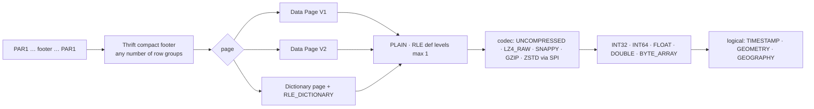

# Parquet — the app's own reader and writer

**Scope:** `:core:parquet`: what the reader accepts and refuses, the writer, GeoParquet 2.0, codecs, fixtures and the oracles that prove them.
**Code:** `core/parquet/…/data/history/parquet/`: `ParquetFile.kt` (mmap reader), `ParquetFooterParser.kt`, `ParquetMetadata.kt`, `ColumnValues.kt`, `ParquetWriter.kt`, `ThriftCompact.kt` / `ThriftCompactWriter.kt`, `Lz4Block.kt`, `ParquetCodecs.kt` (SPI), `Geometry.kt` (WKB), `GeoParquetMetadata.kt`; `:app` `data/history/parquet/AppParquetCodecs.kt` (ZSTD via `zstd-jni`).
**Fixtures:** `core/parquet/src/test/resources/parquet/{device,v3,expected.json}` and `…/geoparquet/{pyarrow,duckdb,expected.json}` (shared into `:core:history` tests).
**Tools:** `tools/make_parquet_fixtures.py`, `tools/make_geoparquet_fixtures.py`, `tools/validate_parquet_samples.py` — run as `cd ../aq-parquet && pixi run python ../opensensor-space-android/tools/<script>`.
**Related:** [history-pipeline.md](history-pipeline.md) (who reads/writes), [sync-engine.md](sync-engine.md) (PAR1/CRC verification is in `:core:protocol`, not here).

## Why an own reader

Kotlin DataFrame cannot read Parquet on Android (`dataframe-arrow` needs Arrow's native Dataset
JNI, no Android build) and boxes values; DuckDB for Android is an experimental self-build (Swift is
official). Settled — do not re-research (evaluation §1). The reader is ~zero-copy: `FileChannel.map`
+ absolute reads; only the requested column chunks are touched (3 of 77 for a PM2.5 chart); pages
decode once into `IntArray`/`LongArray`/`FloatArray`/`DoubleArray`/binary with a `BooleanArray`
validity mask (`ColumnValues`), no per-row objects. All 881 columns of the device/v3 fixtures decode
byte-identically to PyArrow in ~0.15 s.

## What is accepted

Refused with a typed `ParquetFormatException` naming the feature: repetition levels / nested
schemas, DELTA / BYTE_STREAM_SPLIT encodings, BROTLI / LZO, BOOLEAN / INT96 / FIXED_LEN_BYTE_ARRAY.
Footer statistics are read (`min_value`/`max_value`, exact flags, `null_count`), including the v6
firmware's per-row-group statistics (the index takes spans from them without decoding).

## Codecs (`ParquetCodecs` SPI)

| Codec | Where | Notes |
| --- | --- | --- |
| UNCOMPRESSED, **LZ4_RAW** | `builtIn`, own ~60-line block decoder + compressor (`Lz4Block`) | the firmware's codec |
| **SNAPPY** | `builtIn`, own decoder | PyArrow / DuckDB / GDAL default |
| **GZIP** | `builtIn`, `java.util.zip` | |
| **ZSTD** | `AppParquetCodecs` in `:app` registers `zstd-jni` (`@aar`) | the **one native library**; kept out of `:core:*`; `AppParquetCodecsTest` |

## Writer (`ParquetWriter`) — the mirror of the reader

PLAIN, RLE definition levels, LZ4_RAW, per-chunk `min_value`/`max_value` + exact flags +
`null_count` + `nan_count`, TYPE_ORDER column orders, `TIMESTAMP(NANOS, UTC)`, `sorting_columns`,
row-group `file_offset`/`ordinal`, key/value metadata; since D11 also `BYTE_ARRAY`/`DOUBLE`,
`GEOMETRY`/`GEOGRAPHY` logical types with `geospatial_statistics` (bbox + WKB type codes) and the
`geo` key. Used by `DailyDerivedBuilder` ([history-pipeline.md](history-pipeline.md#derived-daily-parquet-dailyderivedbuilder)).
Output is accepted by PyArrow 25 and DuckDB 1.5.5 (`tools/validate_parquet_samples.py`: every
statistic matches the values, `TIMESTAMPTZ` read, range pruning, `time_bucket`).

## GeoParquet 2.0 (D11, 2026-09-17)

**Read any GeoParquet 2.0 rc.1 file, write our own** by extending the reader, not importing an
engine (evaluation §7). 2.0 dropped the nested GeoArrow encodings: a geometry column is a flat
`BYTE_ARRAY` of **WKB** with the Parquet-native `GEOMETRY`/`GEOGRAPHY` logical type (union fields
17/18), CRS on the type (`absent` = OGC:CRS84, PROJJSON, `EPSG:4326`, `srid:0`),
`geospatial_statistics` per chunk, `geo` key optional for reading. Own WKB decoder (`Geometry`):
7 OGC types, XY/Z/M/ZM, both byte orders, EWKB flags, depth ≤ 32; **no PROJ**. Firmware and device
files are unchanged; import UI and map are separate decisions (D4/D5).

## Fixtures and oracles

| Set | Files | Made by | Oracle |
| --- | --- | --- | --- |
| `parquet/device/` | 11 real `AQ-6b40` files: v1 (73 col) and v2 (77 col), UNCOMPRESSED and LZ4, dated and unsynced, 1–90 rows; plus the board's first two **firmware-v6** files (`v3-board-2rg-105rows` 2026-09-17 09:42–09:59Z, 90+15 rows, SHA-256 `1a06e93b…f3cf`; `v3-board-2rg-180rows`, full 1800 s window, 2×90, SHA-256 `a8ceaebe…`) | copied by `make_parquet_fixtures.py`; board files fetched over serial by the firmware-side session | `expected.json` from PyArrow: footer facts, per-row-group statistics decoded from raw bytes, per-column null count / first / last / min / max / sum |
| `parquet/v3/` | 12 firmware writer fixtures (up to 8 row groups, statistics, `TIMESTAMP(NANOS, UTC)`) | the firmware's own fixture writers, compiled by the script | same `expected.json` |
| `geoparquet/pyarrow/` + `duckdb/` | 20 files: PyArrow 25 `{none,snappy,gzip,zstd} × {plain,dict} × {page v1,v2}` + native-only + multipage; DuckDB 1.5.5 `GEOPARQUET_VERSION 'V1'` and `'V2'` | `make_geoparquet_fixtures.py` (PyArrow + DuckDB) | `expected.json`; decoded cell-for-cell |
| `RealArchiveTest` (`:core:history`) | sweeps **all 766 real files** when `../aq-parquet` is a sibling (67 272 rows, 58 868 column chunks, 136 statistics cross-checks, 0.2 s); skips otherwise | — | footer statistics vs decoded rows |

Regenerate fixtures when the firmware writer changes; commit the result. Writer samples land in
`app/build/parquet-samples/` after the tests (or a phone's `derived/` copy) for
`validate_parquet_samples.py`.

## Uses → affects

| Edit… | Affects… |
| --- | --- |
| `ParquetFile` decoding | `ParquetIndexer`, `Aggregator`, `HistoryRepository` day rows, Metrics screen, `RealArchiveTest` |
| `ParquetWriter` | daily derived files → re-run PyArrow/DuckDB oracle; `ParquetWriterTest` |
| `ParquetCodecs` SPI | `AppParquetCodecs` registration order at app start; fixtures per codec |
| `ThriftCompact*` | every footer read/write — the fixtures are the regression net |
| `Geometry` / `GeoParquetMetadata` | `GeoParquetFileTest`; a future import UI / map (D4/D5) |
