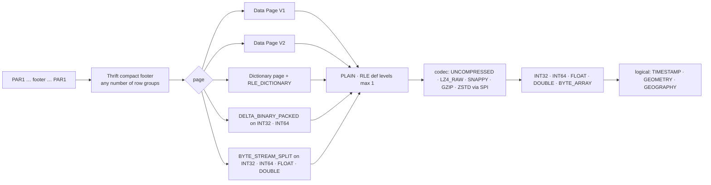

# Parquet — the app's own reader and writer

**Scope:** `:core:parquet`: what the reader accepts and refuses, the writer, GeoParquet 2.0, codecs, storage seams, fixtures and the oracles that prove them.
**Code:** `core/parquet/src/commonMain/…/data/history/parquet/` (JVM and iOS): `ParquetFile.kt` (`ParquetFile`), `ParquetReader.kt` (`ParquetReader`, `ScanRequest`, `FooterCache`), `ColumnDecoder.kt` (the one-pass chunk decoder), `ValueDecoders.kt` (DELTA_BINARY_PACKED and BYTE_STREAM_SPLIT), `PrimitiveColumn.kt` (`PrimitiveColumn`, `ColumnBatch`), `PageIndex.kt`, `RangeSource.kt` (`RangeSource`, `ByteView`, `SourceId`, `RangePolicy`, `MemoryRangeSource`), `RangePlanner.kt` (`RangePlanner`, `CoalescingRangeSource`), `ByteReader.kt`, `Bytes.kt`, `ParquetFooterParser.kt`, `ParquetMetadata.kt`, `ColumnValues.kt`, `ParquetWriter.kt` (`ParquetSink`), `ThriftCompact.kt` / `ThriftCompactWriter.kt`, `Lz4Block.kt`, `ParquetCodecs.kt` (SPI, Snappy, `expect` gzip), `Geometry.kt` (WKB), `GeoParquetMetadata.kt`, `LocalFile.kt`. `src/jvmMain`: `LocalFileReader` (positional `FileChannel` reads), `LocalRangeSource` (the same reads), gzip via `java.util.zip`, `ParquetWriter(OutputStream, …)`. `src/iosMain`: `LocalFileReader` (POSIX `pread`), `LocalRangeSource` (the same reads), gzip via the system zlib. `:app` `data/history/parquet/AppParquetCodecs.kt` (ZSTD via `zstd-jni`).
**Fixtures:** `core/parquet/src/test/resources/parquet/{device,v3,expected.json}` and `…/geoparquet/{pyarrow,duckdb,expected.json}`, `…/parquet/discover/` (page index), `…/parquet/encodings/` (DELTA and BYTE_STREAM_SPLIT) (published as `:core:parquet` test fixtures, see [Fixtures and oracles](#fixtures-and-oracles)).
**Tools:** `tools/make_parquet_fixtures.py`, `tools/make_geoparquet_fixtures.py`, `tools/make_encoding_fixtures.py`, `tools/validate_parquet_samples.py` — run as `cd ../aq-parquet && pixi run python ../opensensor-space-android/tools/<script>`.
**Related:** [history-pipeline.md](history-pipeline.md) (who reads/writes), [sync-engine.md](sync-engine.md) (PAR1/CRC verification is in `:core:protocol`, not here).

## Why an own reader

Kotlin DataFrame cannot read Parquet on Android (`dataframe-arrow` needs Arrow's native Dataset
JNI, no Android build) and boxes values; DuckDB for Android is an experimental self-build (Swift is
official). Settled, do not re-research (evaluation §1). No Parquet library exists for Kotlin/Native
either, so the same reader serves iOS. Only the requested column chunks are read (3 of 77 for a PM2.5
chart), one range read per chunk from a memory-mapped file. Pages decode in one pass straight into
their final slot of an `IntArray`/`LongArray`/`FloatArray`/`DoubleArray`/binary column with a validity
mask (`PrimitiveColumn`, or `ColumnValues` through `ParquetFile`), no per-row objects and no
intermediate per-page arrays. Thrift field and list headers are packed value classes, so parsing a
footer or page header allocates no header objects. All 881 columns of the device/v3 fixtures decode
byte-identically to PyArrow, on the JVM and on the iOS simulator. `RealArchiveTest` reads all 767 real
archive files in about 0.45 s on the JVM (2026-10-08, M-series Mac).

## Portability and storage (W8, 2026-10-08)

The module is Kotlin Multiplatform (`opensensor.kmp.library`). Common code never imports `java.*`.
Bytes reach the decoder through two narrow seams, a blocking `ByteReader` and a suspending `RangeSource`.

| Type | What it is | Implementations |
| --- | --- | --- |
| `ByteReader` | `size`, `read(offset, length)` and `view(offset, length)`, absolute and thread-safe, for `ParquetFile`. `AutoCloseable` since #61, a read after `close()` throws. The local readers never map. Each holds one descriptor and closes it when `close()` returns, so nothing waits for a collector | `ByteArrayReader`, `LocalFileReader` (JVM `FileChannel.read(dst, position)`, iOS `pread` on a reference counted descriptor) |
| `RangeSource` | suspending `id()`, `readTail(n)`, `readRanges(ranges)` returning one `ByteView` per range, and `close()`, for `ParquetReader` | `MemoryRangeSource`, `LocalRangeSource` (JVM `FileChannel`, iOS `pread`), `CoalescingRangeSource` (wraps another), `HttpRangeSource` in `:core:net` |
| `ByteView` | a read-only window over a `ByteArray`. The decoder slices views and never copies them | made by every source |
| `SourceId` | uri, size and version (ETag over HTTP, size and modification time for a file), one immutable version of a file | the `FooterCache` key |
| `LocalFile` | `expect class`, `java.io.File` on the JVM (a typealias), a path on iOS | `ParquetFile.open(LocalFile)` opens it with `LocalFileReader` |
| `ParquetSink` | where `ParquetWriter` writes, `write(bytes)` and `flush()` | `OutputStreamSink` on the JVM, any sink on iOS |

- `ParquetFile.open(file)`, `ParquetFile.open(reader, source)` and `ParquetFile.wrap(bytes)` read the
  footer at once and each column chunk on demand, as `[first page, first page + total_compressed_size)`.
  A writer whose chunk size undercounts gets one wider read up to the footer.
- `ParquetReader.open(source, footerCache, policy)` makes one tail read of `RangePolicy.tailPrefetchBytes`
  (64 KiB `LOCAL`, 128 KiB `CELLULAR`, 256 KiB `WIFI`), which holds the footer and the page index, and
  one more read only when the footer is longer. A file under `wholeFileBelowBytes` is read whole the
  first time a scan needs bytes outside the tail. The `FooterCache` (LRU, 256 entries by default, keyed
  by `SourceId`) keeps parsed footers and page indexes, so reopening a file parses nothing. The Discover
  feed and the History Day view's derived day files (32 entries, [history pipeline](history-pipeline.md))
  use one.
- `scan(ScanRequest(columns, rowGroups, filterColumn, filterRanges))` prunes row groups by footer
  statistics, then pages by the `ColumnIndex` min and max of the INT32 or INT64 filter column, mapped
  to byte ranges through each column's `OffsetIndex`. Only the surviving pages are fetched and decoded,
  then rows are filtered exactly. `readColumns(columns)` reads everything. The `ColumnBatch` reports
  `rowGroupsRead`/`rowGroupsTotal` and `pagesRead`/`pagesTotal`. When a source throws
  `SourceChangedException` (the object was replaced between reads) the reader drops the cached footer,
  reopens and runs the scan again, once.
- `RangePlanner` sorts the wanted ranges and merges those within `coalesceGapBytes`, up to
  `maxRequestBytes`. `CoalescingRangeSource` runs the merged requests at most `parallelism` at a time and
  hands back views into the fetched buffers. Presets are `RangePolicy.LOCAL`, `CELLULAR` and `WIFI`.
- `:core:net` gives `HttpRangeSource`, a `RangeSource` over one URL through an `HttpRangeEngine` (OkHttp
  5.5.0 on Android and the JVM, `NSURLSession` on iOS). The tail is a suffix range, later ranges carry
  `If-Range` with a strong ETag, and a 200 for a changed object raises `SourceChangedException`. It
  sends `Accept-Encoding: identity`, skips the local HTTP cache and logs nothing. Issues #60 and #61
  are closed. `OpenAqAggregatesFeed` builds one per feed file.
- `CachedRangeSource` (`:core:net`, #94) serves a `RangeSource` through aligned 64 KiB blocks kept in a
  `BlockCache` on disk. A cached block is read with no request. Missing blocks are fetched in runs of
  consecutive blocks, one range per run. The key is the URL and a generation, the manifest's `as_of`
  and `generation` in the feed. A small meta file keeps the size and ETag, so a second open makes no
  request at all. Within one key nothing is revalidated, so a writer that replaces a file must change
  the generation. When upstream reports another object, every block of the key is dropped and the
  read throws `SourceChangedException`, so the reader starts again on the new object. An object
  without a strong ETag bypasses the cache. `BlockCache` evicts the least recently used file before
  each write so it stays under its quota, and writes nothing while the quota is 0 or unknown. It adds
  no request and no endpoint of its own.
- `ParquetFileMetadata.longStatistics(column)` returns the footer min, max and null count of an INT32
  or INT64 column per row group without reading a page. `rowGroupsOverlapping(column, ranges)` keeps the
  row groups whose `[min, max]` meets any inclusive `LongRange` (H3 descendant ranges in W12). A chunk
  without statistics is kept, an all-null one dropped. `ParquetReader.scan` applies the same rule before
  page pruning.
- `ColumnValues.longValues()` and `doubleValues()` hand out primitive arrays without boxing, the stored
  array when the type already matches.
- GZIP is an `expect` function, `java.util.zip` on the JVM and `inflateInit2` from `platform.zlib` on
  iOS (also concatenated members). ZSTD stays behind the codec SPI on Android only. iOS has no ZSTD in
  its system libraries, which is why the public feed is written with SNAPPY or LZ4_RAW.
- kotlinx-io is not used. Its API is still alpha and has no random access, so the module keeps its own
  `ByteReader` and the platform file APIs at the edges.

## What is accepted

Refused with a typed `ParquetFormatException` naming the feature: repetition levels / nested
schemas, DELTA_LENGTH_BYTE_ARRAY / DELTA_BYTE_ARRAY and other encodings, BROTLI / LZO, BOOLEAN / INT96 / FIXED_LEN_BYTE_ARRAY.
Footer statistics are read (`min_value`/`max_value`, exact flags, `null_count`), including the v6
firmware's per-row-group statistics (the index takes spans from them without decoding).

DELTA_BINARY_PACKED is read lazily, one miniblock at a time, and every delta is summed in 64 bits.
PyArrow wraps INT32 deltas at 32 bits, DuckDB takes them in 64 bits and packs 33 bit miniblocks when
a value jumps across the INT32 range. The reader accepts both and returns the same INT32 values.
PyArrow refuses the DuckDB form, so a writer for PyArrow readers should wrap at 32 bits. Bit widths
of miniblocks past the last value are not checked, as the spec allows. BYTE_STREAM_SPLIT works for 4
and 8 byte values. A malformed header, a width over 64 or a truncated miniblock is a
`ParquetFormatException`.

### Corrupt files

A corrupt or hostile file raises `ParquetFormatException` and nothing else. The footer, page index
and page header parsers check every field before it is used.

- Each known Thrift field id must carry its `parquet.thrift` wire type (`ThriftCompactReader.expect`,
  `readI32(header)` and the other typed reads). A list must hold the element type of its field, an
  empty list may carry any.
- A list or MAP size is never negative and never larger than the bytes left in the footer or page
  index, so a size field cannot make the reader allocate or loop past the buffer.
- Row counts, value counts, page sizes, offsets, `num_children` and `type_length` are never negative.
  A `ColumnIndex` null count is never negative, and its `null_pages` is a bool list. The V2 data page
  counts `num_nulls`, `definition_levels_byte_length` and `repetition_levels_byte_length` are never
  negative.
- A bounds check that refuses a read throws `ParquetBoundsException`, an `IndexOutOfBoundsException`
  the readers wrap in `ParquetFormatException`. Any other index, arithmetic or allocation error is a
  missing guard.
- The row counts of the row groups must add up to `FileMetaData.num_rows`, summed with `checkedAdd`.
- Byte arithmetic goes through `checkedAdd` and `checkedToInt` (`Bytes.kt`). A column chunk whose
  `total_compressed_size` would run past the column data, or wrap, ends at the data end instead
  (`chunkEnd`). A page index pointer whose end would wrap is ignored.

`FooterHardeningTest` builds one footer, index or page per guard that is valid except for one field.
`ParquetMutationFuzzTest` flips bytes, bits and runs of every fixture family with a fixed seed, about
10k cases on the JVM in a few seconds, and reads each mutant through `ParquetFile` and a
`ParquetReader` scan. It fails on any throwable other than `ParquetFormatException`, and on a
`ParquetFormatException` that wraps a raw index, arithmetic or allocation error. The fuzz is a
backstop for crashes nobody thought of. The unit tests prove each guard.

## Codecs (`ParquetCodecs` SPI)

| Codec | Where | Notes |
| --- | --- | --- |
| UNCOMPRESSED, **LZ4_RAW** | `builtIn`, own ~60-line block decoder + compressor (`Lz4Block`) | the firmware's codec |
| **SNAPPY** | `builtIn`, own decoder | PyArrow / DuckDB / GDAL default |
| **GZIP** | `builtIn`, `java.util.zip` (JVM), system zlib (iOS) | `expect fun gunzip` |
| **ZSTD** | `AppParquetCodecs` in `:app` registers `zstd-jni` (`@aar`) | the **one native library**, kept out of `:core:*`, `AppParquetCodecsTest`. Android only |

`PageDecompressor.decompress(input: ByteArray, uncompressedSize)` receives exactly the compressed page
bytes (it used to receive a `java.nio.ByteBuffer`).

## Writer (`ParquetWriter`) — the mirror of the reader

PLAIN, RLE definition levels, LZ4_RAW, per-chunk `min_value`/`max_value` + exact flags +
`null_count` + `nan_count`, TYPE_ORDER column orders, `TIMESTAMP(MICROS|NANOS, UTC)`, schema `field_id`, `sorting_columns`,
row-group `file_offset`/`ordinal`, key/value metadata; since D11 also `BYTE_ARRAY`/`DOUBLE`,
`GEOMETRY`/`GEOGRAPHY` logical types with `geospatial_statistics` (bbox + WKB type codes) and the
`geo` key. Used by `DailyDerivedBuilder` ([history-pipeline.md](history-pipeline.md#derived-daily-parquet-dailyparquetbuilder)).
Output is accepted by PyArrow 25 and DuckDB 1.5.5 (`tools/validate_parquet_samples.py`: every
statistic matches the values, `TIMESTAMPTZ` read, range pruning, `time_bucket`).

## Device file layouts (`UtcColumns`)

CoreS3 v6.12 (schema `cores3-telemetry-v5`, dictionary `cores3-telemetry-v4`) and Waveshare v2.6
(schema and dictionary `waveshare-sim7670g-telemetry-v4`) write `event_time_utc_us` and
`clock_anchor_utc_us` as `TIMESTAMP(MICROS, isAdjustedToUTC=true)`. Older files on the phone carry
`event_time_utc_ns` and `clock_anchor_utc_ns` as `TIMESTAMP(NANOS, UTC)`, and the first CoreS3 files
left them unannotated. The name only finds the column. The scale comes from the logical type unit,
an unannotated INT64 under an old `*_ns` name reads as nanoseconds, and any other unannotated or non
INT64 column under a UTC name is refused. One rule covers every unit (`UtcColumns.fitsNs`). A value
whose nanoseconds would not fit a Long, before 1677 or past 2262, reads as null instead of wrapping,
in a MICROS column as much as in a NANOS one. The reader exposes `LeafColumn.timestampUtcUnit` and `LeafColumn.fieldId`.

Every leaf of a current device file has `field_id` = its 1-based position in the board's
`telemetry_fields.inc`, and dictionaries are append only, so an id never changes meaning. Older
files have no ids and are mapped by name. A newer schema string is never a reason to refuse a file.

Both layouts stay readable. The owner removed the old files from the Waveshare card, and a file
that is no longer listed by the device is not data loss. The app never uploads a file to the device
and never asks the firmware to delete or rewrite one.

### Removing old files from the phone

Settings › Storage › Old format files removes old layout files from the phone archive only, with
the owner's approval. `UtcColumns.isLegacyLayout` decides from the footer. A file is old when it has
`event_time_utc_ns` as an INT64 that is `TIMESTAMP(NANOS, UTC)` or unannotated, no
`event_time_utc_us`, and no leaf with a field id. A file without any event time column, a current
MICROS file and a file whose footer does not parse are always kept. Purpose plays no part.

`LegacyFileCleanup` (`:core:history`, both phones) runs a dry run first (`plan`), which reads every
footer and changes nothing. A file whose footer cannot be read is counted as skipped and kept, and
Settings shows that count, so it never reads as none found. The first unreadable footer's exception
class is logged once per run. A UTC day range is inclusive and matches a file whose real or estimated
span overlaps it. A file the timeline cannot place is included only when no range is set.

`remove` may run while a sync runs. Each file is handled under its writer lease of the archive's one
`DeviceCoordinator` (`:core:sync`), so a sync of the same file waits, and a sync that waited finds
the tombstone under the lease and skips the file. It checks the file is still old, then takes the
coordinator's station gate, the one sync, `ArchiveIndexRepair` and the startup janitor take for
every archive write. Readers never take it. Under the gate it reads the live record again
and keeps the file when the record is gone or its size or CRC-32 changed. Then it writes a
`PrunedFile` record, removes the index record and deletes the final file, only below the Durable
archive root. A failed delete puts the index record back, drops the `PrunedFile` and counts as
failed. When the restore throws too, the file stays without a record and the startup janitor adopts
it again. A crash between the steps leaves a final file without a record, which the janitor adopts
again under the same gate and drops its `PrunedFile`, so the index never points at a missing file and
a held file is never marked removed. Cancellation is honoured between files only. Each file's steps, from the record check to the re-adopt check, run under
`NonCancellable`. The derived days of the removed files are rebuilt after, also when the caller was
cancelled (Android `HistoryDeriver.deriveStale`, iOS `rebuildDerived`, which also rebuilds a
station whose files all went from no sources, so its stale day files are removed). A rebuild that
throws is logged and reported as `rebuildFailed`, the files stay removed. The report counts
removed, kept (no longer old, changed, gone already or unreadable) and failed. Logs carry counts and
exception class names only. Nothing is sent to a device.

`PrunedFiles` (`:core:archive`, Room `pruned_file` on both phones) keeps the station, name, size and CRC-32 of each removed file. The FILE frame carries no CRC,
so `SyncPlanner` matches on station, name and size. A listed file with such a record and no phone
copy plans as `REMOVED`. It is not downloaded and counts as done, so the device card can still read
as all synced. A phone copy always wins over the record. A whole LIST that no longer names the file
drops the record, so a later file under the same name and size, after a card reset, downloads.
Files shows the file as removed from this phone. On iOS a records file that cannot be read whole
reads as no records, and new records are refused until Download again rewrites it, so a removal
keeps the file rather than overwrite the other records. Settings › Storage › Removed files ›
Download again empties the records after a confirm, and the next sync downloads those files again when the device still lists them.

### Iceberg v3 tables (not in the app yet)

The app has no Iceberg catalog or commit code. When device files are registered, the table is
created as Apache Iceberg format v3. The device files need no change for this.
`TIMESTAMP(MICROS, UTC)` is Iceberg `timestamptz` in every format version, and each leaf's
`field_id` is used as the Iceberg field id. `timestamptz_ns` is not used, Spark, Athena and
Redshift cannot read it. Row lineage (`_row_id`, `_last_updated_sequence_number`) is left to the
committing library, the device never writes it. The commit uses iceberg-go 0.7.0 or later
(`AddFiles`) or iceberg-rust 0.9.0 or later with `DataFile` entries built from the footer
metrics. PyIceberg 0.12 cannot write v3. Files from before CoreS3 v6.12 and Waveshare v2.6 store
UTC as bare INT64 or `TIMESTAMP(NANOS, UTC)` without field ids. A name mapping cannot change a
column's type, so these files stay out of the table or are rewritten on a host. Phone derived days
(`derived-v3`) are a local cache and are not committed either.

## GeoParquet 2.0 (D11, 2026-09-17)

**Read any GeoParquet 2.0 rc.1 file, write our own** by extending the reader, not importing an
engine (evaluation §7). 2.0 dropped the nested GeoArrow encodings: a geometry column is a flat
`BYTE_ARRAY` of **WKB** with the Parquet-native `GEOMETRY`/`GEOGRAPHY` logical type (union fields
17/18), CRS on the type (`absent` = OGC:CRS84, PROJJSON, `EPSG:4326`, `srid:0`),
`geospatial_statistics` per chunk, `geo` key optional for reading. Own WKB decoder (`Geometry`):
7 OGC types, XY/Z/M/ZM, both byte orders, EWKB flags, depth ≤ 32; **no PROJ**. Firmware and device
files are unchanged; import UI and map are separate decisions (D4/D5).

## Fixtures and oracles

| Set | Files | Made by | Oracle |
| --- | --- | --- | --- |
| `parquet/device/` | 11 real `AQ-6b40` files: v1 (73 col) and v2 (77 col), UNCOMPRESSED and LZ4, dated and unsynced, 1–90 rows; plus the board's first two **firmware-v6** files (`v3-board-2rg-105rows` 2026-09-17 09:42–09:59Z, 90+15 rows, SHA-256 `1a06e93b…f3cf`; `v3-board-2rg-180rows`, full 1800 s window, 2×90, SHA-256 `a8ceaebe…`) | copied by `make_parquet_fixtures.py`; board files fetched over serial by the firmware-side session | `expected.json` from PyArrow: footer facts, per-row-group statistics decoded from raw bytes, per-column null count / first / last / min / max / sum |
| `parquet/v3/` | 12 firmware writer fixtures (up to 8 row groups, statistics, `TIMESTAMP(NANOS, UTC)`) | the firmware's own fixture writers, compiled by the script | same `expected.json` |
| `geoparquet/pyarrow/` + `duckdb/` | 20 files: PyArrow 25 `{none,snappy,gzip,zstd} × {plain,dict} × {page v1,v2}` + native-only + multipage; DuckDB 1.5.5 `GEOPARQUET_VERSION 'V1'` and `'V2'` | `make_geoparquet_fixtures.py` (PyArrow + DuckDB) | `expected.json`; decoded cell-for-cell |
| `parquet/discover/` | `cells-24h-res7-pageindex.parquet`, one Discover sample file (190 rows, one row group sorted by `h3_index`, 16-row pages, page index) | `tools/discover-fixture/make_discover_sample.py` (PyArrow 25.0.1) | per-page `h3_index` bounds and null counts from PyArrow in `PageIndexTest` |
| `parquet/encodings/` | 7 files of one seeded 500 row table (2 row groups, 256 byte pages, page index): PyArrow `{none,lz4_raw} × {page v1,v2}` with DELTA_BINARY_PACKED on integers and BYTE_STREAM_SPLIT on floats and two integer columns, a one row PyArrow file, DuckDB `PARQUET_VERSION V2` uncompressed and SNAPPY | `make_encoding_fixtures.py` (PyArrow + DuckDB) | `expected.json`, footer encodings, null counts and an FNV-1a 64 digest of every value's bits, checked by `EncodingFixtureTest` with full reads and pruned scans |
| `RealArchiveTest` (`:core:history`) | sweeps **all 766 real files** when `../aq-parquet` is a sibling (67 272 rows, 58 868 column chunks, 136 statistics cross-checks, 0.2 s); skips otherwise | — | footer statistics vs decoded rows |

The fixtures live once in `core/parquet/src/test/resources`. The build publishes that directory as
this module's test fixtures. A multiplatform module cannot apply `java-test-fixtures`, so
`core/parquet/build.gradle.kts` declares the same variant by hand (a resources jar with the
`<group>:parquet-test-fixtures` capability). `:core:history` (indexing, aggregation) and
`:core:protocol` (CRC-32 and `PAR1` equivalence on real device files) keep declaring
`testFixtures(project(":core:parquet"))` in `jvmTest`. `:core:history` runs its fixture tests from
`commonTest` through its own `fixtureBytes`, which reads that classpath on the JVM and the checkout
directory on the simulator (`SIMCTL_CHILD_PARQUET_FIXTURES`), like `:core:parquet`. `:app` still adds the directory to its
unit-test resources. Never copy the files into another module.

The oracle tests (`ParquetFileTest`, `GeoParquetFileTest`, `ParquetWriterTest`, `ByteReaderTest`,
`GzipTest`, `PageIndexTest`, `EncodingFixtureTest`, `ValueDecodersTest`) and the range tests (`RangePlannerTest`, `LocalRangeSourceTest`,
`TruncatedFooterFuzzTest`, truncated and corrupted files through both readers, `FooterHardeningTest`,
`ParquetMutationFuzzTest`) live in `commonTest` and run on the JVM (`verify`) and on the iOS simulator (`verifyIos`).
The JVM loads fixtures from the classpath. The simulator test binary reads them straight from the
checkout through `PARQUET_FIXTURES`, which the build passes as `SIMCTL_CHILD_PARQUET_FIXTURES`. iOS
skips the ZSTD fixtures. `JvmParquetFileTest` (mapping, threads, `OutputStream`) and
`IosParquetFileTest` (`NSData` mapping) cover the platform edges. `AllocationTest` in
`:core:publicfeed` `jvmTest` asserts the one-pass decoder allocates at most 70 percent of the old
per-page decoder (main at bed7949). Measured ratios were 0.52 for the whole sample feed, 0.58 for a
Berlin viewport and 0.39 for every column through `ParquetFile`.

Regenerate fixtures when the firmware writer changes; commit the result. Writer samples land in
`app/build/parquet-samples/` after the tests (or a phone's `derived/` copy) for
`validate_parquet_samples.py`.

## Uses → affects

| Edit… | Affects… |
| --- | --- |
| `ColumnDecoder` (used by `ParquetFile` and `ParquetReader`) | `ParquetIndexer`, `Aggregator`, `HistoryRepository` day rows, Metrics screen, `RealArchiveTest` |
| `ParquetWriter` | daily derived files → re-run PyArrow/DuckDB oracle; `ParquetWriterTest` |
| `ParquetCodecs` SPI | `AppParquetCodecs` registration order at app start; fixtures per codec |
| `ParquetReader`, `RangeSource`, `RangePlanner`, `PageIndex`, `longStatistics` | `ParquetFeedReader` (Discover), `:core:net`; `PageIndexTest`, `RangePlannerTest`, `TruncatedFooterFuzzTest`, `ParquetMutationFuzzTest`, `AllocationTest` |
| `ByteReader` | `ParquetFile` callers; `ByteReaderTest` |
| `ThriftCompact*` | every footer read/write — the fixtures are the regression net, `FooterHardeningTest` |
| `Geometry` / `GeoParquetMetadata` | `GeoParquetFileTest`; a future import UI / map (D4/D5) |
