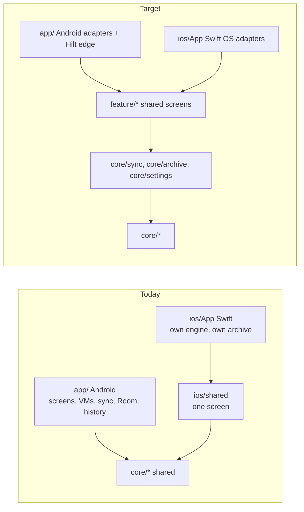

# Platform parity plan (Android and iOS, one source of truth)

**Scope:** the drift found between the Android and iOS apps on 2026-10-09 and the ordered work
that removes it by moving decisions, data and screens into shared Kotlin. **Code:** every module.
**Related:** [cross-platform-guide.md](cross-platform-guide.md) (lasting rules),
[production-readiness-plan.md](production-readiness-plan.md) (W6, W7, W11 overlap),
raw audits in [parity-audit/](parity-audit/) (A screens, B transport and sync, C storage and
history, D settings, background and permissions, E build, tests and docs).

## Current status

The 2026-10-09 baseline and wave tables below are historical planning, not current ownership.
Both platforms now use shared `LinkSession`, `SyncEngine` and `ArchiveCollector`. Android
also adopts `CollectionController` through `DeviceFacade`. iOS controller adoption remains
[#81](https://github.com/walkthru-earth/opensensor-space-mobile/issues/81). iOS Core Bluetooth
runs on the `BlePhysicalLink` serial queue.
Settings and the feature screens are shared, and iOS persists history tiers. Room KMP
backing and `core/model` remain planned. Read [architecture](architecture.md) and
[iOS migration](ios-migration.md) for current code and qualification limits.

## Baseline on 2026-10-09

Android is about 19k lines with 9 destinations, a full sync engine, Room, history and background
sync. iOS is about 3k lines: one Compose screen (`CompanionScreen.kt`), Discover, and Swift adapters
that also carry a second sync engine (`SensorTransfer.swift`, `SensorArchive.swift`). Only the
protocol codec, Parquet, metric registry, WHO scales, units, Discover and design tokens are shared.

## Drift that is a bug today (fix first, before moving code)

| # | Drift | Android | iOS | Decision |
| --- | --- | --- | --- | --- |
| D1 | OPEN reply timeout | 60 s (`DeviceSession.kt:531`) | 10 s for every reply (`LanSession.swift:63`) | 60 s for OPEN and FLUSH, the device CRCs the whole file first |
| D2 | Station id charset | `[0-9A-Za-z._-]` | no dot (`SyncWire.kt:33`, `SensorArchive.swift:73`, `LanCredentials.swift:46`) | allow dot, the firmware name whitelist has it |
| D3 | One bad file | per-file outcome, run continues | whole run aborts | per-file outcome on both |
| D4 | Corrupt resumed partial | re-read once from zero | delete and abort | re-read once from zero |
| D5 | `max_read` missing | 4096 | 16384 | 4096, conservative |
| D6 | Detail levels | Simple, Detailed, Developer | none, raw dBm and firmware always shown | Simple by default on iOS too |
| D7 | Temperature on Now | always when present | only when PM is valid | show when present |
| D8 | PM format | `fmtPm` | `172.0` | one shared formatter |
| D9 | Settings backup | DataStore files not in backup rules | UserDefaults backed up | include DataStore files |
| D10 | Privacy copy | "no location" | n/a | mention approximate location on Near me |
| D11 | `:core:airquality` tests | never run by `verify` or `verifyIos` | same | gate them |
| D12 | Tier and daily de-dup key | tiers skip without `sequence`, daily falls back to time | n/a | one key, shared |

## Target shape

- **`:core:sync`** shared engine behind ports `FrameLink`, `ArchiveStore`, `ArchiveIndex`,
  `CredentialStore`. Android `data/sync`, `DeviceSession`, policies and planner move here. Swift
  keeps sockets and Core Bluetooth only. `SensorTransfer.swift` and `SyncWire.kt` are deleted.
- **`:core:archive`** one archive layout, verifier, records and store ports. Room KMP
  (`:data:store`) backs the index on both platforms. Android keeps `AppDatabase` v10 behind adapters.
- **`:core:settings`** DataStore preferences core on both platforms with Android's existing keys.
  `DetailLevel`, `ClockSyncMode` and the permission policy become shared.
- **`feature/*`** shared Compose screens (settings, devices, history, files, device config, debug)
  with plain controllers exposing `StateFlow`, the `DiscoverController` pattern. Hilt stays at the
  Android edge wrapping controllers. Manual DI on iOS in `AppRoot`.
- **Strings** move to Compose resources, one copy for both apps. A test rejects em dashes, colons
  and semicolons in user-facing copy.
- **Build** an `opensensor.kmp.compose-feature` convention, convention-registered gate tasks so no
  module is missed, `verify` runs `verifyIos` on a Mac, `:ios:shared` becomes iOS only so it can
  consume feature modules.

## Waves

Each task runs in its own worktree with a disjoint file set, merges into `feat/platform-parity`,
and passes `./gradlew --no-daemon verify` plus `verifyIos`. Radio, permission and background
changes also need a dated phone run on each platform in [status.md](status.md).

| Wave | Task | Size | Owns |
| --- | --- | --- | --- |
| 0 | Build foundation: gates, compose-feature convention, iOS-only `:ios:shared`, empty `:core:sync`, `:core:archive`, `:core:settings`, docs drift fixes | M | `build-logic/`, root and module build files, `settings.gradle.kts`, drifted docs |
| 1 | iOS sync drift D1 to D5 in the current Swift engine | S | `ios/App/*.swift`, `SyncWire*.kt`, `ios/tests/` |
| 1 | Copy and Simple drift D6 to D10 | S | `CompanionScreen.kt`, `strings.xml`, backup rules, `FilesViewModel.kt` |
| 2 | `:core:sync` pure moves: session, transport, policies, planner, progress, SHA-256, LAN framing, tests to commonTest | L | `core/sync`, `core/protocol`, `app/.../data/{sync,ble,lan}` pure files |
| 2 | `:core:archive` layout, ports, records, verifier, history helpers, history tests to commonTest, D12 | L | `core/archive`, `core/history`, `app/.../data/history` |
| 2 | `:core:settings` plus shared Settings screen, detail levels on iOS, Discover strings to resources | M | `core/settings`, `feature/settings`, `data/settings`, `ui/settings`, `feature/discover` strings, `AppRoot.kt` settings |
| 2 | Design system: shared components, vendored icons, drop `AqSyncTheme`, one bottom bar | M | `ui/designsystem`, `app/.../ui/{theme,components}` |
| 3 | Engine on ports, Room KMP store, iOS adopts shared engine, Swift engine deleted | L | `core/sync`, `data/store`, `ios/App` |
| 3 | Shared screens: devices list, Today, History, Files, device config, Debug | L | `feature/*`, `app/.../ui/*` |
| 4 | iOS background (BGProcessingTask, Bluetooth restoration), iOS BLE file sync, translations | L | `ios/App`, `core/sync` |

## Needs phone evidence

iPhone OPEN with a large file after D1, the engine swap end to end on both phones (window loss,
resume, cancel, two sensors), settings surviving an upgrade, permission prompts on their own tap,
Android backup and restore, all iOS background work.
