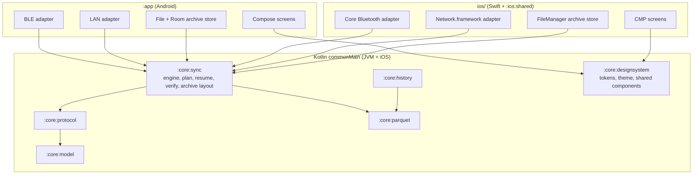

# Production readiness plan

**Scope:** the refactor that takes the Android and iOS apps from a working prototype to a
production, modular codebase that can grow new sensors, transports and screens on both platforms.
**Code:** every module. **Related:** [cross-platform-guide.md](cross-platform-guide.md) (the
lasting rules this plan moves the code towards), [architecture.md](architecture.md),
[status.md](status.md).

Written 2026-10-08 from five parallel reviews (Android data, Android UI, shared KMP core, iOS,
build and release) plus a lead pass. Every P0 item below was re-checked against the code by the
lead before it was listed. Baseline `./gradlew --no-daemon verify verifyIos` passed on `00c64f5`.

## Compatibility stance

The app is still a prototype with no user base to protect, so the refactor may break app-side
compatibility whenever that gives a more robust, faster or simpler design. No migrations for old
app storage, settings, credentials or archive layouts, and no compatibility shims. Reinstalling
the app is an acceptable upgrade path. The firmware contract in `../aq-parquet/docs/shared/`
(frames, opcodes, UUIDs, JSON keys, Hive archive paths on the device) still stays exact, because
devices in the field depend on it.

## Why this refactor

The app works, but four structural problems block growth.

1. **Sync logic exists twice.** Android owns `data/sync/` in Kotlin. iOS re-implemented the
   same download, resume, CRC-32, `PAR1` and archive layout rules in Swift
   (`ios/App/SensorTransfer.swift`, `SensorArchive.swift`). The copies already disagree. iOS
   aborts a sync when a read window comes back short, while the firmware contract
   (`../aq-parquet/docs/shared/ble-sync-protocol.md`) says a failed window is retried from the
   phone's own offset. Android accepts 512-byte names, while the contract caps names at 399 bytes.
   The partial and receipt layouts also differ.
2. **One class owns the whole device.** `DeviceConnectionRepository.kt` is 1430 lines, holds
   link, reconnect, sync, commands, telemetry and credentials, and has unguarded shared state.
   Every ViewModel depends on it directly.
3. **The shared core stops at the protocol.** `:core:parquet` and the file side of
   `:core:history` are JVM-only (`java.nio`, `java.time`, `java.util.zip`), so iOS can not read
   history or verify files through shared code.
4. **Release and UI are prototype grade.** R8 is off, there are no previews or UI tests, debug
   details are visible to ordinary users, and the visual identity does not match
   opensensor.space.

## P0 defects (fix first, all confirmed in code)

| ID | Defect | Evidence |
| --- | --- | --- |
| P0-1 | iOS aborts on a short `READ_END` or an overlapping chunk instead of retrying the window | `ios/App/SensorTransfer.swift:90-103` versus contract `ble-sync-protocol.md` "a failed window is retried" |
| P0-2 | Name limit 512 on Android, contract says at most 399 | `data/sync/SyncPlanner.kt:56` |
| P0-3 | `CancellationException` swallowed by `runCatching` around suspend calls | `DeviceConnectionRepository.kt:561-565`, `SyncWorker.kt:121,125`, `TcpTransport.kt:256` |
| P0-4 | Unguarded job handles and a non-atomic busy flag, so a Stop can be lost and overlapping commands clear busy early | `DeviceConnectionRepository.kt:801-810, 1181, 1208-1209, 1315, 1332` |
| P0-5 | GATT callbacks resume whichever operation is pending, so a late write callback can complete the next read | `ble/BleTransport.kt:148-172` |
| P0-6 | Broadcast receivers launch on an unscoped `CoroutineScope(Dispatchers.IO)` with no handler or timeout | `background/SyncTriggers.kt:139`, `background/AdvertFlagScan.kt:185` |
| P0-7 | Docs say the database goes to cloud backup, the rules exclude it (the token lives there) | `docs/lessons-learned.md:49` versus `res/xml/data_extraction_rules.xml` |
| P0-8 | `setup-signing.sh` would upload signing secrets to the old repository name | `tools/setup-signing.sh:16` |

## Target architecture

Shared code owns every rule that must behave the same on both phones. Platform code owns only
radios, sockets, files, permissions, background execution and OS integration. See
[cross-platform-guide.md](cross-platform-guide.md) for the full rule set.

## Workstreams

Each workstream is one branch, built in its own git worktree, gated by
`./gradlew --no-daemon verify verifyIos` (plus the unsigned simulator build for iOS work). Each
has an exclusive file set so branches merge without conflicts. Implementation agents do not edit
`docs/status.md`. They report evidence, and the lead records it once after merging.

### Wave 1 (parallel)

**W1 Build and release hardening.** Owns `gradle.properties`, `app/build.gradle.kts` (build types,
lint, packaging), `app/proguard-rules.pro` or `app/src/main/keepRules/`, `.github/`, `tools/`,
`docs/build-and-release.md`, file headers outside the root build scripts.
- Enable R8 and resource shrinking with keep rules for zstd-jni (JNI field lookup),
  kotlinx.serialization wire models and exception names shown to users. Publish `mapping.txt`.
  Why. Smaller, faster APK and a release that matches what Play expects.
  ([App optimization](https://developer.android.com/topic/performance/app-optimization/enable-app-optimization))
- Provide a local way to build a minified release without signing secrets, so R8 is gated on host.
- Rename the configuration cache key to `org.gradle.configuration-cache=true`, raise Gradle and
  Kotlin daemon heap for native linking.
- Dependabot for Gradle, Actions and pre-commit. Pin actions to commit SHAs. Least-privilege
  release permissions, read-only cache on tag builds, `~/.konan` cache in CI.
- Lint baseline with `warningsAsErrors`. Fix P0-8. Replace the Android sample copyright headers.
- Needs a phone run of the minified APK before the first tagged release.

**W2 Shared core foundation.** Owns `settings.gradle.kts`, root `build.gradle.kts`,
`build-logic/` (new), `core/*/build.gradle.kts`, `ios/shared/build.gradle.kts`, source layout
under `core/`.
- Included build `build-logic/` with convention plugins (KMP library, JVM library, iOS framework)
  that set targets, `jvmToolchain(17)`, test aliases and warnings policy. Why. Three modules copy
  the same KMP block today and new modules must be one line.
- Move `src/main/kotlin` to `src/jvmMain/kotlin` and `src/test/kotlin` to `src/jvmTest/kotlin`.
  Share Parquet fixtures through a proper test-fixture path, not a cross-project file reach.
- Pure Kotlin `Crc32` and `ParquetVerify` (size, CRC-32, `PAR1` head and tail) in `commonMain`.
  JVM keeps the intrinsic CRC behind `expect`/`actual`. Why. The rule that makes a file "synced"
  must exist once.
- Move portable JUnit tests to `commonTest` with `kotlin.test`, so they also run on iOS.
- Shared `SafeName` with the 399-byte contract limit (fixes P0-2) in `commonMain`.

**W3 Android data hardening.** Owns `app/src/main/java/earth/walkthru/aqsync/data/**` and its
tests, `docs/lessons-learned.md`, `docs/transports.md`, `docs/sync-engine.md`,
`docs/background-sync.md`.
- Fix P0-3 to P0-7 with a regression test each where host-testable.
- Inject dispatchers, an application scope and a clock (Hilt qualifiers). Why. Required for
  `runTest` virtual time and for the later move to `commonMain`.
- One operation gate for busy, sync and background ownership.
- Token hygiene. Plaintext tokens stop flowing to ViewModels. A transient Keystore error no longer
  deletes a credential. The raw-command denylist moves from the UI into the data layer.
- Characterization tests for the repository (reconnect, LAN fallback, token invalidation, stale
  plan) before Wave 2 splits it.
- Keep the public API used by `ui/` source compatible.

**W4 Android design system and simpler UI.** Owns `app/src/main/java/earth/walkthru/aqsync/ui/**`,
`app/src/main/res/**` (except launcher headers handled by W1), `docs/screens.md`.
- Adopt the opensensor.space identity from the website repository (`lib/brand.ts` "sensing"
  palette, Quicksand and Cairo fonts, the peacock mascot, rounded cards, dark pill actions) as a
  token-based Material 3 theme with light and dark schemes. Air-quality band colours stay
  scientific and independent of brand colours.
- Progressive disclosure through the existing detail level. Simple shows what a person needs
  (the headline readings now, today, sync state, one primary action). Detailed adds per-file and per-metric detail.
  Developer alone shows raw frames, logs, CRC, offsets, handles, schema names and diagnostics.
- Split oversized screens into a stateful route and a stateless `Screen(state, onAction)`, one
  file per card. Move the Wi-Fi polling loop out of the composable.
- Read the 1 Hz clock only in leaf composables. Collect one-off events with lifecycle awareness.
- Move device capability checks (schema prefixes, batch candidate) out of composables into a
  shared capability mapping in `:core:history` `commonMain`.

**W5 iOS native hardening.** Owns `ios/App/**`, `ios/OpenSensor.xcodeproj/**`, `ios/tests/**`,
`ios/shared/src/**`, `ios/AGENTS.md`, `docs/ios-migration.md`.
- Fix P0-1 (retry a failed window from the local offset, tolerate overlap) with a test.
- Bytes cross the Kotlin and Swift boundary as `ByteArray` and `NSData`, never hex strings. Why.
  Hex encoding builds one string per byte on the transfer hot path.
- Move LAN receive and archive writes off the main actor onto a per-session queue, with larger
  receive buffers and progress published at a bounded rate.
- Strict concurrency `complete` in Swift 5 mode, then prepare the Swift 6 switch.
- File protection `completeUntilFirstUserAuthentication` on the archive, backup exclusion once,
  Local Network policy-denied detection (TN3179).
- An Xcode unit-test target with Swift Testing if it runs under the simulator in CI, otherwise
  keep `verify-native.sh` and document why.

### Wave 2 (after Wave 1 merges)

**W6 Shared sync engine `:core:sync`.** Port the engine, planner, resume, read window retry,
progress, rate meter, claims and liveness to `commonMain` behind three ports, `FrameLink`
(send and receive frames), `ArchiveStore` (partial, append, persist, commit, completed) and
`ArchiveIndex` (receipts). One canonical archive, partial and receipt layout, documented in
[data-model.md](data-model.md). The old layouts are dropped, with no migration. Android's
`SyncEngine` becomes an adapter. Fakes in `commonTest` cover resume,
window retry, corruption and cancellation on JVM and iOS.

**W7 Android repository decomposition.** Split `DeviceConnectionRepository` into
`LinkController`, `TransportSelector`, `DeviceEnrollment`, `LanCredentialService`,
`ReconnectSupervisor` and policy, `ManifestStore`, `TransferCoordinator`, `BackgroundCollector`,
`DeviceCommandService`, `DeviceTelemetry` and a singleton `KnownDeviceRepository`. ViewModels
receive narrow interfaces. Controllers are closed on forget, flows use `WhileSubscribed`.

**W8 Portable Parquet and history.** Own `ByteReader` abstraction (JVM `MappedByteBuffer`, iOS
mapped `NSData`), common LZ4 and Snappy, `expect` gzip, `ByteArray` codec SPI, kotlinx-datetime
in place of `java.time`, typed non-boxing column accessors. kotlinx-io stays at the file edge
only, because its API is still alpha and has no random access.

**W9 Shared design system and iOS restyle.** Extract tokens, theme and shared components (mood
face, now card, band chart drawn with `drawText` and `drawWithCache`) to a Compose Multiplatform
`:core:designsystem`. Restyle the iOS screen with it, using the same detail-level rules.

**W10 UI quality.** String resources and typed events (no English in ViewModels), accessibility
semantics for charts and live regions, previews and host screenshot tests, a device shell for
tab navigation, `SavedStateHandle` for selections.

**W11 Device-agnostic domain.** Owns new `:core:model`, `Metrics.kt`, `AirMood.kt` and the
capability mapping in `:core:history`. Adds `Device`, `DeviceFamily`, `Capability`,
`ObservedProperty`, `Datastream` and `Scale`, following the firmware observation model. Air
quality becomes one family and `AirMood` one scale. Screens ask for capabilities, never schema
strings. A bundled dictionary per known schema ID is the fallback until the firmware dictionary
ships. Why. The product covers many sensor kinds, and a new family must be data, not new code.
See [devices-and-discovery.md](devices-and-discovery.md).

**W12 Discover map with sample data.** Starts after W9 and W11 merge. Owns new
`:core:publicfeed`, `:feature:discover` (Compose Multiplatform `commonMain`) and
`tools/discover-fixture/`, plus the navigation wiring in both apps.
- A `PublicFeed` port with a JSON fixture source in the shape of the proposed feed contract,
  made by a committed Python `h3` script. The map labels it "Sample data".
- A map with H3 cells coloured by the chosen metric and window, a cell sheet with avg, min and
  max per metric and the device list (crowd rule of three), and a public device page with range,
  aggregation and metric filters.
- MapLibre through `maplibre-compose`, or an `expect`/`actual` MapLibre Native wrapper if it does
  not fit the pinned Kotlin and CMP versions. One GeoJSON source and no composable per cell.
- No location permission. Centre on the last viewed area or the time zone region.
- Discover is the start tab when no device is paired.

### Wave 3 (after Wave 2)

- iOS adopts `:core:sync`. Swift keeps only Core Bluetooth, Network.framework, Keychain and
  FileManager adapters. Delete the Swift engine and CRC table.
- iOS background. `BGContinuedProcessingTask` for user-started collection on iOS 26 and later,
  `beginBackgroundTask` fallback, Core Bluetooth state restoration.
- Android platform rules. Connection priority and 2M PHY during transfers (measured first),
  user-initiated data transfer jobs, notification IDs derived from work IDs.
- Real public feed. The host publisher writes cell and device Parquet to S3 or source.coop. The
  phone reads it with the portable Parquet reader, caches with ETags, and has a Settings switch.
- Per-device opt-in publishing, switched on only in that device's settings and off by default,
  to an owner-chosen H3 cell with a random public ID.
- Feature modules (`:feature:today`, `:feature:history`, `:feature:files`, `:feature:device`)
  and baseline profiles once R8 is proven on a phone.

## Docs that follow the new direction after Wave 1 merges

Wave 1 agents own these files, so the lead aligns them with the sensor-agnostic and discover
direction only after merging, to avoid conflicts. The list covers `screens.md` (Discover, My
devices and Settings tabs, per-device sharing switch), `transports.md` and `background-sync.md`
(the network rule now allows the public feed and basemap), `ios-migration.md` and
`ios/AGENTS.md` (shared discover screens), and the `ui/` and `data/` `AGENTS.md` files (generic
component and model names). README, `docs/README.md`, `architecture.md`, `core/AGENTS.md`,
`history-pipeline.md` and the older location proposal were updated on 2026-10-08.

## Evidence rules for this plan

A merged branch is host-verified only. R8, BLE throughput, background execution, Local Network
prompts and every radio behaviour still need a dated phone run on each platform before a release
claims them. Record results in [status.md](status.md) and firmware observations in the board's
`bench-verified.md`.
