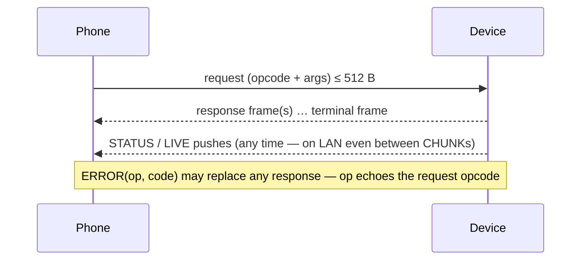

# Protocol quick reference — the mirror, not the contract

**Scope:** constants as implemented in `:core:protocol`, for lookup. The **owner** is
`../aq-parquet/docs/shared/ble-sync-protocol.md`; do not change a layout, opcode, UUID, JSON key
or error code here before changing it there (and the firmware).
**Code:** `core/protocol/…/data/protocol/Frames.kt`, `AqUuids.kt`, `LanFraming.kt`, `DeviceConfig.kt`, `JsonModels.kt`, `ParquetVerify.kt`.
**Related:** [transports.md](transports.md) (pipes), [sync-engine.md](sync-engine.md) (how the file opcodes are driven).

## Request → response shape

## GATT (`AqUuids`)

| Attribute | UUID (`c0a5e9f0-XXXX-4b1a-9c3e-2d7f8a6b4e01`) | Role |
| --- | --- | --- |
| SERVICE | `0001` | the only scan filter. The board name (`OS-xxxx` today) is display data, never matched |
| INFO | `0002` | read once: `proto`, `fw`, `station`, `max_read`, … |
| STATUS | `0003` | read + notify: status JSON (≤ 480 B) |
| LIVE | `0004` | read + notify: live JSON (10-s sample, ≤ 480 B) |
| CONTROL | `0005` | write: request |
| RESPONSE | `0006` | notify: one frame per notification |

`MTU_REQUEST = 517`, `MTU_MINIMUM = 247`, `PROTOCOL_VERSION = 2`. BLE `payload_max = min(MTU − 3, 512)`. Below MTU 483 a snapshot can exceed one notification and is skipped, so the app long reads STATUS and LIVE every 10 s.

**Advertising service data** (`Advertisement`, protocol 2.1 / firmware ≥ `-v6.3`), under SERVICE in the ADV PDU; the name and UUID list are in the scan response (the `ScanRecord` merges both): `ver` u8 = 1 · `flags` u8 (bit 0 `no_utc`, 1 `new_files`, 2 `sd`, 3 `lan`, 4 `fail`, 5 `clk_restored`) · `fin` u32 LE · `boot16` u16 LE (last four hex digits of `info.boot`) · 2 reserved. `Advertisement.decode(scanRecord.getServiceData(SERVICE))`; `flagFilter(flag)` gives the `data/mask` pair for a hardware `ScanFilter`. Absent on older firmware → `null`.

## Opcodes (`Opcode`)

| v1 | | v2 | |
| --- | --- | --- | --- |
| `0x01` LIST | → `FILE`× … `LIST_END` | `0x08` GET_CONFIG | → `CONFIG` |
| `0x02` OPEN | → `OPENED(handle,size,crc32,name)` | `0x09` SET_CONFIG | → `CONFIG` (lines `key=value\n`) |
| `0x03` READ | → `CHUNK(handle,offset,data)`× … `READ_END(next_offset)` | `0x0A` WIFI_SCAN | → `WIFI_AP`× … `WIFI_SCAN_END(status)` |
| `0x04` CLOSE | → `CLOSED` | `0x0B` REBOOT | → `REBOOTING(delay_ms)` |
| `0x05` SET_TIME | → `TIME_SET` | `0x0C` LOG_TAIL | → `LOG`× … `LOG_END(returned)` |
| `0x06` FLUSH | → `FLUSHED` | `0x0D` GET_TOKEN | → `TOKEN` (BLE only; `ERROR` 13 on LAN) |
| `0x07` STATUS | no response frame; the `status` push is the ack | | |

## Frame types (`FrameType`)

| v1 | v2 | LAN-only |
| --- | --- | --- |
| `0x10` FILE · `0x11` LIST_END · `0x20` OPENED · `0x21` CHUNK · `0x22` READ_END · `0x23` CLOSED · `0x30` TIME_SET · `0x31` FLUSHED | `0x40` CONFIG · `0x41` WIFI_AP · `0x42` WIFI_SCAN_END · `0x43` REBOOTING · `0x44` LOG · `0x45` LOG_END · `0x46` TOKEN · `0x4A` CONFIG_CHUNK (BLE when CONFIG exceeds one notification) | `0x47` HELLO · `0x48` STATUS push · `0x49` LIVE push |

## Error codes (`ProtocolError`)

| Code | Meaning | App reaction |
| --- | --- | --- |
| 1 malformed request · 2 invalid name · 3 not a finalized Parquet · 4 open failed · 5 bad handle · 6 range outside file · 8 storage unavailable · 9 invalid epoch (2020–2100) · 10 nothing to flush · 11 unknown opcode | | outcome for that request (`FileOutcome.DeviceError` for files), never a broken pipe |
| 7 | busy | LAN connect: fall back to BLE |
| 12 | invalid config | names the key; nothing changed on the device |
| 13 | not allowed on this link | `GET_TOKEN` over LAN — force BLE |
| 14 | authentication failed | LAN handshake: stored token is dead → clear + refetch over BLE (`LanTokenPolicy`) |
| 15 | Wi-Fi unavailable | `WIFI_SCAN_END.status` → typed "Wi-Fi unavailable" |

`ERROR.op` is "mine" only when it equals the request opcode (firmware echoes the first byte);
anything else is a `ProtocolViolationException`.

## LAN framing (`LanFraming`)

| Constant | Value |
| --- | --- |
| mDNS service | `_aqsync._tcp` (TXT: `station`, `dev`, `fw`, `proto`) |
| `DEFAULT_PORT` | 47390 |
| Handshake | unframed `"AQS1"` + 32-byte token, phone → device within `HANDSHAKE_TIMEOUT_MS` 5 s; answer is framed `HELLO(payload_max, proto)` or `ERROR` 14 / 7 |
| Frame | `len` u16 LE + frame; `PAYLOAD_MAX` 1024 device→phone, `REQUEST_MAX` 512 phone→device |
| Idle | `DEVICE_IDLE_LIMIT_MS` 300 s; phone sends `STATUS` after `KEEPALIVE_AFTER_IDLE_MS` 120 s |

`HELLO.payload_max` is trusted if ≥ 64 (`TcpLinkDriver.MIN_PAYLOAD_MAX`); `mtu` reports
`payload_max + 3` so the same `MTU − 3` arithmetic yields it.

## CONFIG keys (`DeviceConfig`)

`ble.pair` (random / fixed / none) · `ble.pin` (six ASCII digits; arrives as a number, shown
zero-padded) · `ble.clear_bonds=1` · `wifi.on` · `wifi.ssid` (1–32 bytes) · `wifi.psk` (≤ 63 bytes,
**write-only, never echoed or logged**) · `lan.on` · `lan.rotate_token=1` · Waveshare
`sensor.vendor=Plantower`, `sensor.model=PMS5003T`, `sensor.serial=PMS5003T-YYYYMMDD` plus 1–9 unit digits,
`sensor.batch_candidate=0|1`. `CONFIG.sensor` echoes these four fields. A mismatched physical
model is rejected; the batch estimate is enabled only for the reviewed `PMS5003T-20260408` batch.
It is a stored candidate alongside unchanged raw fields, not a reference calibration. No line breaks in
values; validated on the phone before sending. `CONFIG.flags` bit 0 = `ble.*` change pending
until reboot.

BLE may return ordered `CONFIG_CHUNK` frames instead of one `CONFIG`: flags u8, total JSON
bytes u16 LE, offset u16 LE, then a raw UTF-8 slice. The phone rejects gaps, overlaps,
inconsistent flags/total, and incomplete replies before parsing JSON. LAN retains one CONFIG.

## Verification (`ParquetVerify`)

Complete ⇔ byte count == `OPENED.size` **and** CRC-32 (IEEE, `java.util.zip.CRC32`) ==
`OPENED.crc32` **and** first/last 4 bytes are `PAR1`. Anything else is discarded, never data.

## JSON (`JsonModels`)

`info`, `status`, `live`, `CONFIG` payloads. **Absent keys are `null`, never `0`.** `bat`/`pct` in
`live` are shown raw with a "board report, unqualified" label (16,372 → 23 mV seen with no battery).
Feature gates use `info.proto` / `info.fw`, never guesses.

LIVE keys come from each board's field table and are parsed in any order. Unknown keys are ignored,
a missing key is null, and the firmware sends every declared key with null for no reading. Floats such as `1.00` and `1.0` parse as numbers. `utc` is nanoseconds.
`LiveProfiles.resolve` reads the `info.dict` digest only, so a newer schema string over the same
dictionary keeps its profile. It looks the digest up in the bundled board templates under
`core/model/bundled/templates/` and joins the matching app profile under `core/model/bundled/profiles/`
(`BundledCatalog.live`). Only the current digest of each board is bundled. CoreS3 v6.15 (`4f80c26c…`)
sends `imu_t`, the IMU die temperature, shown as board temperature. Its profile hides `t` and `rh`
because they are always null on CoreS3. Waveshare v2.9 (`6f567b38…`) sends `t`, ambient air
temperature, `rh` and `bstate`, the battery health code. A new firmware digest is a template and
profile file swap plus a fixture refresh, with no code change. Any other digest, older ones included,
has no LIVE profile. The station join (`BundledCatalog.station`) still shows such a board from a
served template, with raw column names and raw units and no guessed label. `LiveKeyFixturesTest`
holds every digest from aq-parquet `tools/fixtures/live_keys/`, checks the bundled template live keys
against the current ones and lists the retired ones, and the weekly `live-key-drift` workflow fails
when aq-parquet main has a digest missing there. LIVE is a snapshot, not archive data.

`LOG_TAIL` may contain storage watchdog lines. They are informational. A storage stall resets the
device after about 60 s, which ends the link. The existing `RetryPolicy` and the re-planned LIST of a
new session resume the run, and verified files already on the phone are never fetched again.

## Private device location

`GET_CONFIG` keeps its legacy empty body. Page byte `1` requests the `location`
object with cell, maximum `resolution`, actual `cell_resolution`, derived
center `lat`/`lon` and declared `country`. It uses the same CONFIG/CONFIG_CHUNK
framing and 480-byte JSON limit. `Request.GetLocation` and `DeviceSession.getLocation`
return unsupported when older firmware returns the legacy object or rejects
that selector. A missing location object is not an unset supported location.

`ConfigPatch.location` sends only `location.cell`, `location.resolution` and
`location.country`. SET_CONFIG acknowledges the legacy page; the app then reads
page 1 and checks its saved values. No raw GPS coordinates cross this API.
Pages 2–4 are firmware time policy/status and server configuration; this app
currently exposes location provisioning. See [device-location.md](device-location.md)
and the firmware-owned [wire contract](../../aq-parquet/docs/shared/ble-sync-protocol.md).
