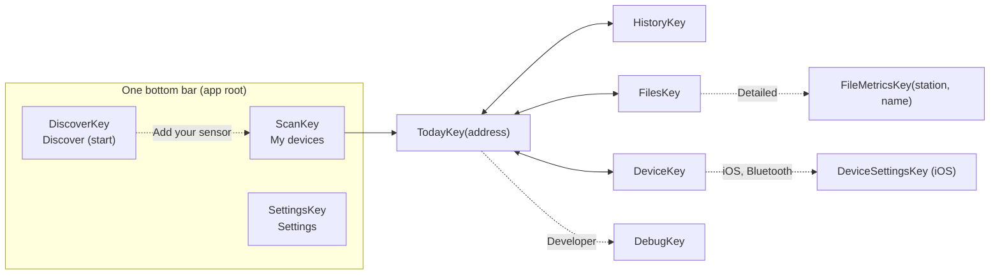

# Screens — what the user sees, and which data path feeds it

**Scope:** navigation graph, every destination's behaviour, detail levels, the transport chip.
**Code:** `feature/shell` (`AppKey.kt`, `TabNavigator.kt`, `AppShell.kt`), `ui/Navigation.kt` (Android entries), `ios/shared/.../AppRoot.kt` (iOS entries), `ui/<screen>/*Screen.kt` + `*ViewModel.kt`, `data/settings/AppSettings.kt`.
**Related:** [history-pipeline.md](history-pipeline.md) (what History/Today read), [transports.md](transports.md) (what the Device screen writes), [background-sync.md](background-sync.md) (Auto-sync card, Sync in background).

## Navigation (Navigation 3 keys)

**One bottom bar (owner decision 2026-10-08).** Both apps host the shared `AppShell`
(`:feature:shell`, [ADR 0001](adr/0001-shared-navigation.md)), one `Scaffold` whose bottom bar
(`BrandBottomBar`) holds Discover, My devices and Settings, around one `NavDisplay`. Android passes
its screens in from `MainNavigation`, iOS from `AppRoot`. No screen draws its own bottom bar. Discover is always the start tab, with or without a paired
device, and nothing is asked at launch.

- Each tab has its own Navigation 3 back stack, decorated separately, so an open device keeps its
  ViewModels while another tab is shown. The rules live in `TabNavigator` (plain class in
  `commonMain`, covered by `TabNavigatorTest` on the host and the iOS simulator). Every key is an
  `AppKey` saved through `AppNavConfig`.
- Reselecting the active tab pops it to its root.
- Back (Android predictive back, the iOS start edge swipe) pops the active tab's stack. At the
  root of My devices or Settings it returns to Discover. At the Discover root the Android app
  closes. On Discover an open cell sheet returns to peek first, through a `NavigationBackHandler`
  in the shared `DiscoverScreen` that wins over the shell's.
- Inside a device, Today, History, Files and Device are a tab row under the top bar
  (`DeviceSectionTabs`), siblings that replace each other. The bottom bar stays visible with My
  devices selected.
- The bottom bar is hidden only on Debug and Metrics, the full-screen inspectors with their own
  back arrow.
- "Add your sensor" on Discover opens the My devices root. A device screen that loses its session
  returns there too. The settings icon on Today and Device opens the Settings tab.

Every destination except Discover, Scan and Settings is keyed by the device's **Bluetooth address**, on both pipes — the
address keys the enrolled Room row and controller, including reconnect after a worker closes its
session. Archive/history use station epochs; a full
`info.dev` check guards continuity. Returning to Devices retains other controllers and their work.

Each Navigation 3 entry owns its ViewModel and saveable UI state. Popping a detail page or
replacing a sibling tab clears that screen's jobs; the process-owned controller and any
WorkManager collection continue. Room and repository flows update visible screens without
manual reload. A screen refreshes device state after reconnect, when its request key changes,
or when the user requests it. Compose recomposition only renders the latest state.

## Detail levels (`DetailLevel`, DataStore)

| Level | Shows | Notes |
| --- | --- | --- |
| **Simple** (default) | The reading now (hero card), today so far, sync state in words with one primary action, the automatically synchronized clock, History and Files one tap away. Device settings as state in words and their actions | Designed first. No identifiers, hex, byte offsets, CRC, MTU, RSSI numbers, schema or firmware build strings, log tails or diagnostics |
| **Detailed** | + other particle sizes, particle counts, board temperature and battery, storage counters, batch estimate card, device card (firmware, protocol), **Finalize buffered rows**, Files chart and **Metrics** inspector (rows, time span, columns), transfer rate, the sensor, pairing and paired phones cards, token replacement | `AppSettings.detailed` |
| **Developer** | + identifiers and internals everywhere (station, device and boot IDs, schema, dictionary, max_read, payload, endpoint, MAC, dBm, file names, partial counts, CF=1 raw values, codec, heap, uptime, footer, row groups, metadata) and the **Debug** destination | `AppSettings.advancedMode`. An old `advanced_mode = true` with no `detail_level` reads as Developer |

Only presentation changes. Every level reads the same data, and nothing the Simple experience
needs may depend on Developer. A new field states its level in code (`level.detailed`,
`level.developer`). In ViewModel state, `advancedMode` always means Developer and `detailed`
means Detailed or Developer. Files reads `detailLevel` directly.

Both apps use the shared detail-level setting. The iOS device page (`CompanionScreen`, opened from My devices) keeps signal dBm, firmware,
finalized file counts, byte counters and transfer rate behind `showTechnical` in Detailed and Developer.

### What moved where (W4 audit, 2026-10-08)

| Screen | Simple | Detailed adds | Developer adds |
| --- | --- | --- | --- |
| Devices (Scan) | Name, paired and known tags, signal bars, archive line (mood, primary metric, day, synced ago), peacock guide when nothing is nearby, connect and privacy notes behind the top bar info button | Coverage percent and file count on the archive line | MAC address, RSSI dBm, station prefix |
| Connection banner | Connected, Connecting, Setting up the link, pairing repair message | Failure reason | Service discovery, MTU, LAN authentication steps, reconnect reason and attempt count |
| Today | Hero (peacock expression, number, mood pill, advice, snapshot note in its info sheet), today so far, temperature and humidity on ambient boards, Smart Sync, automatic clock state | Readings since midnight, placed and unplaced counts, Finalize, batch estimate, PM10 and PM1, particles, board and battery, storage (problem counters only when not zero), device card | Station in the top bar, sample number, CF=1 raw, mV and USB mV, codec, partials, uptime, heap, dropped, errors and missed always, anchor generation, last sample instant, schema, IDs, dictionary, max_read, payload |
| Device | Device name and link in words, Auto-sync one line, wake when nearby, Wi-Fi state, scan and join, Sync over Wi-Fi switch and Get token. The pairing card only when it needs attention (default PIN, pending restart) | Firmware and protocol, sensor sticker card, pairing mode and Restart, paired phones and Forget all, Replace token, server line, Wi-Fi and Bluetooth reachability lines, network name, passphrase state, IP address, discovery errors, phone installation record | Display flag, RSSI, MAC, access point security and channel, mDNS host, port, clients, discovered address, IDs, endpoint, settings read age |
| Files | Local time per file, friendly size, state, Sync all, peacock when all synced, file count | Chart by file, Metrics inspector, transfer rate, current file progress, LIST failure text | File names, UTC folder subtitles, partial and microSD counts, FILE frame mismatch, resumed offsets, recovered windows |
| Metrics (Detailed only) | n/a | Size, rows, columns, UTC first and last, valid particle rows, column min and max | Footer, codec, schema, writer, statistics, index source, decode time, uptime span, sequence, boot, row groups, column types and footer agreement, key value metadata |
| History | Chart, metric chips, range, archive summary, Current and Earlier station chips | (unchanged) | Station ID on chips, Developer source card |
| Debug | Not reachable | Not reachable | Whole screen (pops itself when the level drops) |

## Copy and the info affordance

Every card shows a title, its value or state in words, and one primary action. A card may add one
short supporting line when the state needs it (a warning, "Restart the sensor to apply the
change"). Anything longer lives behind a small outlined **i** next to the card title:
`InfoButton(InfoContent(title, paragraphs…))` in `:ui:designsystem` (`InfoButton.kt`), placed through
`CardHeader(title, info = …, trailing = { Switch(…) })`. It opens `InfoSheet`, a bottom sheet with
the heading and short paragraphs. Its content description is "More about <title>". The same
pattern serves radio options: pairing modes show only their label, and their descriptions are
paragraphs of the pairing info sheet. Confirmation dialogs stay (reboot, token rotation, forget
paired phones, pairing mode none, finalize) with one or two short sentences. Copy rules
in `cross-platform-guide.md` apply, and missing values print `NO_VALUE` ("n/a"), never a dash.
`CopyLintTest` in `:ui:strings` fails on a dash, semicolon (Arabic ؛ included) or sentence colon in any
`strings.xml`, every language included. The data layer
never writes sentences. Its snackbars are `DeviceMessage` codes (`data/DeviceMessage.kt`) that
`ui/components/DeviceMessages.kt` maps to resources, and exception detail stays in the log or a
Developer-level line.

| Screen | Behind the info button |
| --- | --- |
| Devices | How to connect, the pairing code, the privacy note. Collect from all |
| Today | Right now (snapshot, mood cues), Smart Sync, Clock (automatic UTC, finalize), batch estimate |
| Device | Auto-sync and wake when nearby, Wi-Fi (passphrase storage), Sync over Wi-Fi (token, local network), pairing modes, paired phones, sensor sticker and batch factor |
| Files | Chart by file legend |
| History | Valid readings, coverage, estimated time, earlier stations |
| Settings | What a detail level changes, Smart Sync never rewrites files |

### Languages

English and Arabic. Android lists both in the system per-app language picker
(`res/xml/locales_config.xml`, Android 13 and later), iOS in the app's Language setting
(`knownRegions`, `CFBundleLocalizations`). Arabic lays every screen out right to left. Rows, cards,
the bottom bar and sheets mirror because layouts use start and end. Back and paging arrows mirror
through `autoMirror`. Canvas charts keep time running left to right in both directions. Digits
follow each platform's number formatting, so Arabic-Indic digits may appear in Android resource
strings. Both points need a phone check. How to add a language is in
[cross-platform-guide.md](cross-platform-guide.md#languages-and-right-to-left). The Arabic copy is
machine drafted and waits for a native speaker's review (`parity-decisions.md` P22).

## Permission timing

There is no permission wall. The app opens on Discover and asks only from the tap that needs a
permission. The shared `:ui:permissions` module holds the policy for both apps. `PermissionTriggers`
is the one table from user action to permission, `PermissionFlow` decides ask, explain or settings,
and `RuntimeAccess` runs it. `PermissionFlowTest` (commonTest, Android host and iOS simulator)
covers the table, both decision paths and the iOS status mapping. The Android launchers stay in
`app/.../ui/permissions/RuntimeAccess.kt`, the iOS ones in `ios/App` and the Near me actuals.

An in-app rationale appears only when Android reports one is due. Android offers the app's
system settings page after a denial with no rationale due, but only when a rationale was due
before that prompt or the permission was already asked in this session. Closing a first-ever
prompt with Back or a tap outside is quiet, since Android 11 and later do not count it. The page
opens through `rememberOpenAppSettings` (the app details intent on Android,
`UIApplication.openSettingsURLString` on iOS). iOS shows each prompt once and never
explains first. A fresh "no" is quiet. The next tap, or the Bluetooth and Local Network messages
on the iOS screen, offer Settings. Restricted access gets no link, since the user cannot change it.
iOS has no Local Network status API (TN3179), so it stays unknown until the browser reports
`PolicyDenied`. Store answers live in [store-compliance.md](store-compliance.md).

| Permission | Android trigger | iOS trigger | Without it |
| --- | --- | --- | --- |
| Bluetooth (`BLUETOOTH_SCAN` neverForLocation, `BLUETOOTH_CONNECT`; iOS Core Bluetooth) | Scan, opening a sensor, Reconnect, Reconnect over Bluetooth. Turning the adapter on uses the system dialog from the same tap. Once held, Devices scans while visible | My devices Scan tap starts the Bluetooth search; with existing access it also scans on tab entry. First access creates `CBCentralManager` | Archive views (History, Files) still open. A declined open shows the sensor without a link |
| Local network (`ACCESS_LOCAL_NETWORK`, API 37+; iOS Local Network) | My devices Scan tap, Sync over Wi-Fi switch on, Allow local network, Get Wi-Fi token. Discovery runs only once held | My devices Scan or an automatic scan with existing Bluetooth access starts `NWBrowser`; Find Wi-Fi sensors on the device page also starts a browse | Bluetooth sync works. The token fetch still runs |
| Notifications (`POST_NOTIFICATIONS`, API 33+) | Sync now, Sync all, file sync, Sync now in background, Collect from all, Auto-sync on, Set up wake when nearby. Asked once per screen | Not requested | The sync runs, its progress notification is hidden |
| Camera (iOS only, AVFoundation video) | Not requested. Google Code Scanner runs in Play services with no camera permission | Scan on the sensor sticker card in Device settings, straight to the system prompt with no rationale. A later tap after a denial offers Settings. Restricted gets a note only | Typing the sticker always works |
| Location (`ACCESS_COARSE_LOCATION` only, never fine) | Discover **Near me** asks for approximate location on that tap only. It only moves the map and is never stored or sent. The Devices privacy note says so | Same tap, When In Use with reduced accuracy | The map opens on the last area or the time zone region |

## Design system

The identity follows the website (`walkthru-earth.github.io`). Tokens live in the shared
`:ui:designsystem` module (`BrandTokens.kt`, used by Android and iOS) with the website role names (`main`, `ink`, `paper`, `surface`,
`accent`, `deep`, `text`, `muted`, `border`), light and dark, copied from `lib/brand.ts`
palette `sensing`. `BrandTokensTest` pins every value and checks text contrast on both themes.

- **Colour.** `brandColorScheme` maps roles to Material 3. Light primary is `ink` on `paper`,
  dark primary is `main` blue with `ink` text. The primary action (`PillButton`) and any
  selection use `FloatingControl.Selected` (Signal blue with ink) in both themes. The brand scheme is the default on
  every phone. Wallpaper dynamic colour stays off (identity first). Air-quality colours
  are the six WHO 2021 steps (`WhoStep.color`, mapped once by `WhoStep.color()` /
  `AirMood.color()`), a scientific scale, never brand colours, and Signal blue never judges a
  value. Ink on a step uses `onColor()`, step-coloured text uses `textColorOnSurface()` and falls
  back to the text colour where a step cannot reach 3:1 (yellow on light paper, maroon on dark paper).
- **Type.** Quicksand (OFL variable TTF from google/fonts) for text, Cairo (OFL variable TTF
  version 3.130 from google/fonts `ofl/cairo`, the same file as the website's) for Arabic-script
  locales, right-to-left layouts and display numbers, because Quicksand has
  proportional digits and no `tnum` while Cairo's digits share one width. Both fonts and the
  type scale live in `:ui:designsystem` (`Typography.kt`, Compose resources under
  `composeResources/font/`), and both apps wrap content in the one `OpenSensorTheme`, so they
  render the same faces. Each weight pins the variable `wght` axis through `FontVariation.Settings`, which
  Compose resources apply on Android and on iOS (Skia `makeClone`). The language comes from
  `Configuration.locales[0]` on Android and `NSLocale.preferredLanguages` on iOS.
  `TypographyTest` checks the Arabic-script and right-to-left rule, the tabular display styles and that every
  weight sits inside the bundled axis. License texts ship in `composeResources/files/licenses/`.
- **Shape and components.** One content card radius, 32 dp (`CardShape`, used by `BrandCard`,
  tones Plain, Soft, Hero). The components live in `:ui:designsystem` for both apps. Every
  control uses a curved card, never a circle or full pill. `PillButton` (Signal blue with ink
  text and a trailing arrow, the one primary action) and `OutlinePillButton` use
  `FloatingControl.Shape`. Chips, `MoodPill`, small buttons and segmented rows use
  `FloatingControl.SmallShape` (`FloatingControl.segmentShape`), tags and the transport chip use
  `FloatingControl.BadgeShape`. Selected chips, the active segment, the selected Wi-Fi network
  and the bottom bar indicator use `FloatingControl.chipColors`, `segmentedColors` and
  `FloatingControl.Selected`, Signal blue with ink text (6.5 to 1 contrast). The bottom bar is
  `BrandBottomBar`, one component for Android and iOS, its selected icon on a curved card, not a pill. Circles stay only for
  round things (status dots, the mascot, ring charts, radio buttons and switches).
  `SignalBars` and `TiltedBadge` (the website's -5 degree icon tilt, hero only) complete the set.
  Icons are `AppIcons`, the Material vectors the apps use, vendored node for node so neither app
  ships `material-icons-extended`.
- **Floating controls.** Anything over the map or a list uses `FloatingSurface`,
  `FloatingIconButton` or `FloatingTextButton` (the Scan and Sync all actions) and the
  `FloatingControl` shapes and tint (curved cards, Signal blue only for the selection).
  The rules are in `docs/cross-platform-guide.md`, "Floating controls".
- **Mascot.** One peacock represents air moods and app states on Android and iOS. The original
  website reference (`ui/designsystem/src/commonMain/composeResources/drawable/peacock.webp`,
  from `public/mascots/`) stays the full welcome artwork. Compact, static portraits derived from
  that reference live beside it and are selected through `PeacockExpression`, `PeacockIcon` and
  `AirQualityPeacock` in `:ui:designsystem`. In-app portraits are at least 48 dp and keep the
  character's face, crest and feather gestures readable. They accompany live readings, archive
  summaries and History's ring, and replace generic faces or emoji in guide, empty, progress and
  success states. All art ships with the app and works offline, with no Internet asset fetch.
  The expression supplements the translated state or mood label, advice, value and unit.
  WHO thresholds, step colours and chart scales retain their scientific meaning. An image beside
  a label that already explains its state is decorative (`contentDescription = null`).
  Today uses one prominent portrait, 176 dp or 136 dp on narrow screens. Its head, crest and
  wing gesture extend above a smaller white backplate. The daily average and Smart Sync cards
  add their own values or state without repeating the character or the live mood label.

| Situation | Peacock expression |
| --- | --- |
| Fresh air / Fair | Happy / Calm |
| Getting hazy | Concerned |
| Poor / Smoky | Masked, with a serious expression |
| Thick smoke | Feather shield across the beak |
| Missing readings or an empty result | Confused, with the translated explanation beside it |
| Sensor warming up, stale or unavailable | Working, Sleeping or Concerned, with the sensor state in words |
| Collection in progress / verified success, in Files and notifications | Working / Happy |
| Android reconnect or sync failures | Concerned |

Android notifications use the same compact portraits as coloured large icons. Their small status
icon is a white-and-transparent peacock silhouette because Android tints notification icons.
Portraits preload off the main thread and are cached; the silhouette is also the immediate fallback.
The system controls notification icon sizing. This does not add an air-quality alert or an iOS
notification permission request.

## Route and screen split

Today and Device are a stateful `XRoute` (ViewModel, one-off events through `CollectEvents`
while STARTED, launchers, permissions, confirmation dialogs) and a stateless
`XScreen(state, onAction)` with one file per card in `ui/device/cards/`. Previews in
`ui/device/ScreenPreviews.kt` render light and dark at Simple and Developer from fake state.
The Wi-Fi `connecting` poll lives in `DeviceViewModel`. Capability questions (sensor sticker,
batch estimate, live profile, configurable) come from `DeviceCapabilities.from(info)` in
`:core:history` `commonMain`, never from schema strings in the UI. The 1 Hz clock is read only
by leaf texts (`TickingText`, `FreshnessLabel`), and the hero uses `rememberIsFresh`, which
flips once when a reading goes stale.

## Destinations

| Screen | Behaviour | Data path |
| --- | --- | --- |
| **Devices** (Home) | Scans for service UUID `c0a5e9f0-0001-…`, lists `AQ-xxxx` with RSSI + bond state, remembers known devices. Active controller rows show per-device connection/progress and open that controller. Each known device's card shows what the **phone archive** holds (files, last sync, last UTC day with valid readings as mood + average + coverage) — no link needed. ≥ 2 known devices → **Collect from all N devices** (one worker pass, LAN if discovered + token else bond, up to two concurrent devices, missing files only; each already-owned device is skipped). One shared screen for both apps (`:feature:devices`, `MyDevicesScreen` over `DevicesController`). It merges nearby, known and Wi-Fi sensors into one list. Existing access allows discovery while My devices is visible; Scan starts both searches and asks for missing Bluetooth and Local Network access from that tap. Either radio can still show results when the other is unavailable. A Wi-Fi result without a saved token first needs Bluetooth enrollment. Forget asks for confirmation. Android keeps the system bond on Forget and collects in its worker. iOS removes the app record and the Keychain Wi-Fi access, says the bond is removed in iOS Settings, and collects one sensor at a time while the app is open. iOS cards show files and the last sync, with no day mean yet. | Ports `KnownDeviceStore`, `DeviceRadio`, `CollectAllPort`. Android `ScanViewModel` over `BleScanner`, `KnownDeviceDao`, `metric_bucket` DAY tier, `AutoSyncScheduler.collectAll`. iOS `DevicesBridge` over `CompanionState`, saved known records, `LanCredentials.list` and the receipt index |
| **Today** | Reviewed schema/dictionary profiles interpret CoreS3 board temperature and Waveshare ambient temperature/humidity. Unknown profiles retain file collection with an explanatory live placeholder. **Hero card** (`MetricHeroCard`, the primary registry metric): one large six-mood peacock portrait rising above a small tilted backplate, big number with label and unit from `Metrics.primary`, mood pill, advice and comparison, a 10 second snapshot explained in its info sheet, **Today so far** = the *local* day's weighted average + coverage from the hourly tier (re-evaluated every minute), or an indication that time synchronization is pending. Sensor state (warming up / stale / error) in words before any number. **Smart Sync** checks clock quality, synchronizes UTC automatically, downloads/verifies missing files and reports real/estimated/unplaceable readings plainly. **Devices** returns Home while retaining the connection; Disconnect closes only this device. Always: automatic clock state. Detailed adds **Finalize buffered rows**, every measurement card and the device card (`status.open`/`open_rg` only when present). One shared screen and copy for both apps (`:feature:today`, `TodayScreen` over `TodayController`), which owns the Finalize confirmation dialog. Debug shows at Developer level only. On iOS an enrolled sensor opens the shared Today destination from My devices. Today reads INFO, STATUS and LIVE from an authenticated LAN session when present, and prefers it for Sync, UTC synchronization and Finalize; Bluetooth is used when LAN is unavailable. Device opens the companion page; shared Device settings borrow authenticated LAN when available, while obtaining or rotating the Wi-Fi token requires Bluetooth. The sync bar has no byte total. | Port `TodaySource`. Android `TodayViewModel` over the repository, `live`/`status` pushes, reviewed `LiveProfile` + `NowReading.of(live)`, `HistoryRepository`. iOS `CompanionTodaySource` over `CompanionState`, `IosArchive` and `BluetoothCompanion.command` |

For the reviewed Waveshare v2 dictionary, Today shows a separate **unvalidated batch estimate**
when the board has opted in, its sticker is in the known batch, and a fresh valid particle count
arrived after that config acknowledgement. The main Now value stays atmospheric raw PM₂.₅.
History exposes the archived candidate as a separate metric gated by candidate status 3; it has
no mood or standards band.
| **History** | Day · Week · Month · Year of one logger **from the archive** (no session), whole local days (1/7/30/365). Day = a local-day **ring** + one hourly column per elapsed hour (23 or 25 across daylight saving changes; repeated 01:00 hours show their UTC offsets). Week = hourly columns. Month/Year = **local-day calendar heatmap** + daily/weekly columns. Bars are hourly, daily or weekly means (a caption says which), coloured by their own WHO 2021 step on a neutral background (neutral ink for metrics without a WHO scale), faded by coverage, hollow-dashed on estimated time; y axis from zero, 95th percentile with a floor, snapped up to a WHO edge for PM2.5 and PM10, off-scale spikes capped and labelled; dashed, labelled WHO 24 h guideline line for PM2.5 (15) and PM10 (45). The touch readout names the mood and WHO step in words. Neutral signed metrics include negative values and a zero baseline. Touch/drag to read a column. Paging back uses local dates; an open span follows the clock across local midnight. Metric chips show only metrics with valid archived buckets; a first available metric replaces an absent PM default. Earlier authenticated station epochs can be selected separately. One shared screen for both apps (`:feature:history`). On iOS it reads the whole phone archive and opens from a History button on My devices and on the device page. | `HistoryController` → `HistoryWindow` → `HistorySeriesReader.observe` → rows (Day) or tiers (Week/Month/Year); `Columns.rebinHours/rebinLocalDays/rebinLocalWeeks`. See [history-pipeline.md](history-pipeline.md#shared-screen-featurehistory-18) |
| **Files › Chart by file** | One column per synced file in **file order** (not time): a 3-row FLUSH file is as visible as a full window; estimated-time files hollow; unplaceable files say so; label jumps show where the logger was off. Metric chips, 96 files/page, tap → name · rows · valid rows · span · mean/min/max. Archive only. | `HistoryRepository.fileSummaries` → `FileSummary` |
| **Files** | Device manifest grouped by **local calendar day** (dated files: the SD path `day=` and the name's `HHMM` are UTC, so `FileGrouping` converts the window start to the phone's zone; the header's subtitle names the UTC folder(s), each row shows its local start time) then unsynced-boot / benchmarks / legacy. **Sync all** downloads what the archive lacks with per-file + overall progress and "recovered N lost windows". Per-file state: not synced · partial · syncing · synced (verified) · mismatch · invalid name. A `LIST` refresh (manual, post-connect, post-sync) keeps the previous list on screen — "refreshing…" while in flight, "Refresh failed: … — showing the last listing." on failure (`ManifestState.last`); the red full-width "LIST failed" card appears only when no listing exists yet. Share/Inspect resolves the exact storage `(INFO/enrolled station, filename)`, including legacy/benchmark paths and retained producer-station paths; missing ownership refuses a cross-device fallback. Menu: **Sync now in background** (expedited worker), **Auto-sync** toggle, table icon → Metrics (Detailed). One shared screen for both apps (`:feature:files`), the device listing, sync controls, link banner, section tabs and chart come in through slots on Android. Without a device listing it shows the phone archive grouped by local day. On iOS it lists the whole phone archive and opens from a Files button next to History on My devices. | `FilesController` (`:feature:files`), `SyncPlanner`, repository `sync` state |
| **Export** (from Files) | Share one file, share all files loose, share or save a zip of the raw archive, and **Share daily files (derived)**, which zips `derived/v1/<station>/day=….parquet` and manifests (Android only, iOS has no derived files yet). Android shares through the chooser and saves through SAF. iOS shares through `UIActivityViewController` and saves through `UIDocumentPickerViewController(forExporting:asCopy:)`. Every export stages copies in its own run directory (Android `cacheDir/export`, iOS `tmp/opensensor-export`), removed once the sheet closes. Exports only read the archive. | `FilesController` over `ArchiveExport` (`:core:archive`), `ExportPresenter` per platform |
| **Device** | **Auto-sync** card (any proto): per-device switch; **wake when nearby** line + *Set up wake when nearby* (one system dialog; a BLE session is dropped for it and restored) / *Turn off*. Waveshare: **air quality sensor** card selects the supported Plantower PMS5003T, scans its barcode with Google Code Scanner or accepts manual sticker entry, shows the batch, and offers an opt-in unvalidated batch estimate for the reviewed 2026-04-08 batch. Board acknowledgement precedes the phone's installation history entry. Barcode scanning may download a Google Play services module on first use; manual entry remains available. v2 (Detailed): Bluetooth pairing mode (Random code, Fixed PIN, No code, descriptions in the card's info sheet), **Restart device** (confirm). The default PIN warning and the pending restart notice also show at Simple. **Wi-Fi**: state/IP/RSSI, *Scan networks* → pick → hidden passphrase → *Save and connect*, polled while `connecting`, radio on/off. **LAN**: server on/off, token held?, *Get Wi-Fi token* (BLE only), *Replace token* (Detailed, confirm), *Allow local network* (API 37+, asked from the action). **Forget all paired phones** (Detailed, confirm). Every write is one validated `SET_CONFIG`. The cards, the four confirmations and their copy are one shared section (`:feature:device`, `DeviceConfigController`). Android draws them inside its Device screen. iOS shows them on their own page (`DeviceSettingsKey`) from a Sensor settings button on the companion page of an enrolled sensor, over authenticated LAN or Bluetooth, with the VisionKit sticker scan (Scan shown only on A12 and later, camera asked on that tap) and manual entry, and no installation history, device header, Auto-sync card or endpoint line (parity P53 to P63). Worker-owned sessions mark controls busy; interactive sync/config/raw commands wait for that run to finish. Disruptive buttons are disabled while a sync runs (`canDisrupt = canEdit && !syncRunning`). | `DeviceSession.getConfig/setConfig/wifiScan/reboot/getToken` via repository |
| **Settings** (tab) | **Detail level**. Device UTC synchronizes automatically with no clock setting. **Show public sensors**, the one switch for Discover network use. **Units**, Automatic (default, the phone's measurement system, imperial for the US, Liberia and Myanmar), Metric or Imperial, applied live to every reading, chart label and spoken summary on Today, History, Files and Discover. Conversion lives once in `:core:units` (°C to °F, hPa to inHg, mm to in, m/s and km/h to mph, m to ft, km to mi and a few more). µg/m³, ppm, %, mV and unknown units pass through. Bands, moods, colours, chart geometry and stored data stay SI. One shared screen and copy for both apps (`:feature:settings`). Both platforms use automatic UTC regardless of legacy clock preferences. Notes behind the info button. About shows the version, the one line privacy note and the font licence. Device settings stay in the Device section. | `SettingsController` over `SettingsRepository` (`:core:settings`) |
| **Metrics** (Detailed) | Shared on both apps (`:feature:files`). One archived file through the app's own reader: rows, row groups, schema/writer version, codec, footer size, UTC/uptime span, sequence range, PMS-valid rows, per-row-group spans from footer statistics, every column decoded (nulls/min/max/first/last/"footer agrees"), key/value metadata. The archive copy is never touched. | `FileInspector` over `ParquetFile` (`:core:parquet`) |
| **Debug** (Developer) | Active transport + endpoint + `payload_max`; Smart Sync decision trace and archive time accounting (real / same-boot estimate / unplaceable); live `status` JSON; last 200 raw frames (dir, type, len, first 16 bytes; `TOKEN` and `SET_CONFIG` redacted); **Device log** (`LOG_TAIL 8192`); **Raw command** (hex → decoded frames; refuses `REBOOT` and `SET_CONFIG`, which need the Device screen's confirmation). | `FrameRecorder`, `DeviceSession.raw`, repository diagnostics |

The Debug screen is one shared Compose screen in `:feature:debug` (`DebugScreen`, `DebugController`)
for both apps. A platform lends it a `DebugSource`. Android adapts the connection repository and its
long-lived session (`RepositoryDebugSource`). iOS borrows a short `SensorLink` from Swift for each
request (`IosDebugSource`) and keeps one frame recorder per sensor (`FrameRecorderRegistry`), so the
frame history covers Bluetooth and Wi-Fi syncs and debug requests alike. The denylist
(`RawCommandPolicy`, `REBOOT` and `SET_CONFIG`) and the redaction (`FrameRedaction`) live in
`:core:sync` and are checked twice, in `RawCommandSender` and again in `DeviceSession.rawCommand`.
Status and config JSON pass through `FrameRedaction.scrubSecrets` before they are shown. The shell
opens Debug only at the Developer level (`TabNavigator.openDebug`), and the screen pops itself when
the level drops. On iOS the entry is a Debug button on the connected device page, opened from My devices; requests borrow authenticated LAN or Bluetooth. iOS has no
Smart Sync trace card yet, and reads the config on request.

## The transport chip

Top bar of Today, Files, Device and Debug shows **Bluetooth** or **Wi-Fi LAN**. Single source:
`DeviceConnectionRepository.activeTransport` (re-evaluated on every session swap *and* connection
state change, de-duplicated). Never derive it per screen from the session object
([lesson](lessons-learned.md#ui--compose)).

## Uses → affects

| Edit… | Affects… |
| --- | --- |
| `feature/shell/.../AppKey.kt` | `AppNavConfig` saved state, Android and iOS entry providers, `AppNavConfigTest` |
| `DetailLevel` / `AppSettings` | every `detailed`/`advancedMode` collector; Debug visibility; Files table icon |
| `ui/designsystem/.../PeacockExpressions.kt`, mood copy in shared `strings.xml` | Live and archived air moods, empty and guide states on both apps, Android notification portraits; the metric registry still owns labels, units and scales |
| `ui/theme/BrandTokens.kt` | Every screen, `BrandTokensTest` (website values and contrast) |
| `DeviceCapabilities` (`:core:history`) | Today hero and batch card, Device sensor card, `setSensorIdentity` guard |
| `BandColumnChart.kt`, `DayRing.kt`, `CalendarHeatmap.kt` | History and Files › Chart by file (share `Columns` + `HistoryColumn`) |
| `feature/files/.../FileGrouping.kt` | Files list headers on both apps and per-row local time (pure: `zone`/`locale` parameters, `FileGroupingTest`); the firmware's `day=`/`data_HHMM_` naming in `../aq-parquet/docs/shared/telemetry-pipeline.md` is what it parses |
| `DeviceRoute` confirmation dialogs | the **only** call path to `rebootAndReconnect()`. Keep it that way ([sync-engine.md](sync-engine.md#state-changing-requests)) |
