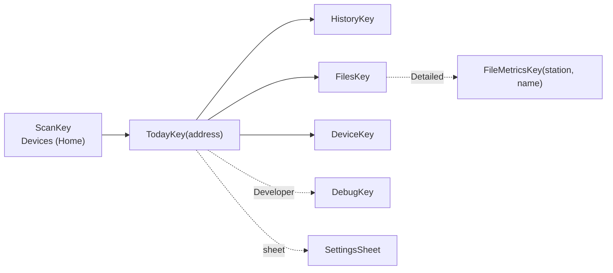

# Screens — what the user sees, and which data path feeds it

**Scope:** navigation graph, every destination's behaviour, detail levels, the transport chip.
**Code:** `ui/Navigation.kt`, `ui/NavigationKeys.kt`, `ui/<screen>/*Screen.kt` + `*ViewModel.kt`, `data/settings/AppSettings.kt`.
**Related:** [history-pipeline.md](history-pipeline.md) (what History/Today read), [transports.md](transports.md) (what the Device screen writes), [background-sync.md](background-sync.md) (Auto-sync card, Sync in background).

## Navigation (Navigation 3 keys)

Every destination except Scan is keyed by the device's **Bluetooth address**, on both pipes — the
address keys the enrolled Room row and controller, including reconnect after a worker closes its
session. Archive/history use station epochs; a full
`info.dev` check guards continuity. Returning to Devices retains other controllers and their work.

Each Navigation 3 entry owns its ViewModel and saveable UI state. Popping a detail page or
replacing a sibling tab clears that screen's jobs; the process-owned controller and any
WorkManager collection continue. Room and repository flows update visible screens without
manual reload. A screen refreshes device state after reconnect, when its request key changes,
or when the user requests it. Compose recomposition only renders the latest state.

## Detail levels (`DetailLevel`, DataStore)

| Level | Shows | Notes |
| --- | --- | --- |
| **Simple** (default) | The reading now (hero card), today so far, sync state in words with one primary action, the clock with **Set time from phone**, History and Files one tap away. Device settings as state in words and their actions | Designed first. No identifiers, hex, byte offsets, CRC, MTU, RSSI numbers, schema or firmware build strings, log tails or diagnostics |
| **Detailed** | + other particle sizes, particle counts, board temperature and battery, storage counters, batch estimate card, device card (firmware, protocol), **Finalize buffered rows**, Files chart and **Metrics** inspector (rows, time span, columns), transfer rate, the sensor, pairing and paired phones cards, token replacement | `AppSettings.detailed` |
| **Developer** | + identifiers and internals everywhere (station, device and boot IDs, schema, dictionary, max_read, payload, endpoint, MAC, dBm, file names, partial counts, CF=1 raw values, codec, heap, uptime, footer, row groups, metadata) and the **Debug** destination | `AppSettings.advancedMode`. An old `advanced_mode = true` with no `detail_level` reads as Developer |

Only presentation changes. Every level reads the same data, and nothing the Simple experience
needs may depend on Developer. A new field states its level in code (`level.detailed`,
`level.developer`).

### What moved where (W4 audit, 2026-10-08)

| Screen | Simple | Detailed adds | Developer adds |
| --- | --- | --- | --- |
| Devices (Scan) | Name, paired and known tags, signal bars, archive line (mood, primary metric, day, synced ago), peacock guide when nothing is nearby, connect and privacy notes behind the top bar info button | Coverage percent and file count on the archive line | MAC address, RSSI dBm, station prefix |
| Connection banner | Connected, Connecting, Setting up the link, pairing repair message | Failure reason | Service discovery, MTU, LAN authentication steps, reconnect reason and attempt count |
| Today | Hero (face, number, mood pill, advice, snapshot note in its info sheet), today so far, temperature and humidity on ambient boards, Smart Sync, clock with Set time | Readings since midnight, placed and unplaced counts, Finalize, batch estimate, PM10 and PM1, particles, board and battery, storage (problem counters only when not zero), device card | Station in the top bar, sample number, CF=1 raw, mV and USB mV, codec, partials, uptime, heap, dropped, errors and missed always, anchor generation, last sample instant, schema, IDs, dictionary, max_read, payload |
| Device | Device name and link in words, Auto-sync one line, wake when nearby, Wi-Fi state, scan and join, Sync over Wi-Fi switch and Get token. The pairing card only when it needs attention (default PIN, pending restart) | Firmware and protocol, sensor sticker card, pairing mode and Restart, paired phones and Forget all, Replace token, server line, Wi-Fi and Bluetooth reachability lines, network name, passphrase state, IP address, discovery errors, phone installation record | Display flag, RSSI, MAC, access point security and channel, mDNS host, port, clients, discovered address, IDs, endpoint, settings read age |
| Files | Local time per file, friendly size, state, Sync all, peacock when all synced, file count | Chart by file, Metrics inspector, transfer rate, current file progress, LIST failure text | File names, UTC folder subtitles, partial and microSD counts, FILE frame mismatch, resumed offsets, recovered windows |
| Metrics (Detailed only) | n/a | Size, rows, columns, UTC first and last, valid particle rows, column min and max | Footer, codec, schema, writer, statistics, index source, decode time, uptime span, sequence, boot, row groups, column types and footer agreement, key value metadata |
| History | Chart, metric chips, range, archive summary, Current and Earlier station chips | (unchanged) | Station ID on chips, Developer source card |
| Debug | Not reachable | Not reachable | Whole screen (pops itself when the level drops) |

## Copy and the info affordance

Every card shows a title, its value or state in words, and one primary action. A card may add one
short supporting line when the state needs it (a warning, "Restart the sensor to apply the
change"). Anything longer lives behind a small outlined **i** next to the card title:
`InfoButton(InfoContent(title, paragraphs…))` in `ui/components/InfoButton.kt`, placed through
`CardHeader(title, info = …, trailing = { Switch(…) })`. It opens `InfoSheet`, a bottom sheet with
the heading and short paragraphs. Its content description is "More about <title>". The same
pattern serves radio options: pairing modes show only their label, and their descriptions are
paragraphs of the pairing info sheet. Confirmation dialogs stay (reboot, token rotation, forget
paired phones, pairing mode none, set time, finalize) with one or two short sentences. Copy rules
in `cross-platform-guide.md` apply, and missing values print `NO_VALUE` ("n/a"), never a dash.

| Screen | Behind the info button |
| --- | --- |
| Devices | How to connect, the pairing code, the privacy note. Collect from all |
| Today | Right now (snapshot, mood cues), Smart Sync, Clock (set time, finalize), batch estimate |
| Device | Auto-sync and wake when nearby, Wi-Fi (passphrase storage), Sync over Wi-Fi (token, local network), pairing modes, paired phones, sensor sticker and batch factor |
| Files | Chart by file legend |
| History | Valid readings, coverage, estimated time, earlier stations |
| Settings | What a detail level changes, Smart Sync never rewrites files |

## Permission timing

There is no permission wall. The app opens on Devices and asks only from the tap that needs a
permission (`ui/permissions/RuntimeAccess.kt`, rules in `PermissionFlow`, tested by
`PermissionFlowTest`). An in-app rationale appears only when Android reports one is due. After a
permanent denial the next tap offers the app's system settings page. Store answers live in
[store-compliance.md](store-compliance.md).

| Permission | Android trigger | iOS trigger | Without it |
| --- | --- | --- | --- |
| Bluetooth (`BLUETOOTH_SCAN` neverForLocation, `BLUETOOTH_CONNECT`; iOS Core Bluetooth) | Scan, opening a sensor, Reconnect, Reconnect over Bluetooth. Turning the adapter on uses the system dialog from the same tap. Once held, Devices scans while visible | First Find sensors tap creates `CBCentralManager` | Archive views (History, Files) still open. A declined open shows the sensor without a link |
| Local network (`ACCESS_LOCAL_NETWORK`, API 37+; iOS Local Network) | Sync over Wi-Fi switch on, Allow local network, Get Wi-Fi token. Discovery runs only once held | First Find Wi-Fi sensors tap starts `NWBrowser` | Bluetooth sync works. The token fetch still runs |
| Notifications (`POST_NOTIFICATIONS`, API 33+) | Sync now, Sync all, file sync, Sync now in background, Collect from all, Auto-sync on, Set up wake when nearby. Asked once per screen | Not requested | The sync runs, its progress notification is hidden |
| Location | Never | Never | |

## Design system

The identity follows the website (`walkthru-earth.github.io`). Tokens live in
`ui/theme/BrandTokens.kt` with the website role names (`main`, `ink`, `paper`, `surface`,
`accent`, `deep`, `text`, `muted`, `border`), light and dark, copied from `lib/brand.ts`
palette `sensing`. `BrandTokensTest` pins every value and checks text contrast on both themes.

- **Colour.** `brandColorScheme` maps roles to Material 3. Light primary is the dark `ink` pill
  on `paper`, dark primary is `main` blue with `ink` text. The brand scheme is the default on
  every phone. Wallpaper dynamic colour stays off (identity first). Air-quality bands
  (`AirMood.color()`) are a scientific metric scale, never brand colours. Ink on a band uses
  `onColor()`, band-coloured text uses `textColorOnSurface()` and falls back to the text colour
  where a band cannot reach 3:1 (yellow on light paper, dark red on dark paper).
- **Type.** Quicksand (OFL variable TTF from google/fonts) for text, Cairo (OFL, from the
  website) for Arabic-script locales and for display numbers, because Quicksand has
  proportional digits and no `tnum` while Cairo's digits share one width. License texts ship in
  `assets/licenses/`.
- **Shape and components.** 32 dp card corners (`BrandCard`, tones Plain, Soft, Hero), pill
  actions (`PillButton` with a trailing arrow, `OutlinePillButton`), `MoodPill`, `SignalBars`,
  `TiltedBadge` (the website's -5 degree icon tilt, hero only).
- **Mascot.** The peacock (`res/drawable-nodpi/peacock.webp`, from the website's
  `public/mascots/`) is a guide on the welcome and no-device states (Devices), the all-synced
  state (Files) and a clean Smart Sync run (Today). Never beside charts or numbers. It enters
  with a finite fade that the system animator setting can turn off.

## Route and screen split

Today and Device are a stateful `XRoute` (ViewModel, one-off events through `CollectEvents`
while STARTED, launchers, permissions, confirmation dialogs, settings sheet) and a stateless
`XScreen(state, onAction)` with one file per card in `ui/device/cards/`. Previews in
`ui/device/ScreenPreviews.kt` render light and dark at Simple and Developer from fake state.
The Wi-Fi `connecting` poll lives in `DeviceViewModel`. Capability questions (sensor sticker,
batch estimate, live profile, configurable) come from `DeviceCapabilities.from(info)` in
`:core:history` `commonMain`, never from schema strings in the UI. The 1 Hz clock is read only
by leaf texts (`TickingText`, `FreshnessLabel`), and the hero uses `rememberIsFresh`, which
flips once when a reading goes stale.

## Destinations

| Screen | Behaviour | Data path |
| --- | --- | --- |
| **Devices** (Home) | Scans for service UUID `c0a5e9f0-0001-…`, lists `AQ-xxxx` with RSSI + bond state, remembers known devices. Active controller rows show per-device connection/progress and open that controller. Each known device's card shows what the **phone archive** holds (files, last sync, last UTC day with valid readings as mood + average + coverage) — no link needed. ≥ 2 known devices → **Collect from all N devices** (one worker pass, LAN if discovered + token else bond, up to two concurrent devices, missing files only; each already-owned device is skipped). | `BleScanner`, `KnownDeviceDao`, `metric_bucket` DAY tier, `AutoSyncScheduler.collectAll` |
| **Today** | Reviewed schema/dictionary profiles interpret CoreS3 board temperature and Waveshare ambient temperature/humidity. Unknown profiles retain file collection with an explanatory live placeholder. **Hero card** (`MetricHeroCard`, the primary registry metric): five-mood face on a tilted badge, big number with label and unit from `Metrics.primary`, mood pill, advice and comparison, a 10 second snapshot explained in its info sheet, **Today so far** = the *local* day's weighted average + coverage from the hourly tier (re-evaluated every minute), or a nudge to set the time. Sensor state (warming up / stale / error) in words before any number. **Smart Sync** checks clock quality, applies the user's consent policy, downloads/verifies missing files and reports real/estimated/unplaceable readings plainly. **Devices** returns Home while retaining the connection; Disconnect closes only this device. Always: clock state and **Set time from phone**. Detailed adds **Finalize buffered rows**, every measurement card and the device card (`status.open`/`open_rg` only when present). | `live`/`status` pushes via repository, reviewed `LiveProfile` + `NowReading.of(live)`, `HistoryRepository` |

For the reviewed Waveshare v2 dictionary, Today shows a separate **unvalidated batch estimate**
when the board has opted in, its sticker is in the known batch, and a fresh valid particle count
arrived after that config acknowledgement. The main Now value stays atmospheric raw PM₂.₅.
History exposes the archived candidate as a separate metric gated by candidate status 3; it has
no mood or standards band.
| **History** | Day · Week · Month · Year of one logger **from the archive** (no session), whole local days (1/7/30/365). Day = a local-day **ring** + one hourly column per elapsed hour (23 or 25 across daylight saving changes; repeated 01:00 hours show their UTC offsets). Week = hourly columns. Month/Year = **local-day calendar heatmap** + daily/weekly columns. Columns coloured by own band, faded by coverage, hollow-dashed on estimated time; y-axis = 95th percentile with a floor (PM2.5 0–60), off-scale spikes capped and labelled; WHO 24-h line at 15 only for PM2.5. Neutral signed metrics include negative values and a zero baseline. Touch/drag to read a column. Paging back uses local dates; an open span follows the clock across local midnight. Metric chips show only metrics with valid archived buckets; a first available metric replaces an absent PM default. Earlier authenticated station epochs can be selected separately. | `HistoryWindow` → `HistoryRepository.observe` → rows (Day) or tiers (Week/Month/Year); `Columns.rebinHours/rebinLocalDays/rebinLocalWeeks` |
| **Files › Chart by file** | One column per synced file in **file order** (not time): a 3-row FLUSH file is as visible as a full window; estimated-time files hollow; unplaceable files say so; label jumps show where the logger was off. Metric chips, 96 files/page, tap → name · rows · valid rows · span · mean/min/max. Archive only. | `HistoryRepository.fileSummaries` → `FileSummary` |
| **Files** | Device manifest grouped by **local calendar day** (dated files: the SD path `day=` and the name's `HHMM` are UTC, so `FileGrouping` converts the window start to the phone's zone; the header's subtitle names the UTC folder(s), each row shows its local start time) then unsynced-boot / benchmarks / legacy. **Sync all** downloads what the archive lacks with per-file + overall progress and "recovered N lost windows". Per-file state: not synced · partial · syncing · synced (verified) · mismatch · invalid name. A `LIST` refresh (manual, post-connect, post-sync) keeps the previous list on screen — "refreshing…" while in flight, "Refresh failed: … — showing the last listing." on failure (`ManifestState.last`); the red full-width "LIST failed" card appears only when no listing exists yet. Share/Inspect resolves the exact storage `(INFO/enrolled station, filename)`, including legacy/benchmark paths and retained producer-station paths; missing ownership refuses a cross-device fallback. Menu: **Sync now in background** (expedited worker), **Auto-sync** toggle, table icon → Metrics (Detailed). | `SyncPlanner`, repository `sync` state |
| **Export** (from Files) | Share one file or a zip of the raw archive; *Save to…* via SAF; **Share daily files (derived)** zips `derived/v1/<station>/day=….parquet` + manifests. | `ExportManager` |
| **Device** | **Auto-sync** card (any proto): per-device switch; **wake when nearby** line + *Set up wake when nearby* (one system dialog; a BLE session is dropped for it and restored) / *Turn off*. Waveshare: **air quality sensor** card selects the supported Plantower PMS5003T, scans its barcode with Google Code Scanner or accepts manual sticker entry, shows the batch, and offers an opt-in unvalidated batch estimate for the reviewed 2026-04-08 batch. Board acknowledgement precedes the phone's installation history entry. Barcode scanning may download a Google Play services module on first use; manual entry remains available. v2 (Detailed): Bluetooth pairing mode (Random code, Fixed PIN, No code, descriptions in the card's info sheet), **Restart device** (confirm). The default PIN warning and the pending restart notice also show at Simple. **Wi-Fi**: state/IP/RSSI, *Scan networks* → pick → hidden passphrase → *Save and connect*, polled while `connecting`, radio on/off. **LAN**: server on/off, token held?, *Get Wi-Fi token* (BLE only), *Replace token* (Detailed, confirm), *Allow local network* (API 37+, asked from the action). **Forget all paired phones** (Detailed, confirm). Every write is one validated `SET_CONFIG`. Worker-owned sessions mark controls busy; interactive sync/config/raw commands wait for that run to finish. Disruptive buttons are disabled while a sync runs (`canDisrupt = canEdit && !syncRunning`). | `DeviceSession.getConfig/setConfig/wifiScan/reboot/getToken` via repository |
| **Settings** (sheet) | **Detail level** plus Smart Sync clock consent: **Ask first** (default), **Automatic**, or **Never**, one short line each. Notes behind the info button. About shows the version and the one line privacy note. | `AppSettings.setDetailLevel`, `setClockSyncMode` |
| **Metrics** (Detailed) | One archived file through the app's own reader: rows, row groups, schema/writer version, codec, footer size, UTC/uptime span, sequence range, PMS-valid rows, per-row-group spans from footer statistics, every column decoded (nulls/min/max/first/last/"footer agrees"), key/value metadata. The archive copy is never touched. | `ParquetFile` (`:core:parquet`) |
| **Debug** (Developer) | Active transport + endpoint + `payload_max`; Smart Sync decision trace and archive time accounting (real / same-boot estimate / unplaceable); live `status` JSON; last 200 raw frames (dir, type, len, first 16 bytes; `TOKEN` and `SET_CONFIG` redacted); **Device log** (`LOG_TAIL 8192`); **Raw command** (hex → decoded frames; refuses `REBOOT` and `SET_CONFIG`, which need the Device screen's confirmation). | `FrameRecorder`, `DeviceSession.raw`, repository diagnostics |

## The transport chip

Top bar of Today, Files, Device and Debug shows **Bluetooth** or **Wi-Fi LAN**. Single source:
`DeviceConnectionRepository.activeTransport` (re-evaluated on every session swap *and* connection
state change, de-duplicated). Never derive it per screen from the session object
([lesson](lessons-learned.md#ui--compose)).

## Uses → affects

| Edit… | Affects… |
| --- | --- |
| `NavigationKeys.kt` | `Navigation.kt` entry providers, back-stack restore |
| `DetailLevel` / `AppSettings` | every `detailed`/`advancedMode` collector; Debug visibility; Files table icon |
| `ui/device/cards/MetricHeroCard.kt`, `components/MoodFace.kt`, mood copy in `strings.xml` | Today, Home cards (same moods), iOS parity (iOS still reads the copy in `AirMood`) |
| `ui/theme/BrandTokens.kt` | Every screen, `BrandTokensTest` (website values and contrast) |
| `DeviceCapabilities` (`:core:history`) | Today hero and batch card, Device sensor card, `setSensorIdentity` guard |
| `BandColumnChart.kt`, `DayRing.kt`, `CalendarHeatmap.kt` | History and Files › Chart by file (share `Columns` + `HistoryColumn`) |
| `ui/files/FileGrouping.kt` | Files list headers and per-row local time (pure: `zone`/`locale` parameters, `FileGroupingTest`); the firmware's `day=`/`data_HHMM_` naming in `../aq-parquet/docs/shared/telemetry-pipeline.md` is what it parses |
| `DeviceRoute` confirmation dialogs | the **only** call path to `rebootAndReconnect()`. Keep it that way ([sync-engine.md](sync-engine.md#state-changing-requests)) |
