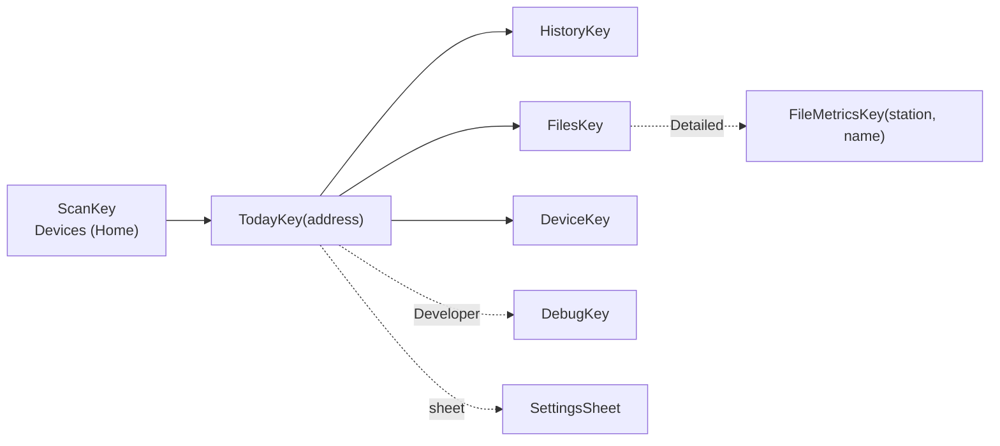

# Screens — what the user sees, and which data path feeds it

**Scope:** navigation graph, every destination's behaviour, detail levels, the transport chip.
**Code:** `ui/Navigation.kt`, `ui/NavigationKeys.kt`, `ui/<screen>/*Screen.kt` + `*ViewModel.kt`, `data/settings/AppSettings.kt`.
**Related:** [history-pipeline.md](history-pipeline.md) (what History/Today read), [transports.md](transports.md) (what the Device screen writes), [background-sync.md](background-sync.md) (Auto-sync card, Sync in background).

## Navigation (Navigation 3 keys)

Every destination except Scan is keyed by the device's **Bluetooth address**, on both pipes — the
address is the identity for the archive, the Room row and the UI.

## Detail levels (`DetailLevel`, DataStore)

| Level | Shows | Notes |
| --- | --- | --- |
| **Simple** (default) | Now card, clock state and actions; History and Files one tap away | |
| **Detailed** | + PM10/PM1, particle counts, board temperature, battery/USB, storage counters, device card, file **Metrics** inspector, History source card | `AppSettings.detailed` |
| **Developer** | + **Debug** destination | `AppSettings.advancedMode`; an old `advanced_mode = true` with no `detail_level` reads as Developer |

Cosmetic only: every level reads the same data. Nothing the Simple experience needs may depend on
Developer.

## Destinations

| Screen | Behaviour | Data path |
| --- | --- | --- |
| **Devices** (Home) | Scans for service UUID `c0a5e9f0-0001-…`, lists `AQ-xxxx` with RSSI + bond state, remembers known devices. Each known logger's card shows what the **phone archive** holds (files, last sync, last UTC day with valid readings as mood + average + coverage) — no link needed. ≥ 2 known loggers → **Collect from all N loggers** (one worker pass, LAN if discovered + token else bond, one at a time, missing files only; an open logger is skipped). | `BleScanner`, `KnownDeviceDao`, `metric_bucket` DAY tier, `AutoSyncScheduler.collectAll` |
| **Today** | **Now card**: five-mood face (Canvas placeholder for the capybara), title, advice, comparison, PM2.5 labelled a 10-s snapshot, **Today so far** = the *local* day's weighted average + coverage from the hourly tier (re-evaluated every minute), or a nudge to set the time. Sensor state (warming up / stale / error) in words before any number. Always: UTC state, **Set time from phone**, **Finalize buffered rows**, each explained. Detailed adds every measurement card + device card (`status.open`/`open_rg` only when present). | `live`/`status` pushes via repository, `NowReading.of(live)`, `HistoryRepository` |
| **History** | Day · Week · Month · Year of one logger **from the archive** (no session), whole local days. Day = 24-h **ring** + 24 hourly **columns** (tappable, peak whisker). Week = hourly columns. Month/Year = **calendar heatmap** + daily/weekly columns. Columns coloured by own band, faded by coverage, hollow-dashed on estimated time; y-axis = 95th percentile with a floor (PM2.5 0–60), off-scale spikes capped and labelled; WHO 24-h line at 15. Touch/drag to read a column. Paging back; an open span follows the clock across local midnight. Metrics: PM2.5, PM10, PM1, board temperature. | `HistoryRepository.observe` → rows (Day) or tiers (Week/Month/Year); `Columns.rebin/axisMax` |
| **Files › Chart by file** | One column per synced file in **file order** (not time): a 3-row FLUSH file is as visible as a full window; estimated-time files hollow; unplaceable files say so; label jumps show where the logger was off. Metric chips, 96 files/page, tap → name · rows · valid rows · span · mean/min/max. Archive only. | `HistoryRepository.fileSummaries` → `FileSummary` |
| **Files** | Device manifest grouped by **local calendar day** (dated files: the SD path `day=` and the name's `HHMM` are UTC, so `FileGrouping` converts the window start to the phone's zone; the header's subtitle names the UTC folder(s), each row shows its local start time) then unsynced-boot / benchmarks / legacy. **Sync all** downloads what the archive lacks with per-file + overall progress and "recovered N lost windows". Per-file state: not synced · partial · syncing · synced (verified) · mismatch · invalid name. Menu: **Sync now in background** (expedited worker), **Auto-sync** toggle, table icon → Metrics (Detailed). | `SyncPlanner`, repository `sync` state |
| **Export** (from Files) | Share one file or a zip of the raw archive; *Save to…* via SAF; **Share daily files (derived)** zips `derived/v1/<station>/day=….parquet` + manifests. | `ExportManager` |
| **Device** | **Auto-sync** card (any proto): per-device switch; **wake when nearby** line + *Set up wake when nearby* (one system dialog; a BLE session is dropped for it and restored) / *Turn off*. v2: Bluetooth pairing mode (random / fixed PIN / none) with "Default PIN 123456 — change it" nag, pending-reboot notice, **Reboot device** (confirm). **Wi-Fi**: state/IP/RSSI, *Scan networks* → pick → hidden passphrase → *Save and connect*, polled while `connecting`, radio on/off. **LAN**: server on/off, token held?, *Fetch token* (BLE only), *Rotate token* (confirm), local-network permission explanation (API 37+). **Forget all bonds** (confirm). Every write is one validated `SET_CONFIG`. Disruptive buttons are disabled while a sync runs (`canDisrupt = canEdit && !syncRunning`). | `DeviceSession.getConfig/setConfig/wifiScan/reboot/getToken` via repository |
| **Settings** (sheet) | One choice: **Detail level**. | `AppSettings.setDetailLevel` |
| **Metrics** (Detailed) | One archived file through the app's own reader: rows, row groups, schema/writer version, codec, footer size, UTC/uptime span, sequence range, PMS-valid rows, per-row-group spans from footer statistics, every column decoded (nulls/min/max/first/last/"footer agrees"), key/value metadata. The archive copy is never touched. | `ParquetFile` (`:core:parquet`) |
| **Debug** (Developer) | Active transport + endpoint + `payload_max`; live `status` JSON; last 200 raw frames (dir, type, len, first 16 bytes; `TOKEN` and `SET_CONFIG` redacted); **Device log** (`LOG_TAIL 8192`); **Raw command** (hex → decoded frames; refuses `REBOOT` and `SET_CONFIG`, which need the Device screen's confirmation). | `FrameRecorder`, `DeviceSession.raw` |

## The transport chip

Top bar of Today, Files, Device and Debug shows **Bluetooth** or **Wi-Fi LAN**. Single source:
`DeviceConnectionRepository.activeTransport` (re-evaluated on every session swap *and* connection
state change, de-duplicated). Never derive it per screen from the session object
([lesson](lessons-learned.md#ui--compose)).

## Uses → affects

| Edit… | Affects… |
| --- | --- |
| `NavigationKeys.kt` | `Navigation.kt` entry providers, back-stack restore |
| `DetailLevel` / `AppSettings` | every `detailed`/`advancedMode` collector; Debug visibility; Files table icon |
| `NowCard.kt` / `AirMood` copy | Today, Home cards (same moods), iOS parity (`MoodFace` is replaced one-for-one) |
| `BandColumnChart.kt`, `DayRing.kt`, `CalendarHeatmap.kt` | History and Files › Chart by file (share `Columns` + `HistoryColumn`) |
| `ui/files/FileGrouping.kt` | Files list headers and per-row local time (pure: `zone`/`locale` parameters, `FileGroupingTest`); the firmware's `day=`/`data_HHMM_` naming in `../m5stack-aq-parquet/docs/telemetry-pipeline.md` is what it parses |
| `DeviceScreen` confirmation dialogs | the **only** call path to `rebootAndReconnect()` — keep it that way ([sync-engine.md](sync-engine.md#state-changing-requests)) |
