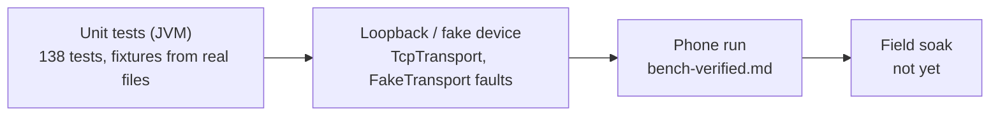

# Status — what is verified, where, and what is next

**Scope:** the current state of the app; the split between "unit-tested", "run on a phone" and "unverified".
**Code:** `./gradlew verify` (the gate), `.github/workflows/verify.yml`.
**Related:** measured device behaviour is recorded only in `../m5stack-aq-parquet/docs/bench-verified.md` ("Phone over LAN and BLE"); anything not there is unverified.

## One-line status

Implements **protocol v2** + **Auto-sync** + **on-phone history** (index, tiers, derived daily
Parquet, charts) + **GeoParquet 2.0** read/write. BLE and LAN file sync have run against the board
from one phone (OnePlus 7 Pro, Android 16 / API 36, 2026-09-17, app commit `a993268`, partial runs).
Auto-sync has **not** completed a period cycle on a phone yet.

## Verification ladder

`./gradlew --no-daemon clean verify` on 2026-09-18: **0 lint errors** (7 pre-existing warnings),
**138/138 unit tests** — 47 `:app` (auto-sync runner, deriver, indexer, repository, ZSTD codec,
LAN token policy, `TcpTransport` loopback, planner, resume policy, lost-window recovery), 47
`:core:protocol` (frame codec v1+v2, CONFIG + `SET_CONFIG` builder, LAN framing with a `LIVE` push
between two `CHUNK`s, JSON, Parquet verify), 23 `:core:parquet` (reader vs PyArrow, writer,
GeoParquet), 21 `:core:history` (aggregation, moods, columns, file summary, indexer, time
estimate, `RealArchiveTest`). Debug APK 68.4 MiB unminified.

## What is verified where

| Area | Unit / fake | Phone (bench-verified) | Not yet |
| --- | --- | --- | --- |
| v1 file sync (LIST/OPEN/READ/CLOSE, SET_TIME, FLUSH) | captured v1 payloads from `AQ-6b40` | macOS host client 2026-09-16 (766 files, 15–21 KB/s); phone partial runs 2026-09-17 | instrumented **full** 776-file sync over each link with the foreground-service build |
| v2 config / Wi-Fi / reboot / log / token | hand-assembled fixtures from the contract | a v2 device was read from the phone; no capture taken | `ble.clear_bonds`, `lan.rotate_token` end to end, `fixed`/`none` pairing (needs display-less board) |
| LAN transport | loopback `TcpTransportTest` | `LanDiscovery` found the board via `NsdManager`; app chose TCP on its own | `ACCESS_LOCAL_NETWORK` prompt (enforced only from API 37) |
| Lost window / drain / resume | `WindowRecoveryTest`, `SyncResumePolicyTest` | 514-byte-frame drop reproduced 2026-09-17 and survived | — |
| Auto-sync worker | `AutoSyncRunnerTest` over the fake | — | a complete 15-min period cycle, `setForeground` refusal in background, OEM battery settings |
| History pipeline | fixtures + `RealArchiveTest` (766 real files, 0.2 s) | derive fix observed 2026-09-18 02:35 ("derived 1 of 3 station-days") | chart update after a sync of a v3 file recorded in bench-verified |
| Derived daily Parquet | PyArrow 25 + DuckDB 1.5.5 oracle | — | — |
| GeoParquet 2.0 | 20 fixtures (PyArrow + DuckDB) cell-for-cell; writer accepted by both | n/a (no device files) | import UI / map (D4/D5, undecided) |

## Recent changes (newest first)

- **2026-09-18** — bugs found on the phone, fixed: `derived_day` upsert that never updated (every pass rebuilt every day), Today card on the UTC day, History span frozen at open time, Day re-read on every Room write. Day view → **24 hourly columns**; Files gained **Chart by file**.
- **2026-09-17** — GeoParquet 2.0 (D11); modules split into `:core:protocol` / `:core:parquet` / `:core:history`; metric registry, tiers one row per metric (Room v7); History steps 1–5 + §4.6 time estimate; Now card, detail levels, Home cards, Collect from all loggers; first phone run fixes (foreground service, auto-reconnect, token renewal, WifiLock, resume policy, REBOOT audit); Auto-sync; protocol v2.
- **2026-09-16** — v1 protocol bench-verified from a macOS host; decisions mirrored into `ble-sync-protocol.md`.

## Next

1. **Instrumented phone runs** → `bench-verified.md` (date, firmware SHA-256, app commit, phone): full sync over BLE and LAN with the foreground-service build; BLE/Wi-Fi coexistence soak; energy; `lan.rotate_token`, `ble.clear_bonds`, `fixed`/`none` pairing.
2. **Auto-sync overnight on the OnePlus**: count 15-min periods that ran (`adb logcat -s AutoSync SyncWorker`), whether `setForeground` was refused, whether BLE-by-address connects with the screen off; record OEM battery settings needed.
3. **API 37 local-network permission** on a real Android 17 device (grant / deny / revoke while connected) and `NsdManager` across API 31–37.
4. **Further transports** (LoRa relays) behind `AqTransport`; engine, archive, verification unchanged.
5. **Opt-in cloud step after local sync** — off by default, own setting and review; `INTERNET` for LAN does not pre-approve it. Privacy boundaries: `../m5stack-aq-parquet/product/mobile-architecture.md`.
6. **Open decisions** D1–D10 (location/map, import UI, iOS parity) in [history-ux-and-data-layer.md](history-ux-and-data-layer.md) §6.

## Test phone

OnePlus 7 Pro, Android 16, Wi-Fi ADB `adb connect 192.168.100.173:38457` (port changes after
reboot). `run-as` is refused on this ROM: inspect via logcat tags `HistoryIndexer HistoryDeriver
SyncEngine DeviceConnection TcpTransport BleTransport AutoSync SyncWorker SyncFgs`, not files.
