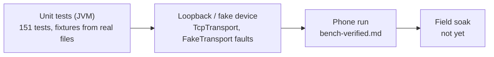

# Status — what is verified, where, and what is next

**Scope:** the current state of the app; the split between "unit-tested", "run on a phone" and "unverified".
**Code:** `./gradlew verify` (the gate), `.github/workflows/verify.yml`.
**Related:** measured device behaviour is recorded in the board-specific `../aq-parquet/docs/boards/*/bench-verified.md`; anything not recorded there is unverified.

## 2026-10-10 — incomplete LAN listings, memory bounds and Android recovery

On the connected OnePlus 7 Pro (GM1911, Android 16), the old firmware returned
successful Wi-Fi LIST snapshots of only 12–13 files, ending near 02:30–02:45
local time. USB enumeration of the same CoreS3 returned 35, including the morning
files. Concurrent serial output reported `allocate_dma_buf: not enough mem,
err=0x101` and failed SD reads. The firmware had mistaken a failed directory
read for EOF and emitted LIST_END for a prefix; the phone's “All synced” banner
therefore described an incomplete device snapshot. The files remained on SD.
Before this fix, BLE recovery copied 22 files (1,062,753 bytes), with zero
failures and measurements through 08:14:59 local time.

Whole-device Sync all and Smart Sync now fetch a fresh LIST and build their plan
directly from its result. LIST count mismatches fail, and retained/error/loading
snapshots cannot establish “All synced.” Planning queries this station's local
archive. Android TCP retains at most 64 response frames and applies backpressure
without dropping them; readiness is published before the reader and keepalive
start, fixing an eager-start keepalive race. Firmware v6.11 reserves an SD DMA
buffer before radios start and rejects failed archive enumeration.

`./gradlew --no-daemon verify` passed (957 tasks), including Android lint, APK,
unit tests, shared host tests, shared iOS simulator tests and framework link.
The eight TCP tests include eager keepalive startup, a 257-file response burst
and disconnect while backpressured. Sanitized firmware directory, archive and
SD-buffer and Parquet conformance tests and all three native board builds passed separately.

The debug APK was installed with `adb install -r`, preserving the archive,
settings and bond. APK SHA-256:
`e56c48aabb3ff9f8256ec323814770e3adf7255dc5624bab38c3c32454daadd6`.
After the v6.11 flash, automatic LAN sync copied three additional files
(97,718 bytes), with zero failures. Files displayed Wi-Fi LAN, 37/37 checked
files, 1.55 MiB, and the 08:00 file; USB independently listed the same 37.
A later refresh returned 37 again, and the interactive LAN connection remained
ready beyond five minutes without a reconnect. At the next automatic rotation,
the board finalized a 90-row file. “Sync now in background” discovered and copied
its 49,839 bytes over LAN, with zero failures; Files then showed 38/38 checked,
1.59 MiB and the new 17:00 interval. Independent read-only extraction from the
phone matched the device CRC-32 `bf653c17`; PyArrow and DuckDB read all 90 rows
(sequences 0–89), with zero drop, missed-deadline and storage-error fields.
Captures are ignored board
artifacts under `lan-memory-20261010/`. This is a short Android/SD/LAN check;
overnight endurance and real iPhone radio behavior are not qualified.

## 2026-10-10 — pushed interval fix and fresh iPhone installation

Firmware `4d20dad` and mobile `655d865` were pushed to their GitHub `main`
branches. The mobile pre-push `verify` gate passed. Xcode 27.0 built the signed
Debug device app from mobile `655d865`, and strict/deep signature verification
passed with access to the local trust store. Its provisioning profile includes
the connected iPhone 16 Pro and expires on 2026-10-16. Debug dylib SHA-256:
`10ee1af01d3f126095235d84366d22b61bdc8e608f4cac80bfd6e00bd98fd5a5`.

The iPhone (iOS 26.6.2, Developer Mode enabled) had no installed opensensor app
before this run. `devicectl` successfully installed `earth.walkthru.opensensor`.
The initial launch was denied by iOS with its signature/entitlements/developer
trust security message. The bundle signature, application identity and matching
unexpired device profile were checked; owner completion of developer trust and
a successful launch remain pending. No iPhone BLE, LAN or file transfer behavior
is established by this installation. Build/install/launch evidence is retained
under ignored `ios/build/DeviceInstall/evidence-20261010/`.

## 2026-10-10 — interval fragmentation fix, clean Android install and shared iOS checks

Android and iOS now use the shared clock policy to request fresh device status
before automatic maintenance. A usable recent external anchor survives reconnect;
missing/RTC clocks, anchors at least six hours old and drift above two seconds
plus measured link uncertainty request an acknowledged update. Only an actual
`TIME_SET` creates a clock receipt. Firmware v6.10 also stops flushing unfinished
intervals on every anchor update. Existing immutable source files are preserved
by normal sync; no merging or rewriting is required.

After the owner uninstalled the Android app and forgot the sensor bond, the
fresh debug APK was installed on the connected OnePlus 7 Pro (GM1911, Android
16). Bluetooth scan/connect grants were applied and the app launched to the
AQ-6b40 pairing prompt. APK SHA-256:
`a991b60c2870f39d0dec8157d0f9cceb0c703451620ae507271ce868921b7aeb`.
The CoreS3 was separately reset and reflashed; its new station and empty initial
archive are recorded in the board bench evidence. Pairing, reconnect and file
transfer with this new installation are not yet qualified by this entry.

With Kotlin 2.4.21, `./gradlew --no-daemon verify` passed (957 tasks), including
Android lint/APK/unit tests, shared host tests, shared iOS simulator tests and
framework link. Swift host checks and the unsigned Debug iOS simulator app
build also passed. Independent review completed without a remaining blocking
finding. Logs are ignored build artifacts. The owner deferred iPhone deployment;
no iPhone install or radio test was performed for this change.

## 2026-10-09 — fresh installs on Android and iPhone

After the owner deleted both apps, GitHub `main` still matched local commit
`76f31e2`. The locally signed, minified Android release APK built with
`-Paqsync.localRelease=true` and installed on the connected OnePlus 7 Pro
(`GM1911`). Launch succeeded and `adb` listed its process. APK SHA-256:
`0d2768ae810c6d9e16bb73fd6e1f77b70ef3c36d195c12cb39041af400d44e94`.
The previously built and locally signed Debug iOS app from the same commit was
verified, installed on the paired iPhone 16 Pro, and launched after the phone was
unlocked. CoreDevice listed its process running. These are fresh install and
launch checks; no sensor connection, archive, permission or screen behavior was
tested on either phone.

## 2026-10-09 — iPhone install of current main

Commit `76f31e2` on `main` matched GitHub `origin/main`. Xcode 27.0 built the
signed Debug iOS app for the paired iPhone 16 Pro using the existing local
development team. `devicectl` installed `earth.walkthru.opensensor` in place,
launched it, and listed its process running afterward. The app's Debug dylib
SHA-256 was `85a523c66b2a192f44b8e6dd1a2ef91533bdb2a67596cdd711bcc777818ed3a2`.
This confirms the build, install and launch; no screen, radio or sync behavior was
inspected during this check.

## 2026-10-09 — peacock expressions and Today layout (OnePlus and host/simulator)

Eight transparent expression portraits now share the original peacock's identity,
with wings, masks and feather gestures for air quality, missing data and work states.
Today shows one large portrait above a smaller white backplate; both rotate together
and the visible body meets the backplate's bottom edge. Average and sync cards no
longer repeat the character. Shared empty states and Android notifications use the
same expression set. Artwork and prompts are in [the asset record](design/peacock/README.md).

The final debug APK was installed over the existing app on the connected OnePlus
7 Pro (GM1911, Android 16) and launched successfully. The saved AQ-6b40 sensor and
archive remained available. Phone inspection during the layout work showed live
fair-air readings over Wi-Fi LAN, a single Today portrait, and readable history-ring
values. The owner approved the final appearance before commit. This is a UI/install
check; every air-quality expression and notification state was not exercised on
the phone, and no iPhone radio behavior was tested.

APK SHA-256: `558f15e5d85c2dffac22d124e41261917249c3eed3ec019b5f63fbafd68d050f`.

Verification passed with the bundled JBR: `./gradlew --no-daemon verify
:app:assembleRelease -Paqsync.localRelease=true` (1045 tasks), including Android lint,
host tests, shared iOS simulator tests and framework link, plus a locally signed
minified release APK. The unsigned Debug iOS simulator app also built successfully.
All nine peacock resources match their source hashes in the debug APK and iOS app;
the iOS semantics tests load each resource and check accessible state descriptions.

The linked [release job](https://github.com/walkthru-earth/opensensor-space-mobile/actions/runs/37919254818/job/113783676017)
failed its English-literal audit on an iOS retry diagnostic. The diagnostic was
corrected, and the audit now declares the external source and catalogue files it
reads as Gradle inputs. All 19 copy-audit tests passed; a temporary source violation
also proved that a normal incremental run invalidates the prior passing result.

## 2026-10-09 — OnePlus update after automatic UTC changes

Mobile commit `5d5db51` was pushed to `main` after the full pre-push `verify` gate
passed. Its debug APK was installed over the existing app with `adb install -r`
on the connected OnePlus 7 Pro (GM1911, Android 16). Existing app data, the saved
AQ-6b40 sensor/history, and Bluetooth/notification grants were preserved. The app
launched into its shared UI and remained alive without an AndroidRuntime crash.
The phone UTC agreed with the build host at 10:34 UTC.

APK SHA-256: `a844088b545663947e1bdd3a112c18468ffd3ac4af8feea204e381dc08292e56`.

Against M5Stack CoreS3 firmware `01e6468`, after the explicitly requested SD Parquet
cleanup and production flash:

- Tapping the paired AQ-6b40 sensor connected over Bluetooth and displayed live readings.
  The Clock card changed to "Clock is set and checked by a phone" without a manual clock
  action. Board serial independently recorded automatic host UTC over BLE and a successful
  RTC write (epoch `1791542381`, monotonic `55205803` µs).
- Smart Sync downloaded and checked the first fresh file; Today changed from no timed
  readings to a current-day average. Disconnecting and reconnecting selected authenticated
  Wi-Fi LAN automatically; the Clock card again reported the phone-set clock. Board serial
  confirmed the LAN host anchor (epoch `1791542442`, monotonic `115493452` µs).
- Collection over LAN and a final sync of the most recently finalized file completed the
  six-file manifest. Files displayed "All synced", "Everything is on this phone and checked",
  and `Fri 9 Oct 2026 · 6/6 · 65.1 KiB`. The phone retained its older local archive separately
  from the cleaned SD; its final archive count was 1265 files.

The board had a usable RTC at boot. This run qualifies Android BLE/LAN automatic clock sync
and fresh-file collection, not no-RTC recovery, power-cut durability, or iOS radio behavior.
Older phone readings with no retained boot anchor remain undated as designed. Private receipt
inspection via `adb run-as` was unavailable because this phone ROM rejected its target-SDK-37
SELinux context; the observations above use app UI and firmware serial evidence.

## 2026-10-09 — automatic UTC and derived partition recovery (host/simulator)

The working tree now synchronizes device UTC automatically on Android/iOS connection,
without a manual clock setting. A boot-scoped receipt preserves the acknowledged clock
mapping before collection. Shared history imports firmware footer anchors and rebuilds
unknown-UTC readings into derived UTC-day Parquet on both platforms, preserving original
bytes and null UTC. See [decision, behavior and limits](time-reconciliation.md).

Verified for this change:

- `./gradlew --no-daemon verify`: passed, including Android debug APK, unit/host tests,
  lint, shared iOS simulator tests and framework link (957 tasks; no new lint issues).
- `ios/tests/verify-native.sh`: passed archive and LAN host checks.
- Unsigned Debug simulator app: `xcodebuild -project ios/OpenSensor.xcodeproj -scheme
  OpenSensor -configuration Debug -destination 'generic/platform=iOS Simulator'
  -derivedDataPath ios/build/DerivedData CODE_SIGNING_ALLOWED=NO build`: passed,
  without Swift concurrency warnings.
- PyArrow 25.0.0 and DuckDB 1.5.5 read all four generated daily fixtures. The unknown-UTC
  recovery fixture retains all 64 rows, partitions 63 before midnight and one after,
  preserves the exact `123456` microsecond fraction and leaves raw UTC null.
- Clock receipt restart, station/boot isolation, malformed evidence, arithmetic overflow,
  independent footer recovery, stale-day replacement and deduplication have automated tests.
- Changed Kotlin files pass the pinned ktlint hook; repository diff checks are clean.

The sibling firmware passes both board builds and relevant sanitized writer, time-protocol,
SNTP, telemetry and archive tests. No board was flashed and neither mobile app was installed
or radio-tested in this change. Cold boot, Wi-Fi/Bluetooth reconnection, RTC retention and
power-cut behavior still require dated hardware evidence. An unfinished RAM batch remains
exposed to power loss; a boot with no retained anchor stays undated.

## 2026-10-09. Wave 2 install check (OnePlus 7 Pro and iPad Air M2), install and launch only

Debug build of `feat/platform-parity` at 14f0a61 (Wave 2: `:core:archive`, `:core:sync` pure moves,
shared Settings, shared design system and bottom bar). Android was installed with `adb install -r`
and launched. The process stayed alive with no crash in logcat. The screenshot came out black
because the phone was dozing, and the screen was not checked. iPad Air M2 (iPadOS, Developer Mode
on, signer trusted) was built for the device, installed with `devicectl` and launched.
No sensor was connected and no sync, permission dialog or screen flow was tested on either device.

Later merges the same night (#13 permissions at 00910a9, #14 strings at 5261a74, #12 shared shell
at 69cc5c6) passed `verify`, `verify-native.sh` and the simulator build only. They were not
installed on a phone. Owed phone checks are listed on PRs #27, #28, #29, #31 and #33.

## 2026-10-08 17:55 Cairo. On-demand permissions launch check (OnePlus 7 Pro, Android 16)

Minified release build of `refactor/production-readiness` (W13 merged), installed over the
previous build with `adb install -r`. `BLUETOOTH_SCAN`, `BLUETOOTH_CONNECT` and
`POST_NOTIFICATIONS` were revoked and their user-set flags cleared first. Launch opened straight
on "Sensors nearby" with the known sensor listed and no permission dialog. `dumpsys` showed all
three still not granted after launch. Still to check on this phone: Scan asks for Nearby
devices, Sync now asks for notifications, deny twice then the settings link, and the info sheets.

## 2026-10-08 — iOS interruption recovery and Parquet export

The owner reports that switching to another app during M5Stack collection stops sync,
and the next run appears to start over. Code inspection confirms that the old scene
background handler explicitly closed LAN connections; each sync reset its completed-file
counter and OPENed every manifest entry, although finalized files and partial bytes were retained.

The working copy now requests bounded UIKit background time for user-started LAN collection.
Expiration/background transport failure queues resume; foreground return reconnects after old
archive ownership is released. Cancel clears queued intent, including during cleanup/reconnection,
and paused progress remains visible. Verification receipts let later runs count saved files
immediately and skip remote OPEN/READ while still validating local CRC/size/PAR1. Older files
without receipts are checked once through the existing path. Force-quit/relaunch does not retain
automatic resume intent, but downloaded bytes/receipts survive and manual sync reuses them.

Since #19 both apps run the shared Files screen and inspector (`:feature:files`). iOS opens it
from a Files button on My devices and shares one file, all files or a zip, or saves the zip through
Apple's Files picker, preserving station/Hive paths and excluding partials and receipts. This
replaced the older Swift folder export. Simulator build only, the iOS share and save sheets and the
Android chooser and SAF save still need a phone run. Exact storage paths and access are in [data-model.md](data-model.md#finding-and-exporting-the-mobile-archive).

Local validation: `./gradlew --no-daemon verify verifyIos`, unsigned Xcode 27 Debug simulator
build and `./ios/tests/verify-native.sh` passed. Native regressions fail an actual collection
mid-window, reconstruct its archive and check completed-file skipping, exact partial offset,
initial retained progress and newly transferred-byte rates. Receipt tests cover legacy upgrade,
size conflict, same-length corruption and symlinks. Export tests check independent copies,
Hive paths and exclusion of partials/receipts, including Apple's `/var` path alias behavior.
These changes have not been installed on the iPhone. Background timing, pause/reconnect/Cancellation,
screen-lock behavior and Files-picker completion remain real-iPhone qualification work.

## One-line status

The Android app implements multi-device collection, station-epoch recovery and reviewed sensor
profiles; its latest recorded phone checks cover one-file BLE sync and navigation/resume, with
multi-device, LAN and background qualifications outstanding. The iOS app shares protocol and
sensor rules and has a dated iPhone BLE live-reading check plus Bonjour discovery observation.
Authenticated foreground LAN collection, concurrent sensor sessions and verified local archives now
have host/simulator/build checks; their real-phone qualification and background collection remain outstanding. See [opensensor-space.md](opensensor-space.md)
and [ios-migration.md](ios-migration.md). Android, iOS simulator, and iPhone evidence are recorded
separately in the platform records and the relevant firmware board bench files.

Implements **protocol v2** (+ the 2.1 advertising payload) + **Auto-sync** with event-driven
triggers (companion presence, advertising flags, Wi-Fi arrival) + **on-phone history** (index, tiers,
derived daily Parquet, charts) + **GeoParquet 2.0** read/write. BLE and LAN file sync have run against
the board from one phone (OnePlus 7 Pro, Android 16 / API 36, 2026-09-17, app commit `a993268`,
partial runs). Auto-sync has **not** completed a period cycle on a phone yet. Of the triggers, the
**advertising-flag wake is measured once** (2026-09-18, app `678c1c0` / firmware `-v6.3`: dead app
process started by the controller 19 s after the board closed a file, new file on the phone at 28 s);
companion presence and the Wi-Fi-arrival run are not.

## Current host gate (2026-10-09)

`./gradlew --no-daemon verify` on an Apple Silicon Mac, branch `feat/platform-parity` wave 0.
It now includes `verifyIos`, and every shared module joins both gates through its convention
plugin. 353 tasks, **619 tests passed, 1 skipped, 0 failed**, zero lint errors, debug APK built.

| Where | Tests |
| --- | --- |
| `:app` unit tests | 207 |
| JVM, every `:core` module | 208 (protocol 80, history 44 plus 1 skipped, parquet 34, publicfeed 24, units 15, airquality 7, settings 2, sync 1, archive 1) |
| iOS simulator, every `:core` module | 170 (protocol 72, parquet 33, publicfeed 24, history 15, units 15, airquality 7, settings 2, sync 1, archive 1) |
| Android host, Compose modules | 17 (`:feature:discover` 13, `:ui:designsystem` 4) |
| iOS simulator, `:ios:shared` | 17 (no longer run on the JVM) |

`:core:airquality` tests ran for the first time in a gate. Host and simulator checks only. No
phone run is claimed.

## Host gate (2026-09-30)

The pending PMS5003T identity/batch-candidate change has a separate host check:
`./gradlew --no-daemon verify` passes with the new protocol, live estimate, History metric,
Room v10 and barcode/manual Device card; `python3 tools/validate_sensor_installation_migration.py`
passes against the v9/v10 Room exports. The gate also covers BLE CONFIG chunk reassembly for
smaller negotiated MTUs and its missing-chunk failure path. This build has **not** been installed on a phone or
tested against flashed Waveshare v2 firmware. The optional Google Code Scanner depends on
Google Play services and may download its module at first use; manual entry needs neither.

`./gradlew --no-daemon clean verify` (2026-09-30): **247 tests passed, zero skipped or failed** across
`:app` and the three `:core` modules of that date; zero lint errors. The debug APK builds.
The optional real-archive test now finds the sibling `aq-parquet` checkout and
decoded all 767 local Parquet files (67,442 rows) instead of silently skipping
that corpus. The stdlib SQLite migration validator passes against v8/v9 exports.
These are host checks; the dated ladder below retains the hardware baseline.

The OnePlus 7 Pro (Android 16 / API 36) accepted the current debug APK in place
with `adb install -r`, preserving app data. APK SHA-256:
`74da8ddd25f9e3141cf3d43e92475b0a3fa8e994d79adbb4bc49e8f07b1f99ca`.
The device locked before the updated History and Today screens could be checked.
The unlocked-phone lifecycle and one-file BLE check below used the preceding
build. Firmware-side flash and SD readback are in its board bench file.

## Lifecycle and foreground BLE check (2026-09-30 Cairo)

OnePlus 7 Pro (GM1911, Android 16 / API 36), app commit `d1f91e4`, APK SHA-256
`4f00537c996d77a39bea9a09f322b62309d1e955a3868ba05d3dfbb46206de7f`.
Installation preserved the archive and connected AQ-7500 over Bluetooth to the
Waveshare station `81c0da75-009b-4922-94f9-64e310f006b8`. History loaded
its 30 September PM2.5 day chart (26.7 µg/m³, 25% coverage). Switching
History → Files → History, then backgrounding and reopening the app, showed
the same chart. Files' explicit refresh updated the LIST age without clearing
its verified listing. The earlier initial History state exposed an empty 0/0
placeholder while Room resolved; the current build displays “Loading archive…”
until the query is ready.

Today reported zero dropped rows and storage errors. Its confirmed “Finalize
buffered rows” action made one short file available. Files showed 150 finalized
files with one pending transfer. Foreground **Sync all** over BLE completed
**1/1 file, 16.8 KiB displayed**, then showed “Everything on the card is in the
archive and verified”; the phone archive count rose from 1,399 to 1,400. This
is a one-file transfer and UI lifecycle check, not a full-archive throughput,
LAN, screen-off sync or multi-device qualification. The board had no UTC anchor,
so those new readings were archived without invented calendar times. See the
[Waveshare bench record](../../aq-parquet/docs/boards/waveshare-esp32-s3-sim7670g/bench-verified.md).

## USB installation and stale pairing (2026-09-29)

App `06ab6ccd` was installed with `adb install -r` on the OnePlus 7 Pro (GM1911,
Android 16 / API 36), using the same debug certificate as its previous installation.
Startup and Room-backed Home succeeded without an AndroidRuntime crash. Existing known
devices and archive summaries remained visible: AQ-7500 had 99 files and AQ-6b40 had
1,151. This is an installation/startup observation, not a controlled v8-to-v9 migration test.

AQ-7500's automatic BLE reconnect failed: Android recorded GATT status 5 and
`encryption_change:key_missing`, also present before this update. The owner confirmed the
Waveshare had been reflashed/erased after pairing. Its USB console answered `parquet status`
without a reset; no firmware, time, configuration or bond changes were made. Current image
SHA-256 was not measured, so no firmware-specific transfer result is claimed. See the
[Waveshare bench record](../../aq-parquet/docs/boards/waveshare-esp32-s3-sim7670g/bench-verified.md).
The owner then entered the physical USB owner PIN. Android reported BOND_BONDED and BLE
MTU 517; the app verified INFO and displayed current PM2.5, ambient temperature and humidity.
The station changed from `7abe1b6b-e014-42e7-b259-bf61cee9f288` to
`81c0da75-009b-4922-94f9-64e310f006b8`. Both epochs appeared in History, and selecting the
earlier one showed its existing PM2.5 chart (36.5 µg/m³, 18% coverage on 29 September).
This establishes one foreground stale-bond repair and retained-history observation; it does
not establish automatic erased-bond repair, file collection after recovery, or simultaneous links.

The follow-up fixes open device details immediately on a sensor tap, even if its link failed
or a worker owns it. A terminal authentication callback is retained through connection settle
and teardown, rather than overwritten by a service-discovery error. The persistent banner
explains pairing repair and opens Android Bluetooth settings; logs contain the GATT status
and the same explanation. Four regression tests cover failure retention, disconnected status
0, a fresh attempt and repair-banner detection. Eight more cover asynchronous Android pairing:
initial BOND_NONE must not be mistaken for cancellation, fast cancellation cannot be lost to
StateFlow conflation, and timeout/cancellation remain bounded. No automatic unpairing is performed.
Tapping AQ-7500 opened Today even on a failed link; cancelling pairing left a persistent error
with archive tabs available. The final debug APK is SHA-256
`105783e2c2655fea0a9c83cff0fcf577aee3fab17f7d7937899a103f2c26c9b7`.

## Waveshare live battery display (2026-09-30 Cairo)

On the OnePlus 7 Pro (GM1911, Android 16), the installed AQ APK (SHA-256
`105783e2c2655fea0a9c83cff0fcf577aee3fab17f7d7937899a103f2c26c9b7`, local app
commit `5df7aa86171fc72e94a0bd72bfda75cb2f3fc056`) connected to AQ-7500 over Bluetooth
with Waveshare firmware image SHA-256
`63951c913b0995ee7d2180a68fb4fc995202b48cfe6741655909e2b420febc0c`.
The app was in Simple view; switching to Detailed showed **100% / 4,277 mV** in Today's Battery
card while current sensor readings updated. No app source or APK change was needed. The
screenshot at `../../aq-parquet/firmware/arduino-waveshare-sim7670g/artifacts/battery-android-live-20260930.png`
(SHA-256 `8080782f9cc55761599a8dd92354a05c93c43ec7c972f66bc88734fdb61bc988`)
is retained in the firmware trial's git-ignored artifacts; the
[Waveshare bench record](../../aq-parquet/docs/boards/waveshare-esp32-s3-sim7670g/bench-verified.md)
has the board-side evidence. This first display observation was USB-attached. After USB was
unplugged, AQ-7500 remained connected over Bluetooth and the Detailed Battery card showed
**100% / 4,067 mV**, with changed particle and ambient readings, status age 4 s and uptime
12m50s. This verifies a fresh battery-only app readout on the same phone and firmware image.
The second screenshot is retained at
`../../aq-parquet/firmware/arduino-waveshare-sim7670g/artifacts/battery-android-live-battery-only-20260930.png`
(322,123 bytes; SHA-256 `70250dffca9867bc284612c9e0a89a6d47e1569a789bd75810856b84a102d78f`).
Neither run captured a raw GATT packet or transferred a file. The 100% value is the gauge's
capped estimate, not a capacity-calibration result. Charging state remains unknown; the board
adapter does not report `chg` or `vbus`.

## Waveshare History after station reset (2026-09-30 Cairo)

OnePlus 7 Pro (GM1911, Android 16 / API 36) received the updated debug APK in place with
`adb install -r`; app data and archived files were retained. APK SHA-256 was
`9c14cec1db961f842f570f99095db414558f19cd0247e62f01678564001be051`.
The connected AQ-7500 had current station `81c0da75-009b-4922-94f9-64e310f006b8` and
earlier station `7abe1b6b-e014-42e7-b259-bf61cee9f288` from the prior reset. History showed
the current station's 30 September PM2.5 day chart (23.3 µg/m³, 2% coverage), then selecting
**Earlier** opened its latest day, 29 September (36.5 µg/m³, 18% coverage). Changing to Week
kept that date and showed its 23–29 September chart. The full UUIDs were replaced by short
Current/Earlier labels; metric chips now scroll horizontally without squeezing a long label.

Before this fix, History counted 99 retained SD copies whose inner Hive path named the earlier
station as “still indexing” under the current station and described all 115 current-namespace
files as untimed. The page now excludes those copies from the current station's file/time counts
and explains their provenance; the immutable archive bytes and outer INFO-station namespace
were not changed. After four additional files were collected, the current-namespace view showed
20 own files, including three with real UTC, two with estimated time, and 99 retained copies
from the earlier station. This observation covers the two station views and Day/Week controls,
not a controlled reset/reflash or complete file-sync qualification. The firmware image was
previously read as SHA-256 `63951c913b0995ee7d2180a68fb4fc995202b48cfe6741655909e2b420febc0c`;
it was not read again during this battery-only phone run.

Screenshots are retained in the firmware trial's ignored `artifacts/` directory:
`history-android-current-20260930.png` (SHA-256
`1832c216861e926198ba91aec625018439368b66d195b466f06887ffff9cd6c7`) and
`history-android-earlier-20260930.png` (SHA-256
`0e80bc7ea09de10c87b146bb45120290e74d5df10484a2c8fa60f89d7b105634`).
The focused History presentation tests and `./gradlew --no-daemon verify` passed.

## Verification ladder (counts from 2026-09-18, see the current host gate above)

`./gradlew --no-daemon clean verify` on 2026-09-18: **0 lint errors** (7 pre-existing warnings),
**151/151 unit tests** — 55 `:app` (auto-sync runner incl. the LAN-only Wi-Fi trigger, deriver, indexer, repository, ZSTD codec, Files local-day grouping,
LAN token policy, `TcpTransport` loopback, planner, resume policy, lost-window recovery), 52
`:core:protocol` (frame codec v1+v2, CONFIG + `SET_CONFIG` builder, LAN framing with a `LIVE` push
between two `CHUNK`s, JSON, Parquet verify, 2.1 advertising payload), 23 `:core:parquet` (reader vs PyArrow, writer,
GeoParquet), 21 `:core:history` (aggregation, moods, columns, file summary, indexer, time
estimate, `RealArchiveTest`). Debug APK 68.4 MiB unminified.

## What is verified where

| Area | Unit / fake | Phone (bench-verified) | Not yet |
| --- | --- | --- | --- |
| v1 file sync (LIST/OPEN/READ/CLOSE, SET_TIME, FLUSH) | captured v1 payloads from `AQ-6b40` | macOS host client 2026-09-16 (766 files, 15–21 KB/s); phone partial runs 2026-09-17 | instrumented **full** 776-file sync over each link with the foreground-service build |
| v2 config / Wi-Fi / reboot / log / token | hand-assembled fixtures from the contract | a v2 device was read from the phone; no capture taken | `ble.clear_bonds`, `lan.rotate_token` end to end, `fixed`/`none` pairing (needs display-less board) |
| LAN transport | loopback `TcpTransportTest` | `LanDiscovery` found the board via `NsdManager`; app chose TCP on its own | `ACCESS_LOCAL_NETWORK` prompt (enforced only from API 37) |
| Lost window / drain / resume | `SyncEngineTest`, `SyncResumePolicyTest` | 514-byte-frame drop reproduced 2026-09-17 and survived | — |
| Auto-sync worker | `AutoSyncRunnerTest` over the fake (incl. `lanOnly`) | — | a complete 15-min period cycle, `setForeground` refusal in background, OEM battery settings |
| Auto-sync triggers | `AdvertisementTest` (2.1 bytes) | **advertising wake** 2026-09-18: `flag scan registered … 2 filters`, `Start proc … for broadcast {…AdvertScanReceiver}` +19 s after `PARQUET READY`, `trigger=ADVERTISEMENT`, LAN sync 1 file / 22,498 B, done +28 s, app process killed beforehand | association dialog finding the advertising logger, `EVENT_BLE_APPEARED`, companion exemptions vs the screen-off socket kill and the `setForeground` refusal (still refused, no association yet), Wi-Fi-arrival run end to end (fired at both process starts, second throttled) |
| History pipeline | fixtures + `RealArchiveTest` (766 real files, 0.2 s) | derive fix observed 2026-09-18 02:35 ("derived 1 of 3 station-days") | chart update after a sync of a v3 file recorded in bench-verified |
| Derived daily Parquet | PyArrow 25 + DuckDB 1.5.5 oracle | — | — |
| GeoParquet 2.0 | 20 fixtures (PyArrow + DuckDB) cell-for-cell; writer accepted by both | n/a (no device files) | import UI / map (D4/D5, undecided) |

## Recent changes (newest first)

- **2026-09-29** — Rebranded visible copy/releases/exports without changing Android install or wire
  identities. Added per-device assisted ViewModels/controllers, two-transfer budget, shared legacy
  mDNS resolver, foreground aggregation and worker ownership; immutable archive writer leases and
  reference-counted LAN protection; Room v9 station epochs and continuity policy; reviewed nullable
  live profiles and available-metric/signed history charts. Retained SD producer-station mismatch
  stays archived/exportable and is excluded from the new station's charts. No board was flashed,
  rebooted or paired during the initial source audit. The later USB/foreground repair evidence
  is recorded above. Qualification and limitations are in
  [opensensor-space.md](opensensor-space.md).

- **2026-09-20** — LAN bearer tokens are encrypted at rest with Android Keystore AES-GCM. Startup
  completes plaintext migration before Auto-sync services can consume tokens. Missing keys, failed
  authentication and malformed encrypted values fail closed by clearing only that device's token and
  port (the device row remains for a later BLE refresh); DAO reads and flows stay usable while
  unrelated failures still surface. Covered by focused JVM tests; not yet exercised on a phone or
  across a real device-to-device transfer.
- **2026-09-19** — **Post-sync `LIST` no longer dies with the link.** Seen on the phone after a completed sync: "LIST failed: link lost while waiting for a response" replaced the whole file list. Cause: the refresh was launched after `running = false`, i.e. after the foreground service let go of the uid, so the socket was killed under it (transport of that run not recorded — LAN + backgrounded phone fits; confirm with `adb logcat -s SyncEngine SyncFgs ConnectivityService` on the next run). The re-list now runs inside the protected run; `ManifestState` keeps the last listing through `Loading`/`Error` (`ManifestStateTest`), so the Files screen shows "Refresh failed: … — showing the last listing." instead of a blank list, and `plan` stays usable. Not yet on the phone.
- **2026-09-18** (14:03 local) — app `678c1c0` (APK `3c454c74…`) installed on the OnePlus over Wi-Fi adb against firmware `-v6.3`; **first device-flagged wake measured** — see the ladder above and the firmware repo's [bench record](../../aq-parquet/docs/boards/m5stack-cores3/bench-verified.md#board-1-advertising-payload-wakes-the-phone-firmware-v63-protocol-21). `setForeground` still refused (no companion association yet); Wi-Fi callback fires at every process start and is throttled as designed.
- **2026-09-18** (evening) — **Event-driven Auto-sync** ([background-sync.md](background-sync.md#triggers--starting-a-run-before-the-period-is-up)): Companion Device Manager "wake when nearby" (association dialog on the Device screen, `CompanionPresenceService`, `REQUEST_COMPANION_*` exemptions, Room v8 `companionAssociationId`), offloaded advertising-flag scan on the firmware's new protocol-2.1 service data (`Advertisement`, `AdvertFlagScan`), Wi-Fi-arrival LAN-only run (`SyncTriggers`), `SyncTrigger` on every one-time run. 151 tests, lint clean. **Not yet on the phone**; design and measurement list in `../aq-parquet/docs/shared/background-sync-triggers.md`.

- **2026-09-18** (later) — Files list grouped by **local calendar day** (`FileGrouping`, zone-pinned tests): the headers were the SD card's UTC `day=` folder, so at UTC+3 every file after 21:00 local sat under tomorrow. Header subtitle names the UTC folder(s); each row shows its local start time. Installed on the OnePlus (commit `c6c27cd`), not yet recorded in bench-verified.
- **2026-09-18** — bugs found on the phone, fixed: `derived_day` upsert that never updated (every pass rebuilt every day), Today card on the UTC day, History span frozen at open time, Day re-read on every Room write. Day view → **24 hourly columns**; Files gained **Chart by file**.
- **2026-09-17** — GeoParquet 2.0 (D11); modules split into `:core:protocol` / `:core:parquet` / `:core:history`; metric registry, tiers one row per metric (Room v7); History steps 1–5 + §4.6 time estimate; Now card, detail levels, Home cards, Collect from all loggers; first phone run fixes (foreground service, auto-reconnect, token renewal, WifiLock, resume policy, REBOOT audit); Auto-sync; protocol v2.
- **2026-09-16** — v1 protocol bench-verified from a macOS host; decisions mirrored into `ble-sync-protocol.md`.

## Next

0. **Qualify this multi-device/recovery slice**: install upgrade from the existing signed build;
   test BLE/BLE, BLE/LAN and LAN/LAN with two boards, cancellation and foreground ownership;
   normal reset/reflash and separately authorized credential-erasing recovery; retained SD station
   history and pairing repair. Record each result under the correct firmware board bench record.

1. **Instrumented phone runs** → `bench-verified.md` (date, firmware SHA-256, app commit, phone): full sync over BLE and LAN with the foreground-service build; BLE/Wi-Fi coexistence soak; energy; `lan.rotate_token`, `ble.clear_bonds`, `fixed`/`none` pairing.
2. **Auto-sync overnight on the OnePlus**: count 15-min periods that ran (`adb logcat -s AutoSyncScheduler SyncWorker CompanionPresence AdvertFlagScan SyncTriggers`), whether `setForeground` was refused, whether BLE-by-address connects with the screen off; record OEM battery settings needed. **Triggers first:** the owner taps *Set up wake when nearby* — does the association dialog find the advertising logger; does `EVENT_BLE_APPEARED` arrive after walking back in; does a screen-off LAN sync survive with the device present (no "Destroyed live tcp sockets") and does `setForeground` stop being refused. The flag scan firing within a minute of `PARQUET READY` is measured (19 s, one event); repeat for a distribution and after a Bluetooth toggle.
3. **API 37 local-network permission** on a real Android 17 device (grant / deny / revoke while connected) and `NsdManager` across API 31–37.
4. **Further transports** (LoRa relays) behind `AqTransport`; engine, archive, verification unchanged.
5. **Opt-in cloud step after local sync** — off by default, own setting and review; `INTERNET` for LAN does not pre-approve it. Privacy boundaries: `../aq-parquet/product/mobile-architecture.md`.
6. **Open decisions** D1–D10 (location/map, import UI, iOS parity) in [history-ux-and-data-layer.md](history-ux-and-data-layer.md) §6.

## Test phone

OnePlus 7 Pro, Android 16, Wi-Fi ADB `adb connect 192.168.100.173:38457` (port changes after
reboot). `run-as` is refused on this ROM: inspect via logcat tags `HistoryIndexer HistoryDeriver
SyncEngine DeviceConnection TcpTransport BleTransport AutoSync SyncWorker SyncFgs`, not files.

## 2026-10-08 — Kotlin Multiplatform iOS migration started

The Android app and first iOS app now compile the same portable protocol and
sensor-domain implementations. JVM-only Parquet/file adapters and existing
Android screens remain in place. [ios-migration.md](ios-migration.md) describes
the exact source-set split, build commands and remaining feature work.

Host verification: `./gradlew --no-daemon verify` passed after formatting,
with **274 tests passed, no failures or skips**, and no Android lint errors.
Both actual-SQL migration validators passed (v8→v9 and v9→v10). `verifyIos`
passed **17 common tests** on the installed iOS simulator and linked the
Compose framework; iPhone arm64 framework linking also passed. Xcode 27 built
both the simulator and signed device app. These are compilation/test results,
not sensor or radio qualification.

The first simulator launch exposed a required Compose plist setting; adding
`CADisableMinimumFrameDurationOnPhone = true` fixed the startup crash. The
corrected iPhone 17 Pro simulator on **iOS 26.5** rendered the discovery screen
and remained running. Its unavailable-Bluetooth explanation was visually checked.
The corrected app was installed on the owner's **iPhone 16 Pro, iOS 26.6.2**;
after Developer Mode and profile trust were enabled by the owner, launch succeeded
and CoreDevice confirmed the app process was still running. No signing team,
certificate or provisioning material was committed.

Real-phone evidence for app commit `e1a3c6d`: the owner's screenshot showed
Bonjour discovery of `aq-6b40` on the iPhone. After reporting that the other phone
was disconnected, the owner confirmed a Bluetooth connection and visible live
readings in the iOS app. This is owner-reported foreground behavior, not a
captured wire trace or a comparison of values with the board. The corresponding
[CoreS3 bench note](../../aq-parquet/docs/boards/m5stack-cores3/bench-verified.md#2026-10-08--first-ios-companion-phone-observation)
records the evidence and its limits. A fresh pairing/PIN flow, notification
cadence, STATUS updates, stale timeout and foreground/background behavior still
need qualification. At that first-stage commit, the iOS app was a foreground live reader only:
Bonjour discovery is implemented with an explicit **Find Wi-Fi sensors** action,
`NSLocalNetworkUsageDescription` and the `_aqsync._tcp` entry in `NSBonjourServices`.
The browse stays active while iOS asks for permission; denial and unavailable Wi-Fi
are not confused with Bluetooth failure. The shared LAN envelope/handshake now
also compile for iOS. A discovered sensor name is confirmed by the phone
screenshot; the Local Network prompt itself and allow/deny/revoke behavior were
not reported. At that commit, Wi-Fi result cards were discovery-only with no connection action;
Parquet archive download, offline history, exports, authenticated LAN transfers and automatic
background collection were not implemented. The later Wi-Fi implementation is recorded below. Minimum app deployment target is iOS 18.5;
this stage includes Apple Silicon simulator and physical iPhone targets.

## 2026-10-08 — iOS authenticated Wi-Fi collection implemented

The foreground iOS app now supports explicit BLE **Save Wi-Fi access** (`GET_TOKEN`),
device-only Keychain credentials, Bonjour TXT/endpoint discovery and independent authenticated
LAN sessions. Wi-Fi cards expose Connect, Sync and Cancel/Disconnect, with per-sensor live
PM2.5 and collection progress. Two sensors can transfer concurrently on one phone. The TCP
reader separates pushes from file replies and bounds buffering; a STATUS keepalive follows
120 seconds without outgoing phone traffic, independently of received LIVE pushes. Backgrounding
closes all connections. Returning to the foreground requires an explicit reconnect/sync.

Verified Parquet files are retained in Application Support under station/original relative path.
Partial files resume only for the same size/CRC identity. Size, streamed CRC-32 and PAR1 checks
must pass before immutable finalization; unsafe paths, foreign handles, wrong offsets, malformed
READ_END and conflicting finalized archives fail without replacing saved data. Native I/O and
CRC work run on a separate archive actor.

Validation on 2026-10-08: `./gradlew --no-daemon verify verifyIos` passed, the unsigned Xcode
Debug simulator and unsigned Release device builds passed, and `./ios/tests/verify-native.sh` passed against the production
Swift archive/transfer engine. New shared tests cover request/frame codec bridging, token
redaction, identity validation and independent per-sensor presentation state. Native tests cover
resume, CRC failure, immutable conflict, traversal/symlink rejection, foreign handles,
READ_END consistency, two concurrent stations, hardware claims retained through cancellation,
and outbound keepalive timing.
These are host/simulator/build results, not a new iPhone radio observation. BLE GET_TOKEN,
Keychain persistence, LAN live/collection, cancellation/background/resume and multi-phone
behavior need dated phone runs. Offline archive charts, export UI and automatic background
collection remain unimplemented on iOS. The preceding first-stage iPhone observation applies
only to the older BLE live-reading and Bonjour-discovery app.

## 2026-10-08 — iPhone rebuild with Wi-Fi card feedback

After `git pull --ff-only origin main` reported up to date, the local working copy
with the in-progress LAN implementation was updated so tapping a discovered
Wi-Fi card invokes Connect. Each card shows discovered, connecting or connected
state, progress during connection/sync, fresh PM2.5 when available, and waiting or
sensor-not-ready feedback otherwise. Disconnect clears the value and late live
callbacks cannot restore it; a vanished discovery endpoint asks for another scan.

The shared presentation/wire suite passed **11 tests on JVM and 11 on the iOS
simulator**; `verifyIos` also passed the core simulator tests. Xcode 27's signed
Debug device build succeeded. The app was installed in place on the connected
iPhone 16 Pro and launched; CoreDevice confirmed its process remained running.
App executable SHA-256: `274f9f0a811a0c3c3d3d87461d3c4766ee52cd9c425c4c7ecf15f0112dbed0dc`.
This is build/installation evidence from a working copy, not a new authenticated
Wi-Fi reading or transfer observation. The owner still needs to tap a Wi-Fi sensor
and check the connection feedback and live value on the phone.

## 2026-10-08 — owner-reported iPhone enrollment and slow LAN collection

After the card showed that this phone needed Bluetooth enrollment, the owner
confirmed **Save Wi-Fi access** succeeded and Wi-Fi file syncing started on the
iPhone. The owner reported collection slower than BLE, also on Android. This
confirms enrollment and collection start; it does not establish completed-file
verification, measured throughput, Keychain persistence across launches or the
number of simultaneously active collectors. The owner also reported the iOS 27
runtime installed on the Mac; `xcodebuild -version` confirmed Xcode 27.0 (27A266a).

Read-only Android/iOS/firmware inspection and existing board timings are recorded
in [the LAN investigation](transports.md#investigating-slow-wi-fi-collection-2026-10-08).
No transfer tuning, firmware flash or app reinstall was performed during this
investigation. An isolated same-file timing is still needed to distinguish
request/storage latency from contention or radio behavior.

## 2026-10-08 — transfer overhead and firmware scheduling improvements

Android now throttles intermediate progress and debug CHUNK snapshots to 100 ms,
retaining final/recovery events, secret redaction and trailing frame history when
requests end. iOS enables TCP noDelay, limits intermediate progress to 250 ms,
removes a redundant per-chunk archive actor hop and cancels completed operation
timers. Wi-Fi cards show average KiB/s calculated only from newly received bytes;
resumed and already archived bytes do not inflate it. READ-window checkpoints,
offset validation, size/CRC-32/PAR1 verification and immutable archives remain.

`./gradlew --no-daemon verify verifyIos` passed: **286 JVM tests** plus the
common iOS simulator tests, including **12 shared presentation/wire tests**.
The native Swift harness passed rate/throttling, resume/reuse accounting and
archive/transfer integrity checks. Xcode 27.0's signed Debug device build passed;
the enhanced app was installed in place on the connected iPhone 16 Pro, launched,
and confirmed running by CoreDevice. Executable SHA-256:
`651022a29f1c1b497ef36b9389583b913c501f4beb17aff3fac8bab5d90c7a1c`.
This confirms installation, not a measured phone speed improvement.

The sibling firmware now wakes LAN work through bounded socket readiness and
storage work through queue-first signaling, preserving sample/command fairness
and radio/security settings. Sanitized scheduling, LAN, archive and control gates,
format/lint, both board builds and the generic logger build passed. An additional
Waveshare schema gate fails at an existing firmware-identity assertion in unrelated
pending schema work. See its [performance guide](../../aq-parquet/docs/shared/lan-performance.md).
Firmware has not been installed for this change; a sensor restart requires owner
confirmation. Hardware throughput and sampling/coexistence results remain pending.

## 2026-10-08 — authorized CoreS3 v6.7 deployment and measured host speed

The owner approved installing the firmware and measuring Wi-Fi speed. After
the required identity/security checks and verified private 16 MiB backup, the
CoreS3 at AQ-6b40 was upgraded to v6.7; upload verified its hash and LAN INFO
reported the new identity with preserved station/device and a working saved token.
The deployed working-copy image includes the owner's pending configuration work.
USB backpressure was removed from radio/archive diagnostics without changing
physical serial commands; fixed firmware scheduling waits were also removed.

The same **87,654-byte file** took **0.925–1.045 seconds** in three host runs
without a USB reader (**84–95 KB/s**). Two simultaneous host collectors each
reached approximately **57 KB/s**. All copies matched the original SHA-256 and
passed CRC/PAR1 and PyArrow/DuckDB validation; a physical serial readback passed
too. Short-run logger snapshots showed no new dropped rows, errors, missed
deadlines or failed state. An old-image comparison with two connections took
2.149 seconds with the USB console drained versus 16.459 seconds without;
another initial undrained baseline took 33.672 seconds with client count unknown.
Different loads/client counts prevent claiming a controlled phone speed multiplier.

Exact application/ELF and backup hashes, timings and limits are in the
[CoreS3 bench record](../../aq-parquet/docs/boards/m5stack-cores3/bench-verified.md#2026-10-08--cores3-v67-lan-latency-and-usb-backpressure).
The enhanced iPhone app remains installed with average KiB/s feedback. Actual
Android/iPhone throughput after the firmware upgrade still needs phone observations;
these are real-board host measurements, not phone or sustained-radio qualification.

## 2026-10-09 — combined device discovery and iPhone LAN Smart Sync follow-up

The combined Bluetooth and `_aqsync._tcp` My devices list and shared Today/Device
navigation were built with `./gradlew --no-daemon verify`, Xcode Debug, and installed
on the paired iPhone 16 Pro. The owner saw **Wi-Fi LAN** and live Today data, but
reported that Smart Sync immediately disconnected the sensor. A captured iPhone
screen showed **Not connected** and an incorrect **All caught up** message after
the disconnect. This is real-phone app evidence; no completed file or transfer rate
was observed. The owner's earlier impression that Wi-Fi sync was slow has no
measured KiB/s or file size yet.

The app parser omitted valid `TIME_SET` replies from its LAN frame validation;
every fresh LAN sync sends `SET_TIME`, so the reply closed the socket as an invalid
frame. Valid canonical replies now reach the shared sync engine, and an interrupted
LAN run no longer appears caught up. Host and iOS simulator tests passed for the
decoder and failure state. The corrected signed Debug app was installed and launched
on the iPhone 16 Pro; CoreDevice listed its process running. Debug dylib SHA-256:
`1e5debb1f9c623f02826db8af1c115e949d2ba260b3a18265e51543ca7c8e601`.
On retry with this corrected build, the owner reported that Wi-Fi Smart Sync now works.
No file size, completion count or transfer rate was supplied, so throughput and
large-file/resume behavior remain unmeasured on the phone.

The updated Android Debug APK installed and launched on the connected OnePlus 7
Pro (`GM1911`, ADB `8ed37969`); its process was running after launch. APK SHA-256:
`cf71cd19b217b75274e1763bab5479c43a50a8ab303b7036f5b743b03865ad70`.
Android combined discovery, LAN-only open, and sensor collection were not exercised
on that phone in this run.

## 2026-10-09 — sensor screen and sync resilience follow-up

Code now routes Android Reconnect through an enrolled, resolved LAN target when
Bluetooth is unavailable. iOS validates saved hardware identity before accepting BLE
INFO, keeps earlier station IDs for History, scopes sensor Files and exports to that
sensor, and exposes its live LIST and per-file retry. The iOS Smart Sync runner reports
planned remaining bytes and per-file failures; the Debug screen receives a redacted
clock/sync outcome trace. Foreground BLE and LAN sync retry transient link loss at most
twice and retain verified partial files. Stop and disconnect cancel pending retries.

`./gradlew --no-daemon verify` passed after the presentation-literal correction:
Android lint, Debug APK, `:app` unit tests, shared host tests, iOS simulator tests
and framework link. An unsigned iOS simulator app and a locally signed iPhone Debug
app built successfully with Xcode. The new Android Debug APK installed and launched
on the USB OnePlus 7 Pro (`GM1911`, ADB `8ed37969`), and `pidof` listed its process.
APK SHA-256: `b2e3694179efe934dd0166b478f44586066b406ed64ca9b175dec3ce0709fd77`.
The signed iPhone app installed on the paired iPhone 16 Pro; its Debug dylib SHA-256
is `9b78df08c2130bf0c6abc9e7bb9af821db5472972fcfdd45702c93152e14effd`.
CoreDevice initially refused the launch check because the iPhone was locked.
Real-phone selected-file retry, deliberate radio interruption/recovery, two-sensor
Collect all, and throughput remain to be observed on hardware. An install or launch
check alone does not qualify these flows.

## 2026-10-11, maplibre-compose 0.20.0 and Arabic map labels on iOS (#53)

maplibre-compose 0.20.0 (maplibre-native-ffi 0.202610.0) links ICU on Apple, so iOS loads the
same basemap styles as Android and the Latin-only styles are gone. `./gradlew --no-daemon verify`
passed on a Mac, and an unsigned Debug Xcode build for the iPhone 17 simulator succeeded. On that
simulator, launched in Arabic with the Cairo time zone, Discover drew القاهرة, الإسكندرية and
الأقصر joined and right to left. Simulator only. Arabic labels on an iPhone set to Arabic, and
Discover Back returning an open sheet to peek, still need a phone check.
