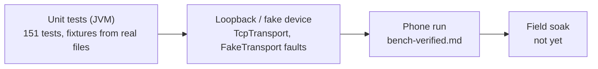

# Status — what is verified, where, and what is next

**Scope:** the current state of the app; the split between "unit-tested", "run on a phone" and "unverified".
**Code:** `./gradlew verify` (the gate), `.github/workflows/verify.yml`.
**Related:** measured device behaviour is recorded only in `../m5stack-aq-parquet/docs/bench-verified.md` ("Phone over LAN and BLE"); anything not there is unverified.

## One-line status

Implements **protocol v2** (+ the 2.1 advertising payload) + **Auto-sync** with event-driven
triggers (companion presence, advertising flags, Wi-Fi arrival) + **on-phone history** (index, tiers,
derived daily Parquet, charts) + **GeoParquet 2.0** read/write. BLE and LAN file sync have run against
the board from one phone (OnePlus 7 Pro, Android 16 / API 36, 2026-09-17, app commit `a993268`,
partial runs). Auto-sync has **not** completed a period cycle on a phone yet. Of the triggers, the
**advertising-flag wake is measured once** (2026-09-18, app `678c1c0` / firmware `-v6.3`: dead app
process started by the controller 19 s after the board closed a file, new file on the phone at 28 s);
companion presence and the Wi-Fi-arrival run are not.

## Verification ladder

`./gradlew --no-daemon clean verify` on 2026-09-18: **0 lint errors** (7 pre-existing warnings),
**151/151 unit tests** — 55 `:app` (auto-sync runner incl. the LAN-only Wi-Fi trigger, deriver, indexer, repository, ZSTD codec, Files local-day grouping,
LAN token policy, `TcpTransport` loopback, planner, resume policy, lost-window recovery), 52
`:core:protocol` (frame codec v1+v2, CONFIG + `SET_CONFIG` builder, LAN framing with a `LIVE` push
between two `CHUNK`s, JSON, Parquet verify, 2.1 advertising payload), 23 `:core:parquet` (reader vs PyArrow, writer,
GeoParquet), 21 `:core:history` (aggregation, moods, columns, file summary, indexer, time
estimate, `RealArchiveTest`). Debug APK 68.4 MiB unminified.

## What is verified where

| Area | Unit / fake | Phone (bench-verified) | Not yet |
| --- | --- | --- | --- |
| v1 file sync (LIST/OPEN/READ/CLOSE, SET_TIME, FLUSH) | captured v1 payloads from `AQ-6b40` | macOS host client 2026-09-16 (766 files, 15–21 KB/s); phone partial runs 2026-09-17 | instrumented **full** 776-file sync over each link with the foreground-service build |
| v2 config / Wi-Fi / reboot / log / token | hand-assembled fixtures from the contract | a v2 device was read from the phone; no capture taken | `ble.clear_bonds`, `lan.rotate_token` end to end, `fixed`/`none` pairing (needs display-less board) |
| LAN transport | loopback `TcpTransportTest` | `LanDiscovery` found the board via `NsdManager`; app chose TCP on its own | `ACCESS_LOCAL_NETWORK` prompt (enforced only from API 37) |
| Lost window / drain / resume | `WindowRecoveryTest`, `SyncResumePolicyTest` | 514-byte-frame drop reproduced 2026-09-17 and survived | — |
| Auto-sync worker | `AutoSyncRunnerTest` over the fake (incl. `lanOnly`) | — | a complete 15-min period cycle, `setForeground` refusal in background, OEM battery settings |
| Auto-sync triggers | `AdvertisementTest` (2.1 bytes) | **advertising wake** 2026-09-18: `flag scan registered … 2 filters`, `Start proc … for broadcast {…AdvertScanReceiver}` +19 s after `PARQUET READY`, `trigger=ADVERTISEMENT`, LAN sync 1 file / 22,498 B, done +28 s, app process killed beforehand | association dialog finding the advertising logger, `EVENT_BLE_APPEARED`, companion exemptions vs the screen-off socket kill and the `setForeground` refusal (still refused, no association yet), Wi-Fi-arrival run end to end (fired at both process starts, second throttled) |
| History pipeline | fixtures + `RealArchiveTest` (766 real files, 0.2 s) | derive fix observed 2026-09-18 02:35 ("derived 1 of 3 station-days") | chart update after a sync of a v3 file recorded in bench-verified |
| Derived daily Parquet | PyArrow 25 + DuckDB 1.5.5 oracle | — | — |
| GeoParquet 2.0 | 20 fixtures (PyArrow + DuckDB) cell-for-cell; writer accepted by both | n/a (no device files) | import UI / map (D4/D5, undecided) |

## Recent changes (newest first)

- **2026-09-19** — **Post-sync `LIST` no longer dies with the link.** Seen on the phone after a completed sync: "LIST failed: link lost while waiting for a response" replaced the whole file list. Cause: the refresh was launched after `running = false`, i.e. after the foreground service let go of the uid, so the socket was killed under it (transport of that run not recorded — LAN + backgrounded phone fits; confirm with `adb logcat -s SyncEngine SyncFgs ConnectivityService` on the next run). The re-list now runs inside the protected run; `ManifestState` keeps the last listing through `Loading`/`Error` (`ManifestStateTest`), so the Files screen shows "Refresh failed: … — showing the last listing." instead of a blank list, and `plan` stays usable. Not yet on the phone.
- **2026-09-18** (14:03 local) — app `678c1c0` (APK `3c454c74…`) installed on the OnePlus over Wi-Fi adb against firmware `-v6.3`; **first device-flagged wake measured** — see the ladder above and the firmware repo's [bench record](../../m5stack-aq-parquet/docs/bench-verified.md#board-1-advertising-payload-wakes-the-phone-firmware-v63-protocol-21). `setForeground` still refused (no companion association yet); Wi-Fi callback fires at every process start and is throttled as designed.
- **2026-09-18** (evening) — **Event-driven Auto-sync** ([background-sync.md](background-sync.md#triggers--starting-a-run-before-the-period-is-up)): Companion Device Manager "wake when nearby" (association dialog on the Device screen, `CompanionPresenceService`, `REQUEST_COMPANION_*` exemptions, Room v8 `companionAssociationId`), offloaded advertising-flag scan on the firmware's new protocol-2.1 service data (`Advertisement`, `AdvertFlagScan`), Wi-Fi-arrival LAN-only run (`SyncTriggers`), `SyncTrigger` on every one-time run. 151 tests, lint clean. **Not yet on the phone**; design and measurement list in `../m5stack-aq-parquet/docs/background-sync-triggers.md`.

- **2026-09-18** (later) — Files list grouped by **local calendar day** (`FileGrouping`, zone-pinned tests): the headers were the SD card's UTC `day=` folder, so at UTC+3 every file after 21:00 local sat under tomorrow. Header subtitle names the UTC folder(s); each row shows its local start time. Installed on the OnePlus (commit `c6c27cd`), not yet recorded in bench-verified.
- **2026-09-18** — bugs found on the phone, fixed: `derived_day` upsert that never updated (every pass rebuilt every day), Today card on the UTC day, History span frozen at open time, Day re-read on every Room write. Day view → **24 hourly columns**; Files gained **Chart by file**.
- **2026-09-17** — GeoParquet 2.0 (D11); modules split into `:core:protocol` / `:core:parquet` / `:core:history`; metric registry, tiers one row per metric (Room v7); History steps 1–5 + §4.6 time estimate; Now card, detail levels, Home cards, Collect from all loggers; first phone run fixes (foreground service, auto-reconnect, token renewal, WifiLock, resume policy, REBOOT audit); Auto-sync; protocol v2.
- **2026-09-16** — v1 protocol bench-verified from a macOS host; decisions mirrored into `ble-sync-protocol.md`.

## Next

1. **Instrumented phone runs** → `bench-verified.md` (date, firmware SHA-256, app commit, phone): full sync over BLE and LAN with the foreground-service build; BLE/Wi-Fi coexistence soak; energy; `lan.rotate_token`, `ble.clear_bonds`, `fixed`/`none` pairing.
2. **Auto-sync overnight on the OnePlus**: count 15-min periods that ran (`adb logcat -s AutoSyncScheduler SyncWorker CompanionPresence AdvertFlagScan SyncTriggers`), whether `setForeground` was refused, whether BLE-by-address connects with the screen off; record OEM battery settings needed. **Triggers first:** the owner taps *Set up wake when nearby* — does the association dialog find the advertising logger; does `EVENT_BLE_APPEARED` arrive after walking back in; does a screen-off LAN sync survive with the device present (no "Destroyed live tcp sockets") and does `setForeground` stop being refused. The flag scan firing within a minute of `PARQUET READY` is measured (19 s, one event); repeat for a distribution and after a Bluetooth toggle.
3. **API 37 local-network permission** on a real Android 17 device (grant / deny / revoke while connected) and `NsdManager` across API 31–37.
4. **Further transports** (LoRa relays) behind `AqTransport`; engine, archive, verification unchanged.
5. **Opt-in cloud step after local sync** — off by default, own setting and review; `INTERNET` for LAN does not pre-approve it. Privacy boundaries: `../m5stack-aq-parquet/product/mobile-architecture.md`.
6. **Open decisions** D1–D10 (location/map, import UI, iOS parity) in [history-ux-and-data-layer.md](history-ux-and-data-layer.md) §6.

## Test phone

OnePlus 7 Pro, Android 16, Wi-Fi ADB `adb connect 192.168.100.173:38457` (port changes after
reboot). `run-as` is refused on this ROM: inspect via logcat tags `HistoryIndexer HistoryDeriver
SyncEngine DeviceConnection TcpTransport BleTransport AutoSync SyncWorker SyncFgs`, not files.
