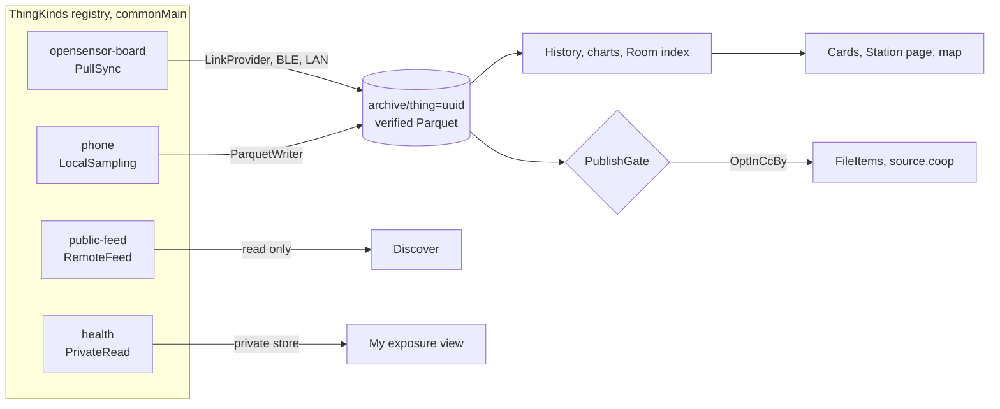

# Thing plugins, one app for many kinds of Things

Research report, 2026-10-27. Status is proposal. Nothing here is implemented yet.

Goal. Any kind of Thing (an opensensor board over BLE or LAN, the phone itself, a device that uploads on its own, a public feed station, later LoRa or a third party cloud) plugs into the app through one contract. Shared Kotlin does the work once for Android and iOS. Screens, the map and the setup wizard are driven by templates and data, with code only where data cannot express it.

Tracking epic [#219](https://github.com/walkthru-earth/opensensor-space-mobile/issues/219).

This builds on [2026-10-25-sensor-agnostic-stac-contract.md](../2026-10-25-sensor-agnostic-stac-contract.md), which made the data layer generic. This proposal does the same for sources, identity, setup and screens.

Inputs.
- Six read-only investigations on 2026-10-27, one each for the shared core, Android adapters, iOS adapters, map and screens, setup wizard and open source prior art. Each finding cites `file:line` or a primary source. The lead checked the main claims against the code before writing this.
- The data contract issue [walkthru-earth/stac-opensensor#2](https://github.com/walkthru-earth/stac-opensensor/issues/2) (phone as a Thing, GPS mobility, health), which is the contract for the phone use cases and comes first.
- The firmware plugin proposal [walkthru-earth/opensensor-space-firmware#117](https://github.com/walkthru-earth/opensensor-space-firmware/pull/117) (module and board manifests).

| File | Concern |
| --- | --- |
| [core.md](core.md) | `ThingKind` contract, registry, data versus code, identity, tests, modules |
| [android.md](android.md) | Hilt multibindings, recording session service, service types, manifest and Play forms |
| [ios.md](ios.md) | Swift versus Kotlin iosMain per plugin, registration, threading, plist and privacy manifest |
| [screens-and-map.md](screens-and-map.md) | Generic cards and Station page, hero slot, one map for own and public Things |
| [setup-wizard.md](setup-wizard.md) | Step graph per kind, config fields from data, confirmations and secrets |
| [prior-art.md](prior-art.md) | Open source projects studied and what to copy or avoid |
| [ai-pilot.md](ai-pilot.md) | On-device model page that uses app abilities as tools, from Google AI Edge Gallery |

## 1. Verdict

1. The data layer is ready. Vocabulary is open, templates resolve served before bundled, a board without a profile gets a derived one, `ParquetWriter` and `FileItems` are common code. What is tied to boards is transport, identity and screens.
2. The boundary every plugin meets is the archive file. Every kind that records data writes verified Parquet files under `archive/thing=<uuid>/` with an `opensensor` footer and a resolvable template. Archive, history, charts, `FileItems` and the existing Room tables then stay as they are. Room gains one table, `thing_source`, in step 4, and existing consumers keep working.
3. Remote Things (boards) keep today's link path unchanged. Local Things (the phone) get a separate sampling path. Forcing phone sensors through `LinkProvider` or `IosLinkPort` would be wrong, since there is no wire protocol and no remote archive.
4. Registration is a plain list built at each app entry point. Kotlin/Native has no `ServiceLoader` and top level properties initialise lazily, so self registration would silently give an empty registry on iOS.
5. Health data is read on the phone and never becomes a published Thing file. The type system enforces it with a `PublishGate`.
6. Setup is a step graph per kind with fields from a small closed set of types, in the Home Assistant config flow style. Sharing is never a wizard step.
7. Screens read `profile.primary` and `profile.hero`. Air keeps its peacock hero as one presenter. Every other family gets a generic hero.

## 2. Shape

## 3. Migration order

Smallest first. Each step passes `./gradlew --no-daemon verify` with no behaviour change unless stated.

| # | Step | Tracking |
| --- | --- | --- |
| 1 | Capability set from `DeviceCapabilities`, air metrics moved out of `Metrics.kt` into a provider, no `requireNotNull` crash, `PMS_STATUS` out of `:core:protocol` | [#220](https://github.com/walkthru-earth/opensensor-space-mobile/issues/220) |
| 2 | Generic Stations cards and a `profile.hero` slot, a `LatestDay` of the main metric on My devices | [#221](https://github.com/walkthru-earth/opensensor-space-mobile/issues/221) |
| 3 | `:core:thing` with one kind, `opensensor-board`, wrapping today's path, plus a registry count test on the iOS simulator | [#222](https://github.com/walkthru-earth/opensensor-space-mobile/issues/222) |
| 4 | Room `thing_source` table keyed by Thing UUID, identity off the Bluetooth address | [#223](https://github.com/walkthru-earth/opensensor-space-mobile/issues/223) |
| 5 | `PublishGate` as the first caller of `FileItems` | [#224](https://github.com/walkthru-earth/opensensor-space-mobile/issues/224) |
| 6 | Setup wizard as a `SetupStep` list and a `ConfigField` table mirroring today's builder keys | [#225](https://github.com/walkthru-earth/opensensor-space-mobile/issues/225) |
| 7 | Own fixed Things on Discover as a clustered point source | [#226](https://github.com/walkthru-earth/opensensor-space-mobile/issues/226) |
| 8 | Manifest gates, iOS plist, privacy manifest and entitlements checked per enabled plugin | [#227](https://github.com/walkthru-earth/opensensor-space-mobile/issues/227) |
| 9 | Phone `LocalSampling` kind, barometer first, foreground session, local only. Blocked on stac-opensensor#2 | [#228](https://github.com/walkthru-earth/opensensor-space-mobile/issues/228) |
| 10 | Health as `PrivateRead`, local only. Blocked on owner review | [#229](https://github.com/walkthru-earth/opensensor-space-mobile/issues/229) |
| 11 | LoRa, third party clouds, Wi-Fi uploaders read back as `RemoteFeed` | later |

## 4. Rules this keeps

- `:core:*` stays free of Android, Hilt and Room (Room only in `:core:database`). Adapters stay in `app/` and `ios/`.
- Composables never touch sources or transport. They reach a session through a facade.
- Location becomes an H3 cell inside the adapter, in one shared function. The original fix is never persisted, logged or sent.
- Upload is off by default and enabled per Thing from its settings with confirmation, never in onboarding or setup.
- Secrets (PIN, Wi-Fi PSK, LAN token) never appear in logs, drafts, frames or LAN patches. App floor rules win over any schema.
- Permissions are asked on the tap that needs them, never as a wall.
- A host or simulator result does not establish phone or radio behaviour. Each plugin needs a dated phone run in `docs/status.md`.

## 5. Owner questions

From [stac-opensensor#2](https://github.com/walkthru-earth/stac-opensensor/issues/2).
1. Accept an app build as a template owner (section A)?
2. Res 7 plus trip end trimming for published moving Things (section B)?
3. Where calibration offsets live (section C)?
4. Define the derived mobility product now or later (section D)?

New here.
5. Precise location for the phone's private track. It changes the coarse only rule in AGENTS.md and Play's Data safety answer.
6. Recording only in explicit sessions (recommended, both platforms force it) versus any background track.
7. Firmware owns the `config` block in the #117 manifests, so the wizard reads limits and confirmation gates from the template. Agree to propose it on #117?
8. Health. Ship the local "my exposure" view at all, given Health Connect and HealthKit review cost?

## 6. Drift found on the way

- `BleConfig` still reads `pin` and keeps `DEFAULT_PIN = "123456"` (`core/protocol/.../DeviceConfig.kt:276`, shown at `feature/device/.../DeviceConfigCards.kt:257`). Firmware no longer echoes the PIN and reports `pin_set` (`ble-sync-protocol.md:322,350,392`).
- `ConfigPatch.Builder.thingMobility()` (`DeviceConfig.kt:204`) has only a test caller.
- `profile.hero` is parsed (`ModelJson.kt:91`) but no screen reads it.
