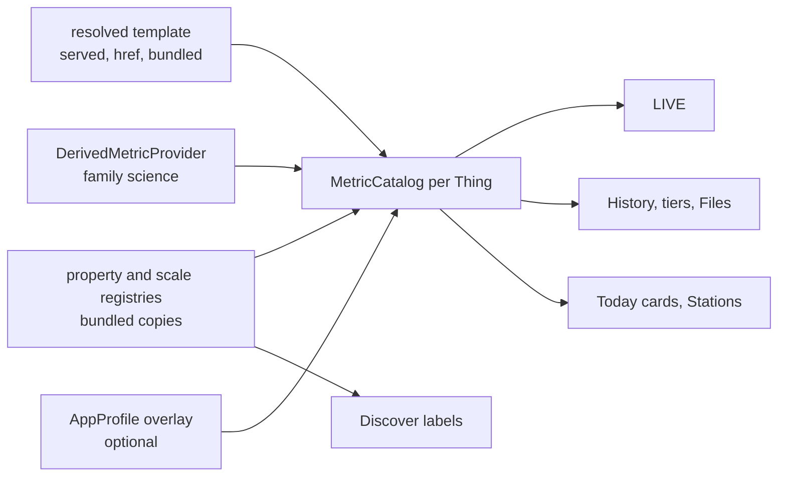

# Metrics from metadata

Part of [Metadata-driven app](README.md). 2026-11-17. Proposal. Field names and fallbacks follow stac-opensensor [#16](https://github.com/walkthru-earth/stac-opensensor/pull/16).

## 1. Target

Every metric a screen shows comes from the Thing's resolved template, the property registry and, for science, a family. Nothing in `:core` names a board, a column or a pollutant.

## 2. Rules

### 2.1 Catalog per Thing

- `MetricCatalog.of(thing)` builds the metrics of one Thing from its resolved template (`TemplateIndex.resolve`, the rule LIVE and History share).
- A union catalog for cross-Thing screens (Stations, Files) is a `StateFlow` that grows when `ServedTemplates` or `TemplateHrefs` adopt a template. It never shrinks while a file of that template is indexed.
- Tier keys stay the column id. `MetricSpec.inTemplate` keeps refusing a column stored in another unit or rolled up another way.
- No caller gets a default catalog. `Metrics.all` and `Metrics.default` go away.

### 2.2 Labels, units, decimals

| Field | First source | Then | Last |
| --- | --- | --- | --- |
| Label (by language) | Column `opensensor:title_i18n` for the language, then column `title` | Registry `label` by `opensensor:property` | Column name with `_` as spaces (`soil_moisture_percent` gives "soil moisture percent") |
| Short label | Registry short label | Column `title` | Label |
| Description | Column `opensensor:description_i18n`, then `description` | Registry `definition` | none |
| Decimals | Column `opensensor:decimals` | Registry `decimals` | 0 for an integer column, else 2. Replaces `AppProfile.displayStepOf` |
| Group | `opensensor:group` | Registry `group` | Role |
| Display unit | `UcumDisplay.of(unit)` in `:core:units` | Firmware `unit_labels` | Raw UCUM |

- `UcumDisplay` maps the UCUM codes the templates use, `ug/m3` to µg/m³, `Cel` to °C, `[ppm]` to ppm, `%` to %, `{count}` and other annotations to an empty unit. An unknown code passes through.
- `UnitConversion` gains `Cel` beside `°C`, `℃` and `degC`, so imperial works on a template unit.
- A label from the app's own strings (`:ui:strings`) is an overlay, used only when it exists in the user's language. The PM2.5 raw and corrected labels stay app strings.

### 2.3 Scales and main metric

Scale for a column, first hit wins.

1. Column `opensensor:scale`, an id in the template's (or Collection's) `opensensor:scales`.
2. Registry `scale` for its `opensensor:property` URI, from the bundled `registry/scales.json`. A registry `null` means none on purpose.
3. None, neutral colour.

- A scale is data. Steps, English and Arabic labels and `color_hint` come from the scale entry, so `WhoGuidelines` stops defining PM2.5 and PM10 steps in code. The family keeps the WHO wording and the guideline line on charts.
- `HealthScale.propertyId` becomes the scale id from the registry. No PM name enters `:core`, so `CoreStaysAirFreeTest` still passes.
- Rule 1 holds for any column, with or without a registry match. Only the registry fallback needs the column's `opensensor:property` in the registry. Nothing is guessed from a name or `cf:standard_name`.
- PM1, PM4, CF=1 and CO2 have no scale in the registry. They stay neutral.
- Every scale has a required `period`, an ISO 8601 duration. The WHO PM2.5 and PM10 scales are `P1D`, 24-hour, as in `WhoGuidelines.kt`. The app reads `period` and the chart caption names it. `P1D` gives "compared with the WHO 24-hour guideline". A scale whose period the app cannot caption still colours values and shows its period in plain words.

Main metric, first hit wins. Collection `opensensor:primary`, template top-level `opensensor:primary` (written from `board.json` `primary`), the first `physicalMeasurement` column with a scale, the first `physicalMeasurement` column.

### 2.4 LIVE

- `Capability.LIVE` is set for any Thing whose template resolved by a verified SHA-256, served, footer href or bundled.
- Family capabilities apply to any resolved Thing, derived profile or not.
- `plausible_range` and `valid_when` still filter LIVE values as they filter History.

### 2.5 Status column

A status column is a `qualityInformation` column with `classification:classes` that a measurement's `valid_when` references by `equals`.

| Meaning | Rule |
| --- | --- |
| Valid | The class whose value equals the gate's `equals` |
| Absent | The class with `nodata: true` |
| Other | Any other class, shown by its title, else its `name` with `_` as spaces |
| No classes | The gate target lists no `classification:classes`. `cls` is null, `valid` is the gate's `equals` test, and LIVE shows the raw value at Developer only |

- A generic `SensorState(column, value, cls, valid)` replaces `PmsStatus` for gating. LIVE hides gated values while the state is not valid. This already holds for History through `valid_when`.
- Family hints stay in the family, keyed by class `name` (`warming`, `stale`, `sensor-error`, `sleeping`, `model-mismatch`), with a generic line for any other name.
- A bitmask column (`sen6x_device_status`) names its set bits from `classification:bitfields`. Without bitfields it shows raw, at Developer only.

### 2.6 Air family by property and procedure

- `AirFamily` finds its columns by `opensensor:property` URI, never by name. PM2.5 atmospheric and SEN63C PM2.5 share `P07/YUDG9DXK`. CF=1 PM2.5 has its own URN.
- The US EPA correction needs the CF=1 property, RH and a Plantower procedure (`pmsa003`, `pms5003t`). A SEN63C gets no EPA correction.
- Particle bins come from their `particle_count_gt_*` URNs.
- `AirMetrics` resolves named metrics per Thing (`AirMetrics.pm25(thing)`), not from a global catalog.
- NowCast, Today so far, the peacock hero and the PM2.5 view swap read those per-Thing lookups.

### 2.7 Discover

- The base label of a feed property is the registry label for its URI, else the feed label.
- `DiscoverLabels.propertyLabels` stays as an i18n overlay for ids the app translates. An unknown id still renders.

### 2.8 Bundled profiles

`AppProfile` becomes an optional overlay (hero id, hidden columns) on top of the template. Once the bundled templates carry the hints, the two bundled profiles shrink to `hero` and `hidden`. Labels, units, primary and scales leave them.

## 3. Work packages

Ordered. Each passes `./gradlew --no-daemon verify`. Tests are `commonTest` unless noted, so they run on the JVM and the iOS simulator.

| # | Package | Modules | Tests to add |
| --- | --- | --- | --- |
| M0 | CrowPanel bundled by [#321](https://github.com/walkthru-earth/opensensor-space-mobile/pull/321), re-copied when the firmware regenerates templates with display hints. Add a fake unknown board template (`acme-soil-probe`, soil moisture, a status column with classes, an unknown property URN, a `firmware` block with `live_keys`) as a test fixture only | `core/model` bundled, `.github/workflows/verify.yml` ref, `core/model` commonTest fixtures | `BundledTemplateBytesTest` pins, `FirmwareTemplatesTest`, fixture parse test |
| M1 | `UcumDisplay` and the `Cel` imperial rule | `core/units` | `UcumDisplayTest` for each unit in the three bundled templates, imperial `Cel` |
| M2 | Parse the new template fields. `Datastream` gains `title`, `titleI18n`, `description`, `descriptionI18n`, `decimals`, `group`, `scale` and bitfields. `BoardTemplate` gains `primary` and `scales` | `core/model` (`ModelJson`, `Datastream`, `BoardTemplate`) | Parse of each field, unknown fields ignored, i18n titles, CrowPanel bitfields |
| M3 | `PropertyRegistry` and `ScaleRegistry`, `registry/properties.json` and `registry/scales.json` bundled byte for byte from stac-opensensor with pinned SHA-256 | `core/model` | Pin test, lookup by URI, unknown URI returns null, a `null` scale stays none |
| M4 | `AppProfile.derive` from M1 to M3. Labels, decimals, primary, display unit. `select` merges an overlay | `core/model` | Derived profile of CrowPanel shows PM2.5 in µg/m³ with its registry label and opens on `opensensor:primary`. Fake board shows names with spaces |
| M5 | Scales from data, lookup order of 2.3. `HealthScale` built from a scale entry | `core/model`, `core/history` (`Metrics.of`), `family/air` (`AirFamily.scales`, `WhoGuidelines`), `ui/designsystem` (`metricLabelRes`) | CrowPanel PM2.5 gets the WHO scale from the registry, CO2, PM4 and CF=1 stay neutral, a column `opensensor:scale` wins. `CoreStaysAirFreeTest` unchanged |
| M6 | `MetricCatalog` per Thing and the union flow. Remove `Metrics.all` and `Metrics.default` defaults | `core/history` (Aggregation, FileSummary, LatestReading, LatestDay, `Metrics`), `feature/history` (`HistoryController`), `app` (`RoomHistoryTiers`, `FilesViewModel`, `ScanViewModel`), `ios/shared` | Catalog of a served template appears in the union. A tier of the fake board aggregates. History opens on `opensensor:primary` |
| M7 | LIVE for verified templates. Drop the gates at `DeviceCapabilities.kt:72` and `:82` | `core/history` | Fake board and CrowPanel get `Capability.LIVE` from a served template. An unresolved desc gets none |
| M8 | `SensorState` from `valid_when` and `classification:classes`. `PmsStatus` removed. Hints keyed by class name | `core/model` or `core/history` (generic), `family/air` (`AirMood`, `LiveQc`, `AirSurfaces`, `PlantowerBatchCandidate`), `feature/today` (`TodayCards`, `TodayText`), `app` (`MoodText`) | `sen6x_status` 4 is valid, 1 is warming. Waveshare `pms_status` 5 still reads model mismatch, CoreS3 declares only 0 to 4. Fake board status renders its class title |
| M9 | Air family by property and procedure. `AirMetrics` per Thing | `family/air`, `feature/today` (`AirNowFlows`, `TodaySoFarFlow`, `TodayCards`), `feature/history` (`HistoryScreen`), `app` (`FilesViewModel`) | CrowPanel gets NowCast and the hero, no EPA correction. CoreS3 and Waveshare keep EPA. Fake board gets no air capability |
| M10 | Discover and metric labels from the registry, app strings as overlay | `feature/discover` (`DiscoverLabels`), `ui/designsystem` (`MetricLabels`) | Unknown feed id with a registry URI shows the registry label |

### Acceptance fixtures

- CrowPanel SEN63C (bundled by #321). Today shows PM2.5 with the WHO scale, PM1, PM4, PM10, temperature, RH and CO2 in display units. LIVE works. `sen6x_status` gates PM. History opens on its primary.
- Fake unknown board (test fixture, never bundled). Served through `ServedTemplates` in the test. Every screen model builds with no app change, labels come from titles or the column name with spaces, LIVE works, status renders, no air term appears.

## 4. Docs to update with the code

Each package updates the doc that states the old rule, in the same PR. `core/AGENTS.md` (LIVE needs a reviewed profile), `docs/protocol-quickref.md` (no LIVE for a derived profile), `docs/status.md`, `docs/device-location.md`, `docs/history-pipeline.md` and `docs/devices-and-discovery.md`.
