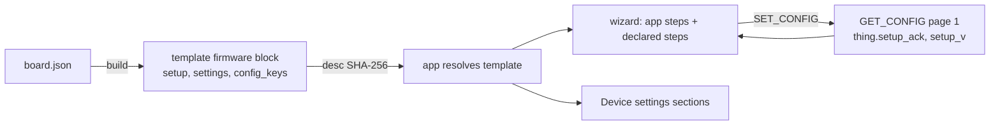

# Setup and settings from a board manifest

Part of [Metadata-driven app](README.md). 2026-11-17. Proposal. Field names below are the app's reading of the contract. The firmware `docs/shared` PR owns the final spelling.

## 1. Target

The board says which setup steps it needs and which settings sections it has. The app owns the components, the order of the app-owned steps and every safety rule. The device remembers which steps are done, so any phone sees the same state.



## 2. Step catalog

The app keeps a fixed catalog. The manifest picks from it by id and orders the declared part.

| Id | Component | Owner | Required rule | Settings section |
| --- | --- | --- | --- | --- |
| `permission` | `PermissionTriggers` binding | App | Always, never a page | none |
| `find` | Find | App | Always first page | none |
| `pair` | Pair | App | Always, not a page | none |
| `name` | Nickname form, phone only | Board declares | Never | none |
| `location` | `DeviceLocationForm` | Board declares | Fixed Thing without a cell, app floor | `location` |
| `mobility` | Fixed or moving choice | Board declares | When the board offers both | `location` |
| `site` | `DeviceSiteForm` | Board declares | Never | `site` |
| `wifi` | Wi-Fi join form | Board declares | Never | `wifi` |
| `pairing` | Pairing form | Board declares | Never | `pairing`, Detailed |
| `lan` | LAN card | Board declares | Never | `lan`, Developer |
| `bonds` | Bonds card | Board declares | Never | `bonds`, Detailed |
| `fields:<id>` | Generic `ConfigField` form | Board declares | From the manifest | `fields:<id>` |
| `done` | Done | App | Always last page | none |

Level gates on settings sections stay app rules. A manifest cannot show LAN below Developer.

## 3. Manifest shape

In the template `firmware` block, generated from `board.json`, hashed with the template. Changing the order changes `desc`.

```json
"firmware": {
  "setup": {
    "version": 2,
    "steps": [
      { "id": "name" },
      { "id": "location", "required": true },
      { "id": "site" },
      { "id": "wifi" },
      { "id": "fields:display", "keys": ["panel.theme", "panel.refresh_s"] }
    ]
  },
  "settings": ["location", "site", "wifi", "fields:display", "fields:sensor", "pairing", "lan", "bonds"],
  "config_keys": {
    "panel.theme": {
      "type": "choice", "values": ["light", "dark"], "applies": "immediately", "page": 7,
      "label": { "en": "Theme", "ar": "السمة" }
    },
    "panel.refresh_s": { "type": "int", "min": 60, "max": 3600, "applies": "next_sample", "page": 7, "label": { "en": "Screen refresh" } }
  }
}
```

- Types map one to one to `FieldType`. `text` (`min_bytes`, `max_bytes`), `digits`, `int` (`min`, `max`), `choice`, `toggle`, `action`. A decimal key (temperature offset, altitude) needs either a new `FieldType.Decimal(min, max, step)` or an int in scaled units. The firmware PR picks one.
- `page` is the `GET_CONFIG` page that reads the key back. Board keys live on one new page. Pages 1 to 6 keep their keys.
- The template carries names, types and limits. Never a value, never a default secret.
- Candidates for the first board keys, today knob-only in NVS `ospanel` on the CrowPanel. Theme, refresh, start page, fan cleaning, CO2 ASC, altitude, temperature offset, sleep.

## 4. Completion on the device

- Page 1 gains `thing.setup_ack`, a bitmask with bit `i` for `steps[i]`, and `setup_v`, the manifest version it was written under.
- `setup_v` different from the template's `setup.version` means no step is done.
- The app sets a step's bit with its own `SET_CONFIG` after the step's save reads back. Skip also sets the bit of a skippable step.
- Required steps stay derived from config, never from the bitmask alone. Location is done only while a fixed Thing has a valid `location.cell`.
- Setup is needed when a required step is not satisfied, or when a declared step's bit is clear. Advert bit 6 and page 1 `thing.setup` report the board's own answer, and the app trusts them.
- A required step whose id the app does not know leaves setup pending. The wizard says to update the app and offers Leave.

## 5. Safety floors

The manifest can add protection, never remove it.

| Floor | Rule |
| --- | --- |
| Location | A fixed Thing needs a saved cell before Done, whatever the manifest says |
| Secrets | `ble.pin`, `wifi.psk` and the LAN token are never declared by a manifest, never logged, never in a frame dump. A manifest key marked secret is dropped |
| `SECRET_KEYS` | Never smaller than the app's own set |
| Reserved prefixes | `ble.`, `wifi.`, `lan.`, `location.`, `thing.`, `owner.`, `sensor.` keys come only from the app allowlist. A manifest cannot add one |
| Confirmations | Reboot, token rotation, forget bonds and pairing mode `none` always confirm. A board `action` key always confirms |
| Debug | Raw commands cannot send `REBOOT` or `SET_CONFIG` |
| Silent actions | Clock, token fetch and `lan.on` stay automatic and hidden below Developer |
| Location precision | Res 8 only, coarse fix, the original fix never stored or sent |
| Sharing | Never a setup step. Upload stays per Thing, from its settings, with confirmation |

## 6. `ConfigFields.merge` change

Today `merge` keeps a known key at the app's floor and drops every unknown key ([ConfigField.kt:169](../../../../core/protocol/src/commonMain/kotlin/space/opensensor/data/protocol/ConfigField.kt#L169)). It has no production caller yet, only `ConfigFieldTest`.

New rule.

1. A known key keeps the app's type, timing and protections, and gains any stricter flag the manifest asks for. Unchanged.
2. An unknown key outside the reserved prefixes is accepted when its type parses. It is never secret. An `action` gets `Confirm.Always` and `disrupts`.
3. An unknown key under a reserved prefix, or with a type that does not parse, is dropped.
4. `ConfigPatch.Builder` gains `field(field, value)` that checks the value against its `FieldType`, and refuses a secret or reserved key. The typed methods for app keys stay.

## 7. What goes away

| Today | After |
| --- | --- |
| `SetupFlows.BOARD` fixed list ([SetupStep.kt:95](../../../../feature/setup/src/commonMain/kotlin/space/opensensor/setup/SetupStep.kt#L95)) | App steps around the manifest steps |
| `Fields` always draws `WifiForm` ([SetupScreen.kt:179](../../../../feature/setup/src/commonMain/kotlin/space/opensensor/setup/SetupScreen.kt#L179)) | `wifi` draws `WifiForm`, `fields:<id>` draws `GenericFieldsForm` |
| Phone `SETUP_PENDING` ([SettingsKeys.kt:47](../../../../core/settings/src/commonMain/kotlin/space/opensensor/settings/SettingsKeys.kt#L47)), `SetupPort.setPending` on both phones | Device `thing.setup_ack`. The key, `setSetupPending` and both adapters are removed |
| Site probe, page 5 `ERROR` 1 hides Site (`SetupController.siteSupported`) | Site shows when the manifest lists it |
| `ThingSetupPolicy` derived fallback for firmware without `thing.setup` ([ThingSetupPolicy.kt:35](../../../../core/sync/src/commonMain/kotlin/space/opensensor/data/sync/ThingSetupPolicy.kt#L35)) | Bit 6 and page 1 only, plus the ack rule of section 4 |
| Fixed settings order ([DeviceConfigSection.kt:207](../../../../feature/device/src/commonMain/kotlin/space/opensensor/device/DeviceConfigSection.kt#L207)) | Manifest `settings` order, app level gates kept |
| Sensor card gated by `sensor_serial_code` | `fields:sensor` declared by boards that have a sticker |

Between pairing and the first page 1 read nothing is claimed, as today.

## 8. Work packages

All UI is shared Compose in `commonMain`, one implementation for both phones. Platform code only adapts `SetupPort`.

| # | Package | Modules | Tests to add |
| --- | --- | --- | --- |
| S1 | Parse `setup`, `settings` and `config_keys` from the template `firmware` block into `SetupManifest` | `core/model` | Parse of the CrowPanel and fake board manifests, unknown step ids kept as data |
| S2 | `ConfigFields.merge` rule of section 6, `ConfigPatch.Builder.field`. Decimal type if the contract adds it | `core/protocol` | Reserved prefix refused, secret refused, action gets confirm, out of range refused |
| S3 | Page 1 `thing.setup_ack` and `setup_v`, the new board settings page | `core/protocol` (`DeviceConfig`), `core/sync` (`DeviceSession`) | Parse, stale `setup_v` reads as nothing done |
| S4 | `SetupPlan.of(manifest, config)` in shared code. Steps, required set, done set, pending | `core/sync` beside `ThingSetupPolicy` | Unknown required step leaves pending. Unknown optional step with typed keys becomes `fields:<id>`. Without typed keys it is skipped. Location floor holds when the manifest omits it |
| S5 | Wizard walks `SetupPlan`, sets ack bits, `GenericFieldsForm` | `feature/setup` | Controller tests for each step kind, Skip sets the bit, Done waits for required steps |
| S6 | Remove `SETUP_PENDING`, `setPending`, the Site probe and the derived fallback | `core/settings`, `feature/setup`, `app` (`SetupViewModel`), `ios/shared` (`SetupIos`), `core/sync` | Existing setup watch tests rewritten on device state |
| S7 | Device settings from manifest `settings`, generic sections reuse `GenericFieldsForm` | `feature/device` | Order follows the manifest, LAN stays Developer, bonds and pairing stay Detailed |
| S8 | Update `docs/screens.md`, `docs/sync-engine.md`, `docs/device-location.md`, `docs/store-compliance.md` if a permission moves | docs | none |

Each package passes `./gradlew --no-daemon verify`. The wizard on a CrowPanel and on a CoreS3 needs a dated run on both phones in `docs/status.md`.
