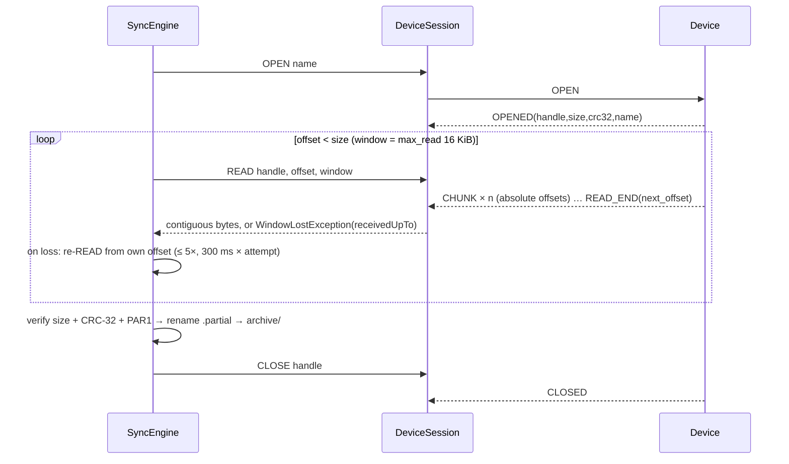
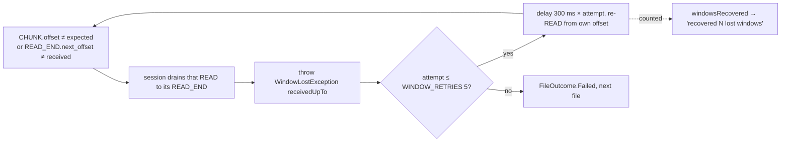
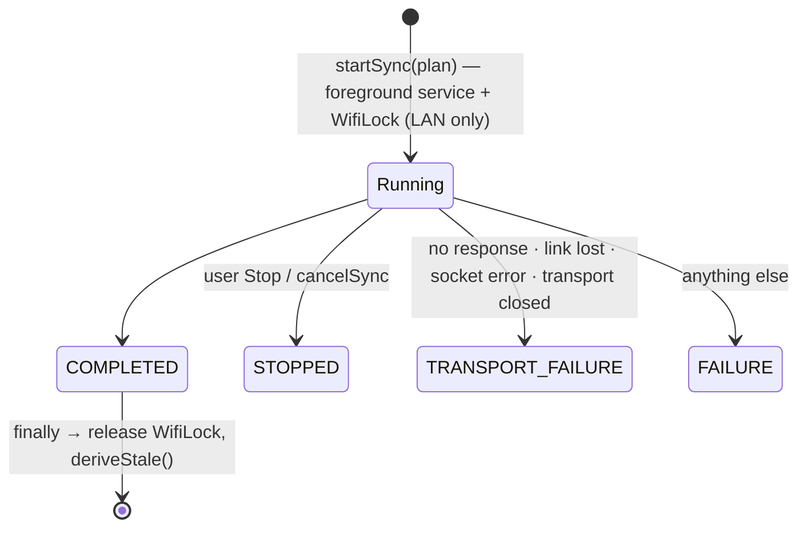

# Sync engine — pull, verify, archive

**Scope:** the file transfer: planner → engine → archive; integrity; lost windows; stale-frame drain; resume; the state-changing requests.
**Code:** `data/sync/SyncPlanner.kt`, `SyncEngine.kt`, `FileArchive.kt`, `ReadWindow.kt`, `SyncResumePolicy.kt`; `data/ble/DeviceSession.kt` (`read`, `drainStale`, `reboot`); `core/protocol/…/ParquetVerify.kt`.
**Tests:** `SyncPlannerTest`, `WindowRecoveryTest` (fake with `dropLeadingChunks` / `closedDelayMs`), `SyncResumePolicyTest`, `ParquetVerifyTest`.
**Related:** [transports.md](transports.md) (the pipe underneath), [data-model.md](data-model.md) (what is recorded), [history-pipeline.md](history-pipeline.md) (what runs after).

## One file



Sync is a **pull of immutable files**. The device is never asked to delete, rename or rewrite.

## Planner (`SyncPlanner`)

Groups the manifest by `HivePartition` (`Dated` / `Unsynced` boot / `Benchmarks` / `Other`),
validates names, and diffs against `archived_file` + partials → `SyncPlan.toDownload` and
`missingBytes`. Verified files are skipped, so a resume only pulls what is missing.
`FileSyncState`: `NOT_SYNCED · PARTIAL · SYNCING · SYNCED · MISMATCH · INVALID_NAME`.

## Integrity (`ParquetVerify`)

Synced ⇔ exactly `size` bytes **and** own CRC-32 == `OPENED.crc32` **and** head/tail `PAR1`. Then
written atomically (temp + rename) under the **verbatim Hive path**, SHA-256'd, recorded in Room
with its history index in the same upsert. `OPENED.name` ≠ requested name → `Mismatch`, not
silently accepted. Nothing incomplete is ever presented as data.

## Archive layout (`FileArchive`)

```
filesDir/archive/<station>/<relative hive name>          verified, immutable (drop-in mirror of the SD card / tools/export_parquet.py)
filesDir/archive-partial/<station>/<name>.partial         in-progress, chunks at absolute offsets
filesDir/archive-partial/<station>/<name>.partial.meta    "<size> <crc32>" from OPENED
```

Root for names without a station (`benchmarks/…`, `legacy-parquet/…`) is still
`archive/<station uuid from info>/<name>`, so dated files sit at `…/<uuid>/station=<uuid>/year=…` —
redundant on purpose: two devices can never collide. Partials resume by absolute offset after a
re-`OPEN` confirms `size`/`crc32` are unchanged.

## Lost window (`DeviceSession.read` + `SyncEngine`)



The **window** fails, never the sync; the device's `next_offset` is never trusted over our byte
count. Continuity is checked **in the session**, so the "one request, one ordered reply" invariant
holds for every caller ([lesson](lessons-learned.md#protocol--sync)). `ProtocolViolationException`
is reserved for malformed streams (wrong handle, undecodable frame). `READ` window = the device's
`max_read` (16 KiB) on **both** links; `ReadWindow.kt` records why BLE is not given a smaller one
(the 2026-09-17 loss was 514-byte frames > 512, a firmware bug, not the radio). `info.max_read`
missing → `DEFAULT_MAX_READ` 4096 (dead guard; firmware always sends 16384).

## Stale-frame drain (`DeviceSession.drainStale`)

A request that failed or was cancelled before its terminal frame (timeout, stray frame, `READ`
stopped mid-stream, `CLOSED` missing its budget) leaves stragglers. Before the next request the
session consumes frames until the failed request's own terminal frame (`READ_END`, `CLOSED`,
`LIST_END`, … or an `ERROR` for it), a **2 s quiet period** (`DRAIN_QUIET_MS`), or **15 s**
(`FRAME_TIMEOUT_MS`) — whichever first. "unexpected Closed frame in response to LIST" was seen on a
phone before this. `WindowLostException` and device `ERROR`s leave the channel clean.

Session timeouts: `FRAME_TIMEOUT_MS` 15 s per frame, `OPEN_TIMEOUT_MS` 60 s (the device may be
finalizing), `WIFI_SCAN_TIMEOUT_MS` 20 s; "no response from device within N s" is a `TransportException`.

## Sync run state



`SyncProgress.endCause` (`SyncEndCause`) records how a run ended; the Files card, the notification
and the resume policy read it. Per-file outcomes (`Synced` / `Mismatch` / `DeviceError` / `Failed`)
are **outcomes**, not a broken pipe.

## Resume after a lost link

`SyncResumePolicy.shouldResume` (pure).

Resume when the sync was `running` **or** ended with `TRANSPORT_FAILURE` within the last
**5 min** (`RESUME_WINDOW_MS` = `TcpTransport`'s 180 s dead-link deadline plus margin). A user Stop,
a completed run, or any other failure is left alone. Seen on the phone: the sync died of the pipe a
moment before the link was declared lost, the reconnect succeeded with `resumeSync=false`, and the
user had to press Sync all again — hence the policy.

## State-changing requests

`SET_TIME`, `FLUSH`, `SET_CONFIG`, `REBOOT` (and `ble.clear_bonds` / `lan.rotate_token` inside
`SET_CONFIG`) are **explicit user actions with an explanation**; the destructive ones (reboot, rotate
token, forget bonds, pairing mode `none`) need a confirmation dialog.

`REBOOT` (0x0B) has exactly **one** call path: `DeviceSession.reboot()` ←
`DeviceConnectionRepository.rebootAndReconnect()` ← the Device screen's confirmation dialog. It is
refused while `sync.running`, takes `busy` with a synchronous compare-and-set so a re-fired confirm
cannot send a second one, and the dialog checks its own flag too. The Debug raw-command box refuses
`REBOOT` and `SET_CONFIG`. Audited 2026-09-17 after a `REBOOT` of uncertain origin reached the board;
no phone-side cause of an unsolicited reboot was found, and these two gaps (buttons enabled during
a sync; raw box accepting `0b`) were closed anyway.

## Decisions (v1, mirrored into the firmware contract 2026-09-16)

| Question | Decision |
| --- | --- |
| `STATUS` (0x07) has no response frame | Fire-and-forget; the `status` notification is the ack. Never awaited on `response`. |
| `ERROR.op` for unparseable requests | "Mine" when it equals the request opcode; anything else is a protocol violation. |
| One outstanding GATT operation | `Mutex` around every GATT call; Android's `BluetoothGatt` silently fails on concurrent ops. |
| Downloads and rotation | Session and sync state are process-scoped in the repository, so rotation mid-sync does not abort. |
| After every sync | `historyDeriver.deriveStale()` in the repository's `finally` (and in `SyncWorker` when files arrived) — no separate `DeriveWorker`. |

## Uses → affects

| Edit… | Affects… |
| --- | --- |
| `WINDOW_RETRIES` / backoff | `WindowRecoveryTest`, "recovered N" copy, worst-case file time |
| `FileArchive` paths | Export zips (byte-exact mirror), `HistoryIndexer` file lookup, `data_extraction_rules.xml` (`archive/` in device transfer) |
| `SyncEngine` post-verify upsert | `archived_file` row + index columns ([data-model.md](data-model.md)); `HistoryDeriver` signature (`name:crc32`) |
| `DeviceSession` request/terminal mapping | `drainStale` `isTerminal`, `FakeTransport` |
| `SyncEndCause` | `SyncResumePolicy`, `SyncForegroundService` copy, `SyncWorker.transientFailure` |
