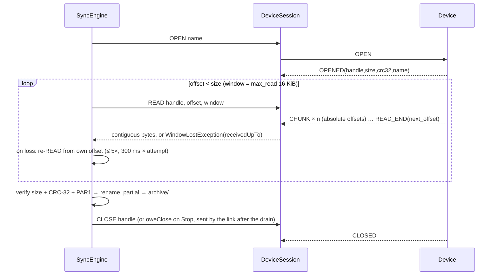
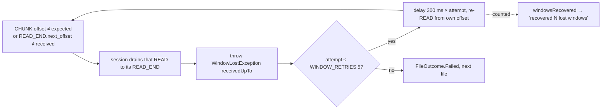
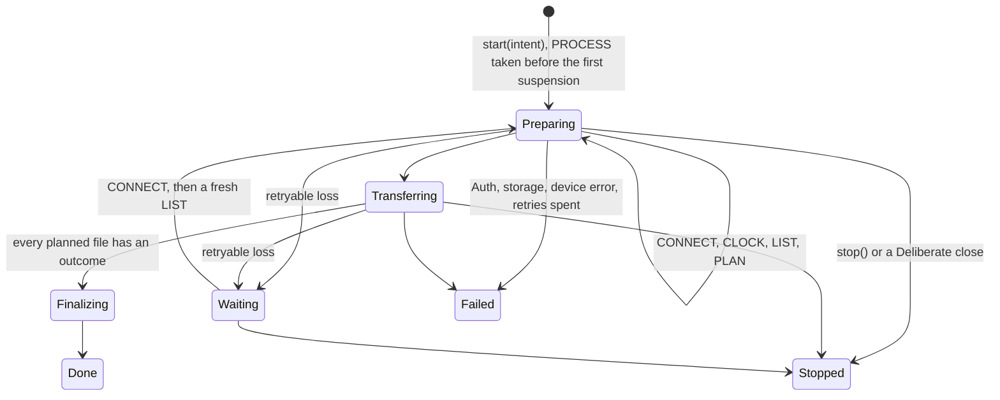

# Sync engine — pull, verify, archive

**Scope:** the file transfer: planner → engine → archive; integrity; lost windows; stale-frame drain; resume; the state-changing requests.
**Code:** `core/sync` commonMain `link/`, `collection/`, `data/ble/DeviceSession.kt`,
`data/sync/SyncEngine.kt` and `ArchiveCollector.kt`. Android `data/DeviceFacade.kt`,
`DeviceLinkOwner.kt`, `data/archive/` and `data/sync/FileArchive.kt`. iOS `core/archive`
iosMain and `ios/shared` iosMain `SensorSync.kt`, `IosLink.kt` and `FilesBridge.kt`.
**Tests:** Shared `LinkSessionTest`, `DeviceSessionTest`, `SyncEngineTest`,
`ArchiveCollectorTest`, `CollectionControllerTest`, drain, owed CLOSE and window recovery
regressions. Android facade and `ConcurrentArchiveTest`. iOS simulator `SensorSyncTest`.
**Related:** [transports.md](transports.md) (the pipe underneath), [data-model.md](data-model.md) (what is recorded), [history-pipeline.md](history-pipeline.md) (what runs after).

## One engine on both phones

Android and iOS run the same `SyncEngine` and `ArchiveCollector` from `:core:sync`. Each
platform supplies only an `ArchiveStore`, an `ArchiveIndex` and a byte pipe. On iOS the pipe is
`IosLink`, one per connection over `LinkSession`. Swift owns the `NWConnection` or the Core Bluetooth peripheral, sends each whole
request frame and hands back each reply frame. `SensorSync` runs one collection per link off the
main thread and reports progress (at most four times a second) and one `SyncResult` on the main
thread. The engine only lists, opens, reads and closes files. It never asks the sensor to delete,
rename or rewrite one. The Swift transfer engine (`SensorTransfer.swift`) is gone. Swift keeps
LAN framing, the HELLO check, keepalive, STATUS and LIVE pushes, and the BLE token request.

Outcomes cross to Swift as `SyncResult` with `keepsLink` and `resumable`, and the message is a
`:ui:strings` key with the Android words. Link and Wi-Fi access events that happen outside a
collection reach the shared state as a typed `CompanionNotice`, so iOS never builds its own
sentence for them.

### Where iOS still differs from Android

| Area | Android | iOS |
| --- | --- | --- |
| Verify and SHA-256 | Shared engine | Shared engine, size, CRC-32, `PAR1` and SHA-256 in one pass over the finished partial |
| Partials | App files | Application Support `archive-partial`. Partials left by the old Swift engine are adopted when size and CRC match |
| Receipts | Room `ArchiveIndex` | `ReceiptArchiveIndex` beside each file, extended with SHA-256. An older receipt with no hash is filled on the next verify |
| Safe names | Shared check | Shared check, stricter than the old Swift whitelist. A name the plan rejects is reported and never downloaded |
| Byte counter | Card shows bytes received | `receivedBytes` counts only this run. Today and Files show that run's planned remaining bytes and received bytes, including on LAN |
| One link per station | Engine holds one writer | `SensorSync` refuses a second link for the same station with `msg_hardware_in_use` |
| LAN `AUTH_FAILED` | Renews the token over BLE and falls back to Bluetooth | Drops the saved token and shows `msg_token_needs_ble`. A sensor open can fall back to an already permitted Bluetooth link; token renewal still requires the explicit BLE action |
| LAN busy | `msg_lan_*` wording that names the Bluetooth fallback | A sensor open can fall back to Bluetooth when permitted; an already running sync reports `msg_busy` without interrupting its link |
| HELLO mismatch | `msg_identity_*` | Same keys. A different hardware ID and a different station now give different notices |
| Today Smart Sync | Syncs over the link the router picked | Routes to Wi-Fi when an idle LAN session for the same sensor is open; the shared Today card shows its progress and result |
| Phone storage fault | `msg_file_failed` for that file, the run goes on | The run goes on and ends with `companion_sync_storage_failed`. The link stays |
| Lost foreground sync | Shared `CollectionController` retries preparation and transfer while PROCESS remains held | BLE and LAN each retry a transient link loss twice, then leave retained partial bytes for an explicit retry. Stop and disconnect cancel pending attempts |
| BLE writes | With response | `control` with response, payload sized from `maximumWriteValueLength(for: .withResponse)` |
| Background | `SyncWorker` on WorkManager | UIKit background-task leases for active BLE and LAN transfers. iOS 26 continued tasks support eligible collection, with bounded lease fallback |

The keepalive rules are unchanged on both phones. See [ios-migration.md](ios-migration.md) for
bounded execution and phone qualification.

## One file



Sync is a **pull of immutable files**. The device is never asked to delete, rename or rewrite.

Android `DeviceFacade` owns one collection controller per address and routes Sync all,
Smart Sync, one-file sync and worker requests into it. `DeviceLinkOwner` lends connections
and owns manual commands and idle reconnect. `DeviceConnectionRepository` is the
compatibility typealias for the facade. iOS uses the shared link, collector and engine through
`SensorSync`, and `SensorCollections` holds one controller per device over `IosLinkProvider`,
which asks Swift to dial when a retry finds no open link. Only tests build it today. Routing the Swift entry points into
it, and giving it a Swift dial, remains [#81](https://github.com/walkthru-earth/opensensor-space-mobile/issues/81).

## Planner (`SyncPlanner`)

Groups the manifest by `HivePartition` (`Dated` / `Unsynced` boot / `Benchmarks` / `Other`),
validates names, and diffs against `archived_file` + partials → `SyncPlan.toDownload` and
`missingBytes`. Android supplies projected `station`, `name`, `bytes` and `crc32` archive
identities, not full history rows. Verified files are skipped, so a resume only pulls what
is missing. Each controller attempt takes a fresh LIST and archive snapshot.
`FileSyncState`: `NOT_SYNCED · PARTIAL · SYNCING · SYNCED · MISMATCH · INVALID_NAME`.

## Integrity (`ParquetVerify`)

Synced ⇔ exactly `size` bytes **and** own CRC-32 == `OPENED.crc32` **and** head/tail `PAR1`. Then
committed without replacement through `AtomicFiles` under the **verbatim Hive path**,
SHA-256 calculated and recorded, then indexed. Android records archive and history index in one Room
transaction. iOS persists a verification receipt. `OPENED.name` ≠ requested name → `Mismatch`, not
silently accepted. Nothing incomplete is ever presented as data.

## Disk writes and Stop (#55)

The engine reads frames on the link and writes chunks through `ArchiveWriter`, one coroutine per
file on the injected `io` dispatcher. Its queue holds 2 chunks. When it is full the `READ`
callback suspends, so the next window is not requested until the disk caught up. The window is
the credit. A write failure is kept, the rest of the queue is dropped, and the file ends as
`Failed(storage = true)` with its partial kept for resume.

A file that settled (synced, mismatch, device `ERROR`) gets a normal `CLOSE`. A file that was
cancelled or failed mid-`READ` calls `oweClose(handle)` and returns. The link aborts the `READ`,
drains it, then sends the `CLOSE` and consumes `CLOSED` before the next request. There is no
`NonCancellable` close and no 3 s wait.

## Free space (#55)

Before any `OPEN`, a run needs the plan's missing bytes plus 32 MiB headroom in the Durable
class of `StorageBudget` (#60), through `requireRoom` in `ArchiveRoom.kt`. When they fit, it
reserves them. If not, it ends with `InsufficientSpaceException` and nothing is opened or
removed. After a file fails to store, the check runs again for what is left, so a disk that
filled mid-run ends the run with its partial kept. Android uses `AndroidStorageBudget` and shows
"Not enough space on this phone". iOS uses `IosStorageBudget` and ends as `STORAGE_FAILED`.

## Concurrent archive safety (2026-09-29)

The shared `WriterLeases` in `SyncEngine` (`core/sync`) guards OPEN through CLOSE, including partial resume,
verification, immutable commit and Room indexing. Other devices with different file identities can
transfer concurrently. A second writer for the same identity waits cancellably and then rechecks
any committed destination against the current OPENED size/CRC/PAR1 and recorded SHA-256.
Identical content is reused without changing source provenance; `alreadyArchived` excludes it from
worker new-file counts. Conflicting or corrupt existing bytes are retained and reported, never
replaced. `commit` also refuses an existing destination with `AlreadyCommitted` (`AtomicFiles.commitNoReplace`,
#60). The engine then adopts the existing file through the same size, CRC, `PAR1` and SHA-256
check, so a final that appears between the plan and the commit is never replaced. A crash between
the commit and the index record is repaired by `StorageJanitor` at the next start. Host coverage: `ConcurrentArchiveTest`;
physical concurrent transfers remain unverified.

The per-address controller reserves interactive/background ownership and the manager rejects
competing full hardware IDs. Current proto 3 firmware has independent logical handles
per BLE connection and LAN peer. Phone ownership policy remains per physical device.
Raw Hive paths and outer INFO-station namespaces remain unchanged. After station regeneration,
a retained inner Hive station mismatch is archived/exportable but excluded from the new station's
history. Earlier epochs remain separately selectable. Richer producer provenance and duplicate
old-station downloads need an owner-contract decision ([opensensor-space.md](opensensor-space.md)).

## Archive layout (`FileArchive`)

```
filesDir/archive/<station>/<relative hive name>          verified, immutable (drop-in mirror of the SD card / tools/export_parquet.py)
filesDir/archive-partial/<station>/<name>.partial         in-progress, chunks at absolute offsets
filesDir/archive-partial/<station>/<name>.partial.meta    "<size> <crc32>" from OPENED
```

Root for names without a station (`benchmarks/…`, `legacy-parquet/…`) is still
`archive/<station uuid from info>/<name>`, so dated files sit at `…/<uuid>/station=<uuid>/year=…` —
redundant on purpose: two devices can never collide. Partials resume by absolute offset after a
re-`OPEN` confirms `size`/`crc32` are unchanged.

## Lost window (`DeviceSession.read` + `SyncEngine`)



The **window** fails, never the sync; the device's `next_offset` is never trusted over our byte
count. Continuity is checked **in the session**, so the "one request, one ordered reply" invariant
holds for every caller ([lesson](lessons-learned.md#protocol--sync)). `ProtocolViolationException`
is reserved for malformed streams (wrong handle, undecodable frame). `READ` window = the device's
`max_read` (16 KiB) on **both** links; `ReadWindow.kt` records why BLE is not given a smaller one
(the 2026-09-17 loss was 514-byte frames > 512, a firmware bug, not the radio). `info.max_read`
missing → `DEFAULT_MAX_READ` 4096 (dead guard; firmware always sends 16384).

## Requests over the link (#55)

`DeviceSession` is a typed view over one `LinkSession`. It holds no lock, no drain and no poll.
Every request goes through the link's FIFO queue, and a request that failed or was cancelled
before its terminal frame is drained by the link's router before the next one is written (see
below). Views are cheap, so any number of them may share one link. `rawCommand` uses
`exchangeRaw` and returns the bytes as received until the terminal or 1.5 s of quiet.

`READ` keeps continuity. A gap marks the window lost, later chunks of that window are dropped
until `READ_END`, and only then `WindowLostException` is thrown, so a late window never reaches
the next `READ`. `LIST` checks the count in `LIST_END` and throws `ProtocolViolationException` on
a mismatch, with the link still Ready.

`RequestSpec` allows 20 s between reply frames and normally 15 s for the first frame.
WIFI_SCAN allows 20 s. OPEN, FLUSH and REBOOT allow 60 s for the first frame. The connection-open deadline is
separate, 180 s through `DeviceSession.over` to cover Bluetooth connect and bonding.
Timeouts carry `DisconnectCause.Timeout` with the failed phase.

## Link session (`core/sync` `link/`, proto 3, #54)

`DeviceSession`, `SyncEngine` and `ArchiveCollector` run on it. Android native
`TcpLinkDriver` and `BleLinkDriver` feed its `FrameSink`. `TransportLinkDriver` adapts the
fake and compatibility `AqTransport` paths. iOS uses the connection's `IosLink`.

- One session per physical connection. A single router coroutine owns every reply frame. A
  request is registered before its write, owns the link until its terminal frame
  (`TerminalRules`, the only opcode to terminal table), and callers queue in FIFO order.
- The driver's reader never waits. Unconsumed reply bytes count against a budget (1 MiB LAN,
  256 KiB BLE) and passing it closes the link with `ResponseOverflow`.
- A cancelled, timed out or early-finished request is drained by the router at once, not by
  the next request. On a proto 3 peer it sends `ABORT` and waits for `ABORTED` too. Past its
  `DrainBound` (4096 frames, 4 MiB, 30 s) the link closes with `DrainExceeded`. A stopped
  reply ends in `ABORTED` naming the op plus `ERROR` 16 in either order, and a late `ERROR` 16
  never ends a later request. `ABORTED` op 0 with no reply frame yet ends the drain, because
  the device runs commands in order.
- `oweClose(handle)` queues a `CLOSE` without waiting. The router sends it once the request in
  flight and its drain have ended, consumes the `CLOSED`, and only then admits the next request.
  A stopped transfer uses it, so Stop returns at once and never waits behind the abandoned `READ`.
- A close from the driver first forwards frames already received, so a reply just before EOF
  (`REBOOTING`, `BYE`, close) still reaches its caller.
- Reply timeouts measure progress, 20 s between frames per the proto 3 contract. A timeout
  fails the request and keeps the link.
- The optional `Heartbeat` (LAN 120 s ping, 180 s deadline) reads only reader RX marks from an
  injected `TimeSource`. Nothing polls.
- Loss is a typed `DisconnectCause`. `retryable` is false for `Auth`, `Deliberate`,
  `FramingViolation`, `Rejected` and `UpdateFirmware`. `Rejected` is a peer the app refused after
  it answered (another identity, hardware held elsewhere, a failed setup step). A `BYE` refuses new requests and attaches its reason
  to the close.
- `open` applies `requireProto3`, so firmware below proto 3 ends as `UpdateFirmware`.

## Collection controller (`core/sync` `collection/`, #56)

`CollectionController` is one device's collection as a single state machine, from the tap to its
outcome. Preparation is part of the collection, so a lost link during `LIST` is retried like a
lost link during a `READ`. One controller per device, so two devices run independent machines.
Android `DeviceFacade` (#74) creates one controller per address. `DeviceLinkOwner` lends links
and handles idle connections and commands. Collection retry has one owner, the shared controller.
Workers pass an explicit LAN or BLE policy, a fresh mDNS target or a bounded bonded BLE connect,
and PROCESS protection from their WorkManager job. They never use interactive BLE or pairing.



- **Ownership.** The controller job alone owns the PROCESS lease, the WIFI lease, the shared
  `Semaphore` permit and the lent `CollectionLink`. One outermost `finally` lets them go in reverse
  order, each step on its own, so an adapter that throws is logged by class and never keeps the
  permit or PROCESS held. Every lease is wrapped so it closes once, whoever calls it.
- **One lender.** A run started right after a Stop waits, before its permit and connect, until
  the stopped run let go of its link. A run stopped while it waits still ends after the one
  before it, so quick restarts keep the order. `LinkProvider.connect` that is cancelled after it
  lent a link releases that lend itself, since the controller never saw it. A connect must
  honour cancellation or end within a bounded time, or every later request of that device waits.
- **Logs never decide.** A `log` callback that throws is ignored, so it never changes an outcome.
- **PROCESS** is taken inside `start`, before the job is launched, and held in every non-terminal
  state, `Waiting` included. A refused PROCESS lease ends as `Failed(KeepAliveRefused)` with no
  connect.
- **WIFI** is held only when the link is LAN and the state is `Preparing(LIST or PLAN)`,
  `Transferring` or `Finalizing`. One `syncLeases` call runs on every transition. A refused WIFI
  lease is logged once and the collection goes on, since the lock only keeps the radio fast. It
  is asked again only after the link stops carrying data.
- **Stop** moves the state to `Stopped`, then cancels the job. Every transition holds one lock
  and checks by identity that its run still owns the state, so Stop always wins. Stop never
  closes the link. The abandoned request drains behind its `ABORT` and the link stays Ready.
  Each run owns a private copy of its intent, so a restart with the same intent object never
  lets the old job write. A job cancelled by its scope, not by `stop`, ends `Stopped(SYSTEM)`.
- **Retry.** A retryable `DisconnectCause` publishes `Waiting(attempt, retryAtEpochMs)`, waits per
  `RetryPolicy` (2 s doubling to 60 s, 5 attempts, no retry starts after 30 min) and starts again at
  `Preparing(CONNECT)` with a fresh `LIST`. An attempt that received bytes resets the count.
  `Auth` fails at once, `Deliberate` ends `Stopped(APP)`. Spent retries end
  `Failed(Link(lastCause))`. Partial files resume by offset through the collector.
- **Outcomes** stay in `state`. `events` is a bounded channel of terminal states for one toast
  consumer and drops the oldest when nobody reads.
- **Logs** carry the intent id, state names, causes and counts, never names of networks, tokens or
  a PIN.

`SyncResumePolicy` remains a compatibility helper with tests, with no production callers. Android collection
retry is owned exclusively by `CollectionController`. `StopSource.FGS_TIMEOUT` distinguishes
the Android service deadline from a user Stop. A generation-specific refused foreground start
ends only its protected intents as `Failed(KeepAliveRefused)`.

`CollectionSummary.files` is the scoped listing total. `newFiles` and `newBytes` count only
`Synced` outcomes with `alreadyArchived == false`, including outcomes from earlier retry
attempts. Worker summaries use those new totals.

## UI progress and terminal state

`CollectionState` is the authoritative Android lifecycle. `DeviceFacade` projects it to
`SyncProgress` for Files and notifications, keeping `running` true through preparation,
retry waiting and finalization. Done maps to COMPLETED, Failed to FAILURE and Stopped to
STOPPED. `SyncProgress.endReason` names why a run ended (2026-10-12). It is null while running,
COMPLETED on Done, `CollectionFailure.endReason()` on Failed, STOPPED for a user or app stop and
INTERRUPTED for a system stop or foreground timeout. Each reason has its own short message
(`DeviceMessage.SyncEnded`), pairing repair and not enough space keep their own paths. The last
`SyncProgress` and the archive summary survive a disconnect. The summary reads Room for the bound
station and counts every archived row, like the Stations card. `DeviceFacade.ownership` says
whether a device is idle, held by an interactive run or by a background worker. A restart during
cleanup takes over the old reservation and hands it back only after that run let go. A collection
that ends on a dead link clears it, so workers do not skip the device. PROCESS lease ownership determines service lifetime, even during terminal cleanup.
Per-file outcomes remain separate from controller failure. iOS receives typed `SyncResult`.

**Session errors end the run (2026-10-09).** An `ERROR` about the session, not the file, is not a
per-file `DeviceError`. `AUTH_FAILED`, `BUSY` and any `ERROR` with op 0 during `OPEN` or `READ`
are rethrown by `SyncEngine`, so the run ends with that exception and no later file is tried.
Before this, both phones turned a token revoked mid-sync, or a busy sensor, into "refused" for
every remaining file, and LAN never dropped the stale token. iOS now ends with `AUTH_FAILED` or
`BUSY`. Android ends the run as `FAILURE` with the "sync stopped early" message. Host test
`ArchiveCollectorTest`, `SensorSyncTest` on the simulator.

**This phone's storage fails one file (2026-10-09).** Every `ArchiveStore` and `ArchiveIndex`
call in `SyncEngine` (exists, open, write, sync, verify read, discard, commit, receipt) turns a
failure into `FileOutcome.Failed(storage = true)` for that file, `FileProblem.STORAGE` in the
summary, and the next file runs. The engine logs the file name, the exception class and its
message, never bytes or secrets. Verified bytes stay as a partial for the next run. iOS ends such a
run with `SyncEnd.STORAGE_FAILED` (`companion_sync_storage_failed`) and keeps the link. A protocol
fault still ends the run with `SyncEnd.FAILED` (`msg_sync_aborted`), logged by class and message,
and also keeps the link, BLE included. Android changes. Before, a disk-full or move failure threw
out of the collection and the run ended with `SyncAborted`. Now Android shows `msg_file_failed` for
that file and goes on. A directory at a final path used to be a per-file `Mismatch` ("archive
destination is not a file") and is now a per-file storage failure. Host test
`ArchiveCollectorTest`, `SensorSyncTest` on the simulator.

**The post-sync `LIST` runs inside finalization.** Android interactive collection refreshes the
manifest and history before publishing Done, while PROCESS and the LAN WIFI lease remain held.
A failed refresh preserves verified files and the previous listing. The worker skips the second
LIST because its owned link closes after collection. Stop cancels finalization and retains its
own terminal reason. Service lifetime follows PROCESS leases, with no flag inference or grace
period.

**A refresh never blanks the listing** (`ManifestState`, `data/ManifestState.kt`). `Loading` and
`Error` carry the last `Loaded` in `last`; `plan` derives from `last`, and the Files screen keeps
the list with "refreshing…" or "Refresh failed: … — showing the last listing." above it. Only a
new session (`resetDerivedState` → `Idle`) drops it. There is no blind retry of `LIST` on the same
session: a lost link is a reconnect (which re-lists), a timeout means the device is not answering
and a second request would only queue behind the stale reply. Longer timeouts are not the answer
either — "link lost" fires on the transport's state change, not on `FRAME_TIMEOUT_MS`.

**Explicit whole-device sync takes a fresh listing (2026-10-10).** Android Sync all and Smart
Sync reserve the same operation gate before launching, issue `LIST`, and plan directly from the
returned snapshot and current archive. They never execute a retained `plan` flow from an earlier
listing, even when that plan has zero missing files. A failed refresh keeps known files visible
but reports a typed collection failure, starts no download, and cannot emit `UpToDate`. The Files screen
suppresses its all-synced message while the latest refresh is loading or failed. Stop and disconnect
also cancel preparation before the first OPEN; the command slot hands off atomically to the transfer.
Host regressions: `DeviceConnectionRepositoryTest`. The shared `DeviceSession.list` rejects a
FILE-frame count that differs from LIST_END on both phone platforms without delaying the next
request and with the link still Ready (`DeviceSessionTest`). These checks
cannot detect a firmware scan that silently skips card entries and reports its own smaller count;
the firmware must report scan failure instead of LIST_END in that case.

## Resume after a lost link

Android active collection retry belongs exclusively to `CollectionController`. A retryable
`DisconnectCause` enters Waiting with PROCESS held, then restarts CONNECT, clock setup, LIST
and PLAN. Partial bytes resume only after a new OPENED confirms size and CRC. The controller
uses its bounded `RetryPolicy`, not the old five-minute `SyncResumePolicy.shouldResume`
progress heuristic. `SyncResumePolicy` remains in core for compatibility tests only.

Idle reconnect belongs to `DeviceLinkOwner`, which suppresses its watcher while collection
is reserved. A user Stop, deliberate disconnect, service timeout or refused protection
ends the relevant intent. Workers additionally remain bounded by their eight-minute attempt.
iOS adapters retain their native retry and foreground-resume intent until issue 81.

Historical observation motivating the old compatibility policy. Seen on the phone: the sync died of the pipe a
moment before the link was declared lost, the reconnect succeeded with `resumeSync=false`, and the
user had to press Sync all again — hence the policy.

## Smart Sync and state-changing requests

**Device UTC synchronizes automatically on connection, before LIST.** Android and iOS send
phone UTC without a manual clock control or consent setting. Smart Sync retries missing or
RTC-restored UTC automatically; phone and network anchors (`clk == 1` or `clk == 3`) continue
without a second clock update. Legacy Ask/Never preferences cannot disable this behavior.

The accepted UTC/monotonic acknowledgement is bound to the full station and boot identity,
allowing the local archive to reconcile earlier untimed rows from that boot. Android collection
persists the exact accepted receipt before LIST, retaining its verified session identity even if
the link then closes. Persistence completes independently of cancellation; reconciliation and
touched-day derivation stay cancellable within the collection or worker run. Platform link cleanup
also completes before the controller releases its shared permit and PROCESS lease.
Original archive files remain immutable. Clock rejection leaves time unconfirmed but does not
prevent collecting original files over a healthy transport. Future connections retry.
`FLUSH` remains a separate confirmed action. Firmware may finalize short files automatically
when recovering UTC so that its anchor is available promptly to other collectors.

`FLUSH`, `SET_CONFIG`, `REBOOT` (and `ble.clear_bonds` / `lan.rotate_token` inside `SET_CONFIG`)
remain explicit actions. Reboot, rotate token, forget bonds and pairing mode `none` need a
confirmation dialog. Automatic `SET_TIME` requires no user action.

`REBOOT` (0x0B) has exactly **one** call path: `DeviceSession.reboot()` ←
`DeviceFacade.rebootAndReconnect()` through `DeviceLinkOwner` ← the Device screen's confirmation dialog. It is
refused while `sync.running`, takes the operation gate synchronously so a re-fired confirm cannot
send a second one, and the dialog checks its own flag too. `DeviceSession.rawCommand` itself refuses
`REBOOT`, `SET_CONFIG` and manual `SET_TIME` (`RAW_COMMAND_DENYLIST`, `RawCommandRefusedException`) before anything is
written, and the Debug raw-command box keeps its own check as a second guard.

**Atomic command and collection admission.** `DeviceLinkOwner.tryBeginCommand` and
`reserveCollection` check and record ownership under one lock. Config, provisioning, token
fetch/rotation and reboot cannot run alongside a collection. `CollectionAdmission` excludes
interactive and worker collections process-wide, and the shared `CollectionBudget` caps
active transfers at two. A worker also supplies its run ID and bounded PROCESS protection.
Stop targets the controller intent and cleanup completes before ownership is released.

Audited 2026-09-17 after a `REBOOT` of uncertain origin reached the board;
no phone-side cause of an unsolicited reboot was found, and these two gaps (buttons enabled during
a sync; raw box accepting `0b`) were closed anyway.

## Historical decisions (v1, mirrored into the firmware contract 2026-09-16)

The table records the original implementation. Current finalization derives touched days
through `deriveAfterSync`; charging `DeriveWorker` handles deferred stale history. Current
request routing and terminal matching belong to `LinkSession` and `TerminalRules`.

| Question | Decision |
| --- | --- |
| `STATUS` (0x07) has no response frame | Fire-and-forget; the `status` notification is the ack. Never awaited on `response`. |
| `ERROR.op` for unparseable requests | "Mine" when it equals the request opcode; anything else is a protocol violation. |
| One outstanding GATT operation | `Mutex` around every GATT call; Android's `BluetoothGatt` silently fails on concurrent ops. |
| Downloads and rotation | Session and sync state are process-scoped in the repository, so rotation mid-sync does not abort. |
| After every sync | `historyDeriver.deriveStale()` in the repository's `finally` (and in `SyncWorker` when files arrived) — no separate `DeriveWorker`. |

## Uses → affects

| Edit… | Affects… |
| --- | --- |
| `WINDOW_RETRIES` / backoff | `SyncEngineTest`, "recovered N" copy, worst-case file time |
| `FileArchive` paths | Export zips (byte-exact mirror), `HistoryIndexer` file lookup, `data_extraction_rules.xml` (`archive/` in device transfer) |
| `SyncEngine` post-verify upsert | `archived_file` row + index columns ([data-model.md](data-model.md)); `HistoryDeriver` signature (`name:crc32`) |
| `DeviceSession` request/terminal mapping | `TerminalRules`, `FakeTransport`, `FakeArchiveDevice` |
| `CollectionState` and typed disconnect causes | facade progress, active retry, service loss and worker result mapping |
