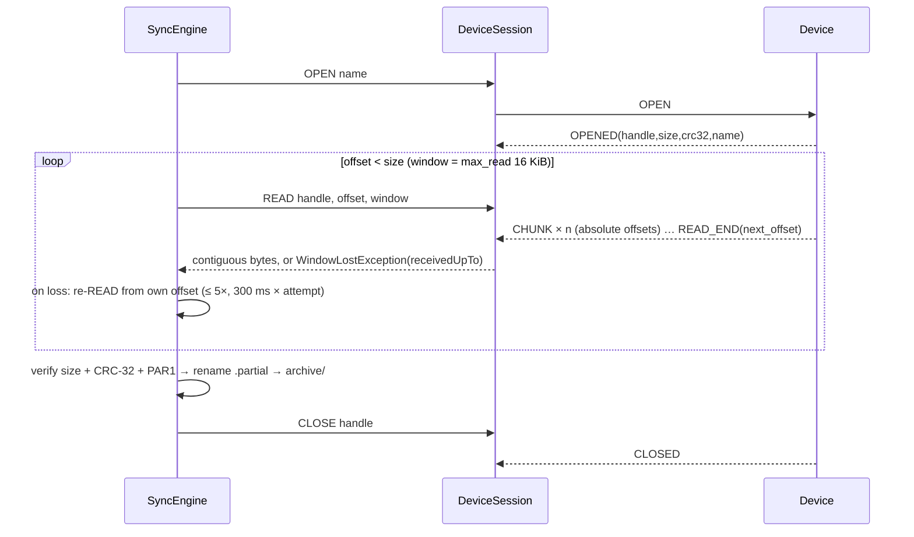
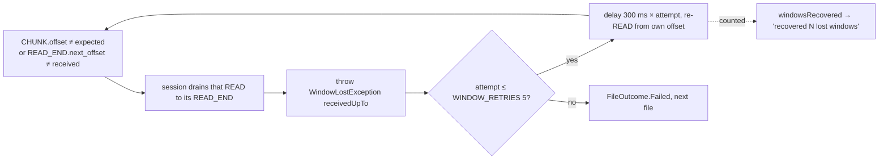
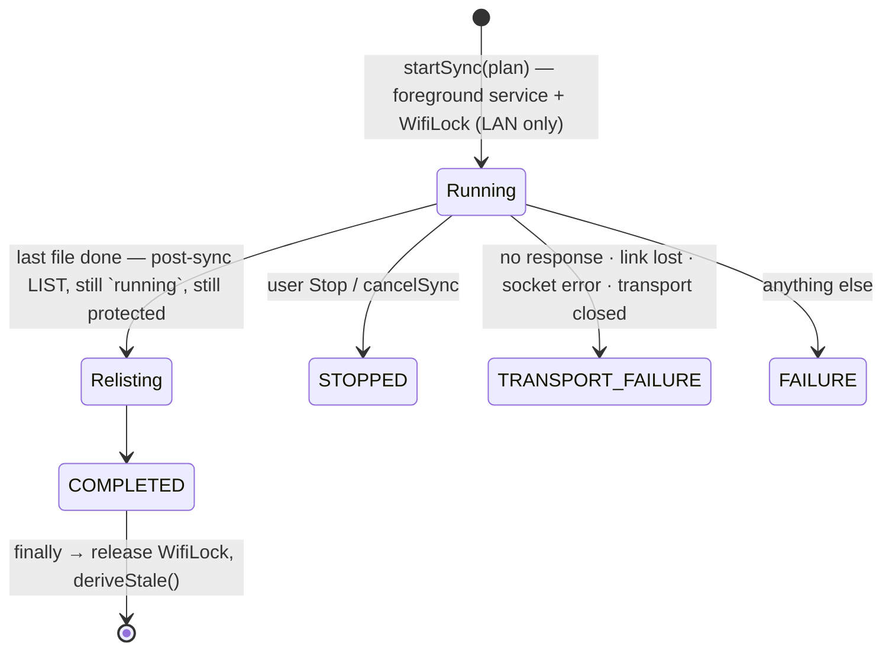

# Sync engine — pull, verify, archive

**Scope:** the file transfer: planner → engine → archive; integrity; lost windows; stale-frame drain; resume; the state-changing requests.
**Code:** `data/sync/SyncPlanner.kt`, `SyncEngine.kt`, `FileArchive.kt`, `ReadWindow.kt`, `SyncResumePolicy.kt`; `data/ble/DeviceSession.kt` (`read`, `drainStale`, `reboot`); `core/protocol/…/ParquetVerify.kt`.
**Tests:** `SyncPlannerTest`, `DeviceSessionPollingTest`, `ConcurrentArchiveTest`, `WindowRecoveryTest` (fake with `dropLeadingChunks` / `closedDelayMs`), `SyncResumePolicyTest`, `ParquetVerifyTest`.
**Related:** [transports.md](transports.md) (the pipe underneath), [data-model.md](data-model.md) (what is recorded), [history-pipeline.md](history-pipeline.md) (what runs after).

The iOS native LAN engine follows the same immutable-file contract. `SensorArchive` writes
atomic size/CRC receipts after finalization and verifies local bytes before skipping their
remote OPEN/READ on later runs. Initial progress counts these completed files. Interrupted
READ windows retain contiguous bytes; a new OPEN resumes from the partial's actual length
only when size/CRC match. Legacy finalized files without receipts use OPEN and local
verification to add one. UIKit background-time expiration pauses active collections, and
foreground return reconnects/resumes after old task ownership ends. See
[ios-migration.md](ios-migration.md) for bounded execution and phone qualification.

## One file



Sync is a **pull of immutable files**. The device is never asked to delete, rename or rewrite.

## Planner (`SyncPlanner`)

Groups the manifest by `HivePartition` (`Dated` / `Unsynced` boot / `Benchmarks` / `Other`),
validates names, and diffs against `archived_file` + partials → `SyncPlan.toDownload` and
`missingBytes`. Verified files are skipped, so a resume only pulls what is missing.
`FileSyncState`: `NOT_SYNCED · PARTIAL · SYNCING · SYNCED · MISMATCH · INVALID_NAME`.

## Integrity (`ParquetVerify`)

Synced ⇔ exactly `size` bytes **and** own CRC-32 == `OPENED.crc32` **and** head/tail `PAR1`. Then
written atomically (temp + rename) under the **verbatim Hive path**, SHA-256'd, recorded in Room
with its history index in the same upsert. `OPENED.name` ≠ requested name → `Mismatch`, not
silently accepted. Nothing incomplete is ever presented as data.

## Response polling under concurrent load

A poll slice must not cancel a receive that has already extracted the next response frame.
Kotlin channels document [prompt cancellation and undelivered elements](https://kotlinlang.org/api/kotlinx.coroutines/kotlinx-coroutines-core/kotlinx.coroutines.channels/-channel/):
a timed receive can change channel state and then throw cancellation. The session therefore
selects atomically between `onReceiveCatching` and `onTimeout`, retaining the same polling and
request timeouts. This closes a potential response-loss race found while investigating a repeated
host-test timeout; deterministic boundary regressions demonstrate frame loss in the original
wait, raw-command quiet wait and stale drain. The observed runner timeout alone does not identify
which response was lost.
Actual request cancellation still propagates and marks the response stream for normal stale drain.

## Concurrent archive safety (2026-09-29)

`FileArchive.withWriterLease(station, name)` guards OPEN through CLOSE, including partial resume,
verification, immutable commit and Room indexing. Other devices with different file identities can
transfer concurrently. A second writer for the same identity waits cancellably and then rechecks
any committed destination against the current OPENED size/CRC/PAR1 and recorded SHA-256.
Identical content is reused without changing source provenance; `alreadyArchived` excludes it from
worker new-file counts. Conflicting or corrupt existing bytes are retained and reported, never
replaced. `commit` also refuses an existing destination. Host coverage: `ConcurrentArchiveTest`;
physical concurrent transfers remain unverified.

The per-address controller reserves interactive/background ownership and the manager rejects
competing full hardware IDs; a physical board still has one file handle across BLE and LAN.
Raw Hive paths and outer INFO-station namespaces remain unchanged. After station regeneration,
a retained inner Hive station mismatch is archived/exportable but excluded from the new station's
history. Earlier epochs remain separately selectable. Richer producer provenance and duplicate
old-station downloads need an owner-contract decision ([opensensor-space.md](opensensor-space.md)).

## Archive layout (`FileArchive`)

```
filesDir/archive/<station>/<relative hive name>          verified, immutable (drop-in mirror of the SD card / tools/export_parquet.py)
filesDir/archive-partial/<station>/<name>.partial         in-progress, chunks at absolute offsets
filesDir/archive-partial/<station>/<name>.partial.meta    "<size> <crc32>" from OPENED
```

Root for names without a station (`benchmarks/…`, `legacy-parquet/…`) is still
`archive/<station uuid from info>/<name>`, so dated files sit at `…/<uuid>/station=<uuid>/year=…` —
redundant on purpose: two devices can never collide. Partials resume by absolute offset after a
re-`OPEN` confirms `size`/`crc32` are unchanged.

## Lost window (`DeviceSession.read` + `SyncEngine`)



The **window** fails, never the sync; the device's `next_offset` is never trusted over our byte
count. Continuity is checked **in the session**, so the "one request, one ordered reply" invariant
holds for every caller ([lesson](lessons-learned.md#protocol--sync)). `ProtocolViolationException`
is reserved for malformed streams (wrong handle, undecodable frame). `READ` window = the device's
`max_read` (16 KiB) on **both** links; `ReadWindow.kt` records why BLE is not given a smaller one
(the 2026-09-17 loss was 514-byte frames > 512, a firmware bug, not the radio). `info.max_read`
missing → `DEFAULT_MAX_READ` 4096 (dead guard; firmware always sends 16384).

## Stale-frame drain (`DeviceSession.drainStale`)

A request that failed or was cancelled before its terminal frame (timeout, stray frame, `READ`
stopped mid-stream, `CLOSED` missing its budget) leaves stragglers. Before the next request the
session consumes frames until the failed request's own terminal frame (`READ_END`, `CLOSED`,
`LIST_END`, … or an `ERROR` for it), a **2 s quiet period** (`DRAIN_QUIET_MS`), or **15 s**
(`FRAME_TIMEOUT_MS`) — whichever first. "unexpected Closed frame in response to LIST" was seen on a
phone before this. `WindowLostException` and device `ERROR`s leave the channel clean.

Session timeouts: `FRAME_TIMEOUT_MS` 15 s per frame, `OPEN_TIMEOUT_MS` 60 s (the device may be
finalizing), `WIFI_SCAN_TIMEOUT_MS` 20 s; "no response from device within N s" is a `TransportException`.

## Sync run state



`SyncProgress.endCause` (`SyncEndCause`) records how a run ended; the Files card, the notification
and the resume policy read it. Per-file outcomes (`Synced` / `Mismatch` / `DeviceError` / `Failed`)
are **outcomes**, not a broken pipe.

**The post-sync `LIST` runs inside the run.** A `FLUSH` or a rotation may have finalized a file
while we were pulling, so a completed run re-lists — *before* `running` turns false, because the
foreground service stops 1.5 s after that and a phone that spent the whole transfer in the
background has no network grace period left: the LAN socket is destroyed the moment the service
goes. Seen on the phone as "LIST failed: link lost while waiting for a response" right after
"Synced n of n" — the link was fine for the files and killed for the listing. A failure of that
`LIST` is the refresh's, never the sync's (the files are verified and stored). The worker skips
the re-list (it closes the session next). `STOPPED` and `FAILURE` still refresh from the `finally`
when the link is up; `TRANSPORT_FAILURE` has no link to ask — `watchLink`'s reconnect issues the
fresh `LIST`.

**A refresh never blanks the listing** (`ManifestState`, `data/ManifestState.kt`). `Loading` and
`Error` carry the last `Loaded` in `last`; `plan` derives from `last`, and the Files screen keeps
the list with "refreshing…" or "Refresh failed: … — showing the last listing." above it. Only a
new session (`resetDerivedState` → `Idle`) drops it. There is no blind retry of `LIST` on the same
session: a lost link is a reconnect (which re-lists), a timeout means the device is not answering
and a second request would only queue behind the stale reply. Longer timeouts are not the answer
either — "link lost" fires on the transport's state change, not on `FRAME_TIMEOUT_MS`.

## Resume after a lost link

`SyncResumePolicy.shouldResume` (pure).

The resume never reads the shared `plan` flow, which can still hold the previous session's plan for a
moment after a reconnect. The reconnect issues its own `LIST` on the new session, waits for it, and
plans from that listing (`resumeAfterReconnect`, `planFor`). The background run plans the same way
after its `LIST`. A `cancelReconnect` (the notification's Stop) also cancels a reconnect that a link
watcher has decided on but not yet started.

Resume when the sync was `running` **or** ended with `TRANSPORT_FAILURE` within the last
**5 min** (`RESUME_WINDOW_MS` = `TcpTransport`'s 180 s dead-link deadline plus margin). A user Stop,
a completed run, or any other failure is left alone. Seen on the phone: the sync died of the pipe a
moment before the link was declared lost, the reconnect succeeded with `resumeSync=false`, and the
user had to press Sync all again — hence the policy.

## Smart Sync and state-changing requests

**Smart Sync is an explicit user action.** It evaluates the pure `SmartSyncPolicy` before downloading:
`clk == 1` continues; `clk == 2` (RTC restored) or no UTC follows the app setting **Ask first ·
Automatic · Never**. The default is Ask first. Choosing Automatic is durable user consent for Smart
Sync to send `SET_TIME` when those states are detected. It sends time before LIST/download so a later
same-boot timed file can anchor earlier untimed files. It never rewrites an archive file and never
includes `FLUSH`; finalizing remains a separate confirmed **sync through now** action so periodic or
ordinary pulls do not create short files. Unknown clock state is not guessed (`utc == 1` on old
firmware is treated as anchored).

`SET_TIME`, `FLUSH`, `SET_CONFIG`, `REBOOT` (and `ble.clear_bonds` / `lan.rotate_token` inside
`SET_CONFIG`) are **explicit user actions or covered by the user's explicit Smart Sync clock policy**;
the destructive ones (reboot, rotate token, forget bonds, pairing mode `none`) need a confirmation
dialog.

`REBOOT` (0x0B) has exactly **one** call path: `DeviceSession.reboot()` ←
`DeviceConnectionRepository.rebootAndReconnect()` ← the Device screen's confirmation dialog. It is
refused while `sync.running`, takes the operation gate synchronously so a re-fired confirm cannot
send a second one, and the dialog checks its own flag too. `DeviceSession.rawCommand` itself refuses
`REBOOT` and `SET_CONFIG` (`RAW_COMMAND_DENYLIST`, `RawCommandRefusedException`) before anything is
written, and the Debug raw-command box keeps its own check as a second guard.

**One operation gate.** Config writes, sensor provisioning, token fetch and rotation, and reboot take
the command slot through `tryBeginCommand`, and a worker takes the device through
`tryBeginBackground`. Both check and set under one lock, so a second command is refused with "Wait
for the current device task to finish" instead of running alongside and clearing the first one's
`busy`. An interactive sync is refused while a command holds the slot. Job handles (`syncJob`,
`linkWatchJob`, `reconnectJob`, `notificationJob`) change only under the same lock, so a Stop from
the notification cannot miss a job that is starting. Audited 2026-09-17 after a `REBOOT` of uncertain origin reached the board;
no phone-side cause of an unsolicited reboot was found, and these two gaps (buttons enabled during
a sync; raw box accepting `0b`) were closed anyway.

## Decisions (v1, mirrored into the firmware contract 2026-09-16)

| Question | Decision |
| --- | --- |
| `STATUS` (0x07) has no response frame | Fire-and-forget; the `status` notification is the ack. Never awaited on `response`. |
| `ERROR.op` for unparseable requests | "Mine" when it equals the request opcode; anything else is a protocol violation. |
| One outstanding GATT operation | `Mutex` around every GATT call; Android's `BluetoothGatt` silently fails on concurrent ops. |
| Downloads and rotation | Session and sync state are process-scoped in the repository, so rotation mid-sync does not abort. |
| After every sync | `historyDeriver.deriveStale()` in the repository's `finally` (and in `SyncWorker` when files arrived) — no separate `DeriveWorker`. |

## Uses → affects

| Edit… | Affects… |
| --- | --- |
| `WINDOW_RETRIES` / backoff | `WindowRecoveryTest`, "recovered N" copy, worst-case file time |
| `FileArchive` paths | Export zips (byte-exact mirror), `HistoryIndexer` file lookup, `data_extraction_rules.xml` (`archive/` in device transfer) |
| `SyncEngine` post-verify upsert | `archived_file` row + index columns ([data-model.md](data-model.md)); `HistoryDeriver` signature (`name:crc32`) |
| `DeviceSession` request/terminal mapping | `drainStale` `isTerminal`, `FakeTransport` |
| `SyncEndCause` | `SyncResumePolicy`, `SyncForegroundService` copy, `SyncWorker.transientFailure` |
