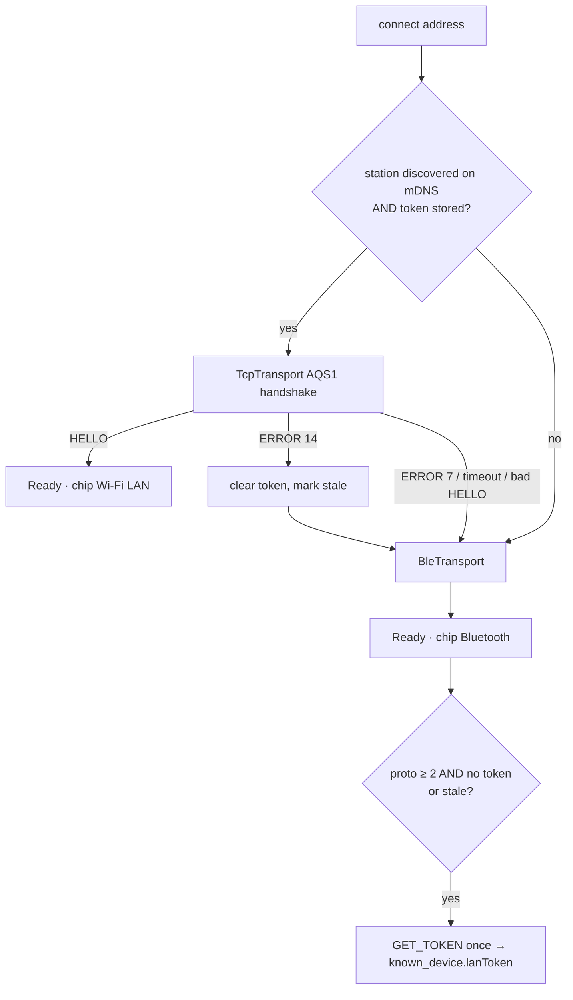
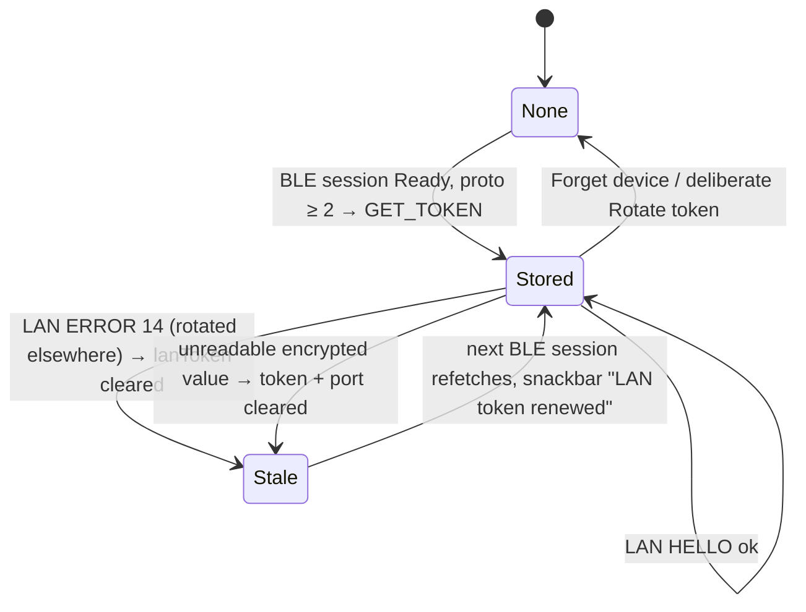

# Transports — BLE, LAN, pairing, the token, reconnect

**Scope:** the two byte pipes behind `AqTransport`, how the repository picks one, pairing, the LAN token lifecycle, link loss.
**Code:** `data/ble/AqTransport.kt`, `BleTransport.kt`, `BleScanner.kt`, `DeviceSession.kt`; `data/lan/TcpTransport.kt`, `LanDiscovery.kt`, `LanTokenPolicy.kt`, `LanWifiLock.kt`; `data/TransportFactory.kt`; `data/DeviceConnectionRepository.kt` (`connect`, `tryLan`, `reconnectLoop`, `activeTransport`); `ui/permissions/LanPermission.kt`.
**Related:** [protocol-quickref.md](protocol-quickref.md), [sync-engine.md](sync-engine.md) (what runs on top), [background-sync.md](background-sync.md) (unattended links, WifiLock).

## Choosing a link

`TransportPreference.AUTO` is the rule above; `GET_TOKEN` and *Fetch token* force BLE. Any LAN
failure falls back to BLE with a snackbar. Identity stays the Bluetooth address on both pipes.

## Side by side

| | Bluetooth LE (`BleTransport`) | LAN (`TcpTransport`) |
| --- | --- | --- |
| Discovery | GATT scan for the service UUID (`BleScanner`) | mDNS `_aqsync._tcp` via `NsdManager` (`LanDiscovery`), TXT `station`/`dev`/`fw`/`proto`; browsed only while the app is started and the permission is held |
| Auth | LE Secure Connections bond (passkey / PIN / none per `ble.pair`); every characteristic needs an encrypted, authenticated link | `"AQS1"` + 32-byte token, obtainable **only** over BLE; the socket itself is unencrypted by contract |
| Framing | one notification per frame; `payload_max = min(MTU − 3, 512)` — Android silently drops notifications above the 512-byte GATT attribute limit; control requests ≤ 512 B | `len` u16 LE + frame; `payload_max` from `HELLO` (1024), `mtu` reports `payload_max + 3` |
| Pushes | `status` / `live` characteristics | `STATUS` 0x48 / `LIVE` 0x49 frames, **demultiplexed by type byte in the transport's single reader loop** — they may sit between two `CHUNK`s; `DeviceSession` is byte-for-byte identical for both pipes |
| Liveness | GATT link state | `STATUS` keep-alive after 120 s idle (`KEEPALIVE_POLL_MS` 15 s); link declared dead after `DEAD_AFTER_MS` 180 s without a byte |
| Timeouts | connect 15 s unattended (`BACKGROUND_BLE_CONNECT_MS`), `requestMtu` 10 s | `CONNECT_TIMEOUT_MS` 5 s, `HANDSHAKE_TIMEOUT_MS` 8 s, `PUSH_WAIT_MS` 10 s (`readStatus`), `LIVE_WAIT_MS` 15 s (`readLive`) |
| Framing loss | n/a (per-notification) | zero-length or oversize frame, or EOF mid-frame → close the socket (a resync could deliver a wrong `CHUNK`) |
| Kept alive by | `dataSync` foreground service during a transfer; nothing while idle | the same + `LanWifiLock` only while a LAN transfer runs |
| Serialization | **one GATT op at a time** — `opMutex` around every read/write/descriptor call | one socket, one reader loop |

## Pairing (BLE)

Device is display-only: first connection shows a random six-digit passkey full-screen; Android asks
for it. `createBond()` before first characteristic access if unbonded; GATT status 5 / 15 / 133
during pairing → wait for `BOND_BONDED`, retry the operation once. Reconnects are silent.
`allowBonding = false` (unattended path) treats "not bonded" as a failure — never a passkey dialog
nobody can answer. MTU < 247 is refused.

## LAN token lifecycle

`LanTokenPolicy` (pure, unit-tested).

The DAO exposes the 64-character hex value but stores AES-GCM ciphertext in
`known_device.lanToken` (nullable). **Never logged, never displayed**: `KnownDevice.toString`,
`Frame.Token.toString`, `FrameRecorder` and the raw-command view redact it. Startup finishes the
one-time plaintext migration before Auto-sync scheduling or triggers can read credentials. A missing
Keystore key, failed GCM authentication, or malformed encrypted value clears only the token and port,
keeps the known-device row, and falls back to BLE; the next bonded BLE session fetches a fresh token.
Any LAN failure other than `AUTH_FAILED` keeps a readable token. Unrelated DAO/programmer failures are
not converted into token loss ([data-model.md](data-model.md#backup)).

## Lost link → automatic reconnect (repository)

`Failed`, or `Disconnected` without a `disconnect()` call (`closeSessionLocked` clears the slot
first, so deliberate closes are never mistaken) → **3 attempts, 5 s apart**
(`RECONNECT_ATTEMPTS`, `RECONNECT_DELAY_MS`) with the normal transport rule, then an error snackbar.
Banners say "Link lost (…). Reconnecting automatically, attempt n of 3…"; Stop on the notification
cancels. The foreground service stays up (`foregroundNeeded = sync.running || reconnecting != null`).
Whether the sync resumes is `SyncResumePolicy` ([sync-engine.md](sync-engine.md#resume-after-a-lost-link)).

## `REBOOT` reconnect

After `REBOOTING(delay_ms)`: wait `delay_ms`, drop the session, wait `REBOOT_RECONNECT_DELAY_MS`
6 s, reconnect with the normal rule. `ble.*` changes show as pending (`CONFIG.flags` bit 0) until then.

## Local-network permission (API 37+)

**Path B — broad `ACCESS_LOCAL_NETWORK` runtime permission**, not the per-device picker
(`DiscoveryRequest.FLAG_SHOW_PICKER`): the app manages devices persistently and reconnects on its
own. It is in the NEARBY_DEVICES group with the Bluetooth permissions so it is *usually* granted with
them — but a runtime permission can be missing while its group is granted, and below API 37 the
constant does not exist. `LanPermission` returns "granted" below 37 and asks above; a denial hides
LAN with an explanation while BLE keeps working. `INTERNET` exists only for these sockets.

## `NsdManager` two code paths

API 34+: `registerServiceInfoCallback` (continuous, `getHostAddresses`). API 31–33: one-shot
`resolveService`, which rejects concurrent calls (`FAILURE_ALREADY_ACTIVE`) → resolves are queued.

## Decisions (protocol v2, 2026-09-17)

| Question | Decision |
| --- | --- |
| `HELLO.payload_max` ≠ 1024 | Trusted if ≥ 64; longer frames are a framing error that drops the link. Before `HELLO` the cap is 1024. |
| LAN `readLive()` / `readStatus()` | Nothing can request a `LIVE`, so `readLive` returns the latest push or waits ≤ 15 s; `readStatus` returns the latest push or sends `STATUS` and waits ≤ 10 s. |
| `WIFI_SCAN_END.status` ≠ 0 | The scan's error (15 → "Wi-Fi unavailable"), not partial success; APs received before it are discarded. |
| `LOG` slices | Kept as bytes, decoded after concatenation (a boundary may split UTF-8). `LOG_END.returned` ≠ bytes received → "a slice may be missing" but the text is shown (for humans, not data). |
| `SET_CONFIG` recording | Recorded as opcode only (PSK is a secret); `Frame.Token` redacted. |
| Fake "LAN" | `FakeTransport(simulateLan = true)` is not a socket: `payload_max` 1024 and `GET_TOKEN` → `ERROR` 13. The real pipe is unit-tested over loopback (`TcpTransportTest`) and otherwise only on hardware. |

## Uses → affects

| Edit… | Affects… |
| --- | --- |
| `AqTransport` interface | all three transports, `DeviceSession`, repository, `TransportFactory` |
| `TcpTransport` reader loop | push demux (`LIVE` between `CHUNK`s) — `TcpTransportTest` asserts it |
| `BleTransport.allowBonding` / timeouts | `AutoSyncRunner` path (`bleUnattended`) — a passkey dialog in the background is a bug |
| `LanTokenPolicy` | repository `tryLan`, token refetch after Ready, snackbar copy |
| `LanDiscovery` TXT parsing | `AutoSyncPolicy.linksFor` (station match), Device screen LAN card |
| `DeviceConnectionRepository.activeTransport` | the top-bar chip on four screens |
