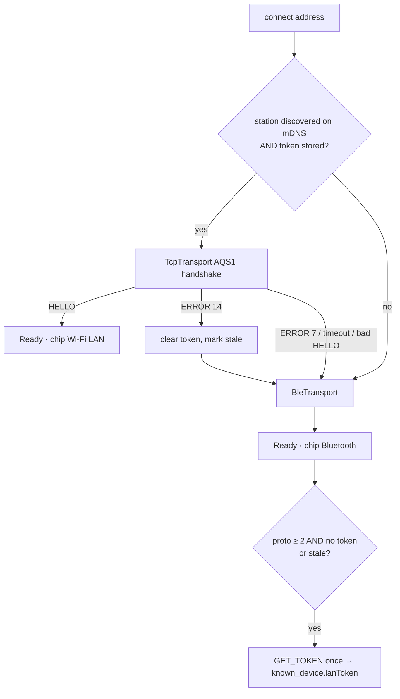
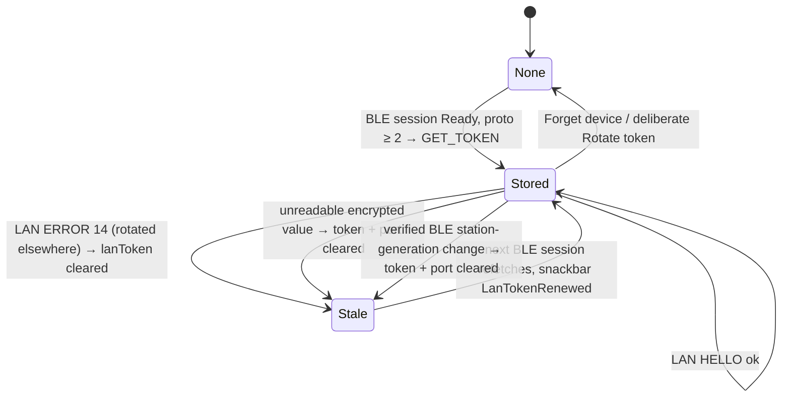

# Transports — BLE, LAN, pairing, the token, reconnect

**Scope:** the two byte pipes behind `AqTransport`, how the repository picks one, pairing, the LAN token lifecycle, link loss.
**Code:** Android `data/ble/BleTransport.kt`, `BleScanner.kt`; `data/lan/TcpTransport.kt`, `LanDiscovery.kt`, `LanWifiLock.kt`; `data/TransportFactory.kt`; `data/DeviceConnectionManager.kt`, `DeviceConnectionRepository.kt` (`connect`, `tryLan`, `reconnectLoop`, `activeTransport`), `DeviceIdentityClaims.kt`; `ui/permissions/LanPermission.kt`. Shared in `core/sync` commonMain: `data/ble/AqTransport.kt`, `DeviceSession.kt`, `FrameRecorder.kt`; `data/lan/LanTokenPolicy.kt`, `LanFailure.kt`; `data/DeviceContinuityPolicy.kt`, `TransportSelector.kt`, `ConnectionIntent.kt`. `core/protocol` `LanFrameSplitter.kt` (socket slices to frames).
**Related:** [protocol-quickref.md](protocol-quickref.md), [sync-engine.md](sync-engine.md) (what runs on top), [background-sync.md](background-sync.md) (unattended links, WifiLock).

## Choosing a link

On Android, My devices **Scan** searches Bluetooth and `_aqsync._tcp` mDNS from one action.
Existing access permits discovery while the screen is visible; the tap requests any missing
Bluetooth and Local Network permissions. Each radio can still show results if the other is
unavailable. LAN-only results without an enrolled Bluetooth identity and saved token are
informational. Opening an enrolled sensor uses the AUTO rule below. If Bluetooth permission is declined,
a known sensor with a saved token, station and current mDNS discovery may open LAN only. That
path has no BLE fallback or BLE auto-reconnect; if LAN cannot connect, its archive remains
available offline.

`TransportPreference.AUTO` is the rule above; `GET_TOKEN` and *Fetch token* force BLE. Any LAN
connection failure falls back to BLE with a snackbar. After connection, INFO must pass
`DeviceContinuityPolicy` before identity is persisted or files collected; a mismatch closes the
attempt and surfaces an error. Enrollment stays keyed by the Bluetooth address on both pipes.
The [canonical firmware contract](../../aq-parquet/docs/shared/ble-sync-protocol.md) owns the UUIDs,
advertising and mDNS names; the app rebrand does not change them.

`DeviceConnectionManager` owns one controller per enrolled public Bluetooth endpoint. Each has
its own session, reconnect, manifest and sync state; selecting another device does not close it.
`DeviceIdentityClaims` refuses a second active controller claiming the same full hardware ID, so
two apparent endpoints cannot create duplicate collection sessions for one physical device on the same phone. Operations remain
serialized within each GATT pipe and each session. LAN transfers hold independent leases on a
shared `LanWifiLock`; the last transfer releases it.

## Concurrent Wi-Fi collection

The shared firmware supports up to three LAN clients per sensor alongside its
single BLE connection. Each phone has an independent file handle and offsets;
one phone connecting or opening a file does not disconnect another. A full
sensor returns busy instead of replacing an active phone. Each phone still
obtains its LAN token through Bluetooth pairing once, then reconnects over the
same local Wi-Fi without internet.

Android already keeps separate controllers for several sensors and limits
concurrent file transfers to two per phone. Its existing framed TCP transport
uses the same protocol with the firmware's multi-client pool. iOS collection
support and its validation scope are documented in [ios-migration.md](ios-migration.md).
Real multi-phone/multi-sensor throughput and radio behavior require phone and
board qualification; host tests alone do not establish these results.

## Side by side

### Investigating slow Wi-Fi collection (2026-10-08)

The owner reported Wi-Fi file collection slower than BLE on both iPhone and
Android after saving iPhone access. Both mobile engines already use the advertised
`max_read` (normally 16 KiB); Android also enables `TCP_NODELAY`. Do not shrink
LAN windows, remove integrity checks or assume an iOS UI change fixes both apps.

The [CoreS3 v6.6 concurrency bench](../../aq-parquet/docs/boards/m5stack-cores3/bench-verified.md#board-1-concurrent-lan-collectors-firmware-v66)
measured two host collectors downloading 87,654 bytes each in 49.801 seconds
(about 1.8 KB/s each), with a third connection present. That host benchmark used
4 KiB READ windows; it establishes a slow concurrent run, not the throughput of
an isolated phone using 16 KiB windows. Older single-client LAN observations were
faster, so this is not an established hardware speed ceiling.

Firmware inspection found a 100 ms LAN request poll, up to a 50 ms sample-queue
wait before storage command dispatch, whole-file CRC calculation on OPEN, and a
single storage worker shared by all clients. Socket sends also share a mutex;
one blocked peer can delay others within its one-second frame-send deadline.
Wi-Fi modem sleep is intentional for BLE coexistence. These are candidates,
not a measured attribution of the owner's slowdown.

Compare the same immutable file with one active collector, then two. Time OPEN,
each 16 KiB READ through READ_END, CLOSE, and local verification separately;
report actual newly received bytes per second, excluding resumed bytes. Record
firmware/app versions, file size, active collectors and radio conditions. Keep
tokens and private credentials out of traces. Any firmware scheduling or radio
change belongs in `../aq-parquet` and needs sampling/coexistence checks and a
dated board run before claiming a throughput improvement.

The subsequent implementation replaces the fixed LAN poll sleep with a bounded
socket-readiness wait, and wakes the storage worker after successful queue
enqueues. Sampling and commands retain one turn each per worker pass; queue
contents survive coalesced wakeups. See the firmware owner's
[LAN performance guide](../../aq-parquet/docs/shared/lan-performance.md) for
regressions and qualification. CRC calculation, Wi-Fi sleep/coexistence, frame
sizes and the wire contract remain unchanged.

Android now limits intermediate file progress and debug CHUNK snapshot copies
to ten updates per second, while keeping every ring entry and flushing trailing
history at request completion/failure. Initial/final/recovery progress remains
immediate. iOS limits chunk progress to four updates per second, removes the
second archive-actor hop per chunk, cancels completed timeout timers, and enables
TCP `noDelay` as Android already does. Its card reports end-to-end average KiB/s
from newly written bytes, excluding resumed or reused bytes. Read-window fsync
and final verification are retained. These changes remove overhead; a new board
run is required to establish actual throughput improvement.

The owner subsequently authorized the CoreS3 v6.7 deployment. Three host fetches
of the same 87,654-byte file without a USB reader took 0.925–1.045 seconds;
two simultaneous host collectors each reached about 57 KB/s. The old image's
USB-drained/undrained comparison identified console backpressure as a material
contributor: radio/archive diagnostics now stay in LOG_TAIL without console IO.
Physical serial DATA/list/status/provisioning paths retain their behavior.
See the [dated board result](../../aq-parquet/docs/boards/m5stack-cores3/bench-verified.md#2026-10-08--cores3-v67-lan-latency-and-usb-backpressure)
for image/backup hashes, client-count differences and limits. These short host
measurements do not establish Android/iPhone throughput after the upgrade.

| | Bluetooth LE (`BleTransport`) | LAN (`TcpTransport`) |
| --- | --- | --- |
| Discovery | GATT scan for the service UUID (`BleScanner`) | mDNS `_aqsync._tcp` via `NsdManager` (`LanDiscovery`), TXT `station`/`dev`/`fw`/`proto`; browsed only while the app is started and the permission is held |
| Auth | LE Secure Connections bond; passkey/PIN modes require encrypted, authenticated access; explicit lab `none` mode uses encrypted Just Works without MITM authentication | `"AQS1"` + 32-byte token, obtainable **only** over BLE; the socket itself is unencrypted by contract and does not authenticate server identity |
| Framing | one notification per frame; `payload_max = min(MTU − 3, 512)` — Android silently drops notifications above the 512-byte GATT attribute limit; control requests ≤ 512 B | `len` u16 LE + frame; `payload_max` from `HELLO` (1024), `mtu` reports `payload_max + 3` |
| Pushes | `status` / `live` characteristics | `STATUS` 0x48 / `LIVE` 0x49 frames, **demultiplexed by type byte in the transport's single reader loop** — they may sit between two `CHUNK`s; `DeviceSession` is byte-for-byte identical for both pipes |
| Liveness | GATT link state | `STATUS` keep-alive after 120 s idle (`KEEPALIVE_POLL_MS` 15 s); link declared dead after `DEAD_AFTER_MS` 180 s without a byte |
| Timeouts | connect 15 s unattended (`BACKGROUND_BLE_CONNECT_MS`), `requestMtu` 10 s | `CONNECT_TIMEOUT_MS` 5 s, `HANDSHAKE_TIMEOUT_MS` 8 s, `PUSH_WAIT_MS` 10 s (`readStatus`), `LIVE_WAIT_MS` 15 s (`readLive`) |
| Framing loss | n/a (per-notification) | zero-length or oversize frame, or EOF mid-frame → close the socket (a resync could deliver a wrong `CHUNK`) |
| Kept alive by | `dataSync` foreground service during a transfer; nothing while idle | the same + `LanWifiLock` only while a LAN transfer runs |
| Serialization | **one GATT op at a time** — `opMutex` around every read/write/descriptor call; a callback completes the pending op only when its kind and characteristic match (`PendingGattOperation`), so a late callback is dropped | one socket, one reader loop |

## Pairing (BLE)

The bond-state receiver is registered with `RECEIVER_EXPORTED` on purpose. `ACTION_BOND_STATE_CHANGED`
comes from the Bluetooth app, a privileged app that does not run as the system UID, and
developer.android.com ("Context-registered receivers") says a `RECEIVER_NOT_EXPORTED` receiver misses
broadcasts from such apps. The action is protected, so no other app can send it.

Display-equipped firmware shows a random six-digit pairing passkey; headless firmware uses a
per-device fixed PIN obtained through the owner's physical provisioning path. Android handles
the pairing dialog. `createBond()` before first characteristic access if unbonded; GATT status 5 / 15 / 133
during pairing → wait for `BOND_BONDED`, retry the operation once. Reconnects are silent.
`allowBonding = false` (unattended path) treats "not bonded" as a failure — never a passkey dialog
nobody can answer. MTU < 247 is refused.

### Reset, reflash and identity continuity

The wire INFO has no cryptographic fingerprint. `dev` is the full 12-hex Wi-Fi hardware MAC,
`station` is a random UUID persisted in NVS, `boot` is a fresh random identifier per boot,
`fw` is a text label and `dict` hashes the telemetry dictionary, not the firmware binary.
Advertising names, the 16-bit advertising boot suffix and mDNS TXT are public hints, not
authorization to replace trust. LAN HELLO identity checks detect inconsistencies, but the current
plaintext bearer-token handshake authenticates the phone rather than the server.

| Observed change | Implemented app policy |
| --- | --- |
| Same enrolled endpoint/full hardware ID/station; new boot, firmware or dictionary | Accept the connection; refresh the manifest and use the normal resume policy |
| Same enrolled BLE endpoint/full hardware ID; changed station | Preserve old history, record a new station epoch, clear old LAN token/port and refetch over BLE |
| Changed station learned over LAN | Reject; reconnect over the enrolled BLE link before accepting a generation |
| Changed full hardware ID, missing previously pinned ID, malformed ID or changed endpoint | Reject automatic continuity; replacement needs explicit enrollment/ownership handling |
| Legacy optional `dev` absent; same station | Allow generic collection; a new station cannot be automatically linked without a previously matching full hardware ID |

Normal reset and uploads that preserve NVS should retain station, BLE bonds, LAN token and Wi-Fi
configuration. A full NVS erase creates a new station/PIN/token and loses bonds and provisioned
Wi-Fi. Android may still report `BOND_BONDED` after firmware lost its keys. The app does not silently
forget bonds, downgrade security or pair from a worker: stale-bond repair requires the foreground
and Android's pairing/settings interaction. There is no guaranteed fully automatic reconnection
after all device trust material is erased, nor a hidden `removeBond` recovery path.

Station generations preserve the original archive and Hive paths; they do not reparent old data
([data model](data-model.md#station-generations-and-device-continuity)). The policies and migration
are covered by host checks; multi-device radio behavior, erased-NVS Android recovery and fingerprint
replacement have **not been verified on a phone**. Measured runs remain in the
[CoreS3 bench record](../../aq-parquet/docs/boards/m5stack-cores3/bench-verified.md#phone-over-lan-and-ble-oneplus-7-pro-android-16);
other boards need their own records.

## LAN token lifecycle

`LanTokenPolicy` (pure, unit-tested).

`known_device.lanToken` (nullable) holds AES-GCM ciphertext. Rows read through the DAO, and so
every ViewModel, see only that ciphertext, enough for `hasLanToken`. The plaintext hex comes only from
`LanCredentialStore.lanToken(address)`, which the repository calls at the moment it builds a LAN
transport (`tryLan`, `syncInBackground`). **Never logged, never displayed**: `KnownDevice.toString`,
`Frame.Token.toString`, `FrameRecorder` and the raw-command view redact it. Startup finishes the
one-time plaintext migration before Auto-sync scheduling or triggers can read credentials. Failed GCM
authentication (`AEADBadTagException`, which is also what a regenerated key gives), a key Android
invalidated for good, or a malformed `enc1` value clears only the token and port, keeps the
known-device row, and falls back to BLE. The next bonded BLE session fetches a fresh token. A
`KeyStoreException`, an `UnrecoverableKeyException` or another transient Keystore error keeps the
credential and uses BLE for this connect only.
An accepted same-hardware station-generation change also clears the token and port before the
post-INFO upsert and requests a fresh token on that BLE connection. Rejected identity changes
cannot overwrite credentials or trigger automatic trust replacement.
Any LAN failure other than `AUTH_FAILED` keeps a readable token. Unrelated DAO/programmer failures are
not converted into token loss ([data-model.md](data-model.md#backup)).

The LAN probe in `tryLan` is removed from the session slot and its transport is closed on every
failure path, including an unexpected exception and cancellation, and an unexpected exception falls
back to BLE like a connect failure.

## Lost link → automatic reconnect (repository)

`Failed`, or `Disconnected` without a `disconnect()` call (`closeSessionLocked` clears the slot
first, so deliberate closes are never mistaken) → **3 attempts, 5 s apart**
(`RECONNECT_ATTEMPTS`, `RECONNECT_DELAY_MS`) with the normal transport rule, then an error snackbar.
Banners say "Link lost (…). Reconnecting automatically, attempt n of 3…"; Stop on the notification
cancels. The foreground service stays up (`foregroundNeeded = sync.running || reconnecting != null`).
Whether the sync resumes is `SyncResumePolicy` ([sync-engine.md](sync-engine.md#resume-after-a-lost-link)).

## `REBOOT` reconnect

After `REBOOTING(delay_ms)`: wait `delay_ms`, drop the session, wait `REBOOT_RECONNECT_DELAY_MS`
6 s, reconnect with the normal rule. `ble.*` changes show as pending (`CONFIG.flags` bit 0) until then.

## Local-network permission (API 37+)

**Path B — broad `ACCESS_LOCAL_NETWORK` runtime permission**, not the per-device picker
(`DiscoveryRequest.FLAG_SHOW_PICKER`): the app manages devices persistently and reconnects on its
own. It is in the NEARBY_DEVICES group with the Bluetooth permissions so it is *usually* granted with
them — but a runtime permission can be missing while its group is granted, and below API 37 the
constant does not exist. `LanPermission` returns "granted" below 37 and asks above; a denial hides
LAN with an explanation while BLE keeps working. Today `INTERNET` exists only for these sockets.
The planned discover feed adds anonymous, read-only GETs of the public feed and basemap behind
the "Show public sensors" switch, and per-device opt-in uploads later
([devices-and-discovery.md](devices-and-discovery.md#network-boundary)).

## `NsdManager` two code paths

API 34+: `registerServiceInfoCallback` (continuous, `getHostAddresses`). API 31–33: one-shot
`resolveService`, which rejects concurrent calls (`FAILURE_ALREADY_ACTIVE`) → resolves are queued.

## Decisions (protocol v2, 2026-09-17)

| Question | Decision |
| --- | --- |
| `HELLO.payload_max` ≠ 1024 | Trusted if ≥ 64; longer frames are a framing error that drops the link. Before `HELLO` the cap is 1024. |
| LAN `readLive()` / `readStatus()` | Nothing can request a `LIVE`, so `readLive` returns the latest push or waits ≤ 15 s; `readStatus` returns the latest push or sends `STATUS` and waits ≤ 10 s. |
| `WIFI_SCAN_END.status` ≠ 0 | The scan's error (15 → "Wi-Fi unavailable"), not partial success; APs received before it are discarded. |
| `LOG` slices | Kept as bytes, decoded after concatenation (a boundary may split UTF-8). `LOG_END.returned` ≠ bytes received → "a slice may be missing" but the text is shown (for humans, not data). |
| `SET_CONFIG` recording | Recorded as opcode only (PSK is a secret); `Frame.Token` redacted. |
| Fake "LAN" | `FakeTransport(simulateLan = true)` is not a socket: `payload_max` 1024 and `GET_TOKEN` → `ERROR` 13. The real pipe is unit-tested over loopback (`TcpTransportTest`) and otherwise only on hardware. |

## Uses → affects

| Edit… | Affects… |
| --- | --- |
| `AqTransport` interface | all three transports, `DeviceSession`, repository, `TransportFactory` |
| `TcpTransport` reader loop | push demux (`LIVE` between `CHUNK`s) — `TcpTransportTest` asserts it |
| `BleTransport.allowBonding` / timeouts | `AutoSyncRunner` path (`bleUnattended`) — a passkey dialog in the background is a bug |
| `LanTokenPolicy` | repository `tryLan`, token refetch after Ready, snackbar copy |
| `DeviceContinuityPolicy` / `DeviceIdentityClaims` | INFO acceptance, station epochs, credential renewal and prevention of duplicate physical-device owners |
| `DeviceConnectionManager` | per-device ownership and snapshots; selection must not close another controller |
| `LanDiscovery` TXT parsing | `AutoSyncPolicy.linksFor` (station match), Device screen LAN card |
| `DeviceConnectionRepository.activeTransport` | the top-bar chip on four screens |

## Automatic UTC on connection

After verified INFO identity and before any archive LIST, Android automatically sends the
phone's UTC through SET_TIME. iOS does the same when its Bluetooth connection becomes ready;
LAN collection synchronizes before LIST. A successful Bluetooth handshake is reused by the
immediately following collection on that connection. A failed handshake leaves UTC unconfirmed and permits collection of original unsynced files
if the transport survives; later connections retry automatically. Manual clock buttons, consent settings and raw SET_TIME commands
are unavailable on both platforms.

The shared session sends epoch seconds plus microseconds and falls back to the legacy
seconds-only request only on MALFORMED_REQUEST. Reconciliation records the acknowledged UTC
and device monotonic pair, bound to the full station and boot identity from INFO or HELLO.
A legacy reply contributes whole seconds only; request fractions are never invented in an
acknowledgement. Hardware radio and power-loss qualification remains separate from host tests.
