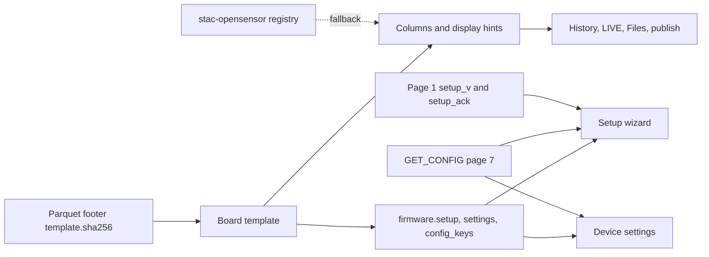

# Add your own board or sensor

**Scope.** How an outside contributor gets a new board or sensor working in the app with no app code,
what the app reads from the board, what each part drives on screen, and what still needs app code.
**Code.** `core/model/` (`BoardTemplate`, `SetupManifest`, `AppProfile`, `BundledCatalog`),
`core/protocol/` (`ConfigFields`, `BoardSettings`, `SetupAck`), `core/sync/` (`SetupPlan`),
`core/history/` (`Metrics`, `OpenSensorFooter`, `FileTemplates`, `BoardDescriptors`, `TemplateHrefs`),
`feature/setup/`, `feature/device/` (`DeviceSection`).
**Proof.** `feature/device/src/commonTest/.../YourFirstBoardTest.kt` runs this whole guide on a soil probe
no app code names, `core/model/src/acmeFixture/.../AcmeSoilProbe.kt`.
**Related.** [devices-and-discovery.md](devices-and-discovery.md), [screens.md](screens.md),
[history-pipeline.md](history-pipeline.md), [protocol-quickref.md](protocol-quickref.md).

The firmware and the profile own every contract below. This page says what the app does with them and
links to the source instead of copying it.

| Contract | Owner |
| --- | --- |
| Board template, display hints, setup manifest, Parquet footer | stac-opensensor [PROFILE.md](https://github.com/walkthru-earth/stac-opensensor/blob/main/PROFILE.md) and its [JSON Schemas](https://github.com/walkthru-earth/stac-opensensor/tree/main/json-schema) |
| Property and scale registry | stac-opensensor [registry](https://github.com/walkthru-earth/stac-opensensor/tree/main/registry) |
| Why the board declares its own UI | firmware [decision 0003](https://github.com/walkthru-earth/opensensor-space-firmware/blob/main/docs/shared/decisions/0003-metadata-driven-apps.md) |
| Porting a board and generating its template | firmware [board-porting.md](https://github.com/walkthru-earth/opensensor-space-firmware/blob/main/docs/shared/board-porting.md), [plugins](https://github.com/walkthru-earth/opensensor-space-firmware/tree/main/docs/shared/plugins) and [templates](https://github.com/walkthru-earth/opensensor-space-firmware/tree/main/docs/shared/templates) |
| BLE and LAN wire, `GET_CONFIG` pages, `GET_DESCRIPTOR` | firmware [ble-sync-protocol.md](https://github.com/walkthru-earth/opensensor-space-firmware/blob/main/docs/shared/ble-sync-protocol.md) |



## 1. The template is the only description

A board describes itself in one stac-opensensor `OpenSensorTemplate` JSON file, generated by the firmware
build. The app parses it with `BoardTemplate.parse` and never reads a column name from its own code.
Columns live in `item_assets.data.table:columns`.

| Column field | What it drives in the app |
| --- | --- |
| `name`, `type`, `unit` (UCUM) | The Parquet column read, and the unit shown, such as `Cel` as °C |
| `roles` | A `physicalMeasurement` or `modelResult` column is a History metric. Other roles stay out of the metric list |
| `opensensor:valid_when` | Rows that fail it are left out of every mean, as the soil test shows with its probe status |
| `opensensor:aggregate` | How a column rolls up into 15 minute, hourly and daily buckets |
| `opensensor:plausible_range`, `opensensor:settle_s` | Values outside the range are flagged as suspect, never masked. Rows in the warm up window after power on still count and are flagged as settling |
| `classification:classes`, `classification:bitfields` | Names for status codes and bits |
| `firmware.live_keys` | Which LIVE JSON key carries each column |

### Display hints

Display hints change only how a value looks. The app derives them in `AppProfile.derive`, first hit wins,
in the order the profile's [Display hints](https://github.com/walkthru-earth/stac-opensensor/blob/main/PROFILE.md#display-hints)
section gives.

| Hint | Drives | Fallback when absent |
| --- | --- | --- |
| `title` and `opensensor:title_i18n` | The metric label in the app language | Registry label of `opensensor:property`, then the name with spaces |
| `opensensor:decimals` | Digits after the point | Registry decimals, then 0 for an integer column and 2 otherwise |
| `opensensor:scale` with top level `opensensor:scales` | Coloured bands on the card and chart | Registry scale of the property, else a neutral metric |
| `opensensor:primary` | The metric History opens on and the first card | First measured column with a scale, then the first measured column |

A scale whose unit differs from the column unit is never applied. An owner's Thing Collection may add
or replace column hints, and those win over the template's.

## 2. Setup steps and Device settings sections

The `firmware` block declares the board's own wizard and Device settings. The app parses it into
`SetupManifest` and keeps going when an entry is malformed, so a bad entry never costs the template
its columns.

`firmware.setup` is the ordered wizard, at most 31 steps. `SetupPlan.of` turns each entry into a page.

| Entry | What the wizard shows |
| --- | --- |
| A catalog id, `name`, `location`, `mobility`, `site`, `wifi`, `pairing`, `lan` or `bonds` | The app's own page with its own title. Only `location` and `mobility` can be required |
| Your own id with `keys` | A form of those keys, titled by `label` and `label_i18n` in the app language |
| Your own required id with no usable key | Setup stays pending and the app says it needs an update |
| Your own optional id with no usable key | Left out |

Location is required for a fixed Thing whatever the manifest says. Find, Pair, Permission and Done
belong to the app and never appear in the manifest.

`firmware.settings` is the ordered list of Device settings cards. `DeviceSection.of` maps each entry.

| Entry | Card |
| --- | --- |
| `location`, `mobility` or `site` | The one Location card |
| `wifi` | Wi-Fi |
| `pairing` | Pairing, from Detailed, or at Simple when pairing needs attention |
| `bonds` | Paired phones, from Detailed |
| `lan` | Sync over Wi-Fi, at Developer only |
| `sensor` | The sensor sticker card from Detailed on a board with sensor identity, then a form of its keys |
| Your own id with `keys` | A form of those keys, titled by `label` and `label_i18n`, else Sensor settings |

In `setup`, `sensor` is not a catalog step, so there it acts like your own id.

## 3. Config keys on `GET_CONFIG` page 7

`firmware.config_keys` declares each key a step or section shows. A key carries a type and a label,
never a value. The device reports current values on `GET_CONFIG` page 7, nested by prefix, so
`{"probe":{"depth_cm":20}}` reads as `probe.depth_cm`. Each change is one `SET_CONFIG` of that key.

`ConfigFields.declared` and `ConfigFields.merge` keep a key only when every floor holds.

- The name matches `[a-z][a-z0-9_]*(\.[a-z][a-z0-9_]*)+` and is at most 48 bytes.
- It is not under a reserved prefix, `ble.`, `wifi.`, `lan.`, `location.`, `thing.`, `owner.` or `sensor.`,
  which only the app allowlist uses. So a template can never declare the PIN, the Wi-Fi password or the LAN token.
- It is not one of the app's secret keys.
- `page` is 7.
- `type` is `boolean`, `integer` with a `{"min","max"}` range, `enum` with its choices, or `text` with an
  optional byte range of at most 64.
- `applies` is `immediately`, `next sample`, `next boot` or `action`, and only a `boolean` is an `action`.

A board `action` always asks for confirmation. The form checks a value against the declared range before
it sends anything. A key that fails a floor is dropped from the form, never shown greyed out.

## 4. `setup_v` and `setup_ack`

The device keeps which steps are done on `GET_CONFIG` page 1, in `thing.setup_ack` and `thing.setup_v`.
The device only stores the two numbers. The phone computes them in `SetupAck`.

- Bit `i` of `setup_ack` is step `i` of `firmware.setup`, in template order.
- `setup_v` is the first 31 bits of SHA-256 over the step ids joined by a newline, and never 0.
- When a step is done or skipped, the phone writes both in one `SET_CONFIG`.
- A device whose `setup_v` differs from the phone's reads as no step done. So adding, removing or
  reordering a step starts setup over, while changing `req`, `keys` or a label keeps the bits.

If the device does not confirm the write, the wizard says why and offers Retry.

## 5. The property registry

stac-opensensor keeps [registry/properties.json](https://github.com/walkthru-earth/stac-opensensor/blob/main/registry/properties.json)
and [registry/scales.json](https://github.com/walkthru-earth/stac-opensensor/blob/main/registry/scales.json).
The app bundles both byte for byte from a pinned commit in `core/model/bundled/registry/`, and reads them only
as the fallback in the table above.

A new quantity gets its registry entry in stac-opensensor in the same change as the template, since its
profile check refuses a property the registry lacks. A phone that does not bundle that entry yet still
shows the column from the template's own `title`, `opensensor:title_i18n` and `opensensor:decimals`. So
put those hints on every column you want to look right today.

## 6. Parquet footer and the template SHA-256

Every file carries one `opensensor` key in its Parquet key-value metadata, described in the profile's
[Parquet footer](https://github.com/walkthru-earth/stac-opensensor/blob/main/PROFILE.md#parquet-footer) section.

| Footer member | What the app does with it |
| --- | --- |
| `template.sha256` | The SHA-256 of the exact template bytes, the `desc`. The file is read with the template that hashes to it |
| `dictionary.sha256` | The firmware `dict`, used only when the footer names no `desc` |
| `template.href` | Where the exact bytes can be fetched, see the next section |
| `acquisition.sample_interval_ms` | The file's own cadence, ahead of the template default |

`OpenSensorFooter` trusts a footer only when its `version` is 0.1 with any patch and every required member
is present. A file whose footer is missing or names a template the phone cannot resolve keeps its rows and
shows no metric values. The template bytes are hashed as written, so never reformat or pretty print them.
A metric takes values from a file only when the template that file names stores the column in the same unit
and rolls it up the same way, so units never mix in one bucket.

## 7. How the phone gets the template

`TemplateIndex.resolve` finds the template. With a `desc` only the template that hashes to it resolves, a served or
fetched one before a bundled one, and never another template of the same `dict`. Without a `desc` the newest served
template of the `dict` resolves, else the bundled one.

| Source | How | App change |
| --- | --- | --- |
| Served by the device | `INFO` reports `dict` and the first 16 hex of `desc`. When the device connects and nothing on the phone matches, `BoardDescriptors` sends `GET_DESCRIPTOR`, keeps the bytes only when their SHA-256 starts with `desc` and their `firmware.dict` is the device's, and caches at most 16 | None |
| Fetched by href | When nothing on the phone resolves a synced file's footer, `TemplateHrefs` fetches `template.href` and keeps the bytes only when their SHA-256 is the footer `desc`. Only an https link to a pinned commit of the firmware repository's `docs/shared/templates/` is fetched, and the Settings network switch turns it off | None |
| Bundled | A verbatim copy of the firmware's published file under `core/model/bundled/templates/`, listed in its `index.json`. The build checks each copy hashes to its index `desc` | Data files only, no code |

So the quickest path for a new board is to serve its template over `GET_DESCRIPTOR`. A template on any
host other than the firmware repository is never fetched.

## 8. Check it on your machine

Copy your template into a test the way `AcmeSoilProbe.kt` holds the soil probe, then run the steps of
`YourFirstBoardTest` against it. The test parses the exact bytes, plans setup, builds the Device settings
cards, resolves the metrics with their labels, decimals and primary, and summarises a small Parquet file
whose footer names the template by its SHA-256.

```sh
./gradlew :feature:device:testAndroidHostTest --tests '*YourFirstBoardTest*'
```

Run `./gradlew --no-daemon verify` before you open a pull request, as [CONTRIBUTING.md](../CONTRIBUTING.md) sets up.

## What still needs app code

| Need | Why | Where |
| --- | --- | --- |
| A new derived metric family, like `:family:air` | Corrected values, health moods and named science are code that a template cannot carry. A family implements `DerivedMetricProvider` and both apps install it at launch. No `:core` source may name a family's science | `family/`, [cross-platform-guide.md](cross-platform-guide.md) |
| A new catalog step id | A catalog step is an app page with its own facts and strings. Your own id with keys never needs one | `StepId.KNOWN`, `feature/setup/` |
| New transport opcodes | The wire belongs to the firmware protocol. A new opcode lands there first, then in this app's mirror | firmware [ble-sync-protocol.md](https://github.com/walkthru-earth/opensensor-space-firmware/blob/main/docs/shared/ble-sync-protocol.md), [protocol-quickref.md](protocol-quickref.md) |

A key type outside the four above, a settings page other than 7 and a key under a reserved prefix are
refused on purpose, and changing that is an app and profile change together.
